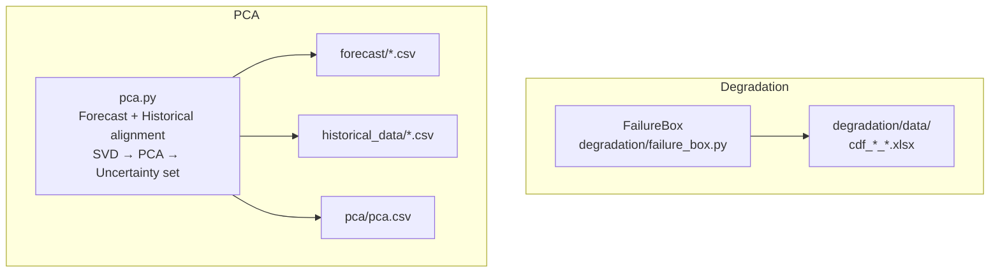
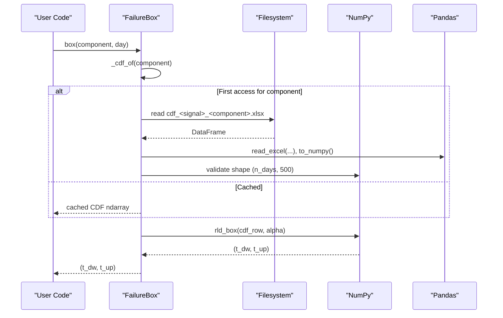
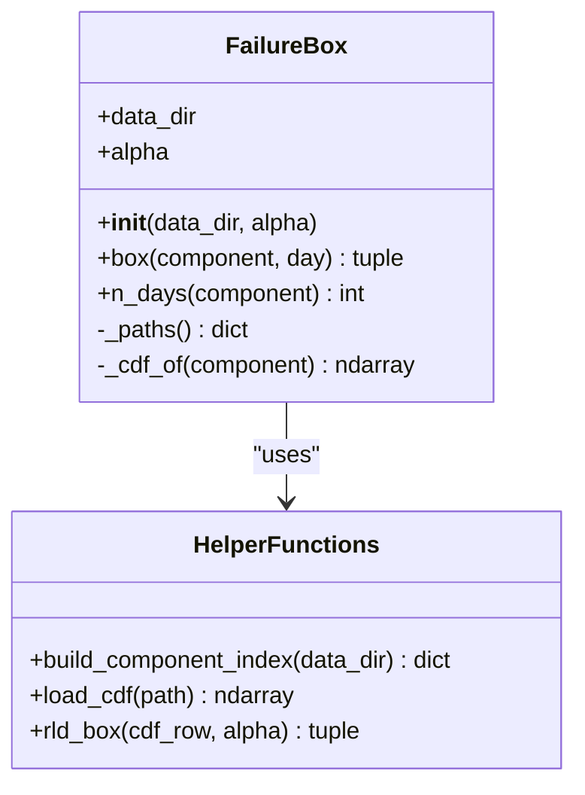
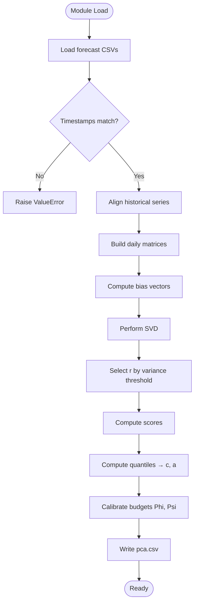

# API Reference

<cite>
**Referenced Files in This Document**
- [failure_box.py](file://degradation/failure_box.py)
- [pca.py](file://pca/pca.py)
- [README.md](file://degradation/README.md)
</cite>

## Table of Contents
1. [Introduction](#introduction)
2. [Project Structure](#project-structure)
3. [Core Components](#core-components)
4. [Architecture Overview](#architecture-overview)
5. [Detailed Component Analysis](#detailed-component-analysis)
6. [Dependency Analysis](#dependency-analysis)
7. [Performance Considerations](#performance-considerations)
8. [Troubleshooting Guide](#troubleshooting-guide)
9. [Conclusion](#conclusion)

## Introduction
This document describes the public APIs exposed by the wind power degradation and forecasting system, focusing on:
- The FailureBox class for computing central residual-life intervals from component CDFs.
- The PCA module functions and data structures used to construct uncertainty sets from historical forecast errors.

The documentation includes method signatures, parameter types, default values, return types, error conditions, usage patterns, performance considerations, and best practices.

## Project Structure
The repository exposes two primary Python modules relevant to this API reference:
- degradation/failure_box.py: Implements the FailureBox class and helper utilities for loading and validating component CDF files.
- pca/pca.py: Loads forecast and historical data, aligns them, performs SVD-based PCA, constructs uncertainty set parameters, and writes results to a CSV file.

**Diagram sources**
- [failure_box.py:17-66](file://degradation/failure_box.py#L17-L66)
- [pca.py:24-31](file://pca/pca.py#L24-L31)
- [pca.py:149-152](file://pca/pca.py#L149-L152)
- [pca.py:308-308](file://pca/pca.py#L308-L308)

**Section sources**
- [failure_box.py:1-134](file://degradation/failure_box.py#L1-L134)
- [pca.py:1-323](file://pca/pca.py#L1-L323)
- [README.md:1-53](file://degradation/README.md#L1-L53)

## Core Components
- FailureBox: Provides interval queries for residual life based on per-component CDFs. It caches loaded CDFs and validates inputs.
- PCA Module: Aligns forecasts with historical data, computes PCA via SVD, determines variance-retaining components, builds uncertainty set centers and radii, calibrates budgets, and exports parameters.

Key responsibilities:
- FailureBox.box(component, day): Returns a central residual-life interval (t_dw, t_up).
- FailureBox.n_days(component): Returns the number of forecast days available for a component.
- PCA module functions: _components_for_variance, _componentes_pares, _presupuestos, _soporte_mw; plus module-level constants and precomputed arrays.

**Section sources**
- [failure_box.py:17-66](file://degradation/failure_box.py#L17-L66)
- [pca.py:155-178](file://pca/pca.py#L155-L178)
- [pca.py:204-234](file://pca/pca.py#L204-L234)
- [pca.py:242-249](file://pca/pca.py#L242-L249)

## Architecture Overview
The system integrates two independent but complementary pipelines:
- Degradation pipeline: Reads per-component CDF Excel files, validates shapes and indices, and returns residual-life intervals for a given day.
- Forecasting/uncertainty pipeline: Loads wind power and demand forecasts and historical series, aligns them by day-of-week and hour, computes PCA via SVD, derives uncertainty set parameters, and saves them.

**Diagram sources**
- [failure_box.py:32-44](file://degradation/failure_box.py#L32-L44)
- [failure_box.py:55-66](file://degradation/failure_box.py#L55-L66)
- [failure_box.py:98-106](file://degradation/failure_box.py#L98-L106)
- [failure_box.py:109-133](file://degradation/failure_box.py#L109-L133)

## Detailed Component Analysis

### FailureBox Class
Purpose:
- Compute the central residual-life interval for a given component and forecast day using its CDF.

Constructor:
- Signature: FailureBox(data_dir=None, alpha=DEFAULT_ALPHA)
- Parameters:
  - data_dir: Optional path-like object pointing to the directory containing CDF files. Defaults to the package’s data directory.
  - alpha: Float in (0, 1); confidence level parameter controlling the central interval coverage (1 − α). Default is 0.1.
- Behavior:
  - Validates alpha ∈ (0, 1).
  - Stores data_dir and alpha.
  - Initializes an internal index cache and a per-component CDF cache.

Public Methods:
- box(component, day) -> tuple[int, int]
  - Parameters:
    - component: int, 1–100.
    - day: int, 1-based row index within the component’s CDF.
  - Returns:
    - A tuple (t_dw, t_up) representing the lower and upper bounds of the central residual-life interval in days.
  - Error Conditions:
    - If component is not present in the data directory, raises ValueError with available range.
    - If day is out of range for the component’s CDF length, raises ValueError indicating valid range.
    - If the CDF support does not cover the required quantile for the given alpha, raises ValueError propagated from the underlying computation.

- n_days(component) -> int
  - Parameters:
    - component: int, 1–100.
  - Returns:
    - Number of rows (days) in the component’s CDF.
  - Error Conditions:
    - Same component validation as box().

Internal Helpers:
- _paths() -> dict[int, Path]: Builds and caches the mapping from component index to CDF file path.
- _cdf_of(component) -> np.ndarray: Loads and caches the CDF array for a component, ensuring correct shape.
- build_component_index(data_dir) -> dict[int, Path]: Scans data_dir for cdf_*_*.xlsx files, validates naming and component ranges, and detects duplicates.
- load_cdf(path) -> np.ndarray: Reads an Excel file into a float NumPy array and validates it has exactly 500 columns.
- rld_box(cdf_row, alpha) -> tuple[int, int]: Computes the central interval for a single CDF row at quantiles α/2 and 1 − α/2.

Usage Notes:
- The first call to box or n_days for a component loads its CDF into memory; subsequent calls reuse the cached array.
- The day argument is 1-based and corresponds to the row index of the CDF file.

Example Usage Patterns:
- Initialize with default settings and query the interval for component 1 on day 1.
- Query the number of forecast days for a component.
- Handle exceptions when querying invalid components or days.

Best Practices:
- Reuse a single FailureBox instance across multiple queries to benefit from caching.
- Validate component IDs before calling methods to avoid repeated I/O and exception overhead.
- Choose alpha carefully; if the CDF support does not reach the upper quantile, increase alpha or adjust data.

**Section sources**
- [failure_box.py:17-66](file://degradation/failure_box.py#L17-L66)
- [failure_box.py:69-95](file://degradation/failure_box.py#L69-L95)
- [failure_box.py:98-106](file://degradation/failure_box.py#L98-L106)
- [failure_box.py:109-133](file://degradation/failure_box.py#L109-L133)
- [README.md:32-53](file://degradation/README.md#L32-L53)

#### FailureBox Class Diagram

**Diagram sources**
- [failure_box.py:17-66](file://degradation/failure_box.py#L17-L66)
- [failure_box.py:69-133](file://degradation/failure_box.py#L69-L133)

### PCA Module Functions and Outputs
Purpose:
- Align forecast and historical time series, compute PCA via SVD, determine retained components by variance thresholds, construct uncertainty set centers and radii, calibrate budgets, and export parameters.

Key Constants:
- HOURS_PER_DAY = 24
- HISTORICAL_YEARS = (2023, 2024)
- DEFAULT_VARIANCE_THRESHOLD = 0.95
- PAIRWISE_VARIANCE_THRESHOLD = 0.90
- ORIGIN_FORECAST = Timestamp("2025-01-06")
- ORIGIN_HISTORICAL = {2023: Timestamp("2023-01-02"), 2024: Timestamp("2024-01-08")}

Data Loading and Alignment:
- Loads wind power and demand forecasts from CSV files and validates that timestamps match.
- Aligns historical series to forecast dates by day-of-week and hour offsets.
- Constructs daily matrices for each year and concatenates them.

SVD and PCA:
- Computes mean bias vectors and centered matrices for wind and demand.
- Applies SVD to obtain singular values and right singular vectors.
- Determines the minimal number of components r that retain at least DEFAULT_VARIANCE_THRESHOLD of variance.
- Projects training samples onto PCA basis to obtain scores.

Uncertainty Set Construction:
- Computes lower and upper quantiles of scores at 0.10 and 0.90 to derive centers c and radii a for wind and demand.
- Calibrates budgets Phi and Psi using pairwise variance threshold logic.

Exported Outputs:
- Writes a CSV file pca/pca.csv with fields: grupo, componente, c, a, s, r, phi, psi.

Public Functions:
- _components_for_variance(sigma, threshold=DEFAULT_VARIANCE_THRESHOLD) -> int
  - Purpose: Find the smallest r such that cumulative explained variance reaches threshold.
  - Input: sigma (singular values), threshold (float).
  - Output: integer r.

- _componentes_pares(sigma, r, threshold=PAIRWISE_VARIANCE_THRESHOLD) -> int
  - Purpose: Determine the smallest s (with 2 ≤ s ≤ r) that meets pairwise variance threshold.
  - Input: sigma (singular values), r (number of PCA components), threshold (float).
  - Output: integer s.

- _presupuestos(scores, c, a, s) -> tuple[ndarray, ndarray, ndarray, float, float]
  - Purpose: Compute normalized scores θ, aggregate magnitudes B and C, and quantile-based budgets Phi and Psi.
  - Inputs:
    - scores: ndarray of shape (n_samples, r).
    - c: center vector of shape (r,).
    - a: radius vector of shape (r,).
    - s: integer pairwise budget dimension.
  - Outputs:
    - theta: ndarray of shape (n_samples, r).
    - B: ndarray of shape (n_samples,).
    - C: ndarray of shape (n_samples,).
    - Phi: float.
    - Psi: float.

- _soporte_mw(L, c, a, b, hat) -> tuple[ndarray, ndarray, ndarray]
  - Purpose: Map uncertainty set z = c + a ⊙ θ back to MW space, returning lower, center, and upper bands.
  - Inputs:
    - L: PCA basis matrix.
    - c: center vector.
    - a: radius vector.
    - b: bias vector.
    - hat: mean forecast vector.
  - Outputs:
    - lo: lower band ndarray.
    - centro: center ndarray.
    - hi: upper band ndarray.

Error Handling:
- Raises ValueError if forecast and demand timestamps do not match.
- Raises ValueError if historical and forecast day-of-week alignment fails.
- Raises ValueError if computed shapes are inconsistent.
- Raises ValueError if PCA bases are not orthonormal or explained variance is below threshold.
- Raises ValueError if any radius component is non-positive in _presupuestos.

Example Usage Patterns:
- Import the module to trigger data loading and preprocessing.
- Access module-level arrays like hat_p, p_historical, e_p, e_d, L_p, L_d, c_p, a_p, etc., after import.
- Use exported functions to compute budgets and uncertainty sets for custom scenarios.

Best Practices:
- Ensure input CSV files have consistent timestamps and complete daily coverage.
- Monitor explained variance; if below threshold, consider adjusting data or thresholds.
- Cache intermediate results if reusing computations across runs.

**Section sources**
- [pca.py:1-31](file://pca/pca.py#L1-L31)
- [pca.py:41-49](file://pca/pca.py#L41-L49)
- [pca.py:52-69](file://pca/pca.py#L52-L69)
- [pca.py:71-90](file://pca/pca.py#L71-L90)
- [pca.py:94-116](file://pca/pca.py#L94-L116)
- [pca.py:118-152](file://pca/pca.py#L118-L152)
- [pca.py:155-178](file://pca/pca.py#L155-L178)
- [pca.py:184-195](file://pca/pca.py#L184-L195)
- [pca.py:204-234](file://pca/pca.py#L204-L234)
- [pca.py:242-249](file://pca/pca.py#L242-L249)
- [pca.py:308-308](file://pca/pca.py#L308-L308)

#### PCA Flowchart

**Diagram sources**
- [pca.py:24-31](file://pca/pca.py#L24-L31)
- [pca.py:41-49](file://pca/pca.py#L41-L49)
- [pca.py:94-116](file://pca/pca.py#L94-L116)
- [pca.py:149-152](file://pca/pca.py#L149-L152)
- [pca.py:155-178](file://pca/pca.py#L155-L178)
- [pca.py:184-195](file://pca/pca.py#L184-L195)
- [pca.py:204-234](file://pca/pca.py#L204-L234)
- [pca.py:308-308](file://pca/pca.py#L308-L308)

## Dependency Analysis
- FailureBox depends on:
  - pathlib.Path for filesystem operations.
  - pandas.read_excel for loading CDF files.
  - numpy for numerical operations and searchsorted.
- PCA module depends on:
  - pandas for CSV reading and timestamp handling.
  - numpy for linear algebra (SVD) and statistical operations.
  - matplotlib for visualization (not part of the core API surface).

Coupling and Cohesion:
- FailureBox encapsulates all degradation-related logic and file I/O, maintaining high cohesion.
- PCA module groups related preprocessing, decomposition, and calibration steps, with clear separation between data loading, transformation, and output.

External Dependencies:
- Both modules rely on standard scientific Python libraries (numpy, pandas).
- Visualization in PCA uses matplotlib but is optional for API consumers.

Potential Circular Dependencies:
- None detected between the two modules; they operate independently.

Integration Points:
- FailureBox expects a specific file naming convention in degradation/data.
- PCA module expects forecast and historical CSVs at known paths relative to the repository root.

**Section sources**
- [failure_box.py:5-8](file://degradation/failure_box.py#L5-L8)
- [failure_box.py:98-106](file://degradation/failure_box.py#L98-L106)
- [pca.py:1-4](file://pca/pca.py#L1-L4)
- [pca.py:24-31](file://pca/pca.py#L24-L31)

## Performance Considerations
- FailureBox:
  - Caching: CDF arrays are cached per component after first load, reducing repeated I/O.
  - Memory: Each CDF is an ndarray of shape (n_days, 500). For many components, memory usage grows linearly with the number of components accessed.
  - Computation: Interval calculation uses efficient searchsorted; complexity is O(k) per row where k is support size (500).
  - Best Practice: Reuse a single FailureBox instance and batch queries by component to maximize cache hits.

- PCA Module:
  - Data Loading: Reads multiple CSVs; ensure sufficient RAM for concatenated arrays.
  - SVD Complexity: SVD on matrices of size (hours × features) scales with feature count; keep only necessary components to reduce memory and computation.
  - Variance Thresholds: Adjusting DEFAULT_VARIANCE_THRESHOLD and PAIRWISE_VARIANCE_THRESHOLD affects r and s, impacting downstream budgets and computational cost.
  - Best Practice: Preprocess and cache aligned historical data if running multiple analyses; monitor explained variance to avoid excessive components.

[No sources needed since this section provides general guidance]

## Troubleshooting Guide
Common Errors and Resolutions:
- Invalid alpha in FailureBox:
  - Symptom: ValueError indicating alpha must be in (0, 1).
  - Resolution: Ensure alpha is strictly between 0 and 1.

- Component not found:
  - Symptom: ValueError stating component is missing and providing available range.
  - Resolution: Verify component ID exists in degradation/data and matches naming convention.

- Day out of range:
  - Symptom: ValueError indicating valid day range for the component.
  - Resolution: Use n_days(component) to determine valid day indices.

- CDF support insufficient:
  - Symptom: ValueError about support not covering upper quantile.
  - Resolution: Increase alpha or ensure CDF files have adequate support up to 500 days.

- Forecast/demand timestamp mismatch:
  - Symptom: ValueError indicating mismatched timestamps.
  - Resolution: Ensure both CSVs share identical source_timestamp columns.

- Historical alignment failure:
  - Symptom: ValueError about day-of-week mismatch.
  - Resolution: Check historical origins and ensure alignment logic matches forecast schedule.

- Explained variance below threshold:
  - Symptom: ValueError about insufficient retained variance.
  - Resolution: Review data quality, adjust thresholds, or include more historical years.

**Section sources**
- [failure_box.py:24-28](file://degradation/failure_box.py#L24-L28)
- [failure_box.py:37-44](file://degradation/failure_box.py#L37-L44)
- [failure_box.py:58-66](file://degradation/failure_box.py#L58-L66)
- [failure_box.py:115-129](file://degradation/failure_box.py#L115-L129)
- [pca.py:32-33](file://pca/pca.py#L32-L33)
- [pca.py:71-72](file://pca/pca.py#L71-L72)
- [pca.py:175-178](file://pca/pca.py#L175-L178)

## Conclusion
The FailureBox class provides a robust interface for querying central residual-life intervals from component CDFs, with careful input validation and caching for efficiency. The PCA module offers a comprehensive pipeline for constructing uncertainty sets through SVD-based PCA, including variance selection, budget calibration, and result export. Together, these APIs enable reliable degradation analysis and uncertainty-aware forecasting for wind power systems.

[No sources needed since this section summarizes without analyzing specific files]