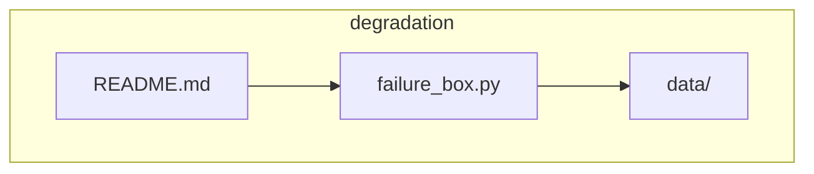
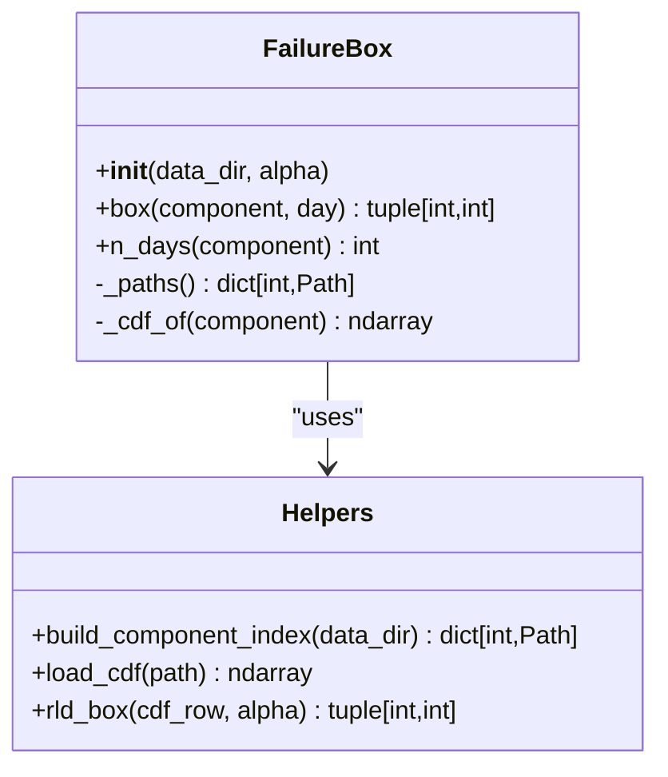
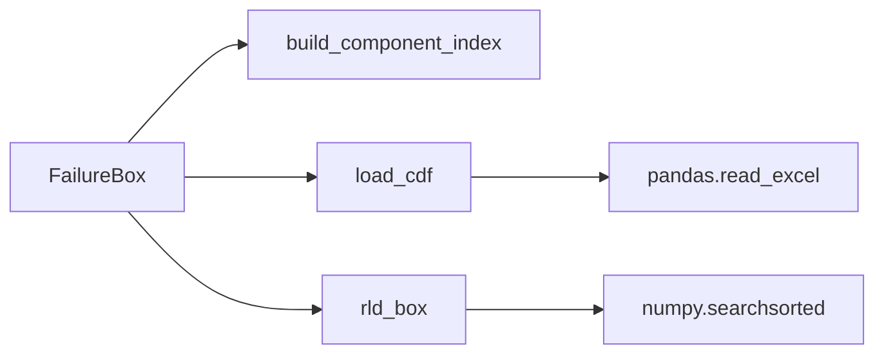

# FailureBox API

<cite>
**Referenced Files in This Document**
- [failure_box.py](file://degradation/failure_box.py)
- [README.md](file://degradation/README.md)
</cite>

## Table of Contents
1. [Introduction](#introduction)
2. [Project Structure](#project-structure)
3. [Core Components](#core-components)
4. [Architecture Overview](#architecture-overview)
5. [Detailed Component Analysis](#detailed-component-analysis)
6. [Dependency Analysis](#dependency-analysis)
7. [Performance Considerations](#performance-considerations)
8. [Troubleshooting Guide](#troubleshooting-guide)
9. [Conclusion](#conclusion)
10. [Appendices](#appendices)

## Introduction
This document provides comprehensive API documentation for the FailureBox class and related functions in the degradation module. It covers initialization, public methods, helper functions, parameter validation, return types, error handling, usage examples, performance considerations, and integration patterns with external optimization systems. The goal is to enable both new and experienced users to correctly use the component’s remaining useful life (RUL) interval calculations based on cumulative distribution function (CDF) data.

## Project Structure
The relevant code resides under the degradation package:
- failure_box.py: Implements FailureBox and helper functions.
- README.md: Explains data layout, conventions, and basic usage.

**Diagram sources**
- [failure_box.py:1-134](file://degradation/failure_box.py#L1-L134)
- [README.md:1-53](file://degradation/README.md#L1-L53)

**Section sources**
- [failure_box.py:1-134](file://degradation/failure_box.py#L1-L134)
- [README.md:1-53](file://degradation/README.md#L1-L53)

## Core Components
- FailureBox: Main class providing RUL interval queries per component and day.
- build_component_index: Builds a mapping from component IDs to CDF file paths.
- load_cdf: Loads a single component’s CDF into a NumPy array.
- rld_box: Computes the central interval for a given CDF row and confidence level.

Key constants:
- CDF_SUPPORT_DAYS: Expected number of columns in each CDF (support length).
- N_COMPONENTS: Maximum allowed component index.
- DATA_DIR: Default directory for CDF files.
- DEFAULT_ALPHA: Default confidence level alpha.

Public API summary:
- FailureBox.__init__(data_dir=None, alpha=DEFAULT_ALPHA)
- FailureBox.box(component, day) -> tuple[int, int]
- FailureBox.n_days(component) -> int

Helper functions:
- build_component_index(data_dir) -> dict[int, Path]
- load_cdf(path) -> np.ndarray
- rld_box(cdf_row, alpha) -> tuple[int, int]

**Section sources**
- [failure_box.py:11-14](file://degradation/failure_box.py#L11-L14)
- [failure_box.py:17-66](file://degradation/failure_box.py#L17-L66)
- [failure_box.py:69-133](file://degradation/failure_box.py#L69-L133)

## Architecture Overview
FailureBox orchestrates loading and caching of CDF data and delegates interval computation to rld_box. Data discovery is handled by build_component_index, and file I/O is performed by load_cdf.

**Diagram sources**
- [failure_box.py:17-66](file://degradation/failure_box.py#L17-L66)
- [failure_box.py:69-133](file://degradation/failure_box.py#L69-L133)

## Detailed Component Analysis

### FailureBox Class
Purpose:
- Provides an interface to query the central RUL interval for a specific component on a specific forecast day.
- Manages lazy loading and in-memory caching of CDF arrays.

Constructor:
- Signature: __init__(self, data_dir: Path | None = None, alpha: float = DEFAULT_ALPHA)
- Parameters:
  - data_dir: Optional path to the directory containing CDF files. If None, uses the default DATA_DIR.
  - alpha: Confidence level configuration; must satisfy 0 < alpha < 1.
- Behavior:
  - Validates alpha and raises ValueError if out of range.
  - Stores data_dir as a Path and alpha as a float.
  - Initializes internal index cache (_index) and CDF cache (_cdf).

Public Methods:
- box(component: int, day: int) -> tuple[int, int]
  - Purpose: Returns the central RUL interval (t_dw, t_up) for the given component and day.
  - Parameters:
    - component: Integer component ID (1..N_COMPONENTS).
    - day: Integer day index (1-based), within the component’s forecast horizon.
  - Return: Tuple of two integers representing lower and upper bounds of the RUL interval.
  - Validation and Errors:
    - Ensures day is within [1, n_days(component)]; otherwise raises ValueError.
    - Delegates interval calculation to rld_box; wraps any ValueError with additional context.
- n_days(component: int) -> int
  - Purpose: Returns the number of forecast days available for the component (length of its CDF).
  - Parameters:
    - component: Integer component ID.
  - Return: Integer count of days.

Internal Methods:
- _paths() -> dict[int, Path]
  - Lazily builds the component-to-file mapping using build_component_index.
- _cdf_of(component: int) -> np.ndarray
  - Loads and caches the CDF array for the specified component.
  - Raises ValueError if the component is missing or invalid.

Error Handling:
- Constructor: Raises ValueError for invalid alpha.
- box: Raises ValueError for invalid day range or when rld_box fails.
- _cdf_of: Raises ValueError if component not found or file format is invalid.

Complexity:
- First access per component loads Excel and caches the array; subsequent accesses are O(1).
- Interval computation uses binary search over support size (500), O(log K) where K = 500.

Usage Example Paths:
- Initialization and basic usage: [README.md:32-52](file://degradation/README.md#L32-L52)
- Constructor and method signatures: [failure_box.py:24-48](file://degradation/failure_box.py#L24-L48)

**Section sources**
- [failure_box.py:17-66](file://degradation/failure_box.py#L17-L66)
- [README.md:32-52](file://degradation/README.md#L32-L52)

### Helper Functions

#### build_component_index(data_dir: Path) -> dict[int, Path]
Purpose:
- Scans the data directory for CDF files matching the expected naming pattern and returns a mapping from component ID to file path.

Parameters:
- data_dir: Path to the directory containing CDF files.

Return:
- Mapping from component integer ID to Path of the corresponding CDF file.

Validation and Errors:
- Raises ValueError if data_dir does not exist.
- Raises ValueError if filenames do not match the expected pattern cdf_<signal>_<component>.xlsx.
- Raises ValueError if component ID is outside the valid range 1..N_COMPONENTS.
- Raises ValueError if duplicate component entries are detected.
- Raises ValueError if no matching CDF files are found.

Complexity:
- O(N log N) due to sorting of discovered files, where N is the number of candidate files.

Code Snippet Path:
- [failure_box.py:69-95](file://degradation/failure_box.py#L69-L95)

#### load_cdf(path: Path) -> np.ndarray
Purpose:
- Reads a single component’s CDF Excel file into a NumPy array with shape (n_days, CDF_SUPPORT_DAYS).

Parameters:
- path: Path to the CDF Excel file.

Return:
- NumPy array of floats with shape (n_days, 500).

Validation and Errors:
- Raises ValueError if the loaded array is not 2D or has a column count different from CDF_SUPPORT_DAYS.

Complexity:
- Dominated by Excel read and conversion to NumPy; typically fast for small to medium files.

Code Snippet Path:
- [failure_box.py:98-106](file://degradation/failure_box.py#L98-L106)

#### rld_box(cdf_row: np.ndarray, alpha: float) -> tuple[int, int]
Purpose:
- Computes the central interval (t_dw, t_up) at confidence level 1 - α for a single CDF row.

Parameters:
- cdf_row: 1-D NumPy array representing the CDF values across support days.
- alpha: Float confidence level; must satisfy 0 < alpha < 1.

Return:
- Tuple of two integers (lower, upper) representing the RUL interval bounds.

Validation and Errors:
- Raises ValueError if alpha is out of range.
- Raises ValueError if cdf_row is not a non-empty 1-D array.
- Raises ValueError if the maximum CDF value does not reach the required upper quantile; suggests adjusting alpha.

Algorithm:
- Computes lower_quantile = α/2 and upper_quantile = 1 - α/2.
- Uses binary search (searchsorted) to find indices for these quantiles.
- Returns 1-based indices adjusted by +1.

Complexity:
- O(log K) where K is the support length (500).

Code Snippet Path:
- [failure_box.py:109-133](file://degradation/failure_box.py#L109-L133)

**Section sources**
- [failure_box.py:69-133](file://degradation/failure_box.py#L69-L133)

## Dependency Analysis
The FailureBox class depends on helper functions for data discovery, loading, and interval computation. External dependencies include NumPy and pandas for numerical operations and Excel reading.

**Diagram sources**
- [failure_box.py:17-66](file://degradation/failure_box.py#L17-L66)
- [failure_box.py:69-133](file://degradation/failure_box.py#L69-L133)

**Section sources**
- [failure_box.py:17-133](file://degradation/failure_box.py#L17-L133)

## Performance Considerations
- Lazy Loading and Caching:
  - CDF arrays are loaded once per component and cached in memory via _cdf. Subsequent calls to box or n_days for the same component avoid re-reading Excel files.
- Memory Management:
  - Each component’s CDF consumes memory proportional to (n_days × 500) floats. For large-scale analysis across many components, consider:
    - Processing components in batches.
    - Explicitly clearing caches if needed (e.g., resetting _cdf dictionary).
- Computational Complexity:
  - Interval computation uses binary search over fixed support size (500), which is efficient.
  - Index building scans and sorts filenames; this is done lazily and only once per FailureBox instance.
- I/O Optimization:
  - Avoid repeated instantiation of FailureBox if analyzing many components; reuse the instance to benefit from caching.
- Numerical Stability:
  - Ensure alpha is chosen such that the CDF support reaches the required upper quantile; otherwise, rld_box will raise an informative error suggesting how to adjust alpha.

[No sources needed since this section provides general guidance]

## Troubleshooting Guide
Common issues and resolutions:
- Invalid alpha:
  - Symptom: ValueError during initialization or in rld_box indicating alpha must be in (0, 1).
  - Resolution: Choose alpha strictly between 0 and 1.
- Missing or invalid day:
  - Symptom: ValueError in box indicating day out of range for the component.
  - Resolution: Use n_days(component) to determine valid day range and ensure day is within [1, n_days].
- Unknown component:
  - Symptom: ValueError stating the component is not present in the data directory.
  - Resolution: Verify component ID exists and matches the naming convention; check available components via the index.
- Unexpected file names or formats:
  - Symptom: ValueError from build_component_index or load_cdf about filename pattern or column count.
  - Resolution: Ensure files follow cdf_<signal>_<component>.xlsx and have exactly 500 columns.
- Insufficient CDF support:
  - Symptom: ValueError from rld_box indicating F(n_days) does not reach the required upper quantile.
  - Resolution: Increase alpha or use a dataset with longer support; the error message suggests a minimum alpha threshold.

**Section sources**
- [failure_box.py:24-48](file://degradation/failure_box.py#L24-L48)
- [failure_box.py:69-133](file://degradation/failure_box.py#L69-L133)

## Conclusion
The FailureBox API offers a robust and efficient interface for computing central RUL intervals from component-specific CDFs. With clear validation, informative errors, and efficient caching, it supports both simple analyses and integration into larger optimization pipelines. Users should pay attention to alpha selection, day ranges, and file naming conventions to ensure correct operation.

[No sources needed since this section summarizes without analyzing specific files]

## Appendices

### API Reference Summary

- FailureBox.__init__(data_dir: Path | None = None, alpha: float = DEFAULT_ALPHA)
  - Validates alpha ∈ (0, 1).
  - Sets data_dir and alpha; initializes caches.
- FailureBox.box(component: int, day: int) -> tuple[int, int]
  - Returns (t_dw, t_up) for the given component and day.
  - Validates day range and delegates to rld_box.
- FailureBox.n_days(component: int) -> int
  - Returns the number of forecast days for the component.

- build_component_index(data_dir: Path) -> dict[int, Path]
  - Maps component IDs to CDF file paths with strict validation.

- load_cdf(path: Path) -> np.ndarray
  - Loads a CDF Excel file into a NumPy array with shape (n_days, 500).

- rld_box(cdf_row: np.ndarray, alpha: float) -> tuple[int, int]
  - Computes central interval for a CDF row at confidence level 1 - α.

**Section sources**
- [failure_box.py:17-133](file://degradation/failure_box.py#L17-L133)

### Usage Examples

Initialization and Basic Queries:
- Create a FailureBox instance with default settings and query the first component’s interval and horizon.
- Code example path: [README.md:32-52](file://degradation/README.md#L32-L52)

Component Analysis Workflow:
- Iterate over components, retrieve n_days, then compute intervals for selected days.
- Handle exceptions for invalid inputs and insufficient CDF support.

Integration with External Optimization Systems:
- Use FailureBox as a black-box evaluator returning interval bounds for decision variables representing maintenance scheduling or resource allocation.
- Cache FailureBox instances across optimization iterations to minimize I/O overhead.

Error Handling Patterns:
- Wrap box calls in try-except blocks to catch ValueError and log detailed diagnostics.
- Validate alpha before constructing FailureBox or calling rld_box.

**Section sources**
- [README.md:32-52](file://degradation/README.md#L32-L52)
- [failure_box.py:24-48](file://degradation/failure_box.py#L24-L48)
- [failure_box.py:109-133](file://degradation/failure_box.py#L109-L133)