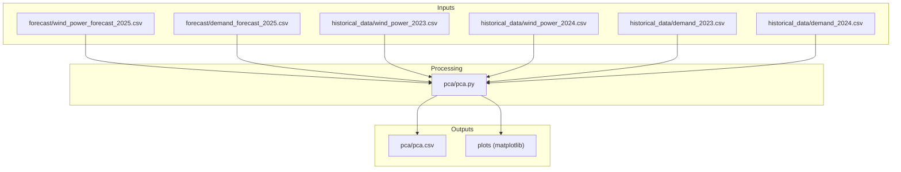
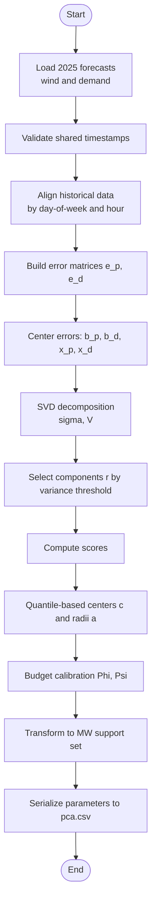
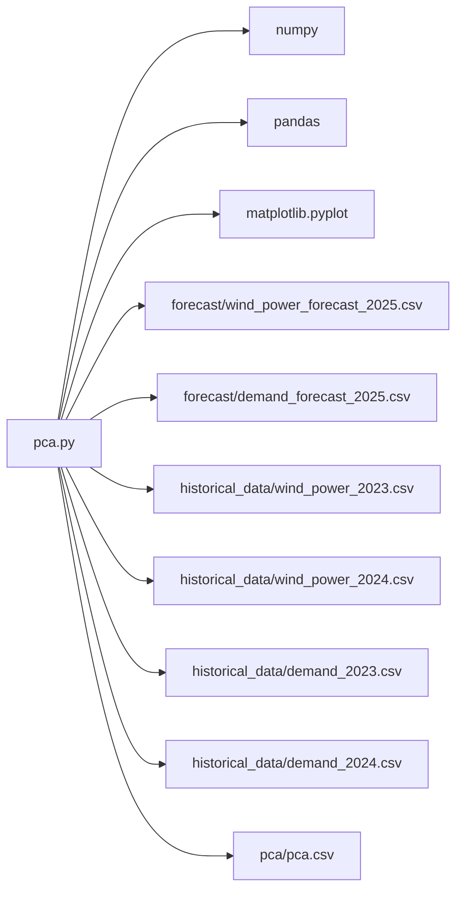

# PCA Module API

<cite>
**Referenced Files in This Document**
- [pca.py](file://pca/pca.py)
- [pca.csv](file://pca/pca.csv)
- [wind_power_forecast_2025.csv](file://forecast/wind_power_forecast_2025.csv)
- [demand_forecast_2025.csv](file://forecast/demand_forecast_2025.csv)
- [wind_power_2023.csv](file://historical_data/wind_power_2023.csv)
- [demand_2023.csv](file://historical_data/demand_2023.csv)
</cite>

## Table of Contents
1. [Introduction](#introduction)
2. [Project Structure](#project-structure)
3. [Core Components](#core-components)
4. [Architecture Overview](#architecture-overview)
5. [Detailed Component Analysis](#detailed-component-analysis)
6. [Dependency Analysis](#dependency-analysis)
7. [Performance Considerations](#performance-considerations)
8. [Troubleshooting Guide](#troubleshooting-guide)
9. [Conclusion](#conclusion)
10. [Appendices](#appendices)

## Introduction
This document provides detailed API documentation for the Principal Component Analysis (PCA) module used to build uncertainty sets for wind power and demand forecasting. The module performs:
- Historical data alignment by day-of-week and hour
- SVD-based dimensionality reduction with variance thresholds
- Quantile-based uncertainty set construction
- Budget calibration for robust optimization
- Support set generation in physical units (MW)
- Output serialization of parameters and diagnostics

The implementation is a single script that reads forecast and historical CSVs, computes error distributions, fits PCA models, and writes calibrated uncertainty parameters to a CSV file.

## Project Structure
The PCA module lives under `pca/` and depends on forecast and historical datasets:
- `pca/pca.py`: Main processing pipeline
- `pca/pca.csv`: Serialized output parameters
- `forecast/*.csv`: 2025 forecasts for wind power and demand
- `historical_data/*.csv`: Historical observations for 2023 and 2024

**Diagram sources**
- [pca.py:24-31](file://pca/pca.py#L24-L31)
- [pca.py:52-69](file://pca/pca.py#L52-L69)
- [pca.py:308-308](file://pca/pca.py#L308-L308)

**Section sources**
- [pca.py:1-323](file://pca/pca.py#L1-L323)

## Core Components
This section documents the key functions and data structures exposed or used by the PCA module.

### Data Loading and Alignment
- Forecast loading:
  - Reads wind power and demand forecasts for 2025
  - Validates that both series share identical timestamps
- Historical alignment:
  - Aligns historical series to the same day-of-week as the forecast origin
  - Removes incomplete days across years to ensure full daily blocks

Key variables and helpers:
- `ORIGIN_FORECAST`, `ORIGIN_HISTORICAL`: anchor dates for alignment
- `_historical_index(origin)`: maps forecast hours to aligned historical timestamps
- `_aligned_historical(relative_path, column, origin)`: loads and reindexes a historical series

**Section sources**
- [pca.py:18-33](file://pca/pca.py#L18-L33)
- [pca.py:41-49](file://pca/pca.py#L41-L49)
- [pca.py:52-69](file://pca/pca.py#L52-L69)

### Error Construction and Centering
- Computes forecast errors:
  - Wind error matrix `e_p` over 48 hourly dimensions (AB and KA)
  - Demand error vector `e_d` over 24 hourly dimensions
- Centers errors by subtracting per-dimension means (`b_p`, `b_d`)
- Builds training matrices `X_p`, `X_d` with rows as centered samples

Shapes and validation:
- `e_p.shape == (48, n_days)`
- `e_d.shape == (24, n_days)`
- Checks for shape consistency after centering

**Section sources**
- [pca.py:113-136](file://pca/pca.py#L113-L136)
- [pca.py:123-141](file://pca/pca.py#L123-L141)

### SVD Decomposition and Component Selection
- Performs SVD on centered training matrices:
  - `U_p, sigma_p, Vt_p = np.linalg.svd(X_p, full_matrices=False)`
  - `U_d, sigma_d, Vt_d = np.linalg.svd(X_d, full_matrices=False)`
- Selects components by cumulative explained variance threshold:
  - Default threshold: 0.95
  - Returns smallest `r` such that cumulative variance reaches threshold
- Constructs basis matrices `L_p`, `L_d` from right singular vectors
- Computes principal component scores: `scores_p = X_p @ L_p`, `scores_d = X_d @ L_d`

Validation:
- Ensures orthonormality of bases
- Verifies score shapes
- Enforces minimum explained variance

**Section sources**
- [pca.py:147-152](file://pca/pca.py#L147-L152)
- [pca.py:155-167](file://pca/pca.py#L155-L167)
- [pca.py:169-178](file://pca/pca.py#L169-L178)

### Uncertainty Set Construction via Quantiles
- Computes quantiles of scores at 10th and 90th percentiles:
  - Lower bounds `z_dw_*`, upper bounds `z_up_*`
- Derives centers `c_*` and radii `a_*`:
  - `c_* = (z_up + z_dw)/2`
  - `a_* = (z_up - z_dw)/2`
- Defines support set in PCA coordinates: `z = c + a * theta`, where `theta ∈ [-1, 1]^r`

**Section sources**
- [pca.py:184-195](file://pca/pca.py#L184-L195)

### Budget Calibration Algorithms
- Pairwise variance selection:
  - `_componentes_pares(sigma, r, threshold=PAIRWISE_VARIANCE_THRESHOLD)` selects minimal even number `s ≥ 2` achieving pairwise variance threshold
- Budget computation:
  - Normalizes scores to unit box: `theta = (scores - c) / a`
  - Computes total budget `B = sum(|theta|)`
  - Computes pairwise budget `C = sum of two largest |theta|` among top `s` components
  - Calibrates thresholds `Phi`, `Psi` at 90th percentile of `B`, `C`

Constraints:
- Raises error if any radius `a` is non-positive

**Section sources**
- [pca.py:204-211](file://pca/pca.py#L204-L211)
- [pca.py:214-228](file://pca/pca.py#L214-L228)
- [pca.py:231-234](file://pca/pca.py#L231-L234)

### Support Set Generation in MW
- Transforms PCA support set back to physical units (MW):
  - Uses mean forecast profiles as anchors
  - Computes lower, center, and upper bounds per hour
- Generates plots visualizing support bands around mean forecasts

**Section sources**
- [pca.py:242-249](file://pca/pca.py#L242-L249)
- [pca.py:254-288](file://pca/pca.py#L254-L288)

### Output Serialization
- Writes calibrated parameters to CSV:
  - Columns: `grupo`, `componente`, `c`, `a`, `s`, `r`, `phi`, `psi`
  - Groups: `viento` (wind), `demanda` (demand)

**Section sources**
- [pca.py:290-308](file://pca/pca.py#L290-L308)

## Architecture Overview
The PCA pipeline follows a linear flow from data ingestion through model fitting to uncertainty set calibration and output.

**Diagram sources**
- [pca.py:24-33](file://pca/pca.py#L24-L33)
- [pca.py:41-69](file://pca/pca.py#L41-L69)
- [pca.py:113-136](file://pca/pca.py#L113-L136)
- [pca.py:147-178](file://pca/pca.py#L147-L178)
- [pca.py:184-234](file://pca/pca.py#L184-L234)
- [pca.py:242-308](file://pca/pca.py#L242-L308)

## Detailed Component Analysis

### SVD Decomposition Parameters
- Input matrices:
  - `X_p`: shape `(n_train_p, 48)`, centered wind error samples
  - `X_d`: shape `(n_train_d, 24)`, centered demand error samples
- SVD call:
  - `np.linalg.svd(X, full_matrices=False)` returns `U`, `sigma`, `Vt`
- Component selection:
  - `_components_for_variance(sigma, threshold=DEFAULT_VARIANCE_THRESHOLD)`
  - Cumulative explained variance normalized by total variance
  - Returns minimal `r` meeting threshold
- Variance threshold configuration:
  - `DEFAULT_VARIANCE_THRESHOLD = 0.95`
  - `PAIRWISE_VARIANCE_THRESHOLD = 0.90`

Complexity:
- SVD on `m × n` matrix costs approximately `O(m n^2)` when `m ≥ n`; here `m ≈ n_days`, `n ∈ {24, 48}`
- Memory usage proportional to storage of `U`, `sigma`, `Vt` and intermediate arrays

Numerical stability:
- Uses NumPy’s LAPACK-backed SVD
- Validates orthonormality of selected basis columns
- Enforces minimum explained variance to avoid degenerate solutions

**Section sources**
- [pca.py:147-152](file://pca/pca.py#L147-L152)
- [pca.py:155-167](file://pca/pca.py#L155-L167)
- [pca.py:169-178](file://pca/pca.py#L169-L178)

### Uncertainty Set Construction Methods
- Quantile-based approach:
  - Computes 10th and 90th percentiles along sample axis
  - Derives centers and radii per component
- Support set definition:
  - In PCA coordinates: `z = c + a * theta`, `theta ∈ [-1, 1]^r`
- Transformation to MW:
  - Applies basis `L` and bias `b` to map back to original space
  - Anchors to mean forecast profile

Output formats:
- Centers `c_*` and radii `a_*` per group and component
- Serialized in `pca.csv` with fields `c`, `a`, plus budgets `phi`, `psi`

**Section sources**
- [pca.py:184-195](file://pca/pca.py#L184-L195)
- [pca.py:242-249](file://pca/pca.py#L242-L249)
- [pca.py:290-308](file://pca/pca.py#L290-L308)

### Budget Parameter Calibration Algorithms
- Pairwise component selection:
  - `_componentes_pares(sigma, r, threshold=PAIRWISE_VARIANCE_THRESHOLD)`
  - Ensures `s ≥ 2` and respects variance threshold
- Budget metrics:
  - Total budget `B = sum_i |theta_i|`
  - Pairwise budget `C = sum of two largest |theta_i|` among top `s`
- Calibration:
  - `Phi = quantile(B, 0.90)`
  - `Psi = quantile(C, 0.90)`

Algorithmic details:
- Uses `np.partition` to efficiently find top-two magnitudes
- Avoids division by zero by validating radii `a > 0`

**Section sources**
- [pca.py:204-211](file://pca/pca.py#L204-L211)
- [pca.py:214-228](file://pca/pca.py#L214-L228)
- [pca.py:231-234](file://pca/pca.py#L231-L234)

### Historical Data Alignment Methods
- Day-of-week matching:
  - Compares weekday indices between forecast and historical origins
  - Raises error if mismatched
- Missing-day handling:
  - Identifies days with NaN values in any series
  - Excludes incomplete days from analysis
- Daily matrix reshaping:
  - Converts hourly series into `(24, days)` matrices for each group

Validation:
- Ensures forecast and historical weekday sequences align
- Tracks excluded days for diagnostics

**Section sources**
- [pca.py:41-49](file://pca/pca.py#L41-L49)
- [pca.py:71-90](file://pca/pca.py#L71-L90)
- [pca.py:94-97](file://pca/pca.py#L94-L97)

### Forecast Integration Utilities
- Forecast loading:
  - Parses timestamps and extracts median forecasts
  - Validates temporal alignment between wind and demand forecasts
- Time indexing:
  - Creates DatetimeIndex for forecast horizon
  - Maps to aligned historical indices

Error handling:
- Raises `ValueError` if timestamp series differ

**Section sources**
- [pca.py:24-33](file://pca/pca.py#L24-L33)
- [pca.py:35-38](file://pca/pca.py#L35-L38)

### Function Signatures and Responsibilities
Note: These are conceptual signatures describing responsibilities; actual code is embedded in the script.

- `_historical_index(origin) -> pd.DatetimeIndex`
  - Purpose: Map forecast hours to aligned historical timestamps
- `_aligned_historical(relative_path, column, origin) -> np.ndarray`
  - Purpose: Load and reindex historical series
- `_daily_matrix(values, mask) -> np.ndarray`
  - Purpose: Reshape hourly series to `(24, days)` matrix
- `_components_for_variance(sigma, threshold=DEFAULT_VARIANCE_THRESHOLD) -> int`
  - Purpose: Select number of components by cumulative variance
- `_componentes_pares(sigma, r, threshold=PAIRWISE_VARIANCE_THRESHOLD) -> int`
  - Purpose: Select pairwise component count `s`
- `_presupuestos(scores, c, a, s) -> tuple(theta, B, C, Phi, Psi)`
  - Purpose: Compute normalized scores and calibrated budgets

**Section sources**
- [pca.py:41-49](file://pca/pca.py#L41-L49)
- [pca.py:94-97](file://pca/pca.py#L94-L97)
- [pca.py:155-167](file://pca/pca.py#L155-L167)
- [pca.py:204-228](file://pca/pca.py#L204-L228)

## Dependency Analysis
The module has clear dependencies on external data files and standard libraries.

**Diagram sources**
- [pca.py:1-4](file://pca/pca.py#L1-L4)
- [pca.py:24-31](file://pca/pca.py#L24-L31)
- [pca.py:52-69](file://pca/pca.py#L52-L69)
- [pca.py:308-308](file://pca/pca.py#L308-L308)

**Section sources**
- [pca.py:1-4](file://pca/pca.py#L1-L4)
- [pca.py:24-31](file://pca/pca.py#L24-L31)
- [pca.py:52-69](file://pca/pca.py#L52-L69)
- [pca.py:308-308](file://pca/pca.py#L308-L308)

## Performance Considerations
- Computational complexity:
  - SVD dominates runtime; cost scales with number of training samples and feature dimension
  - For typical hourly data, `n_days` can be large; consider subsampling or streaming approaches for very large datasets
- Memory usage:
  - Stores multiple large arrays: forecast series, historical series, error matrices, SVD factors
  - Reshaping operations create copies; monitor peak memory during matrix stacking
- Numerical stability:
  - SVD is numerically stable; however, near-singular covariance structures may lead to small singular values
  - Variance thresholding mitigates noise components
- Optimization opportunities:
  - Use sparse representations if many zeros exist in forecasts/historical data
  - Parallelize per-year processing loops
  - Cache intermediate results (e.g., aligned historical series)

[No sources needed since this section provides general guidance]

## Troubleshooting Guide
Common issues and resolutions:

- Singular or near-singular matrices:
  - Symptom: Very small singular values or unstable PCA
  - Resolution: Increase variance threshold or reduce dimensionality; check data quality
- Convergence problems:
  - Symptom: Unexpectedly low explained variance or failed orthonormality checks
  - Resolution: Ensure sufficient training samples; verify no NaN contamination
- Data validation errors:
  - Mismatched timestamps between wind and demand forecasts
    - Check column names and parsing
  - Weekday misalignment between forecast and historical origins
    - Verify origin dates and day-of-week mapping
  - Non-positive radii in uncertainty sets
    - Inspect quantile calculations and ensure variability in scores
- Shape mismatches:
  - Errors indicating incorrect array shapes after centering or SVD
    - Validate input dimensions and masking logic

Specific error messages raised by the module:
- Timestamp mismatch between forecasts
- Weekday mismatch between forecast and historical data
- Shape validation failures for error matrices and biases
- Orthonormality validation failures for PCA bases
- Minimum explained variance not met
- Zero or negative component widths in uncertainty sets

**Section sources**
- [pca.py:32-33](file://pca/pca.py#L32-L33)
- [pca.py:71-72](file://pca/pca.py#L71-L72)
- [pca.py:123-141](file://pca/pca.py#L123-L141)
- [pca.py:169-178](file://pca/pca.py#L169-L178)
- [pca.py:216-217](file://pca/pca.py#L216-L217)

## Conclusion
The PCA module provides a complete pipeline for constructing uncertainty sets based on historical forecast errors. It integrates data alignment, SVD-based dimensionality reduction, quantile-driven uncertainty modeling, and budget calibration for robust decision-making. The outputs include interpretable parameters for downstream optimization and visualization tools for assessing uncertainty bands in physical units. Proper attention to data quality, numerical stability, and performance considerations ensures reliable operation across diverse datasets.

[No sources needed since this section summarizes without analyzing specific files]

## Appendices

### Output Format: pca.csv
The serialized output contains one row per component per group:
- `grupo`: Group identifier (`viento` or `demanda`)
- `componente`: Component index
- `c`: Center of uncertainty interval in PCA coordinates
- `a`: Radius of uncertainty interval in PCA coordinates
- `s`: Number of components used for pairwise budget
- `r`: Total number of retained components
- `phi`: Calibrated total budget threshold
- `psi`: Calibrated pairwise budget threshold

Example structure (values are illustrative):
- Row example: `viento,1,-0.6869522054529762,5.746499080230134,3,5,5.492529673711825,2.7903962749770757`

**Section sources**
- [pca.csv:1-18](file://pca/pca.csv#L1-L18)
- [pca.py:290-308](file://pca/pca.py#L290-L308)

### Data Preprocessing Steps
- Load forecasts and validate temporal alignment
- Align historical data to forecast weekdays
- Remove incomplete days across years
- Reshape hourly series into daily matrices
- Compute forecast errors and center them

**Section sources**
- [pca.py:24-33](file://pca/pca.py#L24-L33)
- [pca.py:41-90](file://pca/pca.py#L41-L90)
- [pca.py:94-136](file://pca/pca.py#L94-L136)

### Model Fitting Procedures
- Perform SVD on centered error matrices
- Select components by cumulative variance threshold
- Compute principal component scores
- Validate orthonormality and explained variance

**Section sources**
- [pca.py:147-178](file://pca/pca.py#L147-L178)

### Result Interpretation Techniques
- Inspect centers and radii to understand uncertainty magnitude
- Review budget thresholds to assess robustness levels
- Visualize support bands against mean forecasts to gauge coverage

**Section sources**
- [pca.py:184-234](file://pca/pca.py#L184-L234)
- [pca.py:242-288](file://pca/pca.py#L242-L288)