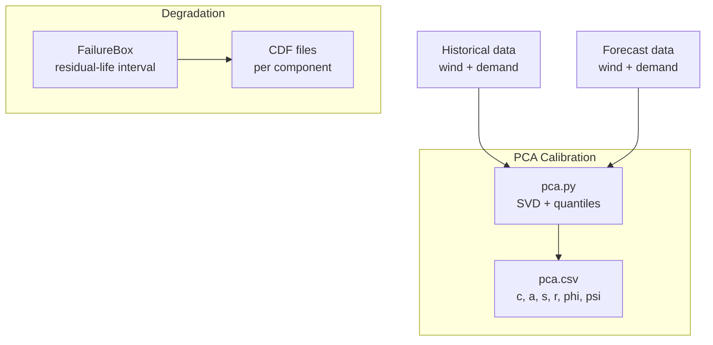
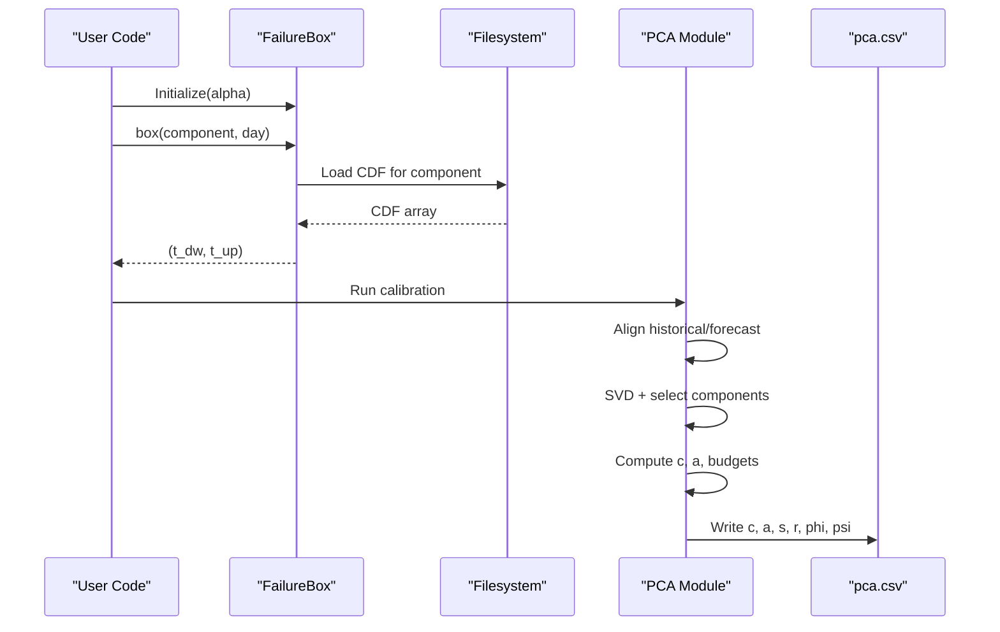
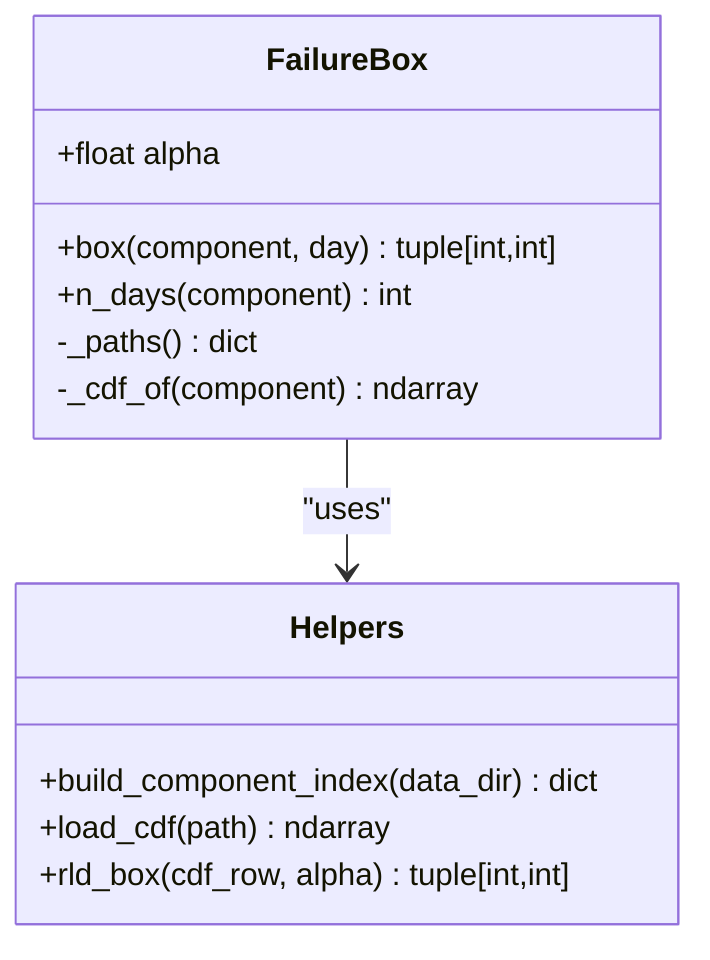
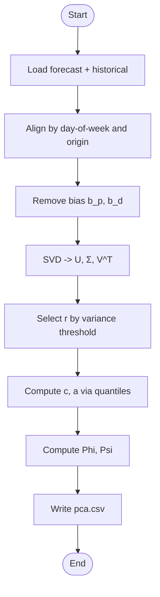
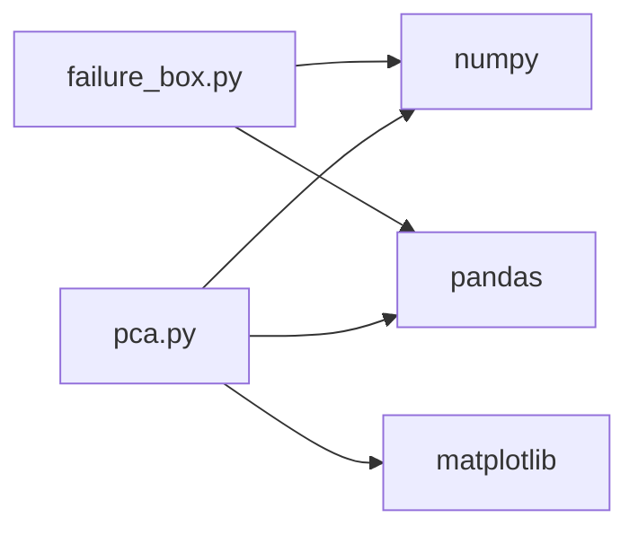

# Advanced Usage

<cite>
**Referenced Files in This Document**
- [failure_box.py](file://degradation/failure_box.py)
- [README.md](file://degradation/README.md)
- [pca.py](file://pca/pca.py)
- [pca.csv](file://pca/pca.csv)
</cite>

## Table of Contents
1. [Introduction](#introduction)
2. [Project Structure](#project-structure)
3. [Core Components](#core-components)
4. [Architecture Overview](#architecture-overview)
5. [Detailed Component Analysis](#detailed-component-analysis)
6. [Dependency Analysis](#dependency-analysis)
7. [Performance Considerations](#performance-considerations)
8. [Troubleshooting Guide](#troubleshooting-guide)
9. [Conclusion](#conclusion)
10. [Appendices](#appendices)

## Introduction
This document provides advanced usage guidance for the wind power degradation and forecasting system, focusing on expert-level customization and optimization. It covers parameter tuning (alpha levels, variance thresholds, convergence criteria), performance strategies (memory management, parallelization, computational efficiency), integration patterns with external solvers and data sources, visualization customization, troubleshooting, extension mechanisms, and scaling considerations. The content is grounded in the repository’s core modules: the degradation uncertainty box engine and the PCA-based uncertainty set calibration pipeline.

## Project Structure
The repository contains two primary analytical components:
- Degradation module: computes central residual-life intervals per component using precomputed CDFs.
- PCA module: calibrates uncertainty sets from historical forecast errors and produces support-set parameters used downstream.

**Diagram sources**
- [failure_box.py:17-66](file://degradation/failure_box.py#L17-L66)
- [pca.py:24-178](file://pca/pca.py#L24-L178)
- [pca.py:240-308](file://pca/pca.py#L240-L308)

**Section sources**
- [failure_box.py:1-134](file://degradation/failure_box.py#L1-L134)
- [pca.py:1-323](file://pca/pca.py#L1-L323)

## Core Components
- FailureBox: Loads per-component residual-life CDFs and returns the central interval at a given day based on alpha.
- PCA calibration: Aligns historical and forecast series, removes bias, performs SVD, selects principal components by variance threshold, computes quantile-based centers and radii, and derives budget parameters (Phi, Psi).

Key tunable parameters:
- Alpha (α): Controls the central coverage of the residual-life interval.
- Variance thresholds: DEFAULT_VARIANCE_THRESHOLD and PAIRWISE_VARIANCE_THRESHOLD control dimensionality selection and pairwise budget calibration.
- Quantile level: 0.10/0.90 define the empirical support bounds in PCA coordinates.

**Section sources**
- [failure_box.py:17-66](file://degradation/failure_box.py#L17-L66)
- [pca.py:9-12](file://pca/pca.py#L9-L12)
- [pca.py:155-178](file://pca/pca.py#L155-L178)
- [pca.py:184-195](file://pca/pca.py#L184-L195)

## Architecture Overview
The system integrates two independent but complementary pipelines:
- Degradation uncertainty: For each component and forecast day, compute a residual-life interval via CDF quantiles.
- Forecast uncertainty: From historical forecast errors, derive an uncertainty set in PCA space that can be mapped back to MW envelopes.

**Diagram sources**
- [failure_box.py:24-48](file://degradation/failure_box.py#L24-L48)
- [pca.py:41-178](file://pca/pca.py#L41-L178)
- [pca.py:290-308](file://pca/pca.py#L290-L308)

## Detailed Component Analysis

### Degradation Uncertainty Box (FailureBox)
FailureBox encapsulates:
- Parameter validation for alpha.
- Lazy loading and caching of CDF arrays per component.
- Interval computation via searchsorted over the CDF row.

Tuning guidelines:
- Alpha (α): Smaller α yields wider central intervals; larger α narrows them. Ensure F(support_end) ≥ 1 − α/2 or adjust α upward.
- Data directory: Override default path to use custom CDF datasets.
- Day indexing: Days are 1-based relative to each component’s CDF length.

**Diagram sources**
- [failure_box.py:17-66](file://degradation/failure_box.py#L17-L66)
- [failure_box.py:69-134](file://degradation/failure_box.py#L69-L134)

Operational notes:
- First access to a component loads its CDF into memory; subsequent calls reuse the cached array.
- If the CDF maximum does not reach the required upper quantile, the call raises an error suggesting a higher α.

**Section sources**
- [failure_box.py:17-66](file://degradation/failure_box.py#L17-L66)
- [failure_box.py:69-134](file://degradation/failure_box.py#L69-L134)
- [README.md:19-30](file://degradation/README.md#L19-L30)

### PCA-Based Uncertainty Set Calibration
The PCA module:
- Aligns historical and forecast time series by day-of-week and origin dates.
- Removes bias and builds training matrices for wind and demand.
- Performs SVD and selects components by cumulative explained variance.
- Computes quantile-based centers (c) and radii (a) in PCA coordinates.
- Derives budgets (Phi, Psi) for robust optimization constraints.

Tuning guidelines:
- DEFAULT_VARIANCE_THRESHOLD: Controls number of retained components r. Higher values increase fidelity but also complexity.
- PAIRWISE_VARIANCE_THRESHOLD: Controls pairwise budget calibration s. Affects robustness vs. conservatism trade-off.
- Quantile level (0.10/0.90): Defines empirical support bounds; adjust if distributions are heavy-tailed or skewed.

**Diagram sources**
- [pca.py:41-178](file://pca/pca.py#L41-L178)
- [pca.py:184-234](file://pca/pca.py#L184-L234)
- [pca.py:290-308](file://pca/pca.py#L290-L308)

Validation checks:
- Ensures orthogonality of selected bases L_p, L_d.
- Verifies shapes of bias-corrected matrices and scores.
- Raises errors when explained variance falls below thresholds.

**Section sources**
- [pca.py:41-178](file://pca/pca.py#L41-L178)
- [pca.py:184-234](file://pca/pca.py#L184-L234)
- [pca.py:290-308](file://pca/pca.py#L290-L308)

## Dependency Analysis
- failure_box.py depends on numpy and pandas for numerical operations and Excel I/O.
- pca.py depends on numpy, pandas, and matplotlib for analysis and plotting.
- Both modules operate independently; integration occurs at the application layer where outputs (intervals and PCA parameters) feed downstream optimization or decision logic.

**Diagram sources**
- [failure_box.py:7-8](file://degradation/failure_box.py#L7-L8)
- [pca.py:3-4](file://pca/pca.py#L3-L4)
- [pca.py:240](file://pca/pca.py#L240)

**Section sources**
- [failure_box.py:7-8](file://degradation/failure_box.py#L7-L8)
- [pca.py:3-4](file://pca/pca.py#L3-L4)

## Performance Considerations
Memory management:
- FailureBox caches CDF arrays per component after first load. Avoid repeatedly constructing new instances within tight loops; reuse a single instance across queries.
- PCA constructs large matrices (e.g., stacked daily blocks). Use contiguous float arrays and avoid unnecessary copies.

Parallel processing:
- CDF loading and index building are file I/O bound; consider parallelizing across components if disk throughput allows.
- PCA SVD is already vectorized; further parallelism may require chunking days or using out-of-core libraries for very large histories.

Computational efficiency:
- Prefer batched queries to FailureBox to amortize index construction.
- In PCA, ensure masks for incomplete days are computed once and reused.
- Reduce plot rendering overhead in production by disabling matplotlib unless needed.

Scaling:
- For many components, partition CDF files across directories and build per-shard indexes.
- For long historical windows, consider streaming quantile estimators or approximate SVD methods.

[No sources needed since this section provides general guidance]

## Troubleshooting Guide
Common issues and resolutions:
- Alpha-related failures in residual-life intervals:
  - Symptom: Error indicating the CDF support does not cover the upper quantile.
  - Resolution: Increase α so that 1 − α/2 ≤ F(support_end); verify component-specific max CDF value.
  - Reference: [failure_box.py:122-129](file://degradation/failure_box.py#L122-L129)

- Invalid day indices:
  - Symptom: Requested day outside component’s valid range.
  - Resolution: Use n_days(component) to determine valid range; ensure 1-based indexing.
  - Reference: [failure_box.py:32-48](file://degradation/failure_box.py#L32-L48)

- Mismatched forecast/historical timestamps:
  - Symptom: Errors about non-matching hours or day-of-week alignment.
  - Resolution: Verify source_timestamp columns and ensure same hourly cadence; check ORIGIN_FORECAST/ORIGIN_HISTORICAL settings.
  - Reference: [pca.py:24-33](file://pca/pca.py#L24-L33), [pca.py:41-49](file://pca/pca.py#L41-L49)

- Insufficient explained variance:
  - Symptom: Error stating retained variance below threshold.
  - Resolution: Lower DEFAULT_VARIANCE_THRESHOLD or include more historical years; inspect sigma vectors.
  - Reference: [pca.py:155-178](file://pca/pca.py#L155-L178)

- Null component widths in PCA:
  - Symptom: Error about zero-width components.
  - Resolution: Check radii a > 0; investigate near-zero variance directions.
  - Reference: [pca.py:214-218](file://pca/pca.py#L214-L218)

Numerical stability tips:
- Normalize or standardize inputs if magnitudes vary widely before SVD.
- Guard against division by small radii in downstream transformations.
- Validate orthogonality of L matrices post-selection.

Debugging strategies:
- Print intermediate shapes and statistics (means, variances, quantiles).
- Save partial results (e.g., scores, budgets) to CSV for inspection.
- Temporarily disable plotting to isolate computational bottlenecks.

**Section sources**
- [failure_box.py:24-48](file://degradation/failure_box.py#L24-L48)
- [failure_box.py:109-134](file://degradation/failure_box.py#L109-L134)
- [pca.py:24-33](file://pca/pca.py#L24-L33)
- [pca.py:155-178](file://pca/pca.py#L155-L178)
- [pca.py:214-218](file://pca/pca.py#L214-L218)

## Conclusion
The system combines component-wise residual-life interval estimation with PCA-calibrated uncertainty sets for wind and demand forecasts. Expert users should tune α, variance thresholds, and quantile levels to balance coverage, robustness, and computational cost. Adopt caching, vectorization, and selective parallelism to scale efficiently. Integrate with external solvers by mapping PCA-space uncertainties back to physical units and feeding budget parameters (Phi, Psi) into constraint formulations.

[No sources needed since this section summarizes without analyzing specific files]

## Appendices

### Custom Configuration Options
- FailureBox.alpha: Central coverage probability; must be in (0, 1).
- DEFAULT_VARIANCE_THRESHOLD: Retained variance cutoff for PCA dimensionality.
- PAIRWISE_VARIANCE_THRESHOLD: Pairwise budget calibration threshold.
- Quantile levels: 0.10/0.90 define support bounds in PCA coordinates.

Guidelines:
- Increase α cautiously to avoid truncation errors in residual-life intervals.
- Raise variance thresholds to retain more modes at the cost of model complexity.
- Adjust quantiles if tail behavior differs significantly from historical assumptions.

**Section sources**
- [failure_box.py:24-28](file://degradation/failure_box.py#L24-L28)
- [pca.py:9-12](file://pca/pca.py#L9-L12)
- [pca.py:184-195](file://pca/pca.py#L184-L195)

### Integration Patterns
- External solvers:
  - Map PCA-space uncertainties z = c + a·θ back to MW using L matrices and bias terms.
  - Use Phi and Psi as budget caps in robust constraints.
- Custom data adapters:
  - Replace Excel readers with database connectors or streaming parsers for large CDF sets.
  - Provide aligned historical/forecast loaders conforming to expected column names and time indices.
- Visualization customization:
  - Modify matplotlib figures to overlay operational limits, scenario bands, or KPI overlays.
  - Export plots to static formats for reporting pipelines.

[No sources needed since this section provides general guidance]

### Extension Mechanisms
- New degradation models:
  - Implement alternative interval estimators alongside FailureBox while preserving the box(component, day) interface.
- Specialized uncertainty quantification:
  - Extend PCA module with copula-based or distributional uncertainty sets; maintain compatibility with c, a, s, r, phi, psi outputs.
- Pluggable solvers:
  - Abstract solver calls behind a common interface; inject different backends (LP/MIP/RO) via configuration.

[No sources needed since this section provides general guidance]

### Scaling Strategies
- Data partitioning:
  - Shard CDF files by signal/component ranges; build per-shard indexes.
- Out-of-core analytics:
  - Use chunked SVD or randomized algorithms for massive historical windows.
- Parallel execution:
  - Distribute component-wise queries across workers; aggregate results safely.
- Storage optimization:
  - Convert Excel CDFs to binary formats (e.g., Parquet) for faster I/O.

[No sources needed since this section provides general guidance]