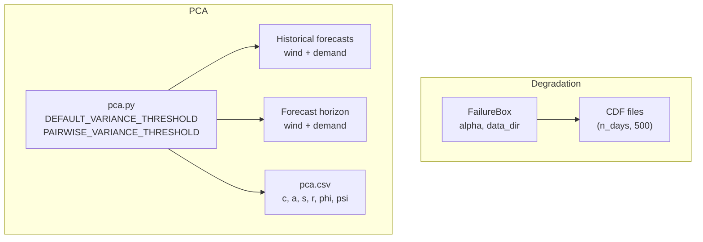
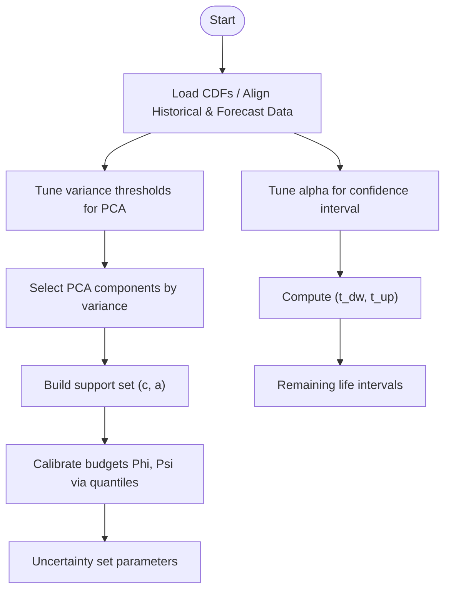
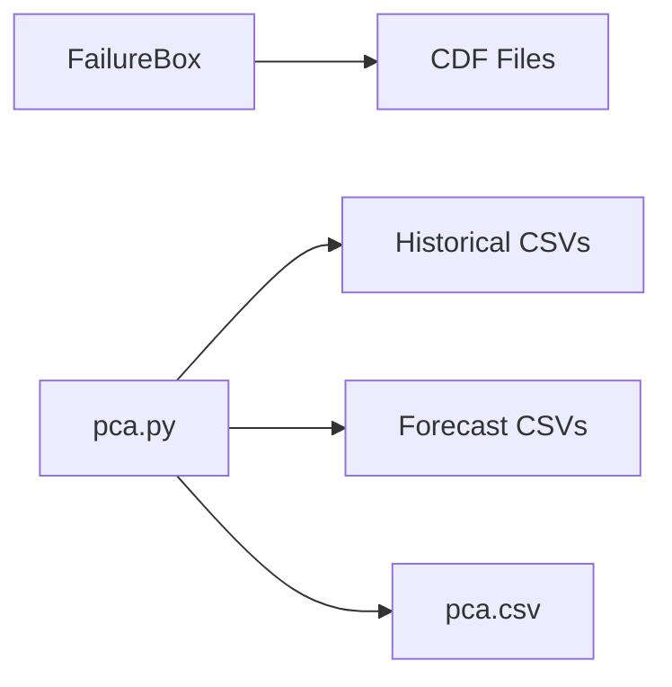

# Custom Configuration and Parameter Tuning

<cite>
**Referenced Files in This Document**
- [failure_box.py](file://degradation/failure_box.py)
- [README.md](file://degradation/README.md)
- [pca.py](file://pca/pca.py)
</cite>

## Table of Contents
1. [Introduction](#introduction)
2. [Project Structure](#project-structure)
3. [Core Components](#core-components)
4. [Architecture Overview](#architecture-overview)
5. [Detailed Component Analysis](#detailed-component-analysis)
6. [Dependency Analysis](#dependency-analysis)
7. [Performance Considerations](#performance-considerations)
8. [Troubleshooting Guide](#troubleshooting-guide)
9. [Conclusion](#conclusion)
10. [Appendices](#appendices)

## Introduction
This document explains how to configure and tune the wind power degradation system’s key parameters:
- Confidence interval alpha for residual life boxes
- Variance thresholds for PCA component selection
- Pairwise variance threshold for uncertainty set calibration
- Convergence-related behavior through quantile-based budget calibration

It also provides mathematical implications, practical configuration examples, sensitivity analysis techniques, automated parameter search strategies, and troubleshooting guidance.

## Project Structure
The relevant code for configuration and tuning is split across two modules:
- Degradation module: computes central confidence intervals for remaining life using a configurable alpha
- PCA module: builds uncertainty sets from historical forecast errors using variance thresholds and quantile-based budgets

**Diagram sources**
- [failure_box.py:11-14](file://degradation/failure_box.py#L11-L14)
- [failure_box.py:24-30](file://degradation/failure_box.py#L24-L30)
- [pca.py:6-11](file://pca/pca.py#L6-L11)
- [pca.py:24-38](file://pca/pca.py#L24-L38)
- [pca.py:308-308](file://pca/pca.py#L308-L308)

**Section sources**
- [failure_box.py:11-14](file://degradation/failure_box.py#L11-L14)
- [pca.py:6-11](file://pca/pca.py#L6-L11)

## Core Components
- FailureBox: Computes a central confidence interval (box) for remaining life per component and day based on a cumulative distribution function (CDF). The primary tunable parameter is alpha.
- PCA pipeline: Builds uncertainty sets for wind power and demand using Principal Component Analysis. Key tunable parameters are DEFAULT_VARIANCE_THRESHOLD and PAIRWISE_VARIANCE_THRESHOLD.

Key responsibilities:
- FailureBox validates inputs, loads component CDFs, and returns lower and upper bounds for remaining life at a given day.
- PCA aligns historical and forecast series, performs SVD, selects components by explained variance, constructs support sets, and calibrates budgets via quantiles.

**Section sources**
- [failure_box.py:17-48](file://degradation/failure_box.py#L17-L48)
- [pca.py:147-179](file://pca/pca.py#L147-L179)

## Architecture Overview
The system has two main processing paths that can be tuned independently:

- Residual Life Box Path
  - Input: Per-component CDF arrays with shape (n_days, 500)
  - Parameter: alpha controls the central coverage probability
  - Output: Lower and upper bounds for remaining life in days

- Uncertainty Set Path (PCA)
  - Inputs: Historical and forecast time series for wind and demand
  - Parameters:
    - DEFAULT_VARIANCE_THRESHOLD controls number of PCA components retained
    - PAIRWISE_VARIANCE_THRESHOLD controls pairwise budget calibration
  - Outputs: Support set centers c, radii a, selected components s, total components r, and calibrated budgets Phi and Psi

**Diagram sources**
- [failure_box.py:109-133](file://degradation/failure_box.py#L109-L133)
- [pca.py:155-179](file://pca/pca.py#L155-L179)
- [pca.py:204-228](file://pca/pca.py#L204-L228)

## Detailed Component Analysis

### Confidence Interval Alpha in FailureBox
Purpose:
- alpha determines the central coverage probability of the remaining life box. For example, alpha = 0.1 yields a 90% central interval.

Mathematical behavior:
- Lower bound t_dw corresponds to the smallest k such that F(k) >= alpha/2
- Upper bound t_up corresponds to the smallest k such that F(k) >= 1 - alpha/2
- If the CDF support does not reach 1 - alpha/2, the computation raises an error indicating insufficient support

Configuration:
- Default alpha is defined as a constant; it can be overridden when constructing FailureBox
- Valid range is strictly between 0 and 1

Practical implications:
- Smaller alpha increases coverage (wider interval), improving robustness but reducing precision
- Larger alpha narrows the interval, increasing precision but risking undercoverage if the CDF support is limited

Example configurations:
- Conservative: alpha = 0.05 (95% central coverage)
- Balanced: alpha = 0.10 (default, 90% central coverage)
- Aggressive: alpha = 0.20 (80% central coverage)

Before/after comparison guidance:
- Compare intervals (t_dw, t_up) across alpha values for the same component and day
- Track changes in interval width and frequency of “insufficient support” errors

Sensitivity analysis:
- Sweep alpha over a grid (e.g., 0.05, 0.10, 0.15, 0.20)
- Record interval widths and failure rates due to support limitations
- Plot interval width vs alpha to identify diminishing returns or instability

Automated parameter search:
- Define an objective combining interval stability and operational cost (e.g., penalize excessive width)
- Use grid search or Bayesian optimization over alpha with cross-validation across components/days

Error handling:
- Invalid alpha outside (0, 1) raises an error
- Insufficient CDF support relative to alpha raises an informative error suggesting a larger alpha

**Section sources**
- [failure_box.py:14-14](file://degradation/failure_box.py#L14-L14)
- [failure_box.py:24-30](file://degradation/failure_box.py#L24-L30)
- [failure_box.py:109-133](file://degradation/failure_box.py#L109-L133)
- [README.md:19-30](file://degradation/README.md#L19-L30)

### Variance Thresholds in PCA Component Selection
Purpose:
- DEFAULT_VARIANCE_THRESHOLD controls the minimum cumulative explained variance required to select the number of PCA components r
- PAIRWISE_VARIANCE_THRESHOLD controls the number of top components s used for pairwise budget calibration

Mathematical behavior:
- Explained variance is computed from singular values sigma
- r is the smallest index where cumulative explained variance reaches the threshold
- s is the smallest even-indexed count (at least 2) where cumulative explained variance among the first r components reaches the pairwise threshold

Configuration:
- Both thresholds are module-level constants and can be adjusted before running the PCA pipeline

Practical implications:
- Higher thresholds retain more components, capturing more variability but potentially increasing noise and computational cost
- Lower thresholds reduce dimensionality, simplifying models but possibly missing important patterns

Example configurations:
- Conservative: DEFAULT_VARIANCE_THRESHOLD = 0.99, PAIRWISE_VARIANCE_THRESHOLD = 0.95
- Balanced: DEFAULT_VARIANCE_THRESHOLD = 0.95, PAIRWISE_VARIANCE_THRESHOLD = 0.90 (defaults)
- Aggressive: DEFAULT_VARIANCE_THRESHOLD = 0.90, PAIRWISE_VARIANCE_THRESHOLD = 0.85

Before/after comparison guidance:
- Compare r and s across thresholds
- Observe changes in support set centers c and radii a
- Evaluate downstream impact on budget calibration (Phi, Psi) and resulting uncertainty sets

Sensitivity analysis:
- Sweep both thresholds across grids (e.g., 0.85–0.99)
- Monitor explained variance retention, r, s, and resulting Phi/Psi
- Visualize how support set shapes change with thresholds

Automated parameter search:
- Optimize thresholds to balance explained variance retention and budget stability
- Use nested validation: inner loop tunes thresholds; outer loop evaluates performance on held-out periods

Validation checks:
- Ensures L_p and L_d are orthonormal bases
- Ensures retained variance meets the configured threshold; otherwise raises an error

**Section sources**
- [pca.py:9-11](file://pca/pca.py#L9-L11)
- [pca.py:155-179](file://pca/pca.py#L155-L179)
- [pca.py:204-228](file://pca/pca.py#L204-L228)

### Convergence Criteria and Budget Calibration
Context:
- There is no explicit iterative optimizer with convergence criteria in this repository
- Convergence-like behavior emerges through quantile-based calibration of budgets Phi and Psi applied to PCA scores

Mechanism:
- Scores are normalized by radii a to obtain theta
- Aggregate magnitudes B (sum) and C (sum of top two among first s components) are computed
- Phi and Psi are set as the 90th percentile of B and C respectively

Implications:
- Increasing DEFAULT_VARIANCE_THRESHOLD typically increases r and may increase s, affecting which components contribute to C
- Changing PAIRWISE_VARIANCE_THRESHOLD directly affects s and thus the composition of C
- These adjustments influence Phi and Psi, shaping the size and shape of uncertainty sets

Configuration guidance:
- Adjust thresholds to stabilize Phi and Psi across rolling windows
- Monitor percentiles and their variability; large swings indicate unstable calibration

Sensitivity analysis:
- Vary thresholds and track distributions of B and C, and resulting Phi/Psi
- Identify regions where small threshold changes cause large budget shifts

Automated parameter search:
- Optimize thresholds to minimize coefficient of variation of Phi and Psi while maintaining target explained variance

**Section sources**
- [pca.py:204-228](file://pca/pca.py#L204-L228)

### Practical Examples: Before/After Comparisons
Residual life boxes:
- Baseline: alpha = 0.10
- Conservative: alpha = 0.05
- Aggressive: alpha = 0.20
Compare interval widths and error frequencies across these settings for representative components and days.

PCA uncertainty sets:
- Baseline: DEFAULT_VARIANCE_THRESHOLD = 0.95, PAIRWISE_VARIANCE_THRESHOLD = 0.90
- Conservative: DEFAULT_VARIANCE_THRESHOLD = 0.99, PAIRWISE_VARIANCE_THRESHOLD = 0.95
- Aggressive: DEFAULT_VARIANCE_THRESHOLD = 0.90, PAIRWISE_VARIANCE_THRESHOLD = 0.85
Compare r, s, c, a, Phi, Psi, and visualized support sets.

[No sources needed since this section provides general guidance]

## Dependency Analysis
Key dependencies and relationships:
- FailureBox depends on CDF files and uses numpy operations to compute quantiles
- PCA module depends on historical and forecast CSV files, performs SVD, and outputs summary statistics to pca.csv

**Diagram sources**
- [failure_box.py:69-106](file://degradation/failure_box.py#L69-L106)
- [pca.py:24-38](file://pca/pca.py#L24-L38)
- [pca.py:308-308](file://pca/pca.py#L308-L308)

**Section sources**
- [failure_box.py:69-106](file://degradation/failure_box.py#L69-L106)
- [pca.py:24-38](file://pca/pca.py#L24-L38)

## Performance Considerations
- Alpha tuning:
  - Very small alpha may trigger “insufficient support” errors if CDF tails are short
  - Larger alpha reduces computation time slightly by narrowing search ranges but risks undercoverage
- PCA thresholds:
  - Higher thresholds increase r and s, leading to larger matrices and more expensive SVD and quantile computations
  - Excessively high thresholds can amplify noise and destabilize Phi/Psi
- Data alignment:
  - Ensure historical and forecast timestamps align correctly; misalignment triggers validation errors and halts processing

[No sources needed since this section provides general guidance]

## Troubleshooting Guide
Common issues and resolutions:
- Invalid alpha value:
  - Symptom: Error indicating alpha must be in (0, 1)
  - Resolution: Choose alpha within the valid range; consider default 0.10
- Insufficient CDF support:
  - Symptom: Error stating the support does not cover the upper quantile
  - Resolution: Increase alpha to reduce required coverage; verify CDF file integrity and length
- Mismatched timestamp indices:
  - Symptom: Error about historical and forecast not sharing the same hours
  - Resolution: Verify CSV structures and ensure consistent hourly indexing
- Orthonormality or shape validation failures:
  - Symptom: Errors about basis or score shapes
  - Resolution: Check data preprocessing steps and ensure correct reshaping and masking

Operational tips:
- Validate CDF file naming conventions and component ranges
- Confirm that the number of columns matches expected support length
- Monitor explained variance retention to ensure thresholds are reasonable

**Section sources**
- [failure_box.py:24-30](file://degradation/failure_box.py#L24-L30)
- [failure_box.py:109-133](file://degradation/failure_box.py#L109-L133)
- [pca.py:32-33](file://pca/pca.py#L32-L33)
- [pca.py:169-179](file://pca/pca.py#L169-L179)

## Conclusion
The wind power degradation system offers clear, interpretable parameters for configuring confidence intervals and uncertainty sets:
- alpha controls the trade-off between interval width and coverage in residual life estimation
- DEFAULT_VARIANCE_THRESHOLD and PAIRWISE_VARIANCE_THRESHOLD govern PCA dimensionality and pairwise budget calibration
Systematic sensitivity analysis and automated parameter search can help identify robust settings tailored to specific datasets and operational requirements. Proper validation and error handling ensure reliable operation across diverse scenarios.

[No sources needed since this section summarizes without analyzing specific files]

## Appendices

### Appendix A: Parameter Summary Table
- alpha
  - Range: (0, 1)
  - Effect: Controls central coverage probability for remaining life intervals
  - Default: 0.10
- DEFAULT_VARIANCE_THRESHOLD
  - Range: (0, 1)
  - Effect: Determines number of PCA components retained (r)
  - Default: 0.95
- PAIRWISE_VARIANCE_THRESHOLD
  - Range: (0, 1)
  - Effect: Determines number of top components used for pairwise budget calibration (s)
  - Default: 0.90

[No sources needed since this section provides general guidance]