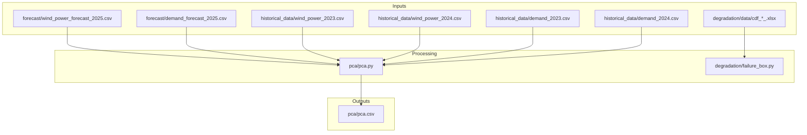
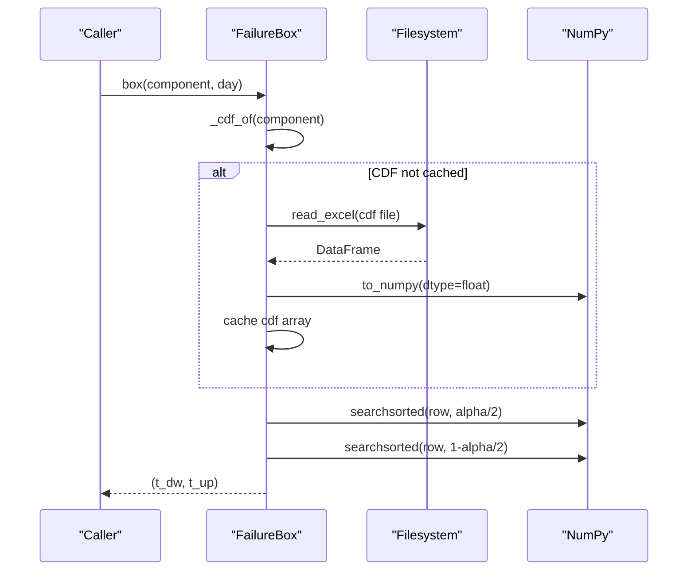
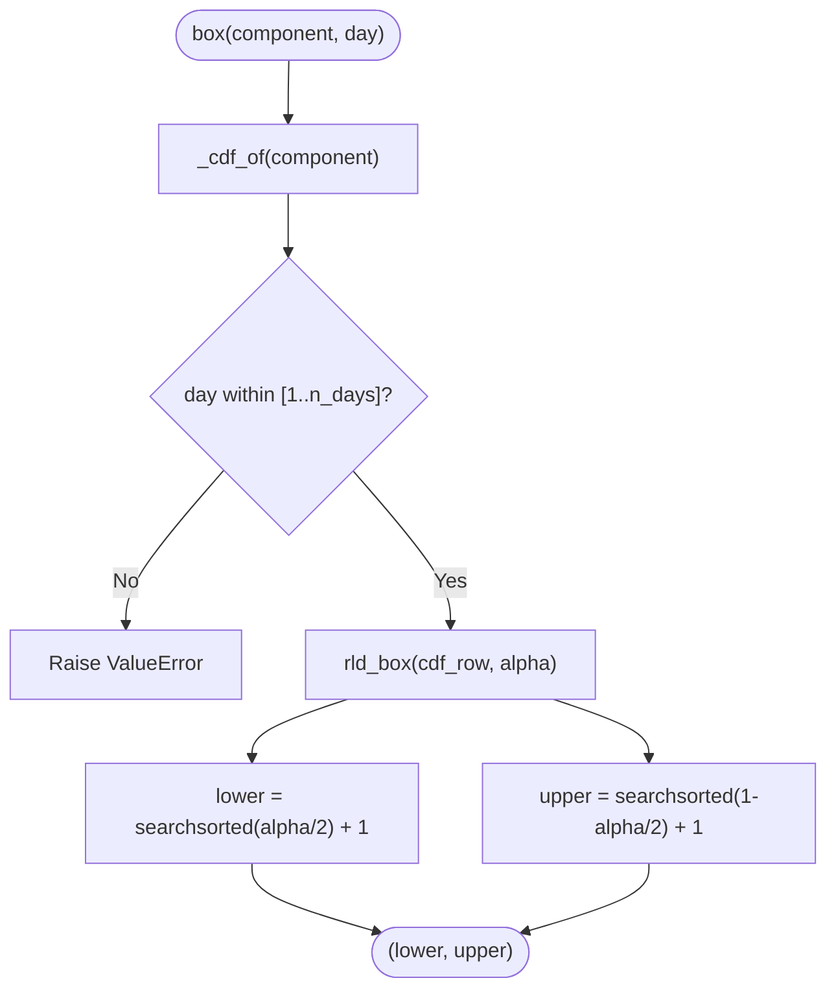
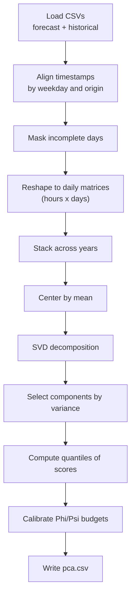
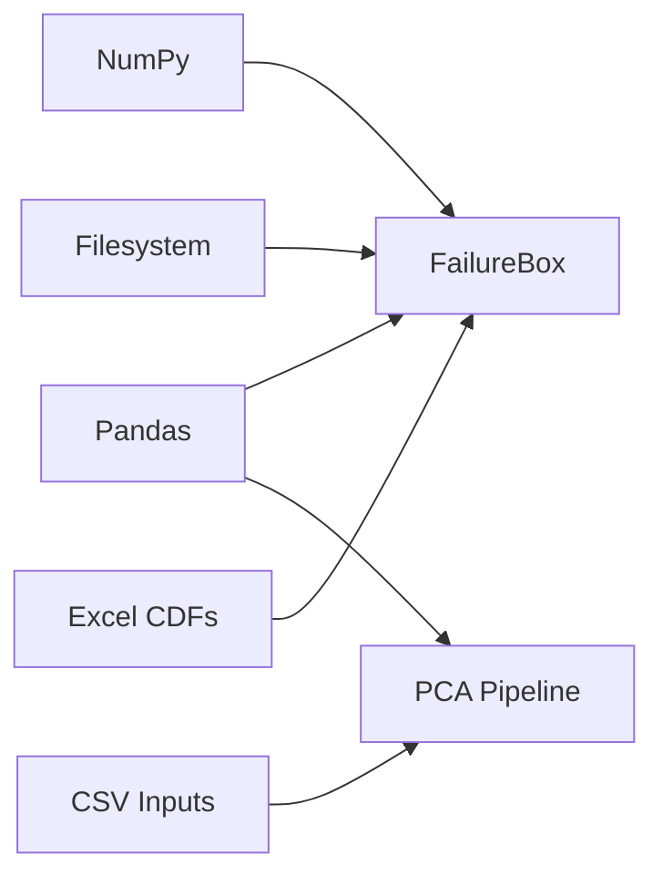

# Performance Optimization and Memory Management

<cite>
**Referenced Files in This Document**
- [failure_box.py](file://degradation/failure_box.py)
- [README.md](file://degradation/README.md)
- [pca.py](file://pca/pca.py)
- [wind_power_forecast_2025.csv](file://forecast/wind_power_forecast_2025.csv)
- [demand_forecast_2025.csv](file://forecast/demand_forecast_2025.csv)
- [wind_power_2023.csv](file://historical_data/wind_power_2023.csv)
- [wind_power_2024.csv](file://historical_data/wind_power_2024.csv)
- [demand_2023.csv](file://historical_data/demand_2023.csv)
- [demand_2024.csv](file://historical_data/demand_2024.csv)
- [pca.csv](file://pca/pca.csv)
</cite>

## Table of Contents
1. [Introduction](#introduction)
2. [Project Structure](#project-structure)
3. [Core Components](#core-components)
4. [Architecture Overview](#architecture-overview)
5. [Detailed Component Analysis](#detailed-component-analysis)
6. [Dependency Analysis](#dependency-analysis)
7. [Performance Considerations](#performance-considerations)
8. [Troubleshooting Guide](#troubleshooting-guide)
9. [Conclusion](#conclusion)
10. [Appendices](#appendices)

## Introduction
This document provides performance optimization and memory management guidance for large-scale wind power datasets in this repository. It focuses on efficient data loading, caching strategies, vectorized numerical computation, parallel processing patterns, I/O optimization for CSV and Excel files, benchmarking methodologies, and scalability considerations. The analysis is grounded in the existing codebase: a failure-box module that loads component CDFs from Excel and computes residual-life intervals, and a PCA module that aligns historical and forecast time series, performs SVD-based dimensionality reduction, and builds uncertainty sets.

## Project Structure
The repository contains:
- Forecast inputs for 2025 (hourly wind power and demand).
- Historical inputs for 2023 and 2024 (hourly wind power and demand).
- A PCA pipeline that aligns forecasts with historical windows, computes SVD, selects components by explained variance, and derives support-set parameters.
- A degradation module that indexes and lazily loads per-component CDFs from Excel to compute central intervals.

**Diagram sources**
- [pca.py:24-31](file://pca/pca.py#L24-L31)
- [pca.py:52-69](file://pca/pca.py#L52-L69)
- [pca.py:149-152](file://pca/pca.py#L149-L152)
- [pca.py:308](file://pca/pca.py#L308)
- [failure_box.py:69-106](file://degradation/failure_box.py#L69-L106)

**Section sources**
- [pca.py:1-323](file://pca/pca.py#L1-L323)
- [failure_box.py:1-134](file://degradation/failure_box.py#L1-L134)
- [README.md:1-53](file://degradation/README.md#L1-L53)

## Core Components
- FailureBox: Lazily loads per-component CDFs from Excel into NumPy arrays, caches them in memory, and computes central residual-life intervals using quantile search.
- PCA pipeline: Loads hourly CSVs, aligns timestamps across forecast and historical windows, constructs daily matrices, centers data, performs SVD, selects principal components by explained variance, computes quantiles, and writes calibrated budget parameters to CSV.

Key performance-relevant behaviors:
- Lazy loading and in-memory caching of CDFs in FailureBox reduce repeated disk reads.
- Vectorized NumPy operations dominate SVD, centering, quantile computations, and matrix multiplications.
- CSV parsing uses pandas with date parsing; Excel reading converts directly to float arrays.

**Section sources**
- [failure_box.py:17-66](file://degradation/failure_box.py#L17-L66)
- [failure_box.py:98-133](file://degradation/failure_box.py#L98-L133)
- [pca.py:24-39](file://pca/pca.py#L24-L39)
- [pca.py:94-152](file://pca/pca.py#L94-L152)
- [pca.py:155-178](file://pca/pca.py#L155-L178)
- [pca.py:184-234](file://pca/pca.py#L184-L234)

## Architecture Overview
The system has two main processing paths:
- Degradation path: Indexes CDF files, loads them on demand, and computes interval bounds via binary search over sorted cumulative probabilities.
- PCA path: Reads multiple CSVs, aligns temporal indices, reshapes to daily matrices, performs SVD, selects components, computes quantiles, and outputs calibration parameters.

**Diagram sources**
- [failure_box.py:32-44](file://degradation/failure_box.py#L32-L44)
- [failure_box.py:55-66](file://degradation/failure_box.py#L55-L66)
- [failure_box.py:98-106](file://degradation/failure_box.py#L98-L106)
- [failure_box.py:109-133](file://degradation/failure_box.py#L109-L133)

## Detailed Component Analysis

### FailureBox: Caching, Validation, and Quantile Search
- Lazy index building: Scans directory once to map component IDs to file paths.
- Lazy CDF loading: Converts Excel to float arrays and caches per component.
- Input validation: Checks alpha range, component existence, day bounds, and CDF shape.
- Interval computation: Uses binary search to find lower and upper quantiles along each row.

Optimization opportunities:
- Use memory-mapped or chunked readers if CDFs are very large.
- Precompute quantile thresholds if alpha is fixed.
- Avoid repeated string parsing by normalizing filenames during indexing.

**Diagram sources**
- [failure_box.py:32-44](file://degradation/failure_box.py#L32-L44)
- [failure_box.py:109-133](file://degradation/failure_box.py#L109-L133)

**Section sources**
- [failure_box.py:17-66](file://degradation/failure_box.py#L17-L66)
- [failure_box.py:69-106](file://degradation/failure_box.py#L69-L106)
- [failure_box.py:109-133](file://degradation/failure_box.py#L109-L133)
- [README.md:32-53](file://degradation/README.md#L32-L53)

### PCA Pipeline: Data Alignment, SVD, and Uncertainty Sets
- Data loading: Reads forecast and historical CSVs, parses timestamps, extracts numeric columns.
- Temporal alignment: Computes aligned historical indices based on weekday matching and origin offsets.
- Daily reshaping: Converts hourly series to daily matrices of shape (hours, days), then stacks across years.
- Centering and SVD: Centers data, computes SVD, selects components by explained variance threshold.
- Uncertainty set construction: Computes quantiles of scores, centers and radii, and calibrates budgets using top-two norms.

Optimization opportunities:
- Vectorize reindexing and masking to avoid Python loops.
- Use in-place operations where possible to reduce allocations.
- Consider sparse representations if many zeros exist in hourly profiles.

**Diagram sources**
- [pca.py:24-39](file://pca/pca.py#L24-L39)
- [pca.py:41-49](file://pca/pca.py#L41-L49)
- [pca.py:71-90](file://pca/pca.py#L71-L90)
- [pca.py:94-117](file://pca/pca.py#L94-L117)
- [pca.py:120-152](file://pca/pca.py#L120-L152)
- [pca.py:155-178](file://pca/pca.py#L155-L178)
- [pca.py:184-234](file://pca/pca.py#L184-L234)
- [pca.py:308](file://pca/pca.py#L308)

**Section sources**
- [pca.py:24-39](file://pca/pca.py#L24-L39)
- [pca.py:41-49](file://pca/pca.py#L41-L49)
- [pca.py:71-90](file://pca/pca.py#L71-L90)
- [pca.py:94-152](file://pca/pca.py#L94-L152)
- [pca.py:155-178](file://pca/pca.py#L155-L178)
- [pca.py:184-234](file://pca/pca.py#L184-L234)
- [pca.py:308](file://pca/pca.py#L308)

## Dependency Analysis
- External libraries:
  - NumPy: Used extensively for vectorized math, SVD, quantiles, and array manipulations.
  - Pandas: Used for CSV/Excel I/O, timestamp parsing, reindexing, and DataFrame operations.
- Internal dependencies:
  - FailureBox depends on filesystem access to locate and read CDF Excel files.
  - PCA depends on multiple CSV inputs and produces a small parameter CSV.

Potential coupling concerns:
- Hardcoded column names and file paths require consistent schema across inputs.
- Excel reader assumes fixed column count for CDFs; changes break validation.

**Diagram sources**
- [failure_box.py:7-8](file://degradation/failure_box.py#L7-L8)
- [pca.py:3-4](file://pca/pca.py#L3-L4)

**Section sources**
- [failure_box.py:7-8](file://degradation/failure_box.py#L7-L8)
- [pca.py:3-4](file://pca/pca.py#L3-L4)

## Performance Considerations

### Memory Management Strategies
- Lazy loading and caching:
  - FailureBox caches loaded CDF arrays keyed by component ID to avoid repeated disk reads.
  - For very large CDF sets, consider an LRU cache with size limits to bound memory usage.
- In-place operations:
  - Prefer in-place arithmetic and view-based slicing to minimize temporary allocations.
- Data types:
  - Ensure float32 where precision allows to halve memory footprint for large arrays.
- Garbage collection:
  - Explicitly delete intermediate arrays after use in long-running pipelines.

### Efficient Data Loading
- CSV:
  - Use dtype specification and column selection to reduce memory overhead.
  - Parse dates only when necessary; otherwise handle timestamps as integers.
- Excel:
  - Convert directly to NumPy arrays and validate shapes immediately to fail fast.
  - Consider parquet or HDF5 for large tabular datasets to improve load times and reduce memory pressure.

### Vectorization Techniques
- NumPy vectorization:
  - SVD, quantiles, broadcasting, and matrix multiplications are already vectorized.
  - Replace Python loops with vectorized operations for speedups.
- Avoid object dtypes:
  - Ensure numeric columns are float/int to leverage optimized BLAS routines.

### Parallel Processing Approaches
- Multiprocessing/joblib:
  - Suitable for independent tasks such as computing intervals per component or per-day blocks.
  - Example pattern: distribute rld_box calls across cores using joblib.Parallel.
- Thread safety:
  - Ensure shared state (like caches) is protected or partitioned per worker.

### I/O Optimization for CSV and Excel
- CSV:
  - Use chunked reading for extremely large files.
  - Pre-filter rows/columns at read time to reduce memory footprint.
- Excel:
  - Batch reads and validate shapes early.
  - Consider converting Excel to a more efficient format (parquet/HDF5) for repeated access.

### Benchmarking Methodologies
- Micro-benchmarks:
  - Time individual functions (e.g., load_cdf, rld_box, SVD step) using timeit.
- Macro-benchmarks:
  - Profile full pipelines with line_profiler or memory_profiler.
- System-level monitoring:
  - Track CPU utilization, memory RSS, and I/O throughput during runs.

### Scalability Considerations
- Larger datasets:
  - Switch to out-of-core methods (Dask, Polars) for CSV/Excel-like workloads.
  - Partition CDF files by component and process partitions in parallel.
- Complex optimization problems:
  - Decompose into smaller linear algebra tasks; exploit block-wise SVD or randomized SVD for approximate solutions.
  - Use GPU-accelerated libraries (CuPy, PyTorch) for large matrix operations.

[No sources needed since this section provides general guidance]

## Troubleshooting Guide
Common issues and resolutions:
- Invalid alpha value:
  - Ensure alpha is strictly between 0 and 1; otherwise raise ValueError.
- Component not found:
  - Verify component ID exists in the indexed CDF files; check naming conventions.
- Day out of range:
  - Validate day against n_days(component); adjust queries accordingly.
- CDF shape mismatch:
  - Ensure each CDF has exactly 500 columns; otherwise raise ValueError.
- Forecast/historical misalignment:
  - Confirm weekday alignment and origin offsets; mismatches raise ValueError.

Operational checks:
- Validate input schemas before running pipelines.
- Monitor memory growth during long runs; clear caches if needed.
- Log errors with context (component ID, day, file path) for faster debugging.

**Section sources**
- [failure_box.py:24-28](file://degradation/failure_box.py#L24-L28)
- [failure_box.py:32-44](file://degradation/failure_box.py#L32-L44)
- [failure_box.py:55-66](file://degradation/failure_box.py#L55-L66)
- [failure_box.py:98-106](file://degradation/failure_box.py#L98-L106)
- [pca.py:32-33](file://pca/pca.py#L32-L33)
- [pca.py:71-72](file://pca/pca.py#L71-L72)

## Conclusion
The repository implements robust, vectorized workflows for wind power forecasting and degradation analysis. FailureBox provides efficient lazy loading and caching of CDFs with validated quantile-based interval computation. The PCA pipeline leverages NumPy’s vectorized capabilities for SVD and uncertainty set construction. To scale further, adopt out-of-core formats, parallelize independent tasks, and monitor memory and I/O bottlenecks. These practices will ensure high performance and reliability for larger datasets and more complex optimization problems.

[No sources needed since this section summarizes without analyzing specific files]

## Appendices

### Data Models and Shapes
- Forecast CSVs:
  - wind_power_forecast_2025.csv: hourly wind power projections with median and quantiles.
  - demand_forecast_2025.csv: hourly demand projections with median values.
- Historical CSVs:
  - wind_power_2023.csv, wind_power_2024.csv: hourly historical wind power.
  - demand_2023.csv, demand_2024.csv: hourly historical demand.
- PCA output:
  - pca.csv: calibrated parameters including centers, radii, component counts, and budget thresholds.

**Section sources**
- [wind_power_forecast_2025.csv:1-10](file://forecast/wind_power_forecast_2025.csv#L1-L10)
- [demand_forecast_2025.csv:1-10](file://forecast/demand_forecast_2025.csv#L1-L10)
- [wind_power_2023.csv:1-10](file://historical_data/wind_power_2023.csv#L1-L10)
- [pca.csv:1-18](file://pca/pca.csv#L1-L18)