# System Integration and Extension Patterns

<cite>
**Referenced Files in This Document**   
- [failure_box.py](file://degradation/failure_box.py)
- [README.md](file://degradation/README.md)
- [pca.py](file://pca/pca.py)
</cite>

## Table of Contents
1. [Introduction](#introduction)
2. [Project Structure](#project-structure)
3. [Core Components](#core-components)
4. [Architecture Overview](#architecture-overview)
5. [Detailed Component Analysis](#detailed-component-analysis)
6. [Dependency Analysis](#dependency-analysis)
7. [Performance Considerations](#performance-considerations)
8. [Troubleshooting Guide](#troubleshooting-guide)
9. [Conclusion](#conclusion)
10. [Appendices](#appendices)

## Introduction
This document explains how to extend the wind power degradation system with external components and custom functionality. It focuses on:
- Integrating optimization solvers such as CVXPY, Gurobi, or Pyomo for robust optimization problems.
- Building adapter patterns for connecting to data sources beyond CSV and Excel.
- Customizing visualizations using Matplotlib for specialized plots and dashboards.
- Creating custom degradation models by extending the FailureBox class.
- Designing APIs that expose system functionality to other applications.
- Testing integrated systems and maintaining compatibility across versions.

The guidance is grounded in the existing codebase, particularly the degradation module’s FailureBox implementation and the PCA-based uncertainty set construction used for robust planning.

## Project Structure
At a high level, the repository contains:
- A degradation module that provides residual-life interval estimates from component CDFs.
- A PCA module that builds uncertainty sets from historical forecast errors and produces visualization outputs.
- Forecast and historical data directories containing time series inputs.
- Supporting files such as PCA parameters and configuration artifacts.

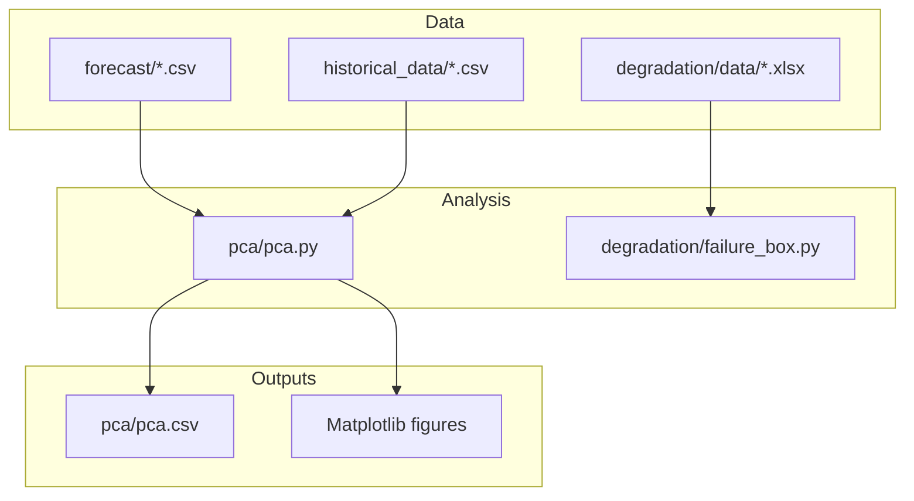

**Diagram sources**
- [pca.py:24-38](file://pca/pca.py#L24-L38)
- [pca.py:46-69](file://pca/pca.py#L46-L69)
- [pca.py:149-178](file://pca/pca.py#L149-L178)
- [pca.py:240-308](file://pca/pca.py#L240-L308)
- [failure_box.py:11-14](file://degradation/failure_box.py#L11-L14)
- [failure_box.py:69-106](file://degradation/failure_box.py#L69-L106)

**Section sources**
- [pca.py:1-38](file://pca/pca.py#L1-L38)
- [failure_box.py:1-14](file://degradation/failure_box.py#L1-L14)

## Core Components
- FailureBox: Provides central residual-life intervals for each component at a given forecast day, based on precomputed CDFs stored as Excel files. It validates inputs, lazily loads CDFs, caches them in memory, and computes quantile-based intervals.
- PCA pipeline: Aligns forecast and historical data, computes error distributions, performs SVD-based dimensionality reduction, constructs uncertainty sets, calibrates budgets, and generates plots and parameter tables.

Key responsibilities:
- Data ingestion and alignment (PCA).
- Uncertainty set construction and budget calibration (PCA).
- Residual-life interval computation per component (FailureBox).
- Visualization and artifact export (PCA).

**Section sources**
- [failure_box.py:17-66](file://degradation/failure_box.py#L17-L66)
- [failure_box.py:69-106](file://degradation/failure_box.py#L69-L106)
- [failure_box.py:109-133](file://degradation/failure_box.py#L109-L133)
- [pca.py:24-69](file://pca/pca.py#L24-L69)
- [pca.py:149-178](file://pca/pca.py#L149-L178)
- [pca.py:240-308](file://pca/pca.py#L240-L308)

## Architecture Overview
The system can be viewed as a layered architecture:
- Data Layer: CSV and Excel sources for forecasts, historical series, and component CDFs.
- Analytics Layer: PCA-based uncertainty set construction and FailureBox-based residual-life estimation.
- Optimization Layer: External solvers (CVXPY, Gurobi, Pyomo) solving robust optimization problems over the constructed uncertainty sets.
- Visualization Layer: Matplotlib-based plotting and dashboard generation.
- API Layer: Optional service layer exposing analytics and optimization results to consumers.

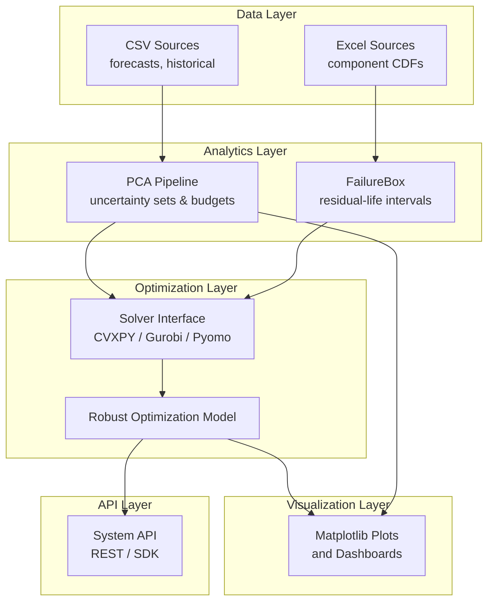

[No diagram sources needed since this diagram shows conceptual architecture, not direct code mapping]

## Detailed Component Analysis

### FailureBox: Residual-Life Interval Engine
FailureBox encapsulates:
- Input validation for alpha and component/day ranges.
- Lazy loading and caching of component CDFs from Excel files.
- Quantile-based interval computation for residual life.

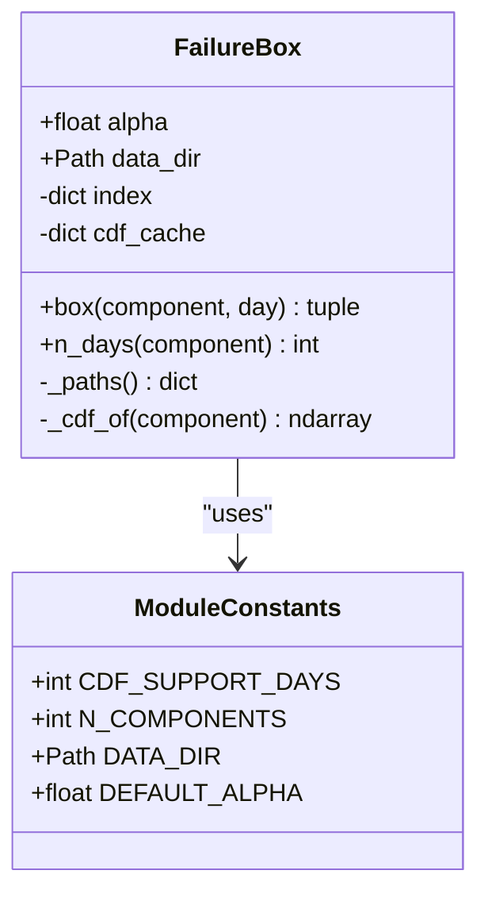

**Diagram sources**
- [failure_box.py:11-14](file://degradation/failure_box.py#L11-L14)
- [failure_box.py:17-66](file://degradation/failure_box.py#L17-L66)

Key behaviors:
- build_component_index scans for CDF files and validates naming and component ranges.
- load_cdf reads an Excel file into a NumPy array and enforces shape constraints.
- rld_box computes lower and upper bounds via searchsorted on quantiles.

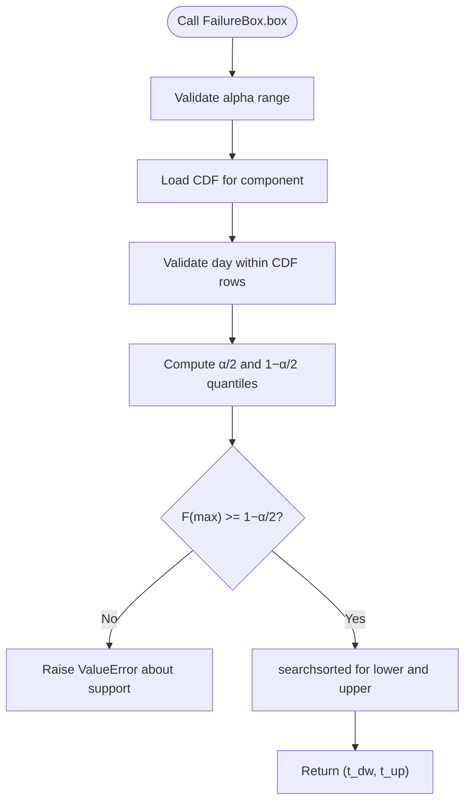

**Diagram sources**
- [failure_box.py:24-44](file://degradation/failure_box.py#L24-L44)
- [failure_box.py:109-133](file://degradation/failure_box.py#L109-L133)

Integration guidance:
- Use FailureBox to supply residual-life intervals to optimization constraints.
- Cache results when querying multiple days/components to avoid repeated I/O.
- Wrap calls with explicit error handling to surface invalid inputs or missing CDFs.

**Section sources**
- [failure_box.py:17-66](file://degradation/failure_box.py#L17-L66)
- [failure_box.py:69-106](file://degradation/failure_box.py#L69-L106)
- [failure_box.py:109-133](file://degradation/failure_box.py#L109-L133)
- [README.md:1-53](file://degradation/README.md#L1-L53)

### PCA Uncertainty Set Construction
The PCA module:
- Loads forecast and historical CSVs and aligns timestamps.
- Computes bias-corrected errors and applies SVD to derive principal components.
- Builds uncertainty sets centered around quantiles and calibrates budgets Phi and Psi.
- Produces Matplotlib visualizations and exports PCA parameters to CSV.

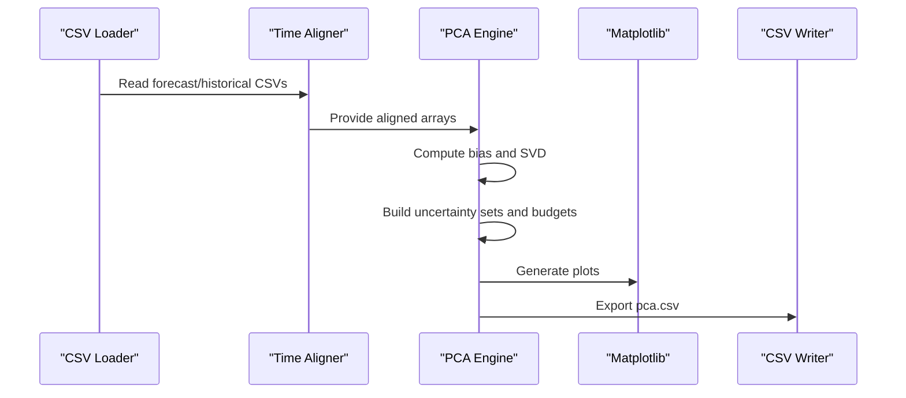

**Diagram sources**
- [pca.py:24-38](file://pca/pca.py#L24-L38)
- [pca.py:46-69](file://pca/pca.py#L46-L69)
- [pca.py:149-178](file://pca/pca.py#L149-L178)
- [pca.py:240-308](file://pca/pca.py#L240-L308)

Integration guidance:
- Reuse PCA outputs (c, a, s, r, Phi, Psi) as inputs to robust optimization models.
- Validate variance thresholds and orthogonality checks before downstream use.
- Extend visualization functions to add customized panels or export additional metrics.

**Section sources**
- [pca.py:24-69](file://pca/pca.py#L24-L69)
- [pca.py:149-178](file://pca/pca.py#L149-L178)
- [pca.py:240-308](file://pca/pca.py#L240-L308)

### Optimization Solver Integration Patterns
Patterns for integrating CVXPY, Gurobi, or Pyomo:
- Define a solver interface abstraction that accepts:
  - Decision variables and constraints.
  - Objective function.
  - Uncertainty set parameters (c, a, s, r, Phi, Psi).
  - Residual-life intervals from FailureBox.
- Implement concrete adapters for each solver backend.
- Provide a unified solve method returning solution status, objective value, and decision variable values.

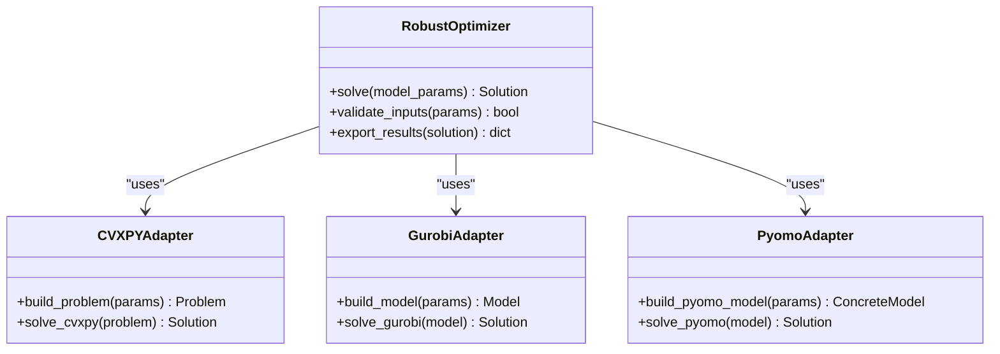

[No diagram sources needed since this diagram shows conceptual integration pattern, not actual code structure]

Implementation tips:
- Map PCA-derived uncertainty sets to robust constraints (e.g., worst-case bounds).
- Incorporate FailureBox intervals as operational constraints (e.g., maintenance windows).
- Standardize result objects with fields like status, objective_value, variables, and diagnostics.

### Data Source Adapter Pattern
To connect to custom data sources beyond CSV and Excel:
- Define a DataSource interface with methods for reading time series and metadata.
- Implement adapters for specific formats (e.g., Parquet, JSON, database connectors).
- Ensure consistent column names and timestamp parsing across adapters.

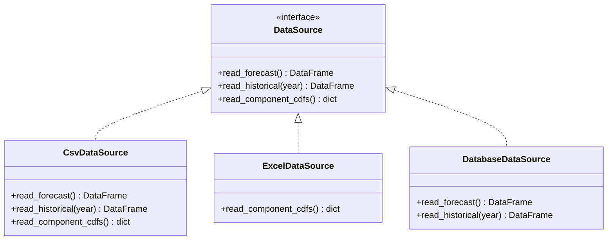

[No diagram sources needed since this diagram shows conceptual adapter pattern, not actual code structure]

### Visualization Customization with Matplotlib
Techniques:
- Extend existing plot functions to add new panels (e.g., residual-life bands, maintenance schedules).
- Create reusable chart builders for dashboards (e.g., Plotly-backed dashboards built on Matplotlib figures).
- Parameterize colors, labels, and legends to support multiple scenarios.

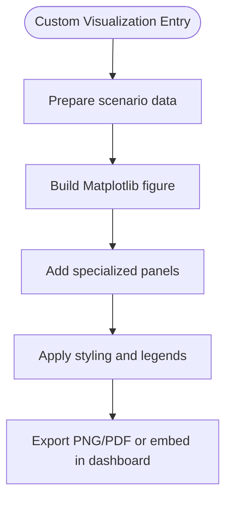

[No diagram sources needed since this diagram shows conceptual workflow, not actual code structure]

### Extending FailureBox for Custom Degradation Models
Approach:
- Subclass FailureBox to override box computation logic.
- Inject alternative CDF loaders or dynamic data sources.
- Maintain backward compatibility by preserving the public API signature.

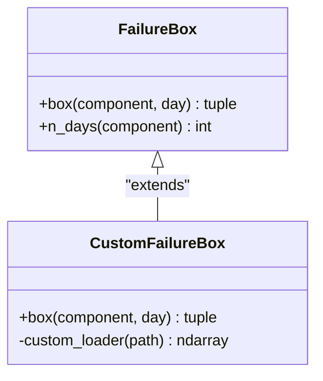

[No diagram sources needed since this diagram shows conceptual extension pattern, not actual code structure]

### API Design Patterns for Exposing Functionality
Recommendations:
- REST endpoints for:
  - Computing residual-life intervals.
  - Running robust optimization scenarios.
  - Retrieving PCA parameters and visualizations.
- SDK-style Python client wrapping HTTP requests.
- Versioned API paths (e.g., /api/v1/) to maintain compatibility.

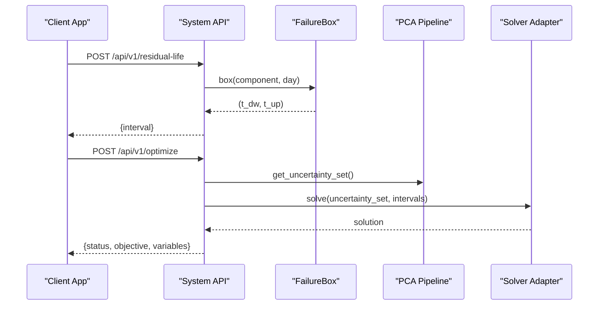

[No diagram sources needed since this diagram shows conceptual API flow, not actual code structure]

## Dependency Analysis
Internal dependencies:
- PCA depends on CSV data loaders and Matplotlib for visualization.
- FailureBox depends on Excel CDF files and NumPy/Pandas for array operations.

External dependencies:
- Optimization integrations depend on solver libraries (CVXPY, Gurobi, Pyomo).
- Visualization may integrate with dashboard frameworks (e.g., Streamlit, Dash).

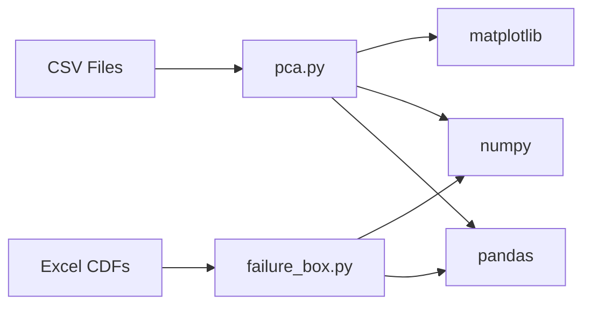

**Diagram sources**
- [pca.py:24-38](file://pca/pca.py#L24-L38)
- [pca.py:240-308](file://pca/pca.py#L240-L308)
- [failure_box.py:7-8](file://degradation/failure_box.py#L7-L8)
- [failure_box.py:98-106](file://degradation/failure_box.py#L98-L106)

**Section sources**
- [pca.py:24-38](file://pca/pca.py#L24-L38)
- [failure_box.py:7-8](file://degradation/failure_box.py#L7-L8)

## Performance Considerations
- Caching: FailureBox caches loaded CDFs; ensure cache size limits if many components are queried.
- Vectorization: PCA uses NumPy vectorized operations; avoid loops over hours/days.
- Solver selection: Choose solvers based on problem size and constraint types; warm-start where possible.
- I/O batching: Batch read operations for large datasets; consider memory-mapped files for very large CDFs.

[No sources needed since this section provides general guidance]

## Troubleshooting Guide
Common issues and resolutions:
- Invalid alpha range: Ensure alpha is strictly between 0 and 1.
- Day out of bounds: Verify day indices against component-specific n_days.
- Missing CDF files: Confirm file naming convention and component numbering.
- Support coverage failure: If F(max) does not reach required quantile, adjust alpha or extend support.
- Time alignment errors: Ensure forecast and historical timestamps align by day-of-week and origin dates.
- Variance threshold failures: Increase PCA variance threshold or adjust number of components.

**Section sources**
- [failure_box.py:24-44](file://degradation/failure_box.py#L24-L44)
- [failure_box.py:109-133](file://degradation/failure_box.py#L109-L133)
- [pca.py:71-73](file://pca/pca.py#L71-L73)
- [pca.py:169-178](file://pca/pca.py#L169-L178)

## Conclusion
Extending the wind power degradation system involves:
- Leveraging FailureBox for residual-life intervals and PCA for uncertainty sets.
- Integrating robust optimization solvers through a clean adapter interface.
- Building flexible data source adapters for diverse input formats.
- Customizing visualizations with Matplotlib for specialized insights.
- Designing versioned APIs to expose capabilities to external applications.
- Applying rigorous testing and compatibility practices to maintain reliability across versions.

[No sources needed since this section summarizes without analyzing specific files]

## Appendices

### Appendix A: Using FailureBox
- Initialize FailureBox with default or custom data directory and alpha.
- Query residual-life intervals for components and days.
- Handle exceptions for invalid inputs or missing data.

**Section sources**
- [failure_box.py:24-44](file://degradation/failure_box.py#L24-L44)
- [README.md:32-53](file://degradation/README.md#L32-L53)

### Appendix B: PCA Outputs
- Retrieve uncertainty set parameters (c, a, s, r, Phi, Psi) from pca.csv.
- Use these parameters to construct robust constraints in optimization models.

**Section sources**
- [pca.py:290-308](file://pca/pca.py#L290-L308)