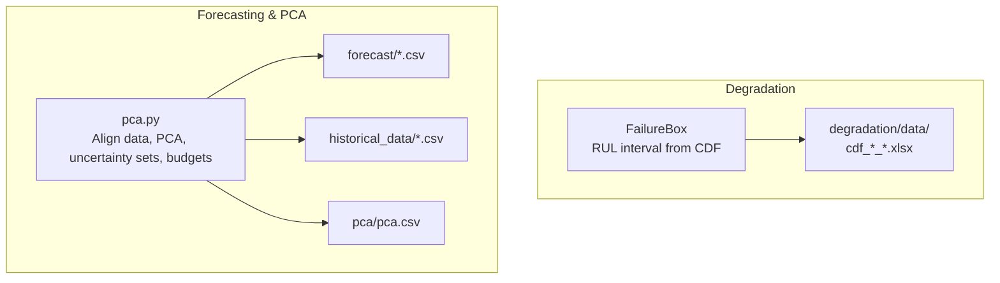
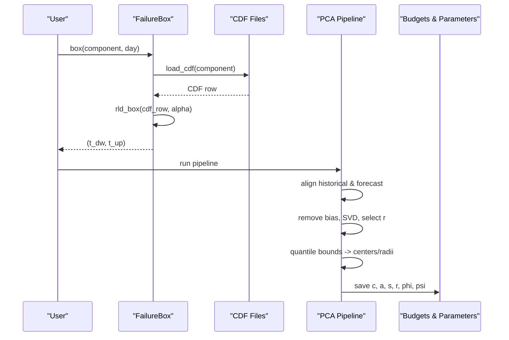
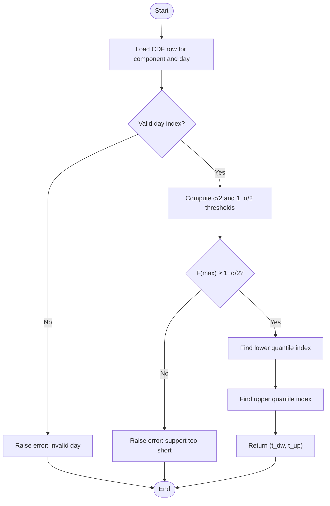
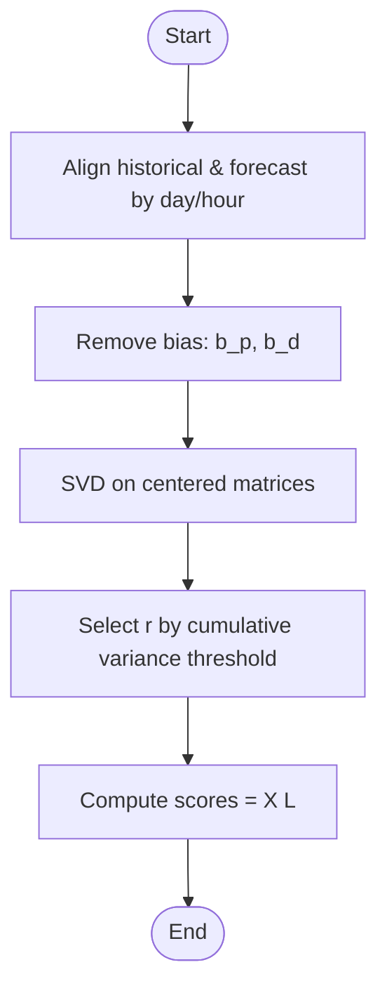
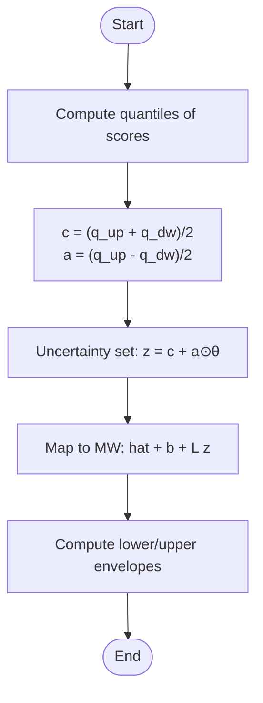
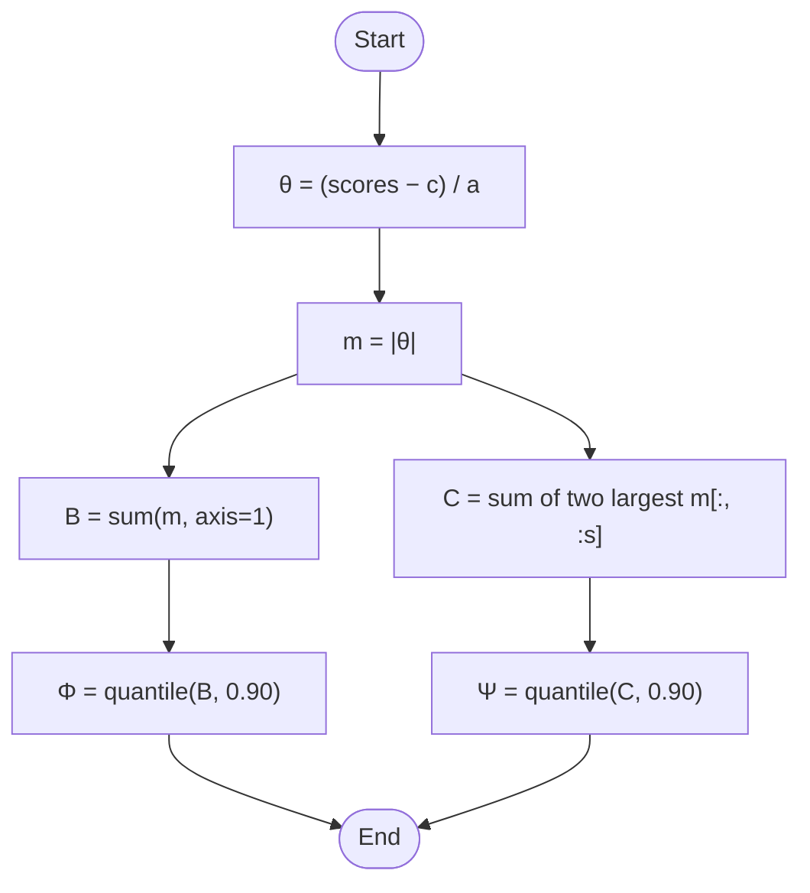
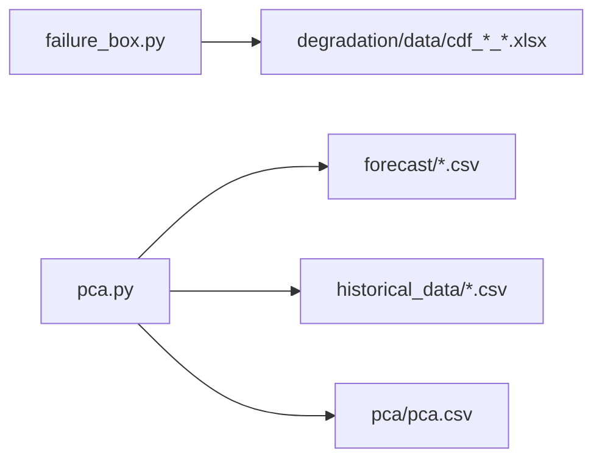

# Core Concepts

<cite>
**Referenced Files in This Document**
- [failure_box.py](file://degradation/failure_box.py)
- [README.md](file://degradation/README.md)
- [pca.py](file://pca/pca.py)
- [pca.csv](file://pca/pca.csv)
</cite>

## Table of Contents
1. [Introduction](#introduction)
2. [Project Structure](#project-structure)
3. [Core Components](#core-components)
4. [Architecture Overview](#architecture-overview)
5. [Detailed Component Analysis](#detailed-component-analysis)
6. [Dependency Analysis](#dependency-analysis)
7. [Performance Considerations](#performance-considerations)
8. [Troubleshooting Guide](#troubleshooting-guide)
9. [Conclusion](#conclusion)

## Introduction
This document explains the fundamental statistical and optimization concepts powering the wind power degradation and forecasting system. It focuses on:
- Cumulative Distribution Functions (CDFs) for reliability engineering and their use in Remaining Useful Life (RUL) estimation.
- Principal Component Analysis (PCA) fundamentals, including Singular Value Decomposition (SVD), variance threshold selection, and dimensionality reduction.
- Uncertainty quantification via confidence intervals, quantile-based methods, and uncertainty set construction.
- RUL estimation methodology applied to wind turbine components.
- Mathematical foundations for budget parameter calibration used in robust optimization constraints.

The goal is to make these concepts accessible to newcomers while providing enough depth for experienced practitioners.

## Project Structure
At a high level, the repository contains:
- Degradation module implementing CDF-based RUL interval estimation per component.
- PCA module that aligns historical and forecast data, performs SVD-based PCA, constructs uncertainty sets, and calibrates budgets for robust optimization.
- Forecast and historical CSV datasets consumed by the PCA pipeline.
- A small output CSV summarizing PCA-derived parameters.

**Diagram sources**
- [failure_box.py:17-66](file://degradation/failure_box.py#L17-L66)
- [pca.py:24-38](file://pca/pca.py#L24-L38)
- [pca.py:147-167](file://pca/pca.py#L147-L167)
- [pca.py:204-234](file://pca/pca.py#L204-L234)

**Section sources**
- [README.md:1-53](file://degradation/README.md#L1-L53)
- [pca.py:1-38](file://pca/pca.py#L1-L38)

## Core Components
- FailureBox: Computes central RUL intervals from component-specific CDFs using quantiles.
- PCA Pipeline: Aligns historical and forecast time series, removes bias, applies SVD-based PCA, selects dimensions by explained variance, builds quantile-based uncertainty sets, and calibrates budgets for robust constraints.

Key responsibilities:
- Reliability: Map daily forecasts to RUL distributions and return conservative intervals.
- Uncertainty modeling: Represent multivariate forecast errors as low-dimensional uncertain vectors with calibrated budgets.

**Section sources**
- [failure_box.py:17-66](file://degradation/failure_box.py#L17-L66)
- [pca.py:147-167](file://pca/pca.py#L147-L167)
- [pca.py:180-234](file://pca/pca.py#L180-L234)

## Architecture Overview
The system integrates two main pipelines:
- Degradation-to-RUL: For each component j, load its CDF and compute a central interval at day t.
- Forecast-to-Uncertainty-Sets: Align historical and forecast data, perform PCA, construct an uncertainty set in PCA space, and derive budgets for robust optimization.

**Diagram sources**
- [failure_box.py:32-44](file://degradation/failure_box.py#L32-L44)
- [failure_box.py:98-133](file://degradation/failure_box.py#L98-L133)
- [pca.py:41-49](file://pca/pca.py#L41-L49)
- [pca.py:147-167](file://pca/pca.py#L147-L167)
- [pca.py:180-234](file://pca/pca.py#L180-L234)

## Detailed Component Analysis

### Cumulative Distribution Functions and RUL Estimation
Concepts:
- A CDF F(k) gives the probability that remaining life is at most k days.
- The central interval at confidence level 1−α is defined by lower and upper quantiles:
  - t_dw = min{k : F(k) ≥ α/2}
  - t_up = min{k : F(k) ≥ 1 − α/2}
- Implementation uses searchsorted over the discretized support (days 1..500).

Implementation highlights:
- FailureBox caches CDFs per component and validates inputs.
- rld_box computes the central interval given a single CDF row and α.
- build_component_index maps component IDs to file paths and enforces naming conventions and ranges.

**Diagram sources**
- [failure_box.py:109-133](file://degradation/failure_box.py#L109-L133)

Practical notes:
- Default α = 0.1 yields a 90% central interval.
- If the CDF does not reach 1−α/2 within the support, the query fails rather than truncating the interval.

**Section sources**
- [failure_box.py:17-66](file://degradation/failure_box.py#L17-L66)
- [failure_box.py:69-106](file://degradation/failure_box.py#L69-L106)
- [failure_box.py:109-133](file://degradation/failure_box.py#L109-L133)
- [README.md:19-30](file://degradation/README.md#L19-L30)

### Principal Component Analysis Fundamentals
Concepts:
- PCA reduces dimensionality by projecting centered data onto orthogonal directions (principal components) that capture maximal variance.
- SVD decomposes the data matrix X into UΣV^T; V provides principal directions, Σ contains singular values proportional to explained variance.
- Variance threshold selection chooses the smallest r such that cumulative explained variance reaches a target (e.g., 95%).

Implementation highlights:
- Historical and forecast series are aligned by day-of-week and hour-of-day across years.
- Bias removal: subtract mean error vectors b_p and b_d to obtain centered matrices x_p and x_d.
- SVD is performed on transposed centered matrices to get scores and loadings.
- Explained variance ratio determines r_p and r_d.

**Diagram sources**
- [pca.py:41-49](file://pca/pca.py#L41-L49)
- [pca.py:120-136](file://pca/pca.py#L120-L136)
- [pca.py:147-167](file://pca/pca.py#L147-L167)

Dimensionality reduction principles:
- Retaining top r components captures most variability while reducing noise.
- Orthonormality of loadings ensures decorrelated projections.

**Section sources**
- [pca.py:41-49](file://pca/pca.py#L41-L49)
- [pca.py:120-167](file://pca/pca.py#L120-L167)

### Uncertainty Quantification: Confidence Intervals, Quantiles, and Uncertainty Sets
Concepts:
- Confidence intervals: Central intervals derived from CDF quantiles for RUL.
- Quantile-based uncertainty sets: Use empirical quantiles of PCA scores to define centers c and radii a in reduced space.
- Uncertainty set construction: z = c + a ⊙ θ with θ ∈ [−1, 1]^r defines a hyperrectangle in PCA coordinates; mapping back to original space yields MW-level envelopes.

Implementation highlights:
- Quantiles at 10th and 90th percentiles of scores produce c and a.
- Support visualization transforms PCA-space boxes back to MW units using loadings L and bias b.

**Diagram sources**
- [pca.py:180-199](file://pca/pca.py#L180-L199)
- [pca.py:242-249](file://pca/pca.py#L242-L249)

**Section sources**
- [pca.py:180-199](file://pca/pca.py#L180-L199)
- [pca.py:242-249](file://pca/pca.py#L242-L249)

### Budget Parameter Calibration for Robust Optimization Constraints
Concepts:
- Budgets constrain the magnitude of uncertainties in robust optimization:
  - B sums absolute deviations across all components.
  - C aggregates the two largest absolute deviations among the first s components (pairwise budget).
- Calibration: Choose Φ and Ψ as quantiles (e.g., 90%) of B and C computed from training scores.

Mathematical foundation:
- Transform scores to normalized deviations: θ = (z − c) / a.
- Compute B = ||θ||_1 and C = sum of two largest |θ_j| among first s components.
- Set Φ = quantile(B, 0.90), Ψ = quantile(C, 0.90).

Implementation highlights:
- _componentes_pares selects s ensuring at least two components contribute pairwise.
- _presupuestos computes θ, B, C, Φ, Ψ and validates non-zero widths a.

**Diagram sources**
- [pca.py:204-228](file://pca/pca.py#L204-L228)

Outputs:
- pca.csv stores group, component indices, centers c, radii a, s, r, and calibrated budgets φ, ψ.

**Section sources**
- [pca.py:204-234](file://pca/pca.py#L204-L234)
- [pca.csv:1-18](file://pca/pca.csv#L1-L18)

### Remaining Useful Life (RUL) Estimation Methodology
Methodology:
- For each component j, maintain a CDF over remaining life in days up to 500.
- At forecast day t, extract the corresponding CDF row and compute the central interval at confidence level 1−α.
- The interval (t_dw, t_up) represents conservative bounds on future failure timing relative to day t.

Application to wind turbine components:
- Each sensor signal contributes multiple components (j = 1..100).
- Operators can monitor RUL intervals to schedule maintenance proactively.

Operational guidance:
- Use FailureBox.box(j, t) to retrieve intervals.
- Inspect n_days(j) to know the horizon available for component j.

**Section sources**
- [failure_box.py:17-66](file://degradation/failure_box.py#L17-L66)
- [failure_box.py:98-133](file://degradation/failure_box.py#L98-L133)
- [README.md:7-17](file://degradation/README.md#L7-L17)

## Dependency Analysis
High-level dependencies:
- FailureBox depends on CDF Excel files under degradation/data.
- PCA pipeline depends on forecast and historical CSVs, outputs parameters to pca/pca.csv.

**Diagram sources**
- [failure_box.py:69-106](file://degradation/failure_box.py#L69-L106)
- [pca.py:24-38](file://pca/pca.py#L24-L38)
- [pca.py:308-308](file://pca/pca.py#L308-L308)

**Section sources**
- [failure_box.py:69-106](file://degradation/failure_box.py#L69-L106)
- [pca.py:24-38](file://pca/pca.py#L24-L38)
- [pca.py:308-308](file://pca/pca.py#L308-L308)

## Performance Considerations
- Caching: FailureBox caches loaded CDF arrays per component to avoid repeated I/O.
- Vectorization: PCA uses NumPy vectorized operations for bias removal, SVD, quantiles, and budget computation.
- Dimensionality control: Selecting r via variance thresholds reduces computational cost downstream.
- Memory layout: Reshaping hourly data into daily matrices improves efficiency of batch processing.

[No sources needed since this section provides general guidance]

## Troubleshooting Guide
Common issues and resolutions:
- Invalid α: Ensure α ∈ (0, 1); otherwise ValueError is raised.
- Day index out of range: Verify day is within [1, n_days(component)].
- CDF support too short: If F(500) < 1−α/2, increase α or extend support.
- Mismatched forecast timestamps: Wind and demand forecasts must share identical timestamps.
- Weekday misalignment: Historical and forecast series must align by day-of-week.
- Incomplete days: Days with missing hours are excluded; check diagnostics for omitted dates.
- Non-orthogonal loadings: Validation checks ensure orthonormality of L_p and L_d.
- Zero-width components: Radii a must be positive; otherwise budget computation raises an error.

Actionable steps:
- Validate input ranges and file naming conventions for CDFs.
- Re-run alignment checks and inspect day masks for missing data.
- Adjust α or extend CDF support if quantile coverage is insufficient.
- Confirm dataset integrity and timestamp synchronization.

**Section sources**
- [failure_box.py:24-28](file://degradation/failure_box.py#L24-L28)
- [failure_box.py:32-44](file://degradation/failure_box.py#L32-L44)
- [failure_box.py:109-133](file://degradation/failure_box.py#L109-L133)
- [pca.py:32-33](file://pca/pca.py#L32-L33)
- [pca.py:71-72](file://pca/pca.py#L71-L72)
- [pca.py:169-178](file://pca/pca.py#L169-L178)
- [pca.py:214-228](file://pca/pca.py#L214-L228)

## Conclusion
This system combines reliability-driven RUL estimation with data-driven uncertainty quantification:
- CDF-based RUL intervals provide actionable maintenance windows for wind turbine components.
- PCA and SVD enable compact representation of forecast errors, supporting efficient robust optimization through calibrated budgets.
- Together, these tools offer a principled framework for proactive operation and risk-aware decision-making in wind power systems.

[No sources needed since this section summarizes without analyzing specific files]