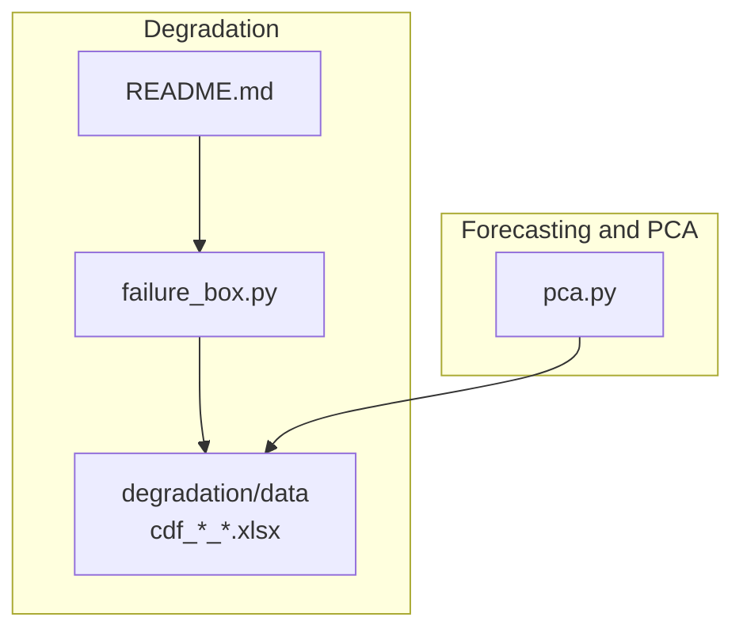
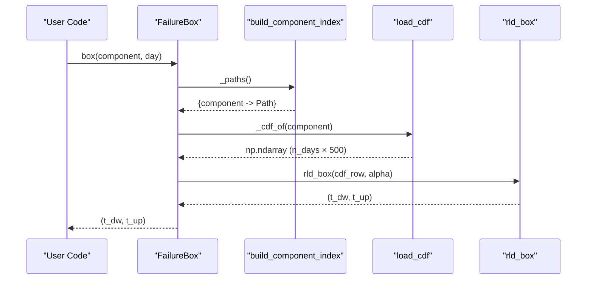
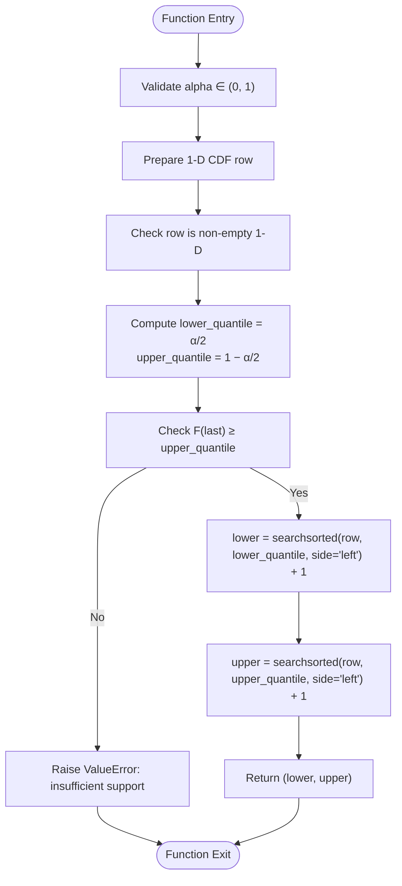
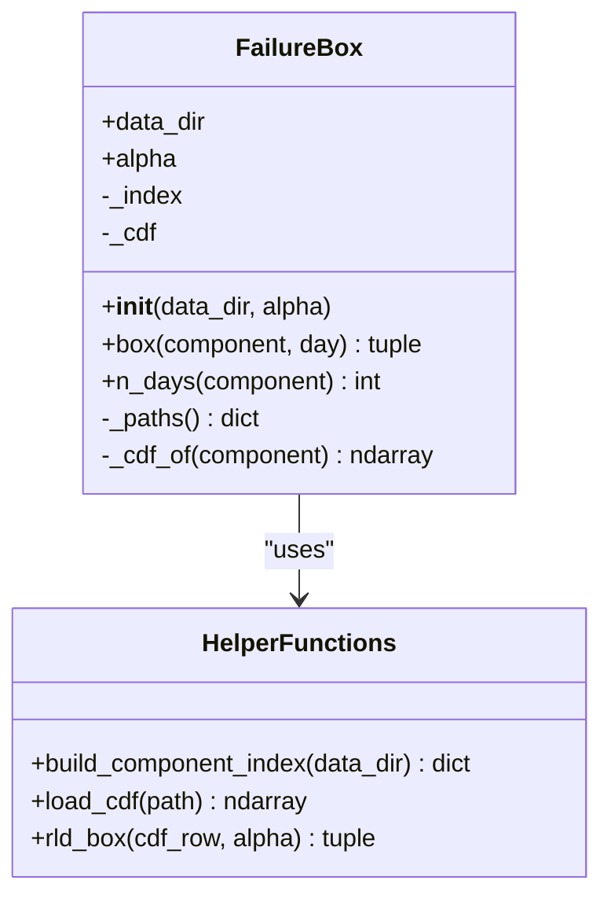
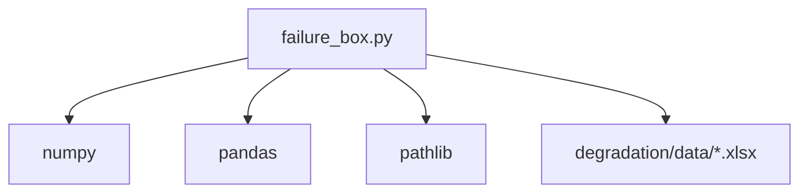

# Cumulative Distribution Functions in Reliability Engineering

<cite>
**Referenced Files in This Document**
- [failure_box.py](file://degradation/failure_box.py)
- [README.md](file://degradation/README.md)
- [pca.py](file://pca/pca.py)
</cite>

## Table of Contents
1. [Introduction](#introduction)
2. [Project Structure](#project-structure)
3. [Core Components](#core-components)
4. [Architecture Overview](#architecture-overview)
5. [Detailed Component Analysis](#detailed-component-analysis)
6. [Dependency Analysis](#dependency-analysis)
7. [Performance Considerations](#performance-considerations)
8. [Troubleshooting Guide](#troubleshooting-guide)
9. [Conclusion](#conclusion)

## Introduction
This document explains how cumulative distribution functions (CDFs) model the remaining useful life of wind turbine components and how they are used to generate confidence intervals for reliability analysis. The implementation focuses on a component-specific CDF per degradation signal, where each row represents a forecast day and each column represents a discrete remaining-life horizon up to 500 days. The codebase provides a practical interface to load these CDFs, index them by component, and compute central intervals using quantiles derived from the CDF values.

The core ideas are:
- A CDF F(k) gives the probability that the remaining useful life is at most k days.
- For a chosen confidence level 1 − α, the central interval is defined by lower and upper quantiles of F.
- Quantiles are computed with a searchsorted-based algorithm over the sorted support of remaining-life days.
- Data files follow a strict naming convention and matrix shape, with 1-based indexing for both days and remaining-life horizons.

## Project Structure
The relevant parts of the repository for this topic are:
- degradation/failure_box.py: Implements the FailureBox class and helper functions to build an index of component CDF files, load CDF matrices, and compute remaining-life intervals.
- degradation/README.md: Documents the data layout, file naming conventions, and usage examples for the CDF-based box computation.
- pca/pca.py: Provides context about upstream forecasting and uncertainty modeling; it uses quantile computations but is not directly responsible for component CDF loading or RUL intervals.

**Diagram sources**
- [failure_box.py:17-66](file://degradation/failure_box.py#L17-L66)
- [README.md:7-17](file://degradation/README.md#L7-L17)
- [pca.py:24-38](file://pca/pca.py#L24-L38)

**Section sources**
- [failure_box.py:1-134](file://degradation/failure_box.py#L1-L134)
- [README.md:1-53](file://degradation/README.md#L1-L53)
- [pca.py:1-323](file://pca/pca.py#L1-L323)

## Core Components
The primary component for CDF-based reliability analysis is the FailureBox class and its supporting functions:
- FailureBox: Encapsulates component CDF loading, caching, and querying to return a central interval of remaining useful life for a given component and day.
- build_component_index: Scans the data directory for CDF files and builds a mapping from component number to file path.
- load_cdf: Reads a CDF Excel file into a NumPy array and validates its shape.
- rld_box: Computes the central interval bounds using quantiles and searchsorted.

Key responsibilities:
- Validate alpha and input ranges.
- Enforce 1-based indexing for days and remaining-life horizons.
- Ensure CDF matrices have exactly 500 columns representing the maximum support horizon.
- Cache loaded CDFs per component to avoid repeated disk reads.

**Section sources**
- [failure_box.py:17-66](file://degradation/failure_box.py#L17-L66)
- [failure_box.py:69-106](file://degradation/failure_box.py#L69-L106)
- [failure_box.py:109-133](file://degradation/failure_box.py#L109-L133)

## Architecture Overview
The system architecture connects data files to the FailureBox API and exposes a simple interface for generating remaining-life intervals.

**Diagram sources**
- [failure_box.py:32-44](file://degradation/failure_box.py#L32-L44)
- [failure_box.py:50-66](file://degradation/failure_box.py#L50-L66)
- [failure_box.py:69-95](file://degradation/failure_box.py#L69-L95)
- [failure_box.py:98-106](file://degradation/failure_box.py#L98-L106)
- [failure_box.py:109-133](file://degradation/failure_box.py#L109-L133)

## Detailed Component Analysis

### Mathematical Foundations of F(k) and Interpretation
- F(k) is the cumulative probability that the remaining useful life is less than or equal to k days.
- For a chosen confidence level 1 − α, the central interval is defined by:
  - Lower bound t_dw = min{k : F(k) ≥ α/2}
  - Upper bound t_up = min{k : F(k) ≥ 1 − α/2}
- These bounds represent the smallest remaining-life horizons whose cumulative probabilities meet the lower and upper quantile thresholds.
- If F(500) < 1 − α/2, the support does not cover the required upper quantile, and the query should fail rather than truncate the interval.

Interpretation in degradation analysis:
- Each row of the CDF corresponds to a specific forecast day for a component.
- Columns represent increasing remaining-life horizons (k = 1, 2, ..., 500).
- As degradation progresses, the distribution shifts toward shorter remaining lives, reflected in changes to F(k) across rows.

**Section sources**
- [README.md:17-30](file://degradation/README.md#L17-L30)
- [failure_box.py:109-133](file://degradation/failure_box.py#L109-L133)

### Data Structure Requirements
- File naming: cdf_<signal>_<component>.xlsx
- Matrix shape: (n_days × 500), where n_days varies per component.
- Indexing: Both days and remaining-life horizons are 1-based.
- Column count must be exactly 500; otherwise, validation fails.
- Component numbers range from 1 to 100; duplicates or out-of-range components raise errors.

Practical implications:
- When reading a CDF file, ensure no header row is present and the resulting NumPy array has two dimensions with 500 columns.
- Accessing a day requires converting 1-based day inputs to 0-based indices when indexing arrays.

**Section sources**
- [README.md:7-17](file://degradation/README.md#L7-L17)
- [failure_box.py:98-106](file://degradation/failure_box.py#L98-L106)
- [failure_box.py:69-95](file://degradation/failure_box.py#L69-L95)

### Implementation of CDF-Based Confidence Intervals Using searchsorted
The central interval calculation proceeds as follows:
- Compute lower_quantile = α/2 and upper_quantile = 1 − α/2.
- Validate that the last value of the CDF row reaches at least upper_quantile; otherwise, raise an error indicating insufficient support.
- Use searchsorted with side="left" to find the first index where F(k) meets each quantile threshold.
- Convert indices to 1-based remaining-life days by adding 1 to the result of searchsorted.

**Diagram sources**
- [failure_box.py:109-133](file://degradation/failure_box.py#L109-L133)

**Section sources**
- [failure_box.py:109-133](file://degradation/failure_box.py#L109-L133)

### Class and Method Relationships
The FailureBox class orchestrates component indexing, CDF loading, and interval computation. It caches loaded CDFs to optimize repeated queries.

**Diagram sources**
- [failure_box.py:17-66](file://degradation/failure_box.py#L17-L66)
- [failure_box.py:69-106](file://degradation/failure_box.py#L69-L106)
- [failure_box.py:109-133](file://degradation/failure_box.py#L109-L133)

**Section sources**
- [failure_box.py:17-66](file://degradation/failure_box.py#L17-L66)
- [failure_box.py:69-106](file://degradation/failure_box.py#L69-L106)
- [failure_box.py:109-133](file://degradation/failure_box.py#L109-L133)

### Practical Usage Examples
From the documentation:
- Instantiate FailureBox with default alpha = 0.1.
- Query the central interval for component 1 at day 1 to obtain (t_dw, t_up).
- Retrieve the number of forecast days for a component via n_days.
- Reuse the returned interval tuple for downstream analysis.

These examples demonstrate:
- Loading component-specific CDFs automatically based on file naming conventions.
- Indexing by component and day with 1-based semantics.
- Generating remaining useful life intervals suitable for reliability planning.

**Section sources**
- [README.md:32-53](file://degradation/README.md#L32-L53)

## Dependency Analysis
The FailureBox module depends on:
- pathlib.Path for file path handling.
- numpy for numerical operations including searchsorted and array shape checks.
- pandas for reading Excel files into NumPy arrays.

External integration points:
- Data directory containing CDF files following the naming convention cdf_<signal>_<component>.xlsx.
- Optional use of PCA outputs for upstream uncertainty modeling, though not directly tied to CDF loading.

**Diagram sources**
- [failure_box.py:1-10](file://degradation/failure_box.py#L1-L10)
- [failure_box.py:98-106](file://degradation/failure_box.py#L98-L106)

**Section sources**
- [failure_box.py:1-10](file://degradation/failure_box.py#L1-L10)
- [failure_box.py:98-106](file://degradation/failure_box.py#L98-L106)

## Performance Considerations
- Caching: FailureBox caches loaded CDFs per component to avoid repeated disk I/O. Subsequent queries for the same component reuse the in-memory array.
- Vectorized operations: searchsorted operates efficiently on 1-D arrays, making quantile calculations fast even for large supports.
- Input validation: Early checks on alpha, row shapes, and CDF support prevent costly downstream errors.

Recommendations:
- Preload frequently queried components if batch processing is needed.
- Ensure CDF files conform strictly to the expected shape to avoid runtime validation overhead.

[No sources needed since this section provides general guidance]

## Troubleshooting Guide
Common issues and resolutions:
- Invalid alpha: Ensure α ∈ (0, 1); otherwise, initialization or interval computation raises an error.
- Out-of-range day: The day must be within 1..n_days(component); otherwise, a ValueError is raised.
- Missing component: If the requested component is not found among available files, an error lists the available range.
- Incorrect CDF shape: The CDF must have exactly 500 columns; otherwise, load_cdf raises an error.
- Insufficient support: If F(500) < 1 − α/2, rld_box raises an error indicating that the support does not cover the required upper quantile.

Operational tips:
- Verify file names match the expected pattern cdf_<signal>_<component>.xlsx.
- Confirm that the data directory contains at least one valid CDF file.
- Use n_days(component) to determine the valid day range before calling box.

**Section sources**
- [failure_box.py:24-28](file://degradation/failure_box.py#L24-L28)
- [failure_box.py:32-44](file://degradation/failure_box.py#L32-L44)
- [failure_box.py:55-66](file://degradation/failure_box.py#L55-L66)
- [failure_box.py:69-95](file://degradation/failure_box.py#L69-L95)
- [failure_box.py:98-106](file://degradation/failure_box.py#L98-L106)
- [failure_box.py:109-133](file://degradation/failure_box.py#L109-L133)

## Conclusion
Cumulative distribution functions provide a rigorous foundation for modeling the remaining useful life of wind turbine components. By interpreting F(k) as the probability that failure occurs within k days, engineers can derive central confidence intervals for maintenance planning. The FailureBox implementation offers a robust, validated interface to load component-specific CDFs, enforce data structure constraints, and compute quantile-based intervals using searchsorted. Adhering to the documented data formats and indexing conventions ensures reliable operation and facilitates integration with broader reliability and forecasting workflows.

[No sources needed since this section summarizes without analyzing specific files]