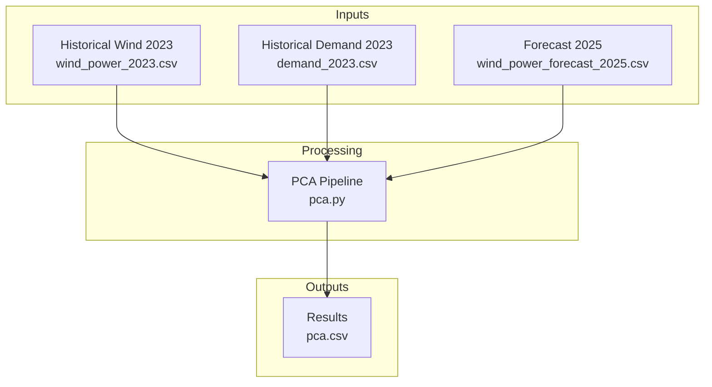
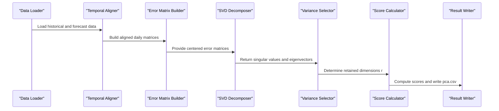
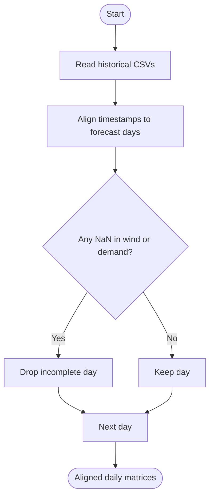
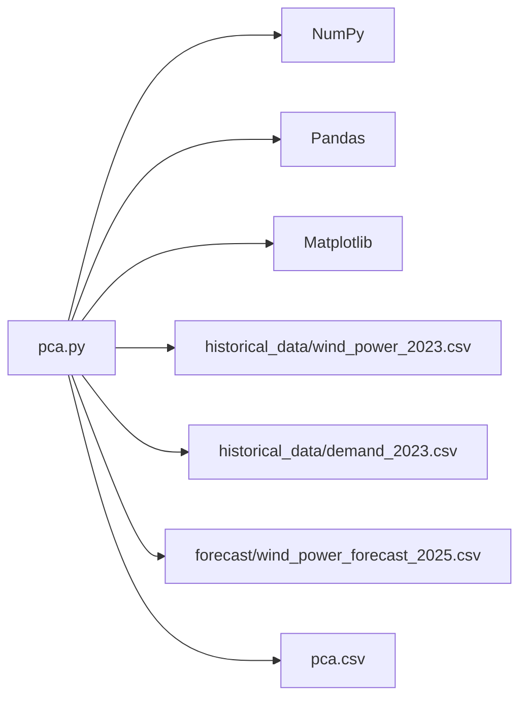

# Principal Component Analysis Fundamentals

<cite>
**Referenced Files in This Document**
- [pca.py](file://pca/pca.py)
- [pca.csv](file://pca/pca.csv)
- [wind_power_2023.csv](file://historical_data/wind_power_2023.csv)
- [demand_2023.csv](file://historical_data/demand_2023.csv)
- [wind_power_forecast_2025.csv](file://forecast/wind_power_forecast_2025.csv)
</cite>

## Table of Contents
1. [Introduction](#introduction)
2. [Project Structure](#project-structure)
3. [Core Components](#core-components)
4. [Architecture Overview](#architecture-overview)
5. [Detailed Component Analysis](#detailed-component-analysis)
6. [Dependency Analysis](#dependency-analysis)
7. [Performance Considerations](#performance-considerations)
8. [Troubleshooting Guide](#troubleshooting-guide)
9. [Conclusion](#conclusion)

## Introduction
This document explains how Principal Component Analysis (PCA) is used to quantify uncertainty for wind power and electricity demand. It focuses on the SVD-based PCA pipeline implemented in the repository, including:
- Data alignment between historical observations and forecasts
- Centering and SVD decomposition
- Variance threshold selection for dimensionality reduction
- Score calculation and uncertainty set construction
- Practical outputs that capture the most important patterns in high-dimensional hourly profiles

The goal is to transform large hourly time series into a small number of principal components that retain most of the variance, enabling robust uncertainty modeling while keeping computations tractable.

## Project Structure
The PCA workflow operates over three main data sources:
- Historical wind power and demand profiles for 2023 and 2024
- Forecasted wind power and demand for 2025
- A Python script that performs PCA and writes results to CSV

**Diagram sources**
- [pca.py:24-38](file://pca/pca.py#L24-L38)
- [pca.py:52-69](file://pca/pca.py#L52-L69)
- [pca.py:308-308](file://pca/pca.py#L308-L308)

**Section sources**
- [pca.py:1-12](file://pca/pca.py#L1-L12)
- [pca.py:24-38](file://pca/pca.py#L24-L38)
- [pca.py:52-69](file://pca/pca.py#L52-L69)
- [pca.py:308-308](file://pca/pca.py#L308-L308)

## Core Components
The core PCA implementation consists of:
- Data loading and validation
- Temporal alignment of historical data with forecast days
- Construction of centered error matrices for wind and demand
- SVD decomposition to extract principal components
- Variance-threshold selection to determine retained dimensions
- Score computation and uncertainty set calibration
- Visualization and result export

Key responsibilities:
- Aligning timestamps by day-of-week and hour
- Removing incomplete days from historical windows
- Computing mean-centered errors and performing SVD
- Selecting principal components based on cumulative explained variance
- Building support sets for uncertainty quantification

**Section sources**
- [pca.py:24-38](file://pca/pca.py#L24-L38)
- [pca.py:41-49](file://pca/pca.py#L41-L49)
- [pca.py:71-91](file://pca/pca.py#L71-L91)
- [pca.py:94-121](file://pca/pca.py#L94-L121)
- [pca.py:128-152](file://pca/pca.py#L128-L152)
- [pca.py:155-178](file://pca/pca.py#L155-L178)
- [pca.py:180-234](file://pca/pca.py#L180-L234)
- [pca.py:240-308](file://pca/pca.py#L240-L308)

## Architecture Overview
The PCA architecture follows a clear sequence: load data, align temporally, compute errors, decompose via SVD, select components by variance, compute scores, calibrate budgets, and export results.

**Diagram sources**
- [pca.py:24-38](file://pca/pca.py#L24-L38)
- [pca.py:41-49](file://pca/pca.py#L41-L49)
- [pca.py:94-121](file://pca/pca.py#L94-L121)
- [pca.py:128-152](file://pca/pca.py#L128-L152)
- [pca.py:155-178](file://pca/pca.py#L155-L178)
- [pca.py:308-308](file://pca/pca.py#L308-L308)

## Detailed Component Analysis

### Data Loading and Validation
The script loads:
- Forecasted wind power and demand for 2025
- Historical wind power and demand for 2023 and 2024

It validates that forecast timestamps match across wind and demand series and checks that historical weekdays align with forecast weekdays.

Practical implications:
- Ensures consistent temporal resolution (hourly)
- Prevents misalignment between variables and time indices
- Guards against missing or mismatched days

**Section sources**
- [pca.py:24-38](file://pca/pca.py#L24-L38)
- [pca.py:71-72](file://pca/pca.py#L71-L72)

### Temporal Alignment and Incomplete Day Handling
The code aligns historical data to forecast days using:
- Day offsets relative to a fixed origin date
- Hour preservation to maintain diurnal patterns
- Removal of days with any missing values across wind or demand

This produces clean daily blocks suitable for PCA.

**Diagram sources**
- [pca.py:41-49](file://pca/pca.py#L41-L49)
- [pca.py:75-91](file://pca/pca.py#L75-L91)

**Section sources**
- [pca.py:41-49](file://pca/pca.py#L41-L49)
- [pca.py:75-91](file://pca/pca.py#L75-L91)

### Error Matrix Construction
For each variable group:
- Wind: two spatial points AB and KA concatenated into a single profile per day
- Demand: one profile per day

Errors are computed as differences between historical observations and corresponding forecast values, then centered by subtracting the mean across samples.

Mathematical notes:
- e_p and e_d represent centered error matrices
- Rows correspond to hours; columns correspond to days
- Mean subtraction ensures zero-mean features before SVD

**Section sources**
- [pca.py:100-121](file://pca/pca.py#L100-L121)
- [pca.py:128-136](file://pca/pca.py#L128-L136)

### SVD Decomposition and Eigenvector Extraction
The implementation uses Singular Value Decomposition (SVD) on the transposed error matrices:
- X_p = x_p.T and X_d = x_d.T
- SVD yields U, sigma, Vt
- Eigenvectors are obtained as V = Vt.T

Complexity considerations:
- SVD on matrices of shape (features x samples) scales with O(min(mn^2, m^2n)) where m is features and n is samples
- Here, features are hourly dimensions (e.g., 48 for wind, 24 for demand), and samples are the number of aligned days

Interpretation:
- Columns of V are principal directions (loadings)
- Singular values sigma relate to variance captured by each component

**Section sources**
- [pca.py:143-152](file://pca/pca.py#L143-L152)

### Variance Threshold Selection for Dimensionality Reduction
The script selects the smallest number of components r such that the cumulative explained variance reaches a threshold:
- Default threshold: 0.95
- Pairwise threshold for budget calibration: 0.90

Selection logic:
- Compute cumulative sum of squared singular values
- Normalize by total variance
- Use searchsorted to find the first index meeting the threshold

Validation:
- Ensures selected components form an orthonormal basis
- Verifies minimum explained variance meets the default threshold

Trade-offs:
- Lower r reduces dimensionality but may lose important variability
- Higher r preserves more information but increases computational cost and model complexity

**Section sources**
- [pca.py:155-178](file://pca/pca.py#L155-L178)

### Score Calculation and Uncertainty Set Calibration
Scores are projections of centered errors onto the selected principal components:
- scores_p = X_p @ L_p
- scores_d = X_d @ L_d

Uncertainty set parameters:
- Centers c and radii a derived from quantiles of scores
- Budgets Phi and Psi calibrated from aggregated absolute scores and top-two magnitudes

These parameters define a hyperrectangle in score space that maps back to physical units (MW) through the principal components.

**Section sources**
- [pca.py:166-167](file://pca/pca.py#L166-L167)
- [pca.py:180-234](file://pca/pca.py#L180-L234)

### Results Export and Interpretation
The script writes a CSV containing:
- Group (wind or demand)
- Component index
- Center c and radius a per component
- Retained dimensions r and pairwise s
- Calibrated budgets Phi and Psi

Example interpretation from pca.csv:
- Wind retains r=5 components with pairwise s=3
- Demand retains r=11 components with pairwise s=6
- Each row provides the center and radius for constructing uncertainty bounds

**Section sources**
- [pca.py:290-308](file://pca/pca.py#L290-L308)
- [pca.csv:1-18](file://pca/pca.csv#L1-L18)

## Dependency Analysis
The PCA module depends on:
- NumPy for numerical operations and SVD
- Pandas for data I/O and datetime handling
- Matplotlib for visualization (internal use)

External data dependencies:
- Historical CSV files for wind and demand
- Forecast CSV files for 2025

**Diagram sources**
- [pca.py:1-4](file://pca/pca.py#L1-L4)
- [pca.py:24-38](file://pca/pca.py#L24-L38)
- [pca.py:308-308](file://pca/pca.py#L308-L308)

**Section sources**
- [pca.py:1-4](file://pca/pca.py#L1-L4)
- [pca.py:24-38](file://pca/pca.py#L24-L38)
- [pca.py:308-308](file://pca/pca.py#L308-L308)

## Performance Considerations
- SVD complexity dominates runtime; reducing feature dimensionality (e.g., fewer hours or aggregated profiles) can improve speed
- Using full_matrices=False avoids computing unnecessary left singular vectors
- Pre-filtering incomplete days reduces sample size and stabilizes covariance estimation
- Choosing a lower variance threshold decreases r, speeding up downstream optimization at the cost of fidelity

[No sources needed since this section provides general guidance]

## Troubleshooting Guide
Common issues and resolutions:
- Mismatched forecast timestamps between wind and demand: ensure both series share identical time indices
- Weekday misalignment between historical and forecast: verify that historical origins align with forecast weekdays
- Zero or negative radii in uncertainty sets: check that score ranges are non-degenerate and thresholds are appropriate
- Insufficient explained variance: increase r or adjust variance threshold to meet minimum requirements

Relevant validations in code:
- Timestamp equality check
- Weekday consistency check
- Orthonormality checks for selected components
- Minimum explained variance assertion

**Section sources**
- [pca.py:32-33](file://pca/pca.py#L32-L33)
- [pca.py:71-72](file://pca/pca.py#L71-L72)
- [pca.py:169-178](file://pca/pca.py#L169-L178)
- [pca.py:214-228](file://pca/pca.py#L214-L228)

## Conclusion
The PCA pipeline in this repository transforms high-dimensional hourly wind power and demand profiles into a compact set of principal components that capture the majority of variance. By combining SVD decomposition with variance threshold selection, it achieves effective dimensionality reduction while preserving essential patterns. The resulting scores and calibrated uncertainty sets enable robust uncertainty quantification for operational planning. Careful attention to data alignment, variance thresholds, and validation checks ensures reliable and interpretable results.

[No sources needed since this section summarizes without analyzing specific files]