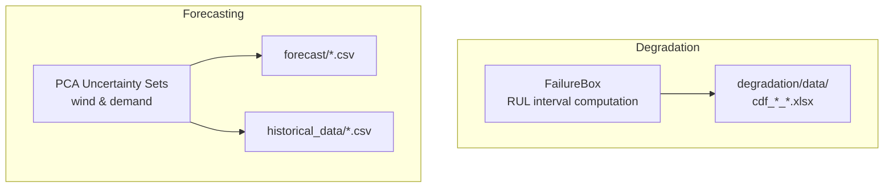
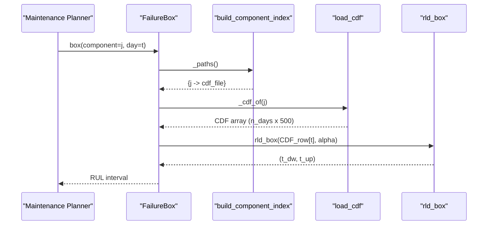
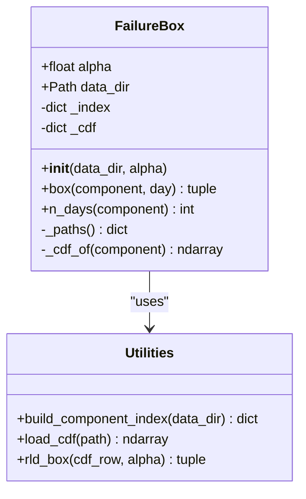
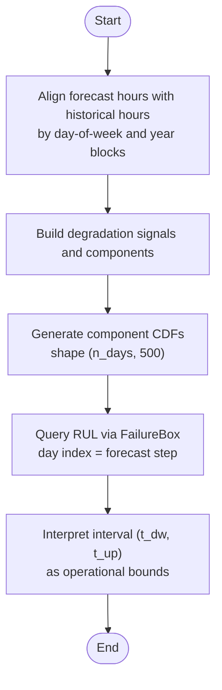
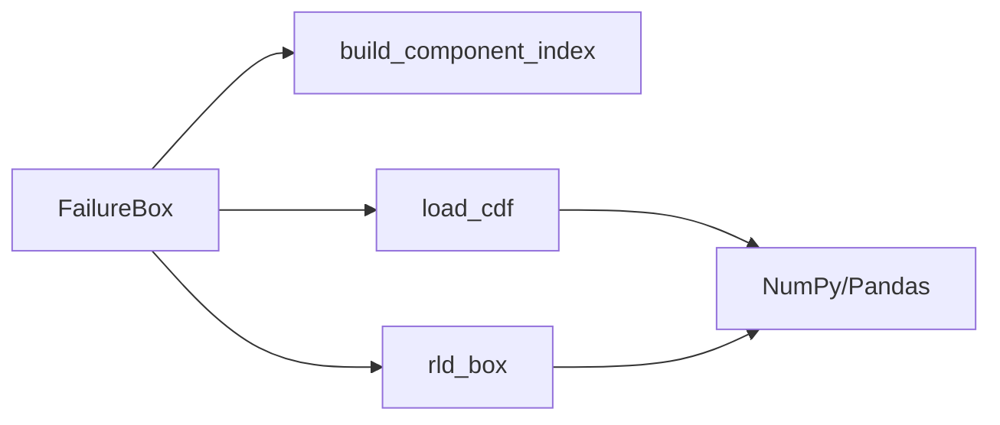

# Remaining Useful Life Estimation

<cite>
**Referenced Files in This Document**
- [failure_box.py](file://degradation/failure_box.py)
- [README.md](file://degradation/README.md)
- [pca.py](file://pca/pca.py)
</cite>

## Table of Contents
1. [Introduction](#introduction)
2. [Project Structure](#project-structure)
3. [Core Components](#core-components)
4. [Architecture Overview](#architecture-overview)
5. [Detailed Component Analysis](#detailed-component-analysis)
6. [Dependency Analysis](#dependency-analysis)
7. [Performance Considerations](#performance-considerations)
8. [Troubleshooting Guide](#troubleshooting-guide)
9. [Conclusion](#conclusion)

## Introduction
This document explains the Remaining Useful Life (RUL) estimation methodology implemented for wind turbine components. RUL is defined as the expected operational lifetime remaining from a given point in time, expressed here as an interval of future days until failure. The approach uses component-specific cumulative distribution functions (CDFs) over a fixed horizon of up to 500 days and returns a central confidence interval at a chosen significance level alpha. These intervals support predictive maintenance by informing when maintenance should be planned and how resources should be allocated.

The implementation centers on the FailureBox class, which:
- Loads per-component CDF tables stored as Excel files.
- Maps a forecast day index to a row in the component’s CDF.
- Computes a central interval using quantiles of the CDF row.
- Returns lower and upper bounds representing minimum and maximum likely remaining days.

The broader project also includes PCA-based uncertainty modeling for wind power and demand forecasts, which contextualizes how degradation inputs are generated and aligned with calendar days.

## Project Structure
The repository contains:
- A degradation module implementing RUL estimation via FailureBox and supporting utilities.
- A PCA module that builds uncertainty sets around wind power and demand forecasts.
- Forecast and historical data directories used by the PCA module.

**Diagram sources**
- [failure_box.py:17-66](file://degradation/failure_box.py#L17-L66)
- [pca.py:24-31](file://pca/pca.py#L24-L31)

**Section sources**
- [failure_box.py:1-134](file://degradation/failure_box.py#L1-L134)
- [README.md:1-53](file://degradation/README.md#L1-L53)
- [pca.py:1-323](file://pca/pca.py#L1-L323)

## Core Components
- FailureBox: Encapsulates loading, indexing, and querying of component CDFs to compute RUL intervals.
- build_component_index: Discovers and validates CDF files per component.
- load_cdf: Reads a component’s CDF table into a NumPy array.
- rld_box: Computes the central interval from a single CDF row using quantile thresholds.

Key responsibilities:
- Validate alpha parameter and ensure it lies strictly between 0 and 1.
- Map component IDs to file paths and cache loaded CDF arrays.
- Enforce valid day indices relative to each component’s forecast horizon.
- Compute lower and upper bounds based on alpha/2 and 1 - alpha/2 quantiles.

Operational meaning:
- For a given component j and forecast day t, the returned pair (t_dw, t_up) represents the minimum and maximum number of additional days until failure, according to the CDF at that day.

**Section sources**
- [failure_box.py:17-66](file://degradation/failure_box.py#L17-L66)
- [failure_box.py:69-106](file://degradation/failure_box.py#L69-L106)
- [failure_box.py:109-134](file://degradation/failure_box.py#L109-L134)

## Architecture Overview
The RUL pipeline integrates degradation data with forecasting context:

**Diagram sources**
- [failure_box.py:32-44](file://degradation/failure_box.py#L32-L44)
- [failure_box.py:50-66](file://degradation/failure_box.py#L50-L66)
- [failure_box.py:69-95](file://degradation/failure_box.py#L69-L95)
- [failure_box.py:98-106](file://degradation/failure_box.py#L98-L106)
- [failure_box.py:109-134](file://degradation/failure_box.py#L109-L134)

## Detailed Component Analysis

### Mathematical Foundations of RUL from CDFs
- Let F_t(k) be the CDF value at residual life k for component j at forecast day t.
- For a chosen significance level alpha, the central interval is defined by:
  - Lower bound t_dw = min{k : F_t(k) >= alpha/2}
  - Upper bound t_up = min{k : F_t(k) >= 1 - alpha/2}
- These bounds represent operational limits:
  - t_dw is the earliest likely day to failure (conservative planning).
  - t_up is the latest likely day to failure (optimistic planning).
- Confidence interpretation:
  - With alpha = 0.1, the interval covers the central 90% of the residual-life distribution for that day.
- Support constraint:
  - If F_t(500) < 1 - alpha/2, the query raises an error indicating insufficient support; this prevents returning misleading upper bounds beyond the modeled horizon.

Practical implications:
- Maintenance scheduling can target windows between t_dw and t_up.
- Resource allocation can prioritize components with smaller t_dw values or narrower intervals requiring tighter control.

**Section sources**
- [README.md:19-31](file://degradation/README.md#L19-L31)
- [failure_box.py:109-134](file://degradation/failure_box.py#L109-L134)

### FailureBox Class Implementation
Responsibilities:
- Initialization:
  - Validates alpha and stores configuration.
  - Sets default data directory and initializes caches for component index and CDF arrays.
- Querying:
  - box(component, day):
    - Retrieves the CDF for the component.
    - Validates day index against the component’s forecast horizon.
    - Calls rld_box to compute the interval.
  - n_days(component):
    - Returns the number of forecast days available for the component.
- Internal helpers:
  - _paths(): Builds and caches the mapping from component ID to file path.
  - _cdf_of(component): Loads and caches the CDF array for a component.

Data model:
- Component CDF shape: (n_days, 500), where rows correspond to forecast days and columns to residual life days up to 500.
- Day indexing is 1-based in user-facing methods but converted to 0-based internally for array access.

Error handling:
- Invalid alpha raises ValueError.
- Out-of-range day index raises ValueError with supported range.
- Missing component or duplicate files raise ValueError with diagnostic information.
- Insufficient CDF support raises ValueError suggesting adjusting alpha.

**Diagram sources**
- [failure_box.py:17-66](file://degradation/failure_box.py#L17-L66)
- [failure_box.py:69-106](file://degradation/failure_box.py#L69-L106)
- [failure_box.py:109-134](file://degradation/failure_box.py#L109-L134)

**Section sources**
- [failure_box.py:17-66](file://degradation/failure_box.py#L17-L66)
- [failure_box.py:69-106](file://degradation/failure_box.py#L69-L106)
- [failure_box.py:109-134](file://degradation/failure_box.py#L109-L134)

### Temporal Aspects: Forecast Days vs Calendar Days
- Forecast days:
  - The day index passed to FailureBox corresponds to the row in the component’s CDF, i.e., the forecast step in the degradation timeline.
  - It is not necessarily the same as the calendar day within a year.
- Calendar alignment:
  - The PCA module aligns forecast hours with historical hours by day-of-week matching and handles leap years and missing data.
  - This alignment ensures that degradation signals and forecasts are temporally consistent before generating CDFs.

Handling varying lifespans:
- Each component has its own number of forecast days (n_days), ranging across components.
- The system enforces component-specific day ranges and raises errors if queries exceed those ranges.

**Diagram sources**
- [pca.py:13-22](file://pca/pca.py#L13-L22)
- [pca.py:41-49](file://pca/pca.py#L41-L49)
- [failure_box.py:32-48](file://degradation/failure_box.py#L32-L48)

**Section sources**
- [README.md:5-6](file://degradation/README.md#L5-L6)
- [pca.py:13-22](file://pca/pca.py#L13-L22)
- [pca.py:41-49](file://pca/pca.py#L41-L49)
- [failure_box.py:32-48](file://degradation/failure_box.py#L32-L48)

### Practical Examples: Maintenance Scheduling and Resource Allocation
- Example scenario:
  - For component j at forecast day t, obtain interval (t_dw, t_up).
  - Plan maintenance activities within the window [t_dw, t_up] to avoid unexpected failures while minimizing downtime.
- Resource allocation:
  - Prioritize components with small t_dw values for immediate attention.
  - Allocate spare parts and crews proportionally to interval widths and urgency.
- Decision-making:
  - Use multiple components’ intervals to balance workload across teams and shifts.
  - Adjust alpha to widen or narrow intervals depending on risk tolerance.

Note: These examples describe usage patterns rather than specific numeric outputs.

[No sources needed since this section provides general guidance]

## Dependency Analysis
Internal dependencies:
- FailureBox depends on:
  - build_component_index for discovering and validating CDF files.
  - load_cdf for reading CDF arrays.
  - rld_box for computing intervals.

External dependencies:
- NumPy for array operations and searchsorted.
- Pandas for reading Excel files.
- Pathlib for path handling.

Coupling and cohesion:
- FailureBox encapsulates all RUL-related logic, promoting cohesion.
- Utility functions are stateless and reusable, reducing coupling.

Potential circular dependencies:
- None observed; the module is self-contained.

**Diagram sources**
- [failure_box.py:17-66](file://degradation/failure_box.py#L17-L66)
- [failure_box.py:69-106](file://degradation/failure_box.py#L69-L106)
- [failure_box.py:109-134](file://degradation/failure_box.py#L109-L134)

**Section sources**
- [failure_box.py:1-134](file://degradation/failure_box.py#L1-L134)

## Performance Considerations
- Caching:
  - CDF arrays are cached per component after first load to avoid repeated I/O.
- Vectorized operations:
  - Interval computation uses NumPy’s searchsorted for efficient quantile lookup.
- Memory usage:
  - Each component’s CDF consumes memory proportional to n_days × 500; consider managing large portfolios carefully.
- Alpha selection:
  - Larger alpha reduces coverage and may avoid support errors but yields wider intervals; choose based on operational risk appetite.

[No sources needed since this section provides general guidance]

## Troubleshooting Guide
Common issues and resolutions:
- Invalid alpha:
  - Ensure alpha is strictly between 0 and 1.
- Out-of-range day index:
  - Verify day is within [1, n_days(component)].
- Missing component:
  - Confirm the component exists in the data directory and matches the naming convention.
- Duplicate component files:
  - Remove duplicates or rename files to adhere to the expected pattern.
- Insufficient CDF support:
  - If F(500) < 1 - alpha/2, increase alpha or extend the CDF horizon.

**Section sources**
- [failure_box.py:24-28](file://degradation/failure_box.py#L24-L28)
- [failure_box.py:37-44](file://degradation/failure_box.py#L37-L44)
- [failure_box.py:58-66](file://degradation/failure_box.py#L58-L66)
- [failure_box.py:87-95](file://degradation/failure_box.py#L87-L95)
- [failure_box.py:124-129](file://degradation/failure_box.py#L124-L129)

## Conclusion
The RUL estimation framework provides a robust, mathematically grounded method for predicting the remaining operational lifetime of wind turbine components. By leveraging component-specific CDFs and a configurable confidence level, FailureBox delivers actionable intervals that inform maintenance scheduling and resource allocation. The distinction between forecast days and calendar days ensures temporal consistency, while handling varying component lifespans accommodates real-world heterogeneity. Integrating these intervals with broader forecasting and uncertainty models enables comprehensive predictive maintenance strategies tailored to wind turbine operations.

[No sources needed since this section summarizes without analyzing specific files]