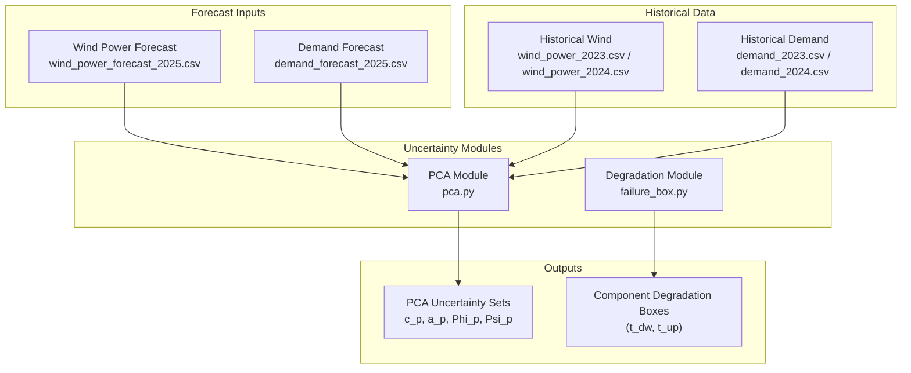
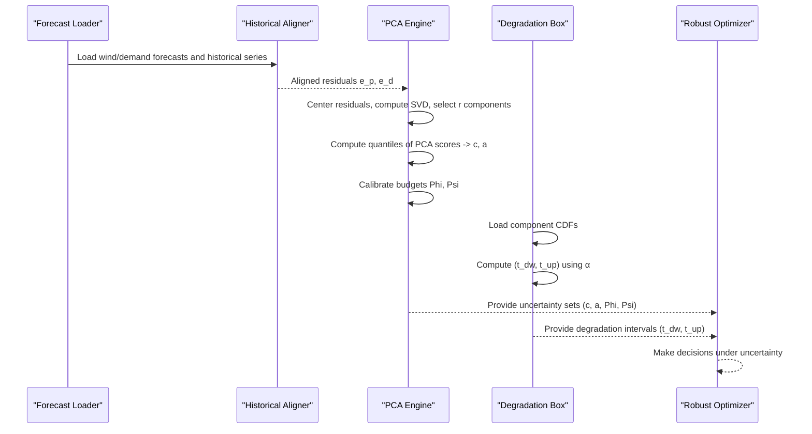
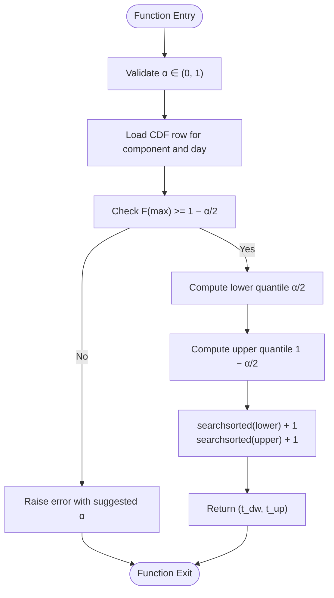
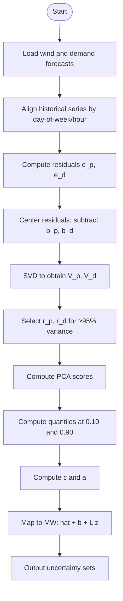
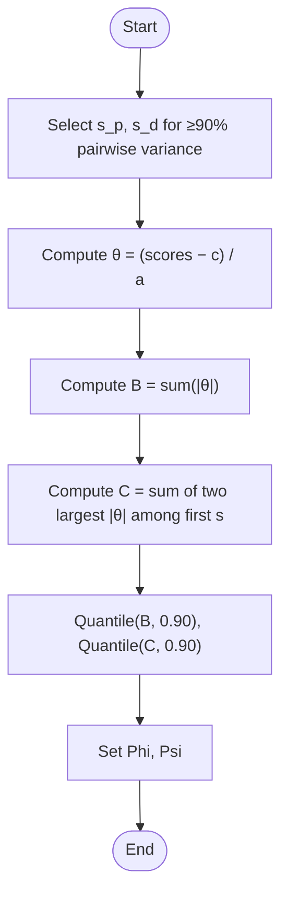
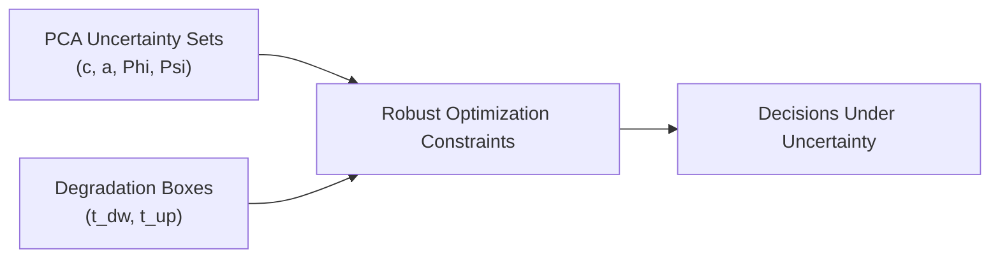
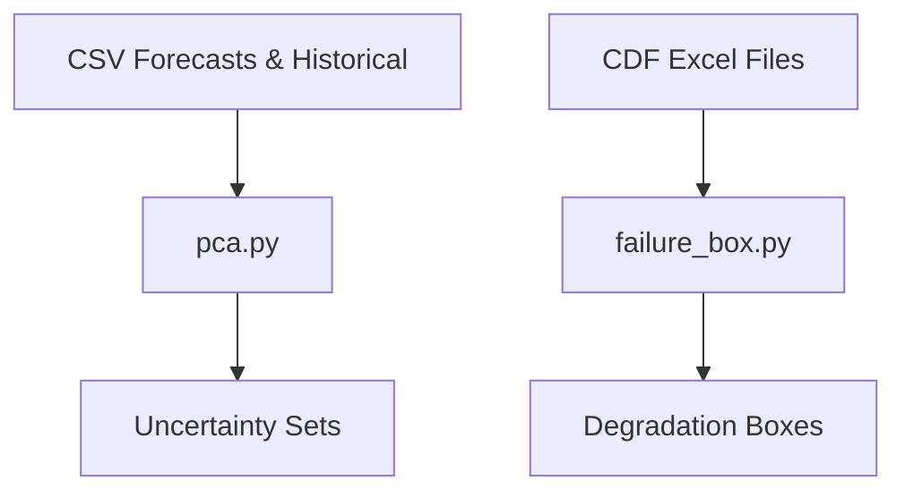

# Uncertainty Quantification Principles

<cite>
**Referenced Files in This Document**
- [pca.py](file://pca/pca.py)
- [failure_box.py](file://degradation/failure_box.py)
- [README.md](file://degradation/README.md)
</cite>

## Table of Contents
1. [Introduction](#introduction)
2. [Project Structure](#project-structure)
3. [Core Components](#core-components)
4. [Architecture Overview](#architecture-overview)
5. [Detailed Component Analysis](#detailed-component-analysis)
6. [Dependency Analysis](#dependency-analysis)
7. [Performance Considerations](#performance-considerations)
8. [Troubleshooting Guide](#troubleshooting-guide)
9. [Conclusion](#conclusion)

## Introduction
This document explains the uncertainty quantification principles used by the wind power forecasting system. It focuses on:
- Confidence interval construction using an alpha parameter, with a default α = 0.1.
- Quantile-based methods for interval estimation in both component degradation and PCA-derived uncertainty sets.
- The mathematical formulation t_dw = min{k : F(k) >= α/2} and t_up = min{k : F(k) >= 1 − α/2}.
- Budget parameter calibration (Phi, Psi) for robust optimization constraints.
- Integration between PCA-derived uncertainty sets and component degradation intervals.
- Visual explanations of how uncertainty propagates through the forecasting pipeline and impacts decision-making under uncertainty.

The goal is to make these concepts accessible while preserving technical precision, including data shapes, algorithmic steps, and error handling.

## Project Structure
At a high level, the repository contains:
- Historical and forecast time series for wind power and demand.
- A PCA module that builds uncertainty sets from historical residuals.
- A degradation module that computes central residual-life intervals per component.

**Diagram sources**
- [pca.py:24-38](file://pca/pca.py#L24-L38)
- [pca.py:52-69](file://pca/pca.py#L52-L69)
- [pca.py:147-179](file://pca/pca.py#L147-L179)
- [pca.py:184-195](file://pca/pca.py#L184-L195)
- [pca.py:204-234](file://pca/pca.py#L204-L234)
- [failure_box.py:17-66](file://degradation/failure_box.py#L17-L66)

**Section sources**
- [pca.py:24-38](file://pca/pca.py#L24-L38)
- [pca.py:52-69](file://pca/pca.py#L52-L69)
- [failure_box.py:17-66](file://degradation/failure_box.py#L17-L66)

## Core Components
Two main components implement uncertainty quantification:
- PCA-based uncertainty set construction for wind power and demand forecasts.
- Degradation-based residual-life interval computation per component.

Key responsibilities:
- PCA module:
  - Aligns historical and forecast series by day-of-week and hour.
  - Computes residuals, centers them, and performs SVD to obtain principal components.
  - Builds support sets via quantiles of PCA scores.
  - Calibrates budgets Phi and Psi for robust optimization.
- Degradation module:
  - Loads per-component residual-life CDFs.
  - Computes central intervals using α-driven quantiles.
  - Provides caching and validation for component indices and CDF shapes.

**Section sources**
- [pca.py:147-179](file://pca/pca.py#L147-L179)
- [pca.py:184-195](file://pca/pca.py#L184-L195)
- [pca.py:204-234](file://pca/pca.py#L204-L234)
- [failure_box.py:17-66](file://degradation/failure_box.py#L17-L66)
- [failure_box.py:109-133](file://degradation/failure_box.py#L109-L133)

## Architecture Overview
The uncertainty quantification pipeline integrates forecast inputs, historical alignment, PCA modeling, and degradation intervals into robust decision-making.

**Diagram sources**
- [pca.py:24-38](file://pca/pca.py#L24-L38)
- [pca.py:41-49](file://pca/pca.py#L41-L49)
- [pca.py:120-136](file://pca/pca.py#L120-L136)
- [pca.py:147-179](file://pca/pca.py#L147-L179)
- [pca.py:184-195](file://pca/pca.py#L184-L195)
- [pca.py:204-234](file://pca/pca.py#L204-L234)
- [failure_box.py:17-66](file://degradation/failure_box.py#L17-L66)
- [failure_box.py:109-133](file://degradation/failure_box.py#L109-L133)

## Detailed Component Analysis

### Confidence Intervals and Alpha Parameters
The degradation module constructs central intervals using an alpha parameter α ∈ (0, 1). With the default α = 0.1, the interval covers the central 90% of the residual-life distribution for each component at a given day.

Mathematical formulation:
- t_dw = min{k : F(k) >= α/2}
- t_up = min{k : F(k) >= 1 − α/2}

Implementation details:
- The function validates α ∈ (0, 1).
- It checks that the CDF support reaches the upper quantile; otherwise it raises an error suggesting a larger α if needed.
- Indices are 1-based; searchsorted returns positions adjusted by +1 to map to days.

**Diagram sources**
- [failure_box.py:109-133](file://degradation/failure_box.py#L109-L133)
- [README.md:21-30](file://degradation/README.md#L21-L30)

**Section sources**
- [failure_box.py:24-28](file://degradation/failure_box.py#L24-L28)
- [failure_box.py:109-133](file://degradation/failure_box.py#L109-L133)
- [README.md:21-30](file://degradation/README.md#L21-L30)

### PCA-Derived Uncertainty Sets
The PCA module builds uncertainty sets in PCA coordinates using quantiles of training scores.

Steps:
- Align historical and forecast series by day-of-week and hour.
- Compute residuals e_p and e_d, center them to remove bias b_p, b_d.
- Perform SVD to obtain principal components V_p, V_d and select r_p, r_d components retaining at least 95% variance.
- Compute quantiles of PCA scores at 0.10 and 0.90 to get centers c and radii a.
- Map back to MW space to visualize support sets around mean forecasts.

**Diagram sources**
- [pca.py:24-38](file://pca/pca.py#L24-L38)
- [pca.py:41-49](file://pca/pca.py#L41-L49)
- [pca.py:120-136](file://pca/pca.py#L120-L136)
- [pca.py:147-179](file://pca/pca.py#L147-L179)
- [pca.py:184-195](file://pca/pca.py#L184-L195)

**Section sources**
- [pca.py:24-38](file://pca/pca.py#L24-L38)
- [pca.py:41-49](file://pca/pca.py#L41-L49)
- [pca.py:120-136](file://pca/pca.py#L120-L136)
- [pca.py:147-179](file://pca/pca.py#L147-L179)
- [pca.py:184-195](file://pca/pca.py#L184-L195)

### Budget Parameter Calibration (Phi, Psi)
Budget parameters control robustness constraints in optimization by bounding deviations in PCA score space.

Calibration process:
- Determine s_p, s_d as the smallest number of top components (≥2) capturing at least 90% of retained variance.
- For each training sample, compute normalized deviations θ = (scores − c) / a.
- Compute B as the sum of absolute θ across all components.
- Compute C as the sum of the two largest |θ| among the first s components.
- Set Phi and Psi as the 90th percentile of B and C respectively.

**Diagram sources**
- [pca.py:204-234](file://pca/pca.py#L204-L234)

**Section sources**
- [pca.py:204-234](file://pca/pca.py#L204-L234)

### Integration Between PCA Uncertainty Sets and Degradation Intervals
Decision-making under uncertainty combines:
- PCA-derived uncertainty sets for aggregate wind and demand variability.
- Component degradation intervals (t_dw, t_up) for maintenance and reliability constraints.

Integration points:
- PCA outputs provide c, a, Phi, Psi to constrain feasible operating regions.
- Degradation outputs provide per-component residual-life bounds to inform maintenance scheduling and risk mitigation.
- Together they shape robust optimization constraints balancing performance and reliability.

**Diagram sources**
- [pca.py:184-195](file://pca/pca.py#L184-L195)
- [pca.py:204-234](file://pca/pca.py#L204-L234)
- [failure_box.py:109-133](file://degradation/failure_box.py#L109-L133)

**Section sources**
- [pca.py:184-195](file://pca/pca.py#L184-L195)
- [pca.py:204-234](file://pca/pca.py#L204-L234)
- [failure_box.py:109-133](file://degradation/failure_box.py#L109-L133)

## Dependency Analysis
The modules have clear separation of concerns:
- PCA module depends on forecast and historical CSV files.
- Degradation module depends on per-component CDF Excel files.
- Both produce outputs consumed by downstream robust optimization or decision logic.

**Diagram sources**
- [pca.py:24-38](file://pca/pca.py#L24-L38)
- [pca.py:52-69](file://pca/pca.py#L52-L69)
- [failure_box.py:69-106](file://degradation/failure_box.py#L69-L106)

**Section sources**
- [pca.py:24-38](file://pca/pca.py#L24-L38)
- [pca.py:52-69](file://pca/pca.py#L52-L69)
- [failure_box.py:69-106](file://degradation/failure_box.py#L69-L106)

## Performance Considerations
- PCA dimensionality selection uses cumulative explained variance thresholds (95% overall, 90% pairwise) to balance model complexity and uncertainty coverage.
- Quantile computations are vectorized over training samples for efficiency.
- Degradation boxes cache loaded CDFs per component to avoid repeated file I/O.
- Error checks prevent invalid α values and insufficient CDF support, reducing runtime failures.

[No sources needed since this section provides general guidance]

## Troubleshooting Guide
Common issues and resolutions:
- Invalid α value: Ensure α ∈ (0, 1); otherwise ValueError is raised.
- Insufficient CDF support: If F(max) < 1 − α/2, increase α or extend support; the function suggests a minimum α based on maximum CDF value.
- Mismatched forecast/historical timestamps: Ensure day-of-week alignment and complete daily windows; otherwise ValueError is raised.
- Missing or malformed CDF files: Validate file naming conventions and dimensions (n_days × 500).

**Section sources**
- [failure_box.py:24-28](file://degradation/failure_box.py#L24-L28)
- [failure_box.py:109-133](file://degradation/failure_box.py#L109-L133)
- [pca.py:71-72](file://pca/pca.py#L71-L72)

## Conclusion
The wind power forecasting system employs rigorous uncertainty quantification through:
- Alpha-driven confidence intervals for component degradation.
- PCA-based uncertainty sets calibrated with budget parameters Phi and Psi.
- Clear integration points enabling robust decision-making under uncertainty.

These methodologies ensure that operational decisions account for both forecast variability and component reliability risks, improving resilience and performance in uncertain environments.

[No sources needed since this section summarizes without analyzing specific files]