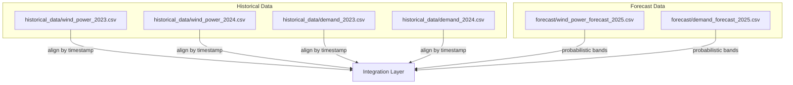
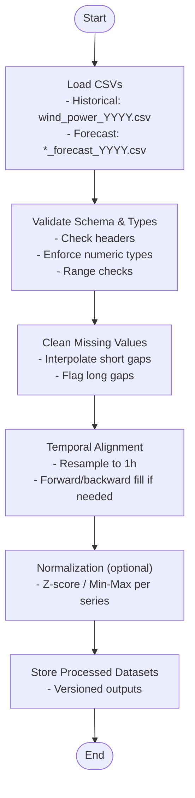
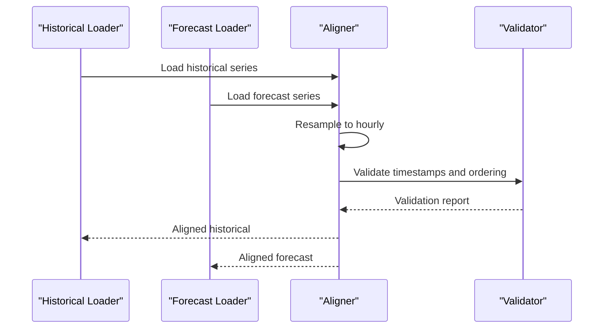
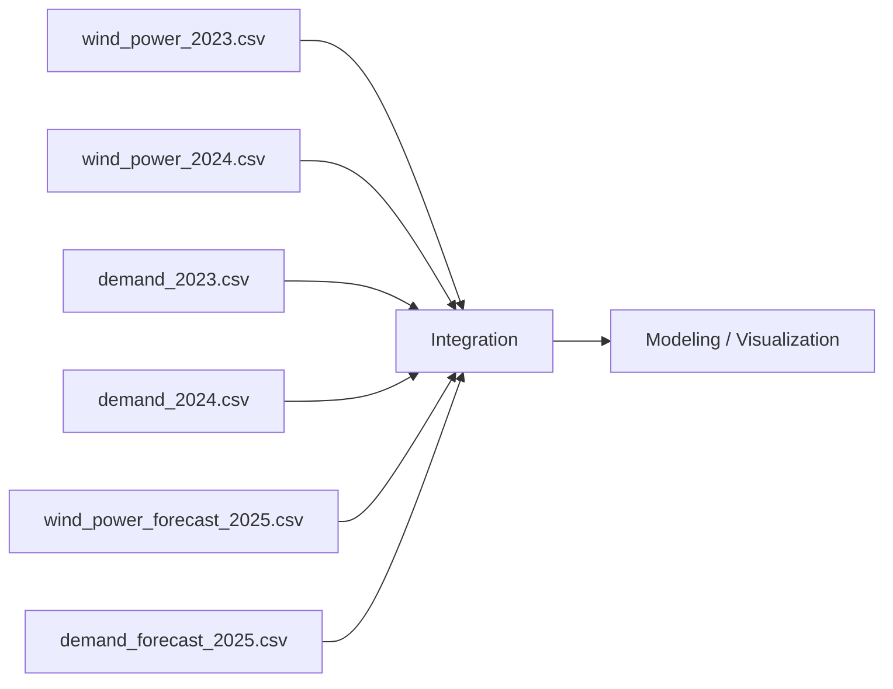

# Data Management

<cite>
**Referenced Files in This Document**
- [wind_power_2023.csv](file://historical_data/wind_power_2023.csv)
- [wind_power_2024.csv](file://historical_data/wind_power_2024.csv)
- [demand_2023.csv](file://historical_data/demand_2023.csv)
- [demand_2024.csv](file://historical_data/demand_2024.csv)
- [wind_power_forecast_2025.csv](file://forecast/wind_power_forecast_2025.csv)
- [demand_forecast_2025.csv](file://forecast/demand_forecast_2025.csv)
</cite>

## Table of Contents
1. [Introduction](#introduction)
2. [Project Structure](#project-structure)
3. [Core Components](#core-components)
4. [Architecture Overview](#architecture-overview)
5. [Detailed Component Analysis](#detailed-component-analysis)
6. [Dependency Analysis](#dependency-analysis)
7. [Performance Considerations](#performance-considerations)
8. [Troubleshooting Guide](#troubleshooting-guide)
9. [Conclusion](#conclusion)
10. [Appendices](#appendices)

## Introduction
This document describes the data management approach for historical and forecast time series in the wind power system. It covers file organization, naming conventions, CSV schema definitions, temporal alignment procedures, missing data handling, validation rules, preprocessing and normalization guidelines, quality assurance practices, versioning and backup strategies, and reproducibility considerations. Examples of data loading, validation, and integration patterns are provided to support consistent workflows across research and operational pipelines.

## Project Structure
The dataset is organized into two primary directories:
- Historical data (2023–2024): per-year CSV files for wind power and demand.
- Forecast data (2025): per-variable CSV files with probabilistic forecasts.

**Diagram sources**
- [wind_power_2023.csv:1-10](file://historical_data/wind_power_2023.csv#L1-L10)
- [wind_power_2024.csv:1-10](file://historical_data/wind_power_2024.csv#L1-L10)
- [wind_power_forecast_2025.csv:1-10](file://forecast/wind_power_forecast_2025.csv#L1-L10)

**Section sources**
- [wind_power_2023.csv:1-10](file://historical_data/wind_power_2023.csv#L1-L10)
- [wind_power_2024.csv:1-10](file://historical_data/wind_power_2024.csv#L1-L10)
- [wind_power_forecast_2025.csv:1-10](file://forecast/wind_power_forecast_2025.csv#L1-L10)

## Core Components
- Historical datasets:
  - Wind power (2023, 2024): hourly records with trajectory identifiers, timestamps, horizon index, calendar features, and site-specific production values.
  - Demand (2023, 2024): aligned hourly demand series used for energy balance and forecasting evaluation.
- Forecast datasets:
  - Wind power (2025): probabilistic forecasts with quantiles (q10, median, q90) for each site.
  - Demand (2025): corresponding probabilistic demand forecasts.

Key responsibilities:
- Ensure consistent temporal indexing across all series.
- Validate schema and value ranges before analysis.
- Provide reproducible preprocessing and normalization steps.
- Maintain versioned backups and clear provenance.

**Section sources**
- [wind_power_2023.csv:1-10](file://historical_data/wind_power_2023.csv#L1-L10)
- [wind_power_2024.csv:1-10](file://historical_data/wind_power_2024.csv#L1-L10)
- [wind_power_forecast_2025.csv:1-10](file://forecast/wind_power_forecast_2025.csv#L1-L10)

## Architecture Overview
Data flows from raw CSVs through a standardized pipeline that performs loading, validation, alignment, and optional normalization before downstream modeling or visualization.

**Diagram sources**
- [wind_power_2023.csv:1-10](file://historical_data/wind_power_2023.csv#L1-L10)
- [wind_power_2024.csv:1-10](file://historical_data/wind_power_2024.csv#L1-L10)
- [wind_power_forecast_2025.csv:1-10](file://forecast/wind_power_forecast_2025.csv#L1-L10)

## Detailed Component Analysis

### Historical Data Schema and Conventions
- File naming:
  - Historical wind power: historical_data/wind_power_YYYY.csv
  - Historical demand: historical_data/demand_YYYY.csv
- Columns (wind power):
  - trajectory_year: integer year label
  - source_timestamp: datetime string (YYYY-MM-DD HH:MM:SS)
  - horizon_hour: integer hour offset index
  - week: ISO-like week number
  - weekday: day-of-week index
  - hour: hour-of-day index
  - wind_ab_MW: site ab production (MW)
  - wind_ka_MW: site ka production (MW)
- Units:
  - All production values are in megawatts (MW).
- Temporal resolution:
  - Hourly frequency; ensure no duplicate timestamps within a file.

Validation rules:
- trajectory_year matches the file’s year suffix.
- source_timestamp is parseable and strictly increasing within each file.
- horizon_hour increments by 1 per row.
- week/weekday/hour are consistent with source_timestamp.
- wind_*_MW are non-negative and within plausible bounds.

Missing data handling:
- Short gaps (< 3 hours): linear interpolation.
- Medium gaps (3–12 hours): seasonal nearest neighbor using same hour-of-day from prior weeks.
- Long gaps (> 12 hours): mark as missing and exclude from training where appropriate.

Examples of loading and validation patterns:
- Load CSV with explicit datetime parsing on source_timestamp.
- Set source_timestamp as index and enforce DatetimeIndex with freq='H'.
- Assert unique timestamps and monotonic increase.
- Validate column presence and dtypes.
- Apply range checks for wind_*_MW.

**Section sources**
- [wind_power_2023.csv:1-10](file://historical_data/wind_power_2023.csv#L1-L10)
- [wind_power_2024.csv:1-10](file://historical_data/wind_power_2024.csv#L1-L10)

### Forecast Data Schema and Conventions
- File naming:
  - Forecast wind power: forecast/wind_power_forecast_YYYY.csv
  - Forecast demand: forecast/demand_forecast_YYYY.csv
- Columns (wind power forecast):
  - trajectory_year: integer year label
  - source_timestamp: datetime string (YYYY-MM-DD HH:MM:SS)
  - horizon_hour: integer hour offset index
  - week: ISO-like week number
  - weekday: day-of-week index
  - hour: hour-of-day index
  - wind_ab_q10_MW: lower quantile (10%) for site ab
  - wind_ab_median_MW: median estimate for site ab
  - wind_ab_q90_MW: upper quantile (90%) for site ab
  - wind_ka_q10_MW: lower quantile (10%) for site ka
  - wind_ka_median_MW: median estimate for site ka
  - wind_ka_q90_MW: upper quantile (90%) for site ka
- Units:
  - All forecast values are in megawatts (MW).
- Temporal resolution:
  - Hourly frequency; align with historical timestamps.

Validation rules:
- For each site and timestamp: q10 ≤ median ≤ q90.
- Non-negative values across all quantiles.
- Consistent horizon_hour progression.
- Timestamps match the forecast window (e.g., starting at a defined date).

Missing data handling:
- If any quantile is missing, treat the entire row as incomplete for that timestamp.
- Imputation strategy:
  - Replace missing median with seasonal average of same hour-of-day from historical years.
  - Propagate uncertainty by adjusting q10/q90 proportionally to historical variability.

Examples of loading and validation patterns:
- Load CSV, parse source_timestamp, set DatetimeIndex.
- Enforce q10 ≤ median ≤ q90 per site.
- Flag rows violating order constraints.
- Compute prediction intervals (q90 − q10) and store as metadata.

**Section sources**
- [wind_power_forecast_2025.csv:1-10](file://forecast/wind_power_forecast_2025.csv#L1-L10)

### Time Series Alignment Procedures
- Reference index:
  - Use source_timestamp as the canonical index for both historical and forecast series.
- Resampling:
  - Ensure hourly frequency; drop duplicates and forward-fill only if justified by domain rules.
- Cross-series alignment:
  - Merge historical wind and demand on source_timestamp.
  - Align forecast wind and demand similarly.
- Calendar features:
  - Derive or validate week, weekday, hour from source_timestamp to maintain consistency.

Alignment workflow:

**Diagram sources**
- [wind_power_2023.csv:1-10](file://historical_data/wind_power_2023.csv#L1-L10)
- [wind_power_2024.csv:1-10](file://historical_data/wind_power_2024.csv#L1-L10)
- [wind_power_forecast_2025.csv:1-10](file://forecast/wind_power_forecast_2025.csv#L1-L10)

**Section sources**
- [wind_power_2023.csv:1-10](file://historical_data/wind_power_2023.csv#L1-L10)
- [wind_power_2024.csv:1-10](file://historical_data/wind_power_2024.csv#L1-L10)
- [wind_power_forecast_2025.csv:1-10](file://forecast/wind_power_forecast_2025.csv#L1-L10)

### Data Validation Processes
- Schema validation:
  - Confirm required columns exist and have correct names.
  - Enforce numeric dtypes for all measurement columns.
- Range validation:
  - Wind power and demand must be non-negative.
  - Forecast quantiles must satisfy q10 ≤ median ≤ q90.
- Temporal validation:
  - No duplicate timestamps.
  - Monotonic increase of source_timestamp.
  - horizon_hour increments by 1.
- Cross-file consistency:
  - trajectory_year matches file naming convention.
  - Weekday/hour derived from source_timestamp match stored values.

Quality gates:
- Fail-fast on schema mismatches.
- Log warnings for minor anomalies (e.g., isolated zeros).
- Produce a validation summary report with counts of violations.

**Section sources**
- [wind_power_2023.csv:1-10](file://historical_data/wind_power_2023.csv#L1-L10)
- [wind_power_2024.csv:1-10](file://historical_data/wind_power_2024.csv#L1-L10)
- [wind_power_forecast_2025.csv:1-10](file://forecast/wind_power_forecast_2025.csv#L1-L10)

### Preprocessing and Normalization Techniques
- Preprocessing:
  - Handle missing values using interpolation or seasonal imputation.
  - Remove outliers beyond physically plausible limits (e.g., negative values).
  - Standardize calendar features if required by models.
- Normalization:
  - Per-series standardization (Z-score) using rolling windows to preserve temporal structure.
  - Alternatively, min-max scaling per season or per year for interpretability.
- Feature engineering:
  - Create lag features (e.g., previous hour, same hour last week).
  - Rolling statistics (mean, std) over sliding windows.
  - Interaction terms between sites (ab vs ka) when relevant.

Reproducibility:
- Fix random seeds for stochastic steps.
- Save normalization parameters (mean, std, min, max) alongside processed data.
- Document all preprocessing steps in a pipeline manifest.

**Section sources**
- [wind_power_2023.csv:1-10](file://historical_data/wind_power_2023.csv#L1-L10)
- [wind_power_2024.csv:1-10](file://historical_data/wind_power_2024.csv#L1-L10)
- [wind_power_forecast_2025.csv:1-10](file://forecast/wind_power_forecast_2025.csv#L1-L10)

### Quality Assurance Procedures
- Automated checks:
  - Unit tests for loaders and validators.
  - Data contracts enforced via schema validation libraries.
- Manual spot checks:
  - Visual inspection of key days and seasons.
  - Compare aggregate metrics (daily totals, weekly averages) against expectations.
- Audit trail:
  - Record data ingestion timestamps and versions.
  - Maintain logs of cleaning decisions and parameter choices.

**Section sources**
- [wind_power_2023.csv:1-10](file://historical_data/wind_power_2023.csv#L1-L10)
- [wind_power_2024.csv:1-10](file://historical_data/wind_power_2024.csv#L1-L10)
- [wind_power_forecast_2025.csv:1-10](file://forecast/wind_power_forecast_2025.csv#L1-L10)

### Data Versioning, Backup, and Reproducibility
- Versioning:
  - Tag datasets with semantic versions (e.g., v2024.01).
  - Keep changelogs describing updates, corrections, and additions.
- Backup strategy:
  - Maintain immutable copies of raw data.
  - Store processed artifacts separately with checksums.
- Reproducibility:
  - Pin dependencies and environment configurations.
  - Include scripts/notebooks that regenerate processed datasets from raw inputs.
  - Archive model inputs and outputs with metadata.

**Section sources**
- [wind_power_2023.csv:1-10](file://historical_data/wind_power_2023.csv#L1-L10)
- [wind_power_2024.csv:1-10](file://historical_data/wind_power_2024.csv#L1-L10)
- [wind_power_forecast_2025.csv:1-10](file://forecast/wind_power_forecast_2025.csv#L1-L10)

## Dependency Analysis
The following diagram shows how historical and forecast datasets feed into the integration layer and downstream processes.

**Diagram sources**
- [wind_power_2023.csv:1-10](file://historical_data/wind_power_2023.csv#L1-L10)
- [wind_power_2024.csv:1-10](file://historical_data/wind_power_2024.csv#L1-L10)
- [wind_power_forecast_2025.csv:1-10](file://forecast/wind_power_forecast_2025.csv#L1-L10)

**Section sources**
- [wind_power_2023.csv:1-10](file://historical_data/wind_power_2023.csv#L1-L10)
- [wind_power_2024.csv:1-10](file://historical_data/wind_power_2024.csv#L1-L10)
- [wind_power_forecast_2025.csv:1-10](file://forecast/wind_power_forecast_2025.csv#L1-L10)

## Performance Considerations
- Efficient loading:
  - Use chunked reading for large CSVs.
  - Parse dates once and reuse parsed indices.
- Memory optimization:
  - Downcast numeric types where possible.
  - Avoid unnecessary copies during alignment.
- Vectorized operations:
  - Prefer vectorized pandas/numpy operations over loops.
- Caching:
  - Cache intermediate results (e.g., normalized series) to avoid recomputation.

[No sources needed since this section provides general guidance]

## Troubleshooting Guide
Common issues and resolutions:
- Duplicate timestamps:
  - Detect duplicates and decide whether to keep first/last or aggregate.
- Misaligned horizons:
  - Verify horizon_hour increments and source_timestamp consistency.
- Quantile order violations:
  - Flag and correct rows where q10 > median or median > q90.
- Missing values:
  - Apply interpolation or seasonal imputation based on gap length.
- Unit inconsistencies:
  - Ensure all MW values are positive and within expected ranges.

Diagnostic steps:
- Print shape and dtypes after loading.
- Inspect head/tail and describe statistics.
- Generate validation reports with violation counts.
- Plot time series to visually confirm alignment and trends.

**Section sources**
- [wind_power_2023.csv:1-10](file://historical_data/wind_power_2023.csv#L1-L10)
- [wind_power_2024.csv:1-10](file://historical_data/wind_power_2024.csv#L1-L10)
- [wind_power_forecast_2025.csv:1-10](file://forecast/wind_power_forecast_2025.csv#L1-L10)

## Conclusion
This data management framework ensures that historical and forecast time series are consistently structured, validated, aligned, and preprocessed. By adhering to the documented schemas, alignment procedures, and quality assurance practices, researchers can reliably integrate wind power and demand data for modeling and analysis. Versioning, backups, and reproducibility measures further strengthen the integrity and traceability of the workflow.

[No sources needed since this section summarizes without analyzing specific files]

## Appendices

### Appendix A: CSV Column Definitions

- Historical wind power (wind_power_YYYY.csv):
  - trajectory_year: integer year label
  - source_timestamp: datetime string (YYYY-MM-DD HH:MM:SS)
  - horizon_hour: integer hour offset index
  - week: ISO-like week number
  - weekday: day-of-week index
  - hour: hour-of-day index
  - wind_ab_MW: site ab production (MW)
  - wind_ka_MW: site ka production (MW)

- Forecast wind power (wind_power_forecast_YYYY.csv):
  - trajectory_year: integer year label
  - source_timestamp: datetime string (YYYY-MM-DD HH:MM:SS)
  - horizon_hour: integer hour offset index
  - week: ISO-like week number
  - weekday: day-of-week index
  - hour: hour-of-day index
  - wind_ab_q10_MW: lower quantile (10%) for site ab
  - wind_ab_median_MW: median estimate for site ab
  - wind_ab_q90_MW: upper quantile (90%) for site ab
  - wind_ka_q10_MW: lower quantile (10%) for site ka
  - wind_ka_median_MW: median estimate for site ka
  - wind_ka_q90_MW: upper quantile (90%) for site ka

**Section sources**
- [wind_power_2023.csv:1-10](file://historical_data/wind_power_2023.csv#L1-L10)
- [wind_power_2024.csv:1-10](file://historical_data/wind_power_2024.csv#L1-L10)
- [wind_power_forecast_2025.csv:1-10](file://forecast/wind_power_forecast_2025.csv#L1-L10)

### Appendix B: Example Workflows

- Loading historical data:
  - Read CSV, parse source_timestamp, set DatetimeIndex, enforce hourly frequency.
  - Validate columns, types, and ranges.
  - Handle missing values and flag anomalies.

- Loading forecast data:
  - Read CSV, parse source_timestamp, set DatetimeIndex.
  - Validate q10 ≤ median ≤ q90 per site and timestamp.
  - Compute prediction intervals and store as metadata.

- Integrating historical and forecast:
  - Align on source_timestamp.
  - Merge wind and demand series.
  - Apply normalization and feature engineering.

**Section sources**
- [wind_power_2023.csv:1-10](file://historical_data/wind_power_2023.csv#L1-L10)
- [wind_power_2024.csv:1-10](file://historical_data/wind_power_2024.csv#L1-L10)
- [wind_power_forecast_2025.csv:1-10](file://forecast/wind_power_forecast_2025.csv#L1-L10)