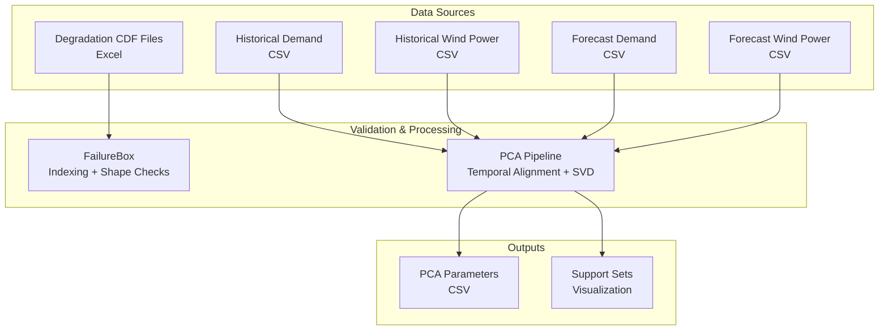
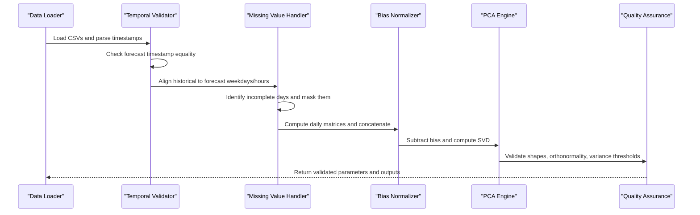
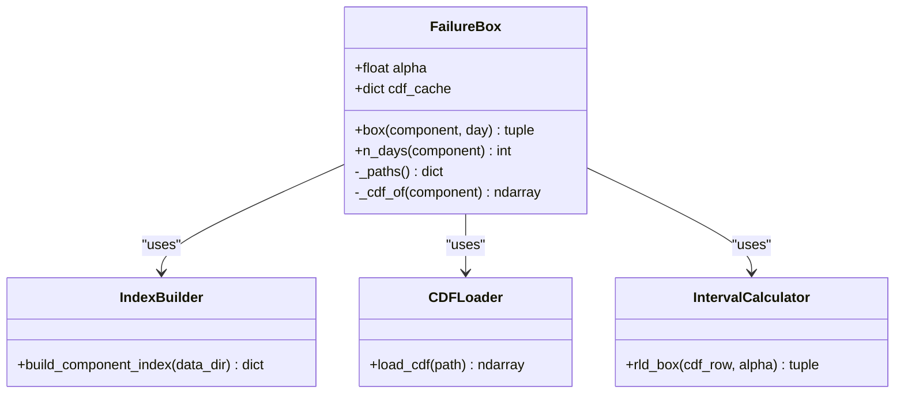
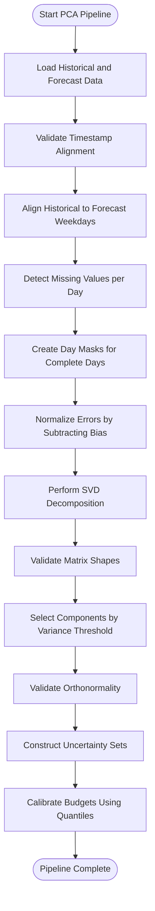
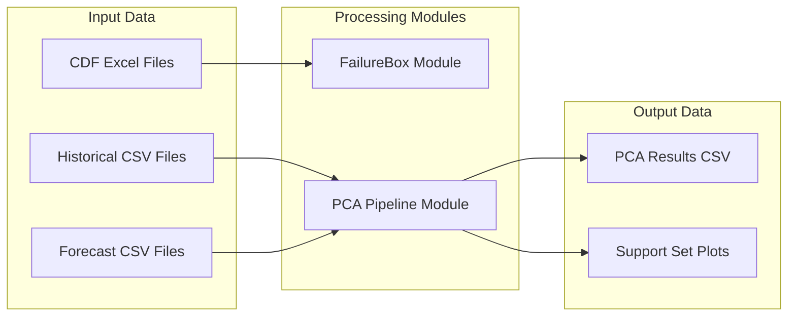

# Data Validation Procedures

<cite>
**Referenced Files in This Document**
- [failure_box.py](file://degradation/failure_box.py)
- [README.md](file://degradation/README.md)
- [pca.py](file://pca/pca.py)
- [demand_2023.csv](file://historical_data/demand_2023.csv)
- [demand_forecast_2025.csv](file://forecast/demand_forecast_2025.csv)
</cite>

## Table of Contents
1. [Introduction](#introduction)
2. [Project Structure](#project-structure)
3. [Core Components](#core-components)
4. [Architecture Overview](#architecture-overview)
5. [Detailed Component Analysis](#detailed-component-analysis)
6. [Dependency Analysis](#dependency-analysis)
7. [Performance Considerations](#performance-considerations)
8. [Troubleshooting Guide](#troubleshooting-guide)
9. [Conclusion](#conclusion)

## Introduction
This document explains the data validation and quality assurance procedures used across the system, focusing on:
- Temporal consistency checks between historical and forecast time series
- Range and format validations for input data
- Preprocessing and normalization techniques applied before analysis
- Error handling strategies and reporting mechanisms
- Quality assurance workflows that verify data integrity prior to modeling
- Data cleaning practices, missing value handling, and outlier detection approaches as implemented in the pipeline

The codebase implements two main validation and processing paths:
- Degradation component support via cumulative distribution functions (CDFs), with strict shape and index validation
- Forecast-historical alignment and Principal Component Analysis (PCA) calibration, including temporal alignment, variance thresholds, and uncertainty set construction

## Project Structure
The repository is organized by analytical modules and data sources:
- `degradation/`: Contains logic for degradation components and their residual life intervals
- `pca/`: Implements PCA-based uncertainty set calibration using historical and forecast data
- `historical_data/`: Stores hourly historical demand and wind power series
- `forecast/`: Stores hourly forecasts for demand and wind power

**Diagram sources**
- [pca.py:1-323](file://pca/pca.py#L1-L323)
- [failure_box.py:1-134](file://degradation/failure_box.py#L1-L134)

**Section sources**
- [pca.py:1-323](file://pca/pca.py#L1-L323)
- [failure_box.py:1-134](file://degradation/failure_box.py#L1-L134)

## Core Components
This section summarizes the primary validation and preprocessing components:

- FailureBox (Degradation):
  - Validates alpha parameter ranges
  - Builds a component index from file naming conventions
  - Enforces fixed column count for CDF arrays
  - Computes central interval bounds using quantiles over CDF rows
  - Provides robust error messages for invalid inputs and unsupported days

- PCA Pipeline:
  - Loads and parses timestamps for both forecast and historical datasets
  - Validates temporal alignment between wind and demand forecasts
  - Aligns historical series to forecast weekdays and hours
  - Detects incomplete days due to missing values and excludes them
  - Normalizes errors by subtracting bias terms
  - Applies SVD to derive principal components and scores
  - Selects components based on explained variance thresholds
  - Constructs uncertainty sets and calibrates budgets using quantiles

**Section sources**
- [failure_box.py:17-66](file://degradation/failure_box.py#L17-L66)
- [failure_box.py:69-106](file://degradation/failure_box.py#L69-L106)
- [failure_box.py:109-133](file://degradation/failure_box.py#L109-L133)
- [pca.py:24-38](file://pca/pca.py#L24-L38)
- [pca.py:41-69](file://pca/pca.py#L41-L69)
- [pca.py:71-126](file://pca/pca.py#L71-L126)
- [pca.py:131-179](file://pca/pca.py#L131-L179)
- [pca.py:184-234](file://pca/pca.py#L184-L234)

## Architecture Overview
The validation architecture ensures data integrity at multiple stages:

**Diagram sources**
- [pca.py:24-38](file://pca/pca.py#L24-L38)
- [pca.py:41-69](file://pca/pca.py#L41-L69)
- [pca.py:71-126](file://pca/pca.py#L71-L126)
- [pca.py:131-179](file://pca/pca.py#L131-L179)

## Detailed Component Analysis

### Degradation Component Validation (FailureBox)
The FailureBox module enforces strict validation rules for degradation data:

- Alpha Parameter Validation: Ensures alpha is within the open interval (0, 1)
- Component Index Building: Validates file naming patterns and component ranges
- CDF Loading: Verifies array dimensions match expected shape (n_days × 500)
- Interval Computation: Uses quantile-based search to determine lower and upper bounds

**Diagram sources**
- [failure_box.py:17-66](file://degradation/failure_box.py#L17-L66)
- [failure_box.py:69-95](file://degradation/failure_box.py#L69-L95)
- [failure_box.py:98-106](file://degradation/failure_box.py#L98-L106)
- [failure_box.py:109-133](file://degradation/failure_box.py#L109-L133)

**Section sources**
- [failure_box.py:24-30](file://degradation/failure_box.py#L24-L30)
- [failure_box.py:32-48](file://degradation/failure_box.py#L32-L48)
- [failure_box.py:69-95](file://degradation/failure_box.py#L69-L95)
- [failure_box.py:98-106](file://degradation/failure_box.py#L98-L106)
- [failure_box.py:109-133](file://degradation/failure_box.py#L109-L133)

### PCA Pipeline Validation and Normalization
The PCA pipeline implements comprehensive validation and preprocessing:

- Temporal Alignment: Ensures historical and forecast data align by weekday and hour
- Missing Value Detection: Identifies incomplete days and creates masks for exclusion
- Bias Normalization: Subtracts mean bias from error series
- SVD Decomposition: Performs singular value decomposition for dimensionality reduction
- Variance Threshold Validation: Ensures sufficient variance retention in selected components

**Diagram sources**
- [pca.py:24-38](file://pca/pca.py#L24-L38)
- [pca.py:41-69](file://pca/pca.py#L41-L69)
- [pca.py:71-126](file://pca/pca.py#L71-L126)
- [pca.py:131-179](file://pca/pca.py#L131-L179)
- [pca.py:184-234](file://pca/pca.py#L184-L234)

**Section sources**
- [pca.py:24-38](file://pca/pca.py#L24-L38)
- [pca.py:41-69](file://pca/pca.py#L41-L69)
- [pca.py:71-126](file://pca/pca.py#L71-L126)
- [pca.py:131-179](file://pca/pca.py#L131-L179)
- [pca.py:184-234](file://pca/pca.py#L184-L234)

## Dependency Analysis
The system exhibits clear separation of concerns with minimal coupling between components:

**Diagram sources**
- [pca.py:1-323](file://pca/pca.py#L1-L323)
- [failure_box.py:1-134](file://degradation/failure_box.py#L1-L134)

**Section sources**
- [pca.py:1-323](file://pca/pca.py#L1-L323)
- [failure_box.py:1-134](file://degradation/failure_box.py#L1-L134)

## Performance Considerations
Key performance aspects of the validation and preprocessing pipeline:

- **Memory Efficiency**: The PCA pipeline processes data in chunks by year and concatenates results, reducing memory footprint during large dataset operations
- **Vectorized Operations**: Heavy use of NumPy vectorized operations for matrix computations and statistical calculations
- **Caching Strategy**: FailureBox caches loaded CDF arrays in memory to avoid repeated file I/O operations
- **Early Validation**: Input validation occurs early in the pipeline to fail fast on invalid data
- **Dimensionality Reduction**: PCA reduces high-dimensional data to manageable component spaces while preserving variance

[No sources needed since this section provides general guidance]

## Troubleshooting Guide
Common issues and their resolution strategies:

### Temporal Alignment Issues
- **Problem**: Historical and forecast data don't align by weekday
- **Symptom**: ValueError indicating mismatched day-of-week patterns
- **Resolution**: Verify that historical data starts on the correct weekday relative to forecast origin

### Missing Value Problems
- **Problem**: Incomplete days due to NaN values in any of the three series (wind AB, wind KA, demand)
- **Symptom**: Days are excluded from analysis, potentially reducing sample size
- **Resolution**: Investigate data source gaps and consider imputation strategies if appropriate

### CDF File Format Issues
- **Problem**: Incorrect number of columns in CDF files
- **Symptom**: ValueError about expected vs actual column count
- **Resolution**: Ensure all CDF files have exactly 500 columns representing residual life days

### Component Index Errors
- **Problem**: Invalid component numbers or duplicate files
- **Symptom**: ValueError about component range or duplicate entries
- **Resolution**: Verify file naming convention follows pattern `cdf_<signal>_<component>.xlsx` with components in range 1-100

### Variance Threshold Failures
- **Problem**: Insufficient variance retained by selected components
- **Symptom**: ValueError about variance threshold not met
- **Resolution**: Adjust variance threshold or investigate data quality issues

**Section sources**
- [pca.py:71-72](file://pca/pca.py#L71-L72)
- [pca.py:79-88](file://pca/pca.py#L79-L88)
- [failure_box.py:101-105](file://degradation/failure_box.py#L101-L105)
- [failure_box.py:83-90](file://degradation/failure_box.py#L83-L90)
- [pca.py:177-178](file://pca/pca.py#L177-L178)

## Conclusion
The system implements comprehensive data validation and quality assurance procedures across multiple stages:

- **Temporal Consistency**: Rigorous alignment between historical and forecast data ensures valid comparisons
- **Range Validations**: Strict bounds checking for parameters like alpha and component indices prevents invalid operations
- **Format Verification**: Automated validation of file structures and data dimensions catches structural issues early
- **Preprocessing Pipeline**: Systematic handling of missing values, bias normalization, and dimensionality reduction prepares data for analysis
- **Error Handling**: Detailed error messages facilitate debugging and troubleshooting
- **Quality Assurance**: Multiple validation checkpoints ensure data integrity throughout the processing pipeline

These procedures collectively ensure that the downstream analysis operates on clean, validated, and properly aligned data, enhancing the reliability of the resulting models and predictions.

[No sources needed since this section summarizes without analyzing specific files]