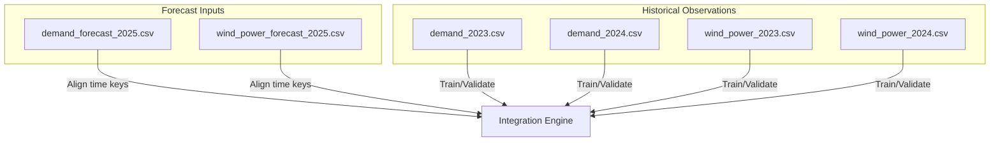
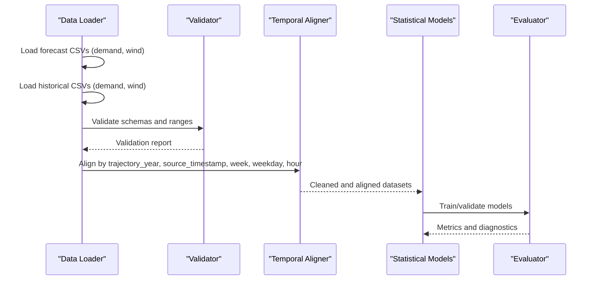
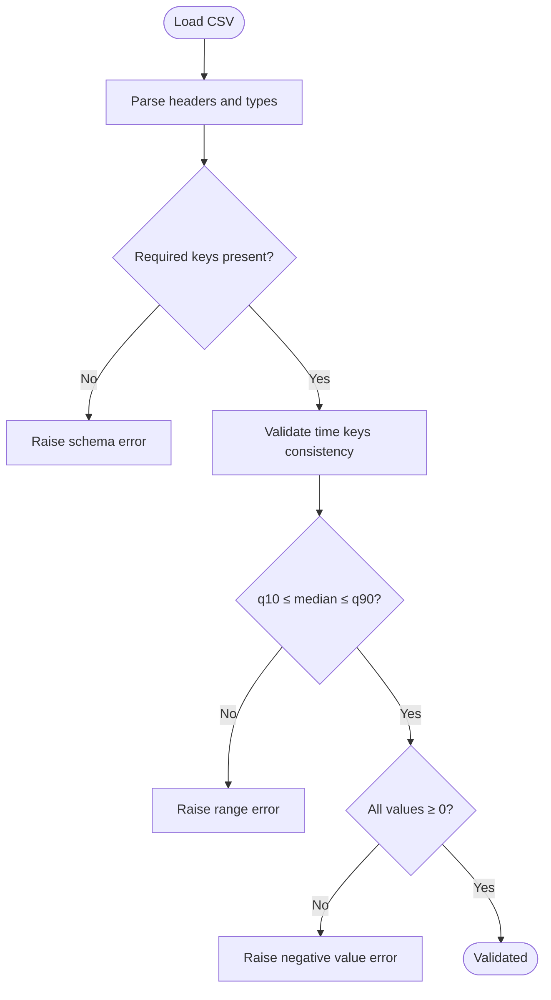
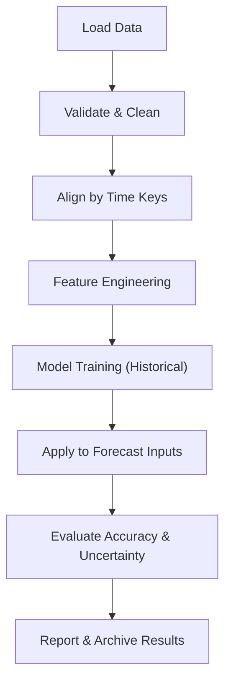
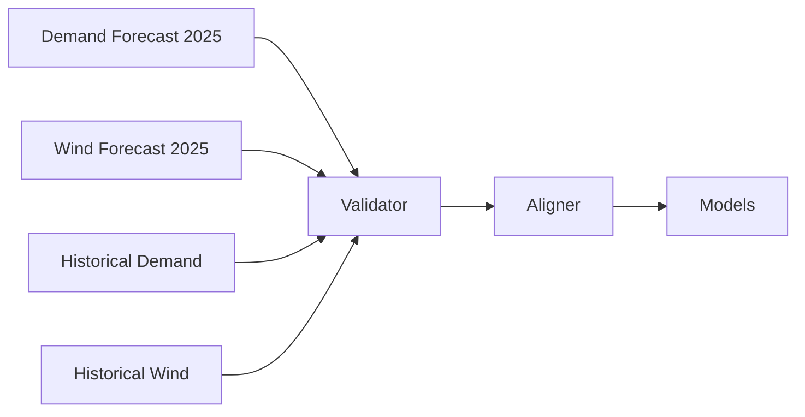

# Forecast Data Integration

<cite>
**Referenced Files in This Document**
- [demand_forecast_2025.csv](file://forecast/demand_forecast_2025.csv)
- [wind_power_forecast_2025.csv](file://forecast/wind_power_forecast_2025.csv)
- [demand_2023.csv](file://historical_data/demand_2023.csv)
- [demand_2024.csv](file://historical_data/demand_2024.csv)
- [wind_power_2023.csv](file://historical_data/wind_power_2023.csv)
- [wind_power_2024.csv](file://historical_data/wind_power_2024.csv)
</cite>

## Table of Contents
1. [Introduction](#introduction)
2. [Project Structure](#project-structure)
3. [Core Components](#core-components)
4. [Architecture Overview](#architecture-overview)
5. [Detailed Component Analysis](#detailed-component-analysis)
6. [Dependency Analysis](#dependency-analysis)
7. [Performance Considerations](#performance-considerations)
8. [Troubleshooting Guide](#troubleshooting-guide)
9. [Conclusion](#conclusion)

## Introduction
This document explains how to integrate 2025 forecast data for wind power and electricity demand with historical statistical models. It covers the structure and format of the forecast datasets, temporal alignment rules, validation procedures, uncertainty handling, and compatibility requirements between forecast and historical datasets. It also provides guidance on loading, validating, and integrating these datasets into a forecasting pipeline.

## Project Structure
The repository organizes data by type:
- Forecast inputs for 2025 are stored under forecast/.
- Historical observations used for model training or benchmarking are stored under historical_data/.

**Diagram sources**
- [demand_forecast_2025.csv:1-10](file://forecast/demand_forecast_2025.csv#L1-L10)
- [wind_power_forecast_2025.csv:1-10](file://forecast/wind_power_forecast_2025.csv#L1-L10)
- [demand_2023.csv:1-10](file://historical_data/demand_2023.csv#L1-L10)
- [demand_2024.csv:1-10](file://historical_data/demand_2024.csv#L1-L10)
- [wind_power_2023.csv:1-10](file://historical_data/wind_power_2023.csv#L1-L10)
- [wind_power_2024.csv:1-10](file://historical_data/wind_power_2024.csv#L1-L10)

**Section sources**
- [demand_forecast_2025.csv:1-10](file://forecast/demand_forecast_2025.csv#L1-L10)
- [wind_power_forecast_2025.csv:1-10](file://forecast/wind_power_forecast_2025.csv#L1-L10)
- [demand_2023.csv:1-10](file://historical_data/demand_2023.csv#L1-L10)
- [demand_2024.csv:1-10](file://historical_data/demand_2024.csv#L1-L10)
- [wind_power_2023.csv:1-10](file://historical_data/wind_power_2023.csv#L1-L10)
- [wind_power_2024.csv:1-10](file://historical_data/wind_power_2024.csv#L1-L10)

## Core Components
- Forecast datasets (2025):
  - Demand forecast includes probabilistic quantiles (q10, median, q90).
  - Wind power forecast includes two scenarios (ab and ka), each with quantiles (q10, median, q90).
- Historical datasets (2023–2024):
  - Demand and wind power observed series at hourly resolution.

Key schema elements:
- Common time keys: trajectory_year, source_timestamp, horizon_hour, week, weekday, hour.
- Units: MW for all energy values.
- Temporal granularity: hourly timestamps.

Validation anchors:
- Consistency across time keys (e.g., weekday/hour consistency with timestamp).
- Quantile ordering (q10 ≤ median ≤ q90).
- Non-negative values for physical quantities.
- Complete coverage per day (24 rows per date).

**Section sources**
- [demand_forecast_2025.csv:1-10](file://forecast/demand_forecast_2025.csv#L1-L10)
- [wind_power_forecast_2025.csv:1-10](file://forecast/wind_power_forecast_2025.csv#L1-L10)
- [demand_2023.csv:1-10](file://historical_data/demand_2023.csv#L1-L10)
- [wind_power_2023.csv:1-10](file://historical_data/wind_power_2023.csv#L1-L10)

## Architecture Overview
The integration workflow aligns forecast and historical data using shared time keys, validates data integrity, and feeds both into statistical models for scenario analysis and planning.

**Diagram sources**
- [demand_forecast_2025.csv:1-10](file://forecast/demand_forecast_2025.csv#L1-L10)
- [wind_power_forecast_2025.csv:1-10](file://forecast/wind_power_forecast_2025.csv#L1-L10)
- [demand_2023.csv:1-10](file://historical_data/demand_2023.csv#L1-L10)
- [wind_power_2023.csv:1-10](file://historical_data/wind_power_2023.csv#L1-L10)

## Detailed Component Analysis

### Forecast Data Schema and Semantics
- Time indexing:
  - trajectory_year: target year (2025).
  - source_timestamp: datetime of the forecast issuance.
  - horizon_hour: index from the start of the horizon window.
  - week, weekday, hour: calendar features for seasonality and periodicity.
- Demand forecast columns:
  - demand_q10_MW, demand_median_MW, demand_q90_MW: probabilistic quantiles.
- Wind power forecast columns:
  - wind_ab_q10_MW, wind_ab_median_MW, wind_ab_q90_MW: scenario ab quantiles.
  - wind_ka_q10_MW, wind_ka_median_MW, wind_ka_q90_MW: scenario ka quantiles.

**Diagram sources**
- [demand_forecast_2025.csv:1-10](file://forecast/demand_forecast_2025.csv#L1-L10)
- [wind_power_forecast_2025.csv:1-10](file://forecast/wind_power_forecast_2025.csv#L1-L10)

**Section sources**
- [demand_forecast_2025.csv:1-10](file://forecast/demand_forecast_2025.csv#L1-L10)
- [wind_power_forecast_2025.csv:1-10](file://forecast/wind_power_forecast_2025.csv#L1-L10)

### Temporal Alignment Rules
- Primary alignment key: source_timestamp.
- Secondary keys for robustness: trajectory_year, week, weekday, hour.
- Horizon continuity: horizon_hour should be monotonic within each source_timestamp group.
- Daily completeness: expect 24 rows per calendar day; missing hours must be flagged.

Alignment checks:
- Verify that weekday and hour match source_timestamp.
- Ensure no duplicate rows per (trajectory_year, source_timestamp, horizon_hour).
- Confirm contiguous horizon windows when required by downstream models.

**Section sources**
- [demand_forecast_2025.csv:1-24](file://forecast/demand_forecast_2025.csv#L1-L24)
- [wind_power_forecast_2025.csv:1-24](file://forecast/wind_power_forecast_2025.csv#L1-L24)

### Historical Data Compatibility
- Historical files use the same time keys (trajectory_year, source_timestamp, week, weekday, hour) enabling direct joins or merges.
- For demand, historical series include a single demand column; for wind power, a single observed column.
- When merging, ensure consistent timezone and datetime parsing across forecast and historical datasets.

Compatibility guidelines:
- Normalize units to MW.
- Standardize column names before joining.
- Handle missing historical values via imputation or exclusion based on policy.

**Section sources**
- [demand_2023.csv:1-10](file://historical_data/demand_2023.csv#L1-L10)
- [demand_2024.csv:1-10](file://historical_data/demand_2024.csv#L1-L10)
- [wind_power_2023.csv:1-10](file://historical_data/wind_power_2023.csv#L1-L10)
- [wind_power_2024.csv:1-10](file://historical_data/wind_power_2024.csv#L1-L10)

### Integration Workflow
The recommended pipeline:
1. Load forecast and historical datasets.
2. Validate schemas, ranges, and temporal consistency.
3. Align datasets by time keys.
4. Compute derived features if needed (e.g., rolling statistics, lagged variables).
5. Fit statistical models on historical data.
6. Apply models to forecast inputs to produce integrated forecasts or scenario analyses.
7. Evaluate accuracy and uncertainty coverage.

[No sources needed since this diagram shows conceptual workflow, not actual code structure]

### Validation Procedures
- Schema validation:
  - Required columns exist and have correct types.
  - Units are MW and numeric.
- Range validation:
  - All values non-negative.
  - Quantile ordering holds (q10 ≤ median ≤ q90).
- Temporal validation:
  - weekday/hour consistent with source_timestamp.
  - No duplicates on primary keys.
  - Continuous horizon_hour sequences where applicable.
- Completeness:
  - 24 rows per day for full-day coverage.
  - No gaps in weekly patterns unless explicitly modeled.

Error handling:
- Raise explicit errors for schema mismatches.
- Flag and quarantine rows failing range or temporal checks.
- Provide summary reports of validation failures.

**Section sources**
- [demand_forecast_2025.csv:1-24](file://forecast/demand_forecast_2025.csv#L1-L24)
- [wind_power_forecast_2025.csv:1-24](file://forecast/wind_power_forecast_2025.csv#L1-L24)

### Handling Uncertainty Ranges
- Use quantile columns to represent uncertainty bands:
  - Lower bound: q10.
  - Central tendency: median.
  - Upper bound: q90.
- For wind power, evaluate both scenarios (ab and ka) separately or jointly depending on use case.
- Coverage checks:
  - Compare historical observation coverage against forecast quantile bands.
  - Track calibration metrics (e.g., quantile score, interval score).

Guidelines:
- Do not collapse quantiles prematurely; preserve them through modeling where possible.
- If deterministic outputs are required, propagate uncertainty via Monte Carlo sampling over quantiles or model residuals.

**Section sources**
- [demand_forecast_2025.csv:1-10](file://forecast/demand_forecast_2025.csv#L1-L10)
- [wind_power_forecast_2025.csv:1-10](file://forecast/wind_power_forecast_2025.csv#L1-L10)

### Code Patterns for Loading, Validation, and Integration
Below are pattern descriptions without embedding code content. Replace placeholders with your preferred library functions.

- Loading:
  - Read CSVs into tabular structures.
  - Parse datetime columns from source_timestamp.
  - Cast numeric columns to float.
- Validation:
  - Assert presence of required columns.
  - Enforce non-negative constraints.
  - Check quantile ordering per row.
  - Validate weekday/hour vs timestamp.
- Alignment:
  - Sort by source_timestamp and horizon_hour.
  - Group by trajectory_year and source_timestamp.
  - Merge forecast and historical datasets on time keys.
- Integration:
  - Fit models on historical series.
  - Predict or simulate using forecast inputs.
  - Preserve quantile columns for uncertainty reporting.

Example references:
- Forecast schema and sample rows: [demand_forecast_2025.csv:1-10](file://forecast/demand_forecast_2025.csv#L1-L10), [wind_power_forecast_2025.csv:1-10](file://forecast/wind_power_forecast_2025.csv#L1-L10).
- Historical schema and sample rows: [demand_2023.csv:1-10](file://historical_data/demand_2023.csv#L1-L10), [wind_power_2023.csv:1-10](file://historical_data/wind_power_2023.csv#L1-L10).

**Section sources**
- [demand_forecast_2025.csv:1-10](file://forecast/demand_forecast_2025.csv#L1-L10)
- [wind_power_forecast_2025.csv:1-10](file://forecast/wind_power_forecast_2025.csv#L1-L10)
- [demand_2023.csv:1-10](file://historical_data/demand_2023.csv#L1-L10)
- [wind_power_2023.csv:1-10](file://historical_data/wind_power_2023.csv#L1-L10)

## Dependency Analysis
- Forecast files depend on consistent time keys to align with historical records.
- Historical files provide the statistical baseline for model training and evaluation.
- The integration engine depends on robust validation to prevent propagation of inconsistent data.

**Diagram sources**
- [demand_forecast_2025.csv:1-10](file://forecast/demand_forecast_2025.csv#L1-L10)
- [wind_power_forecast_2025.csv:1-10](file://forecast/wind_power_forecast_2025.csv#L1-L10)
- [demand_2023.csv:1-10](file://historical_data/demand_2023.csv#L1-L10)
- [wind_power_2023.csv:1-10](file://historical_data/wind_power_2023.csv#L1-L10)

**Section sources**
- [demand_forecast_2025.csv:1-10](file://forecast/demand_forecast_2025.csv#L1-L10)
- [wind_power_forecast_2025.csv:1-10](file://forecast/wind_power_forecast_2025.csv#L1-L10)
- [demand_2023.csv:1-10](file://historical_data/demand_2023.csv#L1-L10)
- [wind_power_2023.csv:1-10](file://historical_data/wind_power_2023.csv#L1-L10)

## Performance Considerations
- Prefer vectorized operations for validation and alignment to minimize overhead.
- Process large CSVs in chunks if memory is constrained.
- Cache intermediate aligned datasets to avoid repeated I/O.
- Use efficient datetime parsing and indexing strategies.

[No sources needed since this section provides general guidance]

## Troubleshooting Guide
Common issues and resolutions:
- Missing columns:
  - Symptom: Schema validation fails.
  - Resolution: Add required columns or adjust loader mapping.
- Invalid quantile ordering:
  - Symptom: q10 > median or median > q90.
  - Resolution: Inspect source generation logic; flag and exclude invalid rows.
- Time inconsistencies:
  - Symptom: weekday/hour mismatch with source_timestamp.
  - Resolution: Recalculate weekday/hour from timestamp; correct or remove misaligned rows.
- Duplicate entries:
  - Symptom: Multiple rows with same primary key.
  - Resolution: Deduplicate by keeping latest or aggregating as appropriate.
- Negative values:
  - Symptom: Negative energy values detected.
  - Resolution: Clamp to zero only after investigation; log and quarantine affected rows.

**Section sources**
- [demand_forecast_2025.csv:1-24](file://forecast/demand_forecast_2025.csv#L1-L24)
- [wind_power_forecast_2025.csv:1-24](file://forecast/wind_power_forecast_2025.csv#L1-L24)

## Conclusion
By adhering to the defined schemas, validation rules, and alignment procedures, you can reliably integrate 2025 forecast data with historical observations. Preserving uncertainty quantiles and ensuring temporal consistency are critical for accurate and interpretable results. The provided workflows and guidelines enable robust forecasting pipelines that combine probabilistic forecasts with statistical models while maintaining data quality and reproducibility.