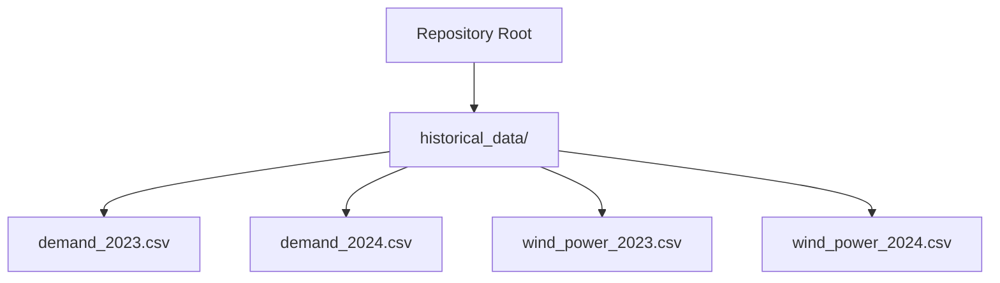
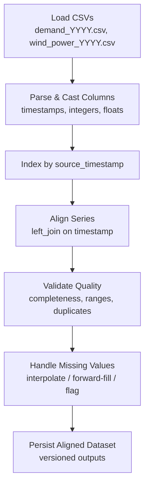
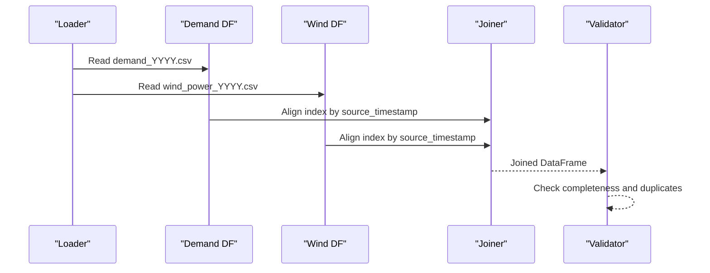
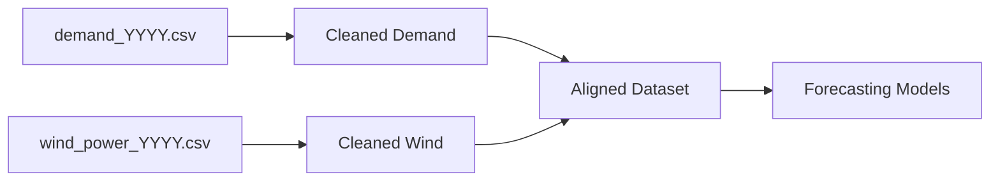

# Historical Data Structure

<cite>
**Referenced Files in This Document**
- [demand_2023.csv](file://historical_data/demand_2023.csv)
- [demand_2024.csv](file://historical_data/demand_2024.csv)
- [wind_power_2023.csv](file://historical_data/wind_power_2023.csv)
- [wind_power_2024.csv](file://historical_data/wind_power_2024.csv)
</cite>

## Table of Contents
1. [Introduction](#introduction)
2. [Project Structure](#project-structure)
3. [Core Components](#core-components)
4. [Architecture Overview](#architecture-overview)
5. [Detailed Component Analysis](#detailed-component-analysis)
6. [Dependency Analysis](#dependency-analysis)
7. [Performance Considerations](#performance-considerations)
8. [Troubleshooting Guide](#troubleshooting-guide)
9. [Conclusion](#conclusion)

## Introduction
This document describes the historical data structure and organization for wind power and demand time series from 2023–2024. It explains the CSV schema, temporal resolution, naming conventions, directory layout, alignment procedures, missing value handling, validation checks, loading patterns, preprocessing steps, and versioning/backup strategies to support reproducible research.

## Project Structure
Historical datasets are stored as flat CSV files under a single directory:
- historical_data/demand_YYYY.csv
- historical_data/wind_power_YYYY.csv

Each file contains one year of hourly observations with consistent column semantics across years.

**Diagram sources**
- [demand_2023.csv:1-10](file://historical_data/demand_2023.csv#L1-L10)
- [demand_2024.csv:1-10](file://historical_data/demand_2024.csv#L1-L10)
- [wind_power_2023.csv:1-10](file://historical_data/wind_power_2023.csv#L1-L10)
- [wind_power_2024.csv:1-10](file://historical_data/wind_power_2024.csv#L1-L10)

**Section sources**
- [demand_2023.csv:1-10](file://historical_data/demand_2023.csv#L1-L10)
- [demand_2024.csv:1-10](file://historical_data/demand_2024.csv#L1-L10)
- [wind_power_2023.csv:1-10](file://historical_data/wind_power_2023.csv#L1-L10)
- [wind_power_2024.csv:1-10](file://historical_data/wind_power_2024.csv#L1-L10)

## Core Components
The dataset comprises two primary series:
- Demand series (hourly consumption)
- Wind power series (hourly generation per site)

Both share a common temporal index schema that enables direct alignment by timestamp.

Key attributes:
- Temporal resolution: Hourly
- Time coverage: Full calendar years 2023 and 2024
- Schema consistency: Identical columns within each series type across years

**Section sources**
- [demand_2023.csv:1-10](file://historical_data/demand_2023.csv#L1-L10)
- [demand_2024.csv:1-10](file://historical_data/demand_2024.csv#L1-L10)
- [wind_power_2023.csv:1-10](file://historical_data/wind_power_2023.csv#L1-L10)
- [wind_power_2024.csv:1-10](file://historical_data/wind_power_2024.csv#L1-L10)

## Architecture Overview
At a high level, the data pipeline ingests yearly CSVs, normalizes timestamps, aligns series on a shared hourly grid, validates quality, and produces aligned datasets ready for modeling or forecasting.

[No sources needed since this diagram shows conceptual workflow, not actual code structure]

## Detailed Component Analysis

### CSV Schema and Column Definitions

#### Demand CSV Columns
- trajectory_year: Integer year label (e.g., 2023, 2024)
- source_timestamp: Datetime string representing the start of the hour
- horizon_hour: Integer hour offset from the beginning of the dataset
- week: Integer week number within the year
- weekday: Integer day-of-week (0=Sunday … 6=Saturday)
- hour: Integer hour-of-day (0–23)
- demand: Float numeric value representing hourly demand

Notes:
- The presence of both source_timestamp and derived fields (horizon_hour, week, weekday, hour) supports flexible indexing and feature engineering.
- The demand values are continuous floats; units are implied by domain context.

**Section sources**
- [demand_2023.csv:1-10](file://historical_data/demand_2023.csv#L1-L10)
- [demand_2024.csv:1-10](file://historical_data/demand_2024.csv#L1-L10)

#### Wind Power CSV Columns
- trajectory_year: Integer year label
- source_timestamp: Datetime string representing the start of the hour
- horizon_hour: Integer hour offset from the beginning of the dataset
- week: Integer week number within the year
- weekday: Integer day-of-week (0=Sunday … 6=Saturday)
- hour: Integer hour-of-day (0–23)
- wind_ab_MW: Float numeric value representing hourly generation at site “ab”
- wind_ka_MW: Float numeric value representing hourly generation at site “ka”

Notes:
- Two generation sites are recorded per timestamp.
- Zero values appear frequently, indicating periods of no generation.

**Section sources**
- [wind_power_2023.csv:1-10](file://historical_data/wind_power_2023.csv#L1-L10)
- [wind_power_2024.csv:1-10](file://historical_data/wind_power_2024.csv#L1-L10)

### Temporal Resolution and Indexing
- Resolution: Hourly
- Primary key for alignment: source_timestamp
- Derived temporal features: horizon_hour, week, weekday, hour
- Consistency check: For each row, hour should be consistent with source_timestamp modulo 24.

Validation recommendations:
- Ensure unique source_timestamp per file
- Verify monotonic increase of source_timestamp
- Confirm horizon_hour equals cumulative hour index starting at 0

**Section sources**
- [demand_2023.csv:1-10](file://historical_data/demand_2023.csv#L1-L10)
- [wind_power_2023.csv:1-10](file://historical_data/wind_power_2023.csv#L1-L10)

### Naming Conventions and Directory Structure
- Directory: historical_data/
- File pattern:
  - demand_YYYY.csv
  - wind_power_YYYY.csv
- Year suffix ensures clear separation of multi-year datasets and simplifies programmatic selection.

Best practices:
- Keep one year per file
- Use ISO-style YYYY suffix
- Maintain consistent capitalization and underscores

**Section sources**
- [demand_2023.csv:1-10](file://historical_data/demand_2023.csv#L1-L10)
- [demand_2024.csv:1-10](file://historical_data/demand_2024.csv#L1-L10)
- [wind_power_2023.csv:1-10](file://historical_data/wind_power_2023.csv#L1-L10)
- [wind_power_2024.csv:1-10](file://historical_data/wind_power_2024.csv#L1-L10)

### Time Series Alignment Procedures
Goal: Synchronize demand and wind power series onto a common hourly timeline.

Recommended procedure:
1. Parse source_timestamp into datetime objects.
2. Set source_timestamp as the index for both datasets.
3. Sort indices ascending.
4. Perform an outer join on source_timestamp to retain all hours.
5. After joining, validate that every expected hour is present.
6. If gaps exist, decide on imputation strategy (see Missing Values).

**Diagram sources**
- [demand_2023.csv:1-10](file://historical_data/demand_2023.csv#L1-L10)
- [wind_power_2023.csv:1-10](file://historical_data/wind_power_2023.csv#L1-L10)

**Section sources**
- [demand_2023.csv:1-10](file://historical_data/demand_2023.csv#L1-L10)
- [wind_power_2023.csv:1-10](file://historical_data/wind_power_2023.csv#L1-L10)

### Handling Missing Values
Observations:
- Wind power series contain many zero values, which represent genuine non-generation rather than missing data.
- Some timestamps may have missing entries after joins if one series lacks a record.

Recommended rules:
- Do not treat zeros in wind power as missing unless explicitly flagged.
- For genuinely missing timestamps:
  - Prefer interpolation for short gaps in smooth series (e.g., demand).
  - For wind power, consider forward-fill/backward-fill only for very short gaps, or mark as missing.
- Introduce a boolean flag column indicating whether a value was imputed.

Quality checks:
- Count NaNs per column before and after imputation.
- Validate that imputation does not introduce unrealistic spikes.

**Section sources**
- [wind_power_2023.csv:1-10](file://historical_data/wind_power_2023.csv#L1-L10)
- [wind_power_2024.csv:1-10](file://historical_data/wind_power_2024.csv#L1-L10)

### Data Quality Checks
Checklist:
- Completeness: No missing source_timestamps within the intended range.
- Uniqueness: Each source_timestamp appears exactly once per series.
- Monotonicity: source_timestamp strictly increases.
- Range validation:
  - hour ∈ [0, 23]
  - weekday ∈ [0, 6]
  - week ≥ 1
  - trajectory_year matches filename year
- Value bounds:
  - demand ≥ 0
  - wind_*_MW ≥ 0
- Consistency:
  - hour corresponds to source_timestamp.hour
  - weekday corresponds to source_timestamp.weekday()
  - week corresponds to ISO week number

Automated tests:
- Unit tests for each rule above
- Summary reports of violations

**Section sources**
- [demand_2023.csv:1-10](file://historical_data/demand_2023.csv#L1-L10)
- [demand_2024.csv:1-10](file://historical_data/demand_2024.csv#L1-L10)
- [wind_power_2023.csv:1-10](file://historical_data/wind_power_2023.csv#L1-L10)
- [wind_power_2024.csv:1-10](file://historical_data/wind_power_2024.csv#L1-L10)

### Data Loading Patterns
Recommended approach:
- Load each CSV into a DataFrame with explicit dtypes:
  - source_timestamp → datetime
  - horizon_hour, week, weekday, hour → integer
  - trajectory_year → integer
  - demand, wind_ab_MW, wind_ka_MW → float
- Set source_timestamp as index immediately after loading.
- Validate and clean before merging.

Example outline (conceptual):
- Read demand_YYYY.csv
- Read wind_power_YYYY.csv
- Convert types
- Validate
- Merge on source_timestamp

[No sources needed since this section provides general guidance]

### Preprocessing Steps
Suggested pipeline:
1. Parse and set datetime index
2. Drop duplicate timestamps
3. Reindex to complete hourly range
4. Impute missing values with documented strategy
5. Create derived features (e.g., rolling averages, lags)
6. Save processed artifacts with versioning

[No sources needed since this section provides general guidance]

### Validation Procedures
Implement automated validations:
- Schema validation (column names and types)
- Temporal validation (ranges, monotonicity, uniqueness)
- Business-rule validation (non-negative values, consistency between derived and raw fields)
- Post-processing checks (no NaNs in final model-ready dataset unless intentional)

[No sources needed since this section provides general guidance]

### Versioning Strategies and Backup Considerations
To ensure reproducibility:
- Version control for code and configuration
- Immutable snapshots of raw CSVs (do not overwrite originals)
- Versioned outputs:
  - Include version tag in filenames or metadata (e.g., vYYYYMMDD)
  - Store checksums (SHA-256) alongside datasets
- Backups:
  - Maintain at least two geographically separate backups
  - Automate periodic backups and integrity checks
- Metadata:
  - Record provenance (source system, extraction date, transformation scripts)
  - Maintain a data dictionary describing columns, units, and transformations

[No sources needed since this section provides general guidance]

## Dependency Analysis
Conceptually, downstream models depend on:
- Correct parsing of source_timestamp
- Accurate alignment across demand and wind series
- Robust handling of missing values
- Stable schema and naming conventions

[No sources needed since this diagram shows conceptual workflow, not actual code structure]

## Performance Considerations
- Use efficient I/O: read CSVs with explicit dtypes and parse_dates for timestamps.
- Avoid unnecessary copies; operate in-place where possible.
- Vectorize operations instead of row-wise loops.
- For large-scale processing, consider chunked reading or partitioned storage formats (e.g., Parquet) for intermediate artifacts.
- Cache validated and cleaned datasets to avoid repeated processing.

[No sources needed since this section provides general guidance]

## Troubleshooting Guide
Common issues and resolutions:
- Duplicate timestamps:
  - Detect via groupby(source_timestamp).size() > 1
  - Resolve by keeping first occurrence or aggregating appropriately
- Misaligned hours:
  - Compare hour vs source_timestamp.hour
  - Fix timezone or DST issues if applicable
- Unexpected zeros in demand:
  - Investigate data source; do not blindly interpolate
- Excessive missingness after join:
  - Review join strategy; prefer outer join and document imputation policy
- Type errors:
  - Enforce strict dtypes during load; log and fix malformed rows

[No sources needed since this section provides general guidance]

## Conclusion
The historical datasets provide a consistent, hourly-resolution foundation for demand and wind power analysis across 2023 and 2024. By adhering to the defined schemas, alignment procedures, and validation checks, researchers can reliably synchronize multiple sources, handle missing data transparently, and maintain reproducible workflows through versioning and backup practices.