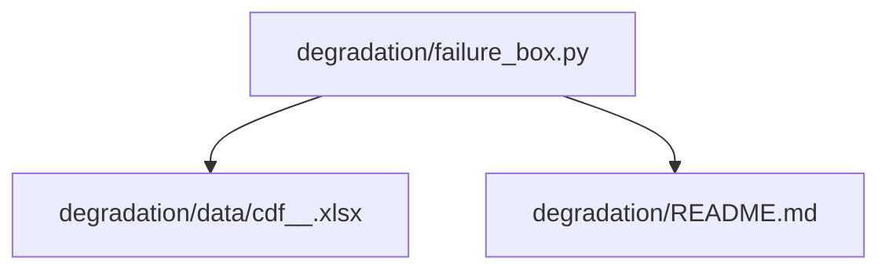
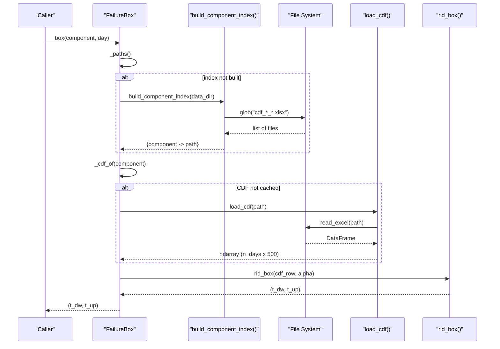
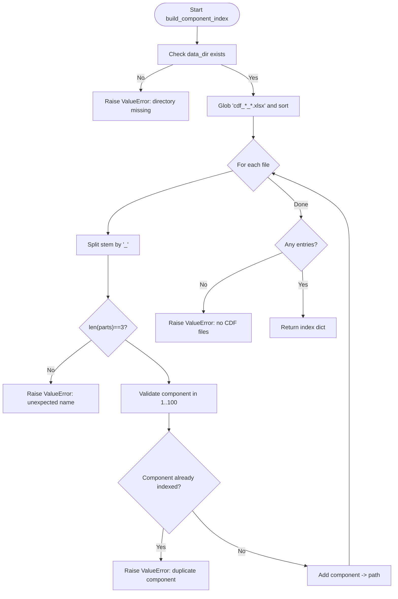
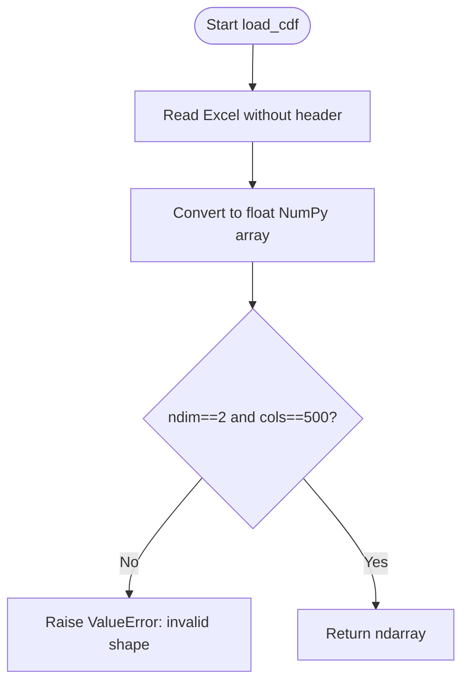
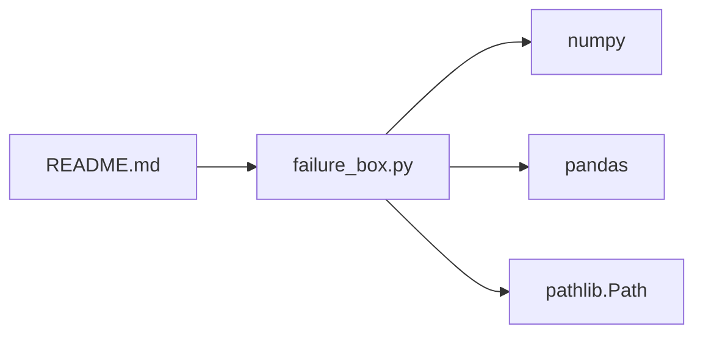

# Component Data Format and Management

<cite>
**Referenced Files in This Document**
- [failure_box.py](file://degradation/failure_box.py)
- [README.md](file://degradation/README.md)
</cite>

## Table of Contents
1. [Introduction](#introduction)
2. [Project Structure](#project-structure)
3. [Core Components](#core-components)
4. [Architecture Overview](#architecture-overview)
5. [Detailed Component Analysis](#detailed-component-analysis)
6. [Dependency Analysis](#dependency-analysis)
7. [Performance Considerations](#performance-considerations)
8. [Troubleshooting Guide](#troubleshooting-guide)
9. [Conclusion](#conclusion)

## Introduction
This document specifies the component data format and management system for residual life distributions. It explains:
- The Excel file naming convention cdf_<signal>_<component>.xlsx
- Directory structure requirements under degradation/data
- Validation rules for file names, component IDs, and CDF matrix shapes
- The build_component_index() function that maps component IDs to file paths
- The load_cdf() function that reads and validates CDF matrices with shape constraints (n_days × 500 support points)
- Concrete examples of valid structures, common errors, and troubleshooting procedures
- Performance considerations for large datasets and memory optimization strategies

The system is implemented in a single module that exposes a class-based API and utility functions for indexing and loading component CDFs.

## Project Structure
The relevant code lives under the degradation package:
- degradation/failure_box.py: Core implementation of FailureBox, build_component_index(), load_cdf(), and related helpers
- degradation/README.md: Documentation describing the data layout and usage patterns
- degradation/data/: Directory containing CDF files named per the convention

**Diagram sources**
- [failure_box.py:1-134](file://degradation/failure_box.py#L1-L134)
- [README.md:7-17](file://degradation/README.md#L7-L17)

**Section sources**
- [failure_box.py:1-15](file://degradation/failure_box.py#L1-L15)
- [README.md:7-17](file://degradation/README.md#L7-L17)

## Core Components
- FailureBox: High-level interface to compute central intervals of residual life for a given component and day. It lazily builds an index and caches loaded CDF arrays.
- build_component_index(data_dir): Scans the data directory for CDF files matching the naming convention, validates component IDs, and returns a mapping from component ID to file path.
- load_cdf(path): Reads an Excel file into a NumPy array and enforces the required shape (n_days × 500).
- rld_box(cdf_row, alpha): Computes the central interval bounds for a single CDF row at a given confidence level.

Key constants:
- CDF_SUPPORT_DAYS = 500
- N_COMPONENTS = 100
- DEFAULT_ALPHA = 0.1

**Section sources**
- [failure_box.py:11-14](file://degradation/failure_box.py#L11-L14)
- [failure_box.py:17-66](file://degradation/failure_box.py#L17-L66)
- [failure_box.py:69-106](file://degradation/failure_box.py#L69-L106)
- [failure_box.py:109-133](file://degradation/failure_box.py#L109-L133)

## Architecture Overview
The system follows a simple pipeline:
1. Indexing: Scan data directory and validate file names to produce a component-to-path map.
2. Loading: Read and validate each CDF file on demand, caching results.
3. Querying: Compute residual life intervals for a specific component and day using quantiles.

**Diagram sources**
- [failure_box.py:32-44](file://degradation/failure_box.py#L32-L44)
- [failure_box.py:50-66](file://degradation/failure_box.py#L50-L66)
- [failure_box.py:69-95](file://degradation/failure_box.py#L69-L95)
- [failure_box.py:98-106](file://degradation/failure_box.py#L98-L106)
- [failure_box.py:109-133](file://degradation/failure_box.py#L109-L133)

## Detailed Component Analysis

### File Naming Convention and Directory Requirements
- Files must be placed under degradation/data.
- Each CDF file must follow the pattern cdf_<signal>_<component>.xlsx.
- signal ranges from 1 to 19; component ranges from 1 to 100.
- There is one CDF file per component j, regardless of the originating signal i.
- The Excel file has no header row and stores a matrix of shape (n_days, 500), where:
  - Rows represent days (1-based index when querying)
  - Columns represent residual life support points up to 500 days

Validation rules enforced by the code:
- Directory existence check before scanning
- File name parsing requires exactly three underscore-separated parts after removing the .xlsx extension
- Component number must be within [1, 100]
- Duplicate components are not allowed
- At least one matching file must exist

**Section sources**
- [README.md:7-17](file://degradation/README.md#L7-L17)
- [failure_box.py:69-95](file://degradation/failure_box.py#L69-L95)

### build_component_index(data_dir)
Purpose:
- Map each component ID j to its corresponding CDF file path.
- Validate file names and component IDs.
- Detect duplicates and missing directories.

Behavior:
- Converts input to Path and checks if it exists as a directory.
- Glob for files matching cdf_*_*.xlsx and sorts them.
- Parses the stem into three parts; rejects unexpected names.
- Validates component range [1, 100].
- Raises on duplicate component entries.
- Requires at least one file; otherwise raises.

Error handling:
- Missing directory: raises ValueError with message indicating the non-existent directory.
- Invalid file name: raises ValueError with details about expected naming.
- Out-of-range component: raises ValueError specifying the invalid component value.
- Duplicate component: raises ValueError listing both conflicting file names.
- No matching files: raises ValueError stating no CDF files found.

Complexity:
- Time: O(F log F) due to sorting F matched files; validation per file is O(1).
- Space: O(C) for the resulting dictionary mapping component IDs to paths.

**Diagram sources**
- [failure_box.py:69-95](file://degradation/failure_box.py#L69-L95)

**Section sources**
- [failure_box.py:69-95](file://degradation/failure_box.py#L69-L95)

### load_cdf(path)
Purpose:
- Read a CDF Excel file into a NumPy array.
- Enforce the required shape (n_days × 500).

Behavior:
- Uses pandas to read the Excel file without headers and converts to float NumPy array.
- Checks ndim == 2 and columns == 500.
- Raises ValueError if shape is invalid.

Shape constraints:
- Exactly two dimensions
- Second dimension equals CDF_SUPPORT_DAYS (500)
- Number of rows varies per component (n_days), typically between 82 and 283 according to documentation

Error handling:
- Invalid shape: raises ValueError including the actual shape and expected column count.

Complexity:
- Time: O(n_days × 500) to parse and convert
- Space: O(n_days × 500) for the resulting array

**Diagram sources**
- [failure_box.py:98-106](file://degradation/failure_box.py#L98-L106)

**Section sources**
- [failure_box.py:98-106](file://degradation/failure_box.py#L98-L106)

### FailureBox Class
Responsibilities:
- Provide a user-friendly interface to query residual life intervals for a component on a given day.
- Lazily build the component index and cache loaded CDF arrays.
- Validate inputs such as alpha and day ranges.

Key methods:
- __init__(data_dir=None, alpha=DEFAULT_ALPHA): Validates alpha and sets configuration.
- box(component, day): Returns (t_dw, t_up) for the specified component and day.
- n_days(component): Returns the number of forecast days available for a component.
- _paths(): Builds and returns the component index.
- _cdf_of(component): Loads and caches the CDF for a component.

Input validation:
- alpha must be in (0, 1)
- day must be within [1, n_days(component)]

Caching strategy:
- CDF arrays are stored in-memory keyed by component ID to avoid repeated disk I/O.

Error handling:
- Missing component: raises ValueError with available range.
- Day out of range: raises ValueError with component-specific limits.
- Underlying rld_box errors are re-raised with context.

**Section sources**
- [failure_box.py:17-66](file://degradation/failure_box.py#L17-L66)

### rld_box(cdf_row, alpha)
Purpose:
- Compute the central interval [t_dw, t_up] covering probability mass 1 − α for a single CDF row.

Algorithm:
- Validates alpha ∈ (0, 1).
- Ensures the row is a non-empty 1-D array.
- Computes lower_quantile = α/2 and upper_quantile = 1 − α/2.
- Verifies that the last cumulative probability reaches at least upper_quantile; otherwise raises an error suggesting a larger α or longer support.
- Uses searchsorted to find indices for the quantiles and returns 1-based day offsets.

Error handling:
- Invalid alpha: raises ValueError.
- Invalid row shape: raises ValueError.
- Insufficient support: raises ValueError with guidance on adjusting α.

Complexity:
- Time: O(k) where k is the number of support points (500).
- Space: O(1) beyond the input row.

**Section sources**
- [failure_box.py:109-133](file://degradation/failure_box.py#L109-L133)

## Dependency Analysis
High-level dependencies:
- failure_box.py depends on pathlib.Path for filesystem operations.
- failure_box.py uses numpy for numerical operations and pandas for Excel reading.
- README.md documents the data layout and usage patterns.

**Diagram sources**
- [failure_box.py:1-9](file://degradation/failure_box.py#L1-L9)
- [README.md:1-5](file://degradation/README.md#L1-L5)

**Section sources**
- [failure_box.py:1-9](file://degradation/failure_box.py#L1-L9)
- [README.md:1-5](file://degradation/README.md#L1-L5)

## Performance Considerations
- Memory usage:
  - Each CDF array consumes approximately n_days × 500 × 8 bytes (float64). For example, a CDF with 200 rows uses ~800 KB.
  - The FailureBox caches all loaded CDF arrays in memory; this avoids repeated disk reads but increases memory consumption proportional to the number of components accessed.
- I/O optimization:
  - Lazy loading ensures only requested CDFs are read.
  - Sorting matched files adds minimal overhead compared to disk I/O.
- Numerical efficiency:
  - rld_box uses vectorized searchsorted over 500 elements, which is fast.
- Recommendations:
  - If working with many components simultaneously, consider limiting the set of components loaded or implementing a bounded cache.
  - Use float32 if precision allows to halve memory usage, though the current implementation uses float64 for compatibility with pandas/numpy defaults.
  - Pre-warm the index once at startup if multiple queries will be performed across components.

[No sources needed since this section provides general guidance]

## Troubleshooting Guide
Common issues and resolutions:

- Missing data directory
  - Symptom: Error indicating the degradation directory does not exist.
  - Cause: build_component_index receives a non-existent path.
  - Resolution: Ensure data_dir points to a valid directory containing CDF files.

- Unexpected file name
  - Symptom: Error stating the file name does not match cdf_<signal>_<component>.xlsx.
  - Cause: The file stem does not split into exactly three parts by underscores.
  - Resolution: Rename files to conform to the naming convention.

- Component out of range
  - Symptom: Error indicating component is outside 1–100.
  - Cause: The numeric suffix in the file name is not within the allowed range.
  - Resolution: Adjust the component number to be within [1, 100].

- Duplicate component
  - Symptom: Error reporting duplicate component with two file names.
  - Cause: Multiple files map to the same component ID.
  - Resolution: Remove or rename conflicting files so each component has exactly one CDF file.

- No CDF files found
  - Symptom: Error stating no cdf_*_*.xlsx files were found in the directory.
  - Cause: The directory lacks any matching files.
  - Resolution: Place correctly named CDF files in the data directory.

- Invalid CDF shape
  - Symptom: Error indicating expected 500 columns but got a different shape.
  - Cause: The Excel file does not have exactly 500 columns.
  - Resolution: Ensure each CDF file has shape (n_days, 500) with no header row.

- Day out of range
  - Symptom: Error stating the requested day is outside the component’s available days.
  - Cause: day is not within [1, n_days(component)].
  - Resolution: Use a day within the component’s forecast horizon.

- Insufficient CDF support for quantile
  - Symptom: Error indicating the maximum cumulative probability does not reach 1 − α/2.
  - Cause: The CDF support length is insufficient for the chosen α.
  - Resolution: Increase α or ensure the CDF extends to cover the required quantile.

**Section sources**
- [failure_box.py:69-106](file://degradation/failure_box.py#L69-L106)
- [failure_box.py:109-133](file://degradation/failure_box.py#L109-L133)

## Conclusion
The component data format and management system provides a robust, validated pipeline for indexing and loading residual life CDFs from Excel files. It enforces strict naming conventions, component ID ranges, and matrix shape constraints, while offering efficient lazy loading and caching. The FailureBox API simplifies querying central intervals for residual life, and comprehensive error messages guide users through common data and configuration issues. For large-scale use, consider memory-aware strategies such as selective loading or reduced precision to optimize performance.

[No sources needed since this section summarizes without analyzing specific files]