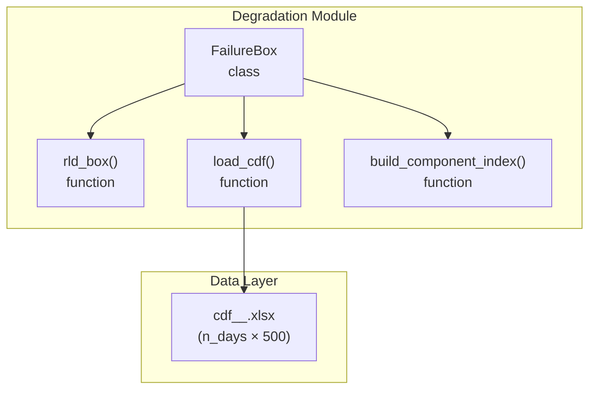
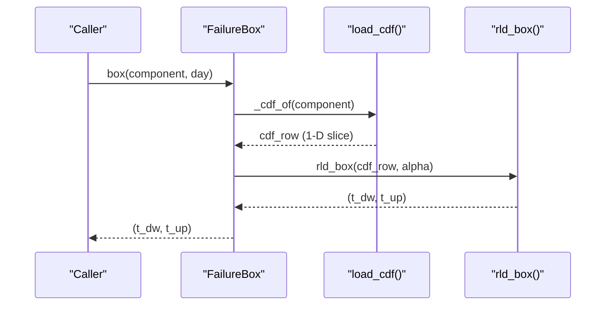
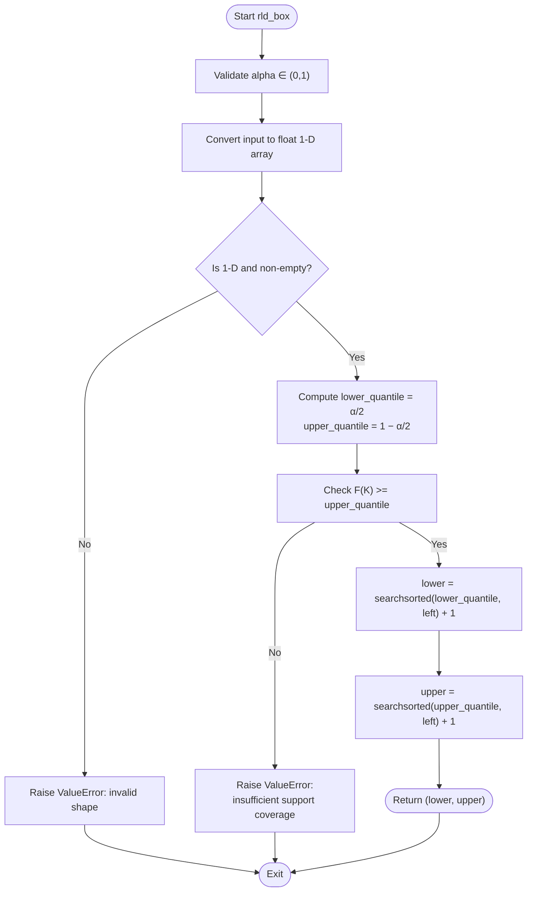
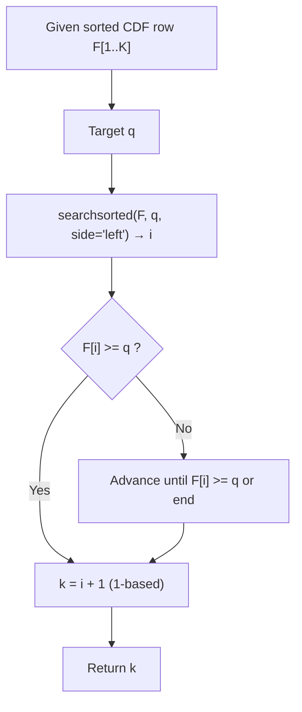
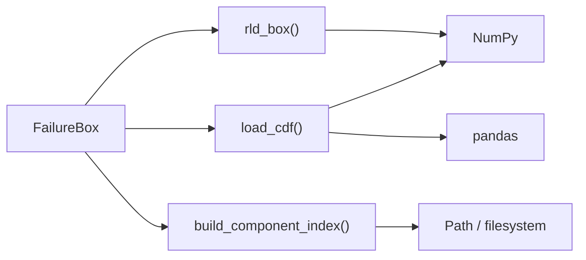

# Confidence Interval Calculation Algorithm

<cite>
**Referenced Files in This Document**
- [failure_box.py](file://degradation/failure_box.py)
- [README.md](file://degradation/README.md)
</cite>

## Table of Contents
1. [Introduction](#introduction)
2. [Project Structure](#project-structure)
3. [Core Components](#core-components)
4. [Architecture Overview](#architecture-overview)
5. [Detailed Component Analysis](#detailed-component-analysis)
6. [Dependency Analysis](#dependency-analysis)
7. [Performance Considerations](#performance-considerations)
8. [Troubleshooting Guide](troubleshooting-guide)
9. [Conclusion](#conclusion)
10. [Appendices](#appendices)

## Introduction
This document explains the confidence interval calculation algorithm implemented in the rld_box() function. The algorithm computes a central confidence interval for remaining life using quantile-based methods on cumulative distribution function (CDF) rows. It uses searchsorted to efficiently locate quantiles and follows a 1-based indexing convention for both days and remaining-life support points. Input validation enforces alpha range, array dimension checks, and support coverage requirements. Guidance is provided for choosing alpha values and handling edge cases such as insufficient support coverage.

## Project Structure
The relevant implementation resides in the degradation module:
- failure_box.py implements FailureBox and the core rld_box() algorithm.
- README.md documents data layout, usage examples, and conceptual behavior.

**Diagram sources**
- [failure_box.py:17-66](file://degradation/failure_box.py#L17-L66)
- [failure_box.py:69-106](file://degradation/failure_box.py#L69-L106)
- [failure_box.py:109-133](file://degradation/failure_box.py#L109-L133)

**Section sources**
- [failure_box.py:1-133](file://degradation/failure_box.py#L1-L133)
- [README.md:1-53](file://degradation/README.md#L1-L53)

## Core Components
- FailureBox: High-level interface that loads CDFs per component, validates inputs (component index, day), and delegates interval computation to rld_box().
- rld_box(): Computes the central interval (t_dw, t_up) from a single CDF row and alpha using quantile thresholds α/2 and 1 − α/2 with 1-based indexing.
- load_cdf(): Reads an Excel file into a NumPy array and validates shape (n_days × 500).
- build_component_index(): Discovers cdf_*_*.xlsx files and maps component IDs to paths.

Key responsibilities and validations:
- Alpha validation: must be strictly between 0 and 1.
- Row validation: must be 1-D and non-empty.
- Support coverage validation: F(k_max) must reach at least 1 − α/2; otherwise, raise an error suggesting a larger alpha.
- Indexing: returns 1-based remaining-life indices corresponding to columns of the CDF row.

**Section sources**
- [failure_box.py:17-66](file://degradation/failure_box.py#L17-L66)
- [failure_box.py:69-106](file://degradation/failure_box.py#L69-L106)
- [failure_box.py:109-133](file://degradation/failure_box.py#L109-L133)

## Architecture Overview
The system provides a user-facing class that encapsulates data loading and caching, while the mathematical core is isolated in rld_box().

**Diagram sources**
- [failure_box.py:32-44](file://degradation/failure_box.py#L32-L44)
- [failure_box.py:55-66](file://degradation/failure_box.py#L55-L66)
- [failure_box.py:109-133](file://degradation/failure_box.py#L109-L133)

## Detailed Component Analysis

### Mathematical Foundation
- Goal: Compute a central confidence interval for remaining life at a given forecast day.
- Quantile definition: For a discrete CDF F(k) over k = 1, …, K (K = 500), define:
  - t_dw = min{k : F(k) >= α/2}
  - t_up = min{k : F(k) >= 1 − α/2}
- Coverage: The interval [t_dw, t_up] is intended to cover the central 1 − α probability mass of the distribution.
- Indexing: k is 1-based, matching column numbering in the CDF file.

Implementation notes:
- Lower and upper quantile targets are lower_quantile = α/2 and upper_quantile = 1 − α/2.
- searchsorted(row, q, side="left") returns the first index i where row[i] >= q in 0-based indexing. Adding 1 converts to 1-based k.
- If the maximum CDF value F(K) < 1 − α/2, the support does not cover the required upper quantile; the function raises an error and suggests a larger alpha.

**Diagram sources**
- [failure_box.py:109-133](file://degradation/failure_box.py#L109-L133)

**Section sources**
- [failure_box.py:109-133](file://degradation/failure_box.py#L109-L133)

### Input Validation
- Alpha range: Must satisfy 0 < alpha < 1; otherwise, raise ValueError.
- Array dimensions: The input row must be 1-D and non-empty; otherwise, raise ValueError.
- Support coverage: The last element of the CDF row (F(K)) must be at least 1 − α/2; otherwise, raise ValueError with guidance to increase alpha.

Additional validations in the surrounding code:
- Component existence and valid range (1–100).
- Day validity: 1 ≤ day ≤ n_days(component).
- Data directory presence and file naming conventions.

**Section sources**
- [failure_box.py:24-28](file://degradation/failure_box.py#L24-L28)
- [failure_box.py:32-44](file://degradation/failure_box.py#L32-L44)
- [failure_box.py:69-95](file://degradation/failure_box.py#L69-L95)
- [failure_box.py:98-106](file://degradation/failure_box.py#L98-L106)
- [failure_box.py:109-133](file://degradation/failure_box.py#L109-L133)

### Efficient Quantile Computation with searchsorted
- Purpose: Locate the smallest index i such that F(i) >= q for a given quantile target q.
- Method: Use np.searchsorted(row, q, side="left"), which performs a binary search assuming the input is sorted (as a CDF should be).
- Conversion: Add 1 to convert from 0-based index to 1-based k.
- Complexity: O(log K) per quantile, where K = 500. Two calls per invocation.

**Diagram sources**
- [failure_box.py:131-132](file://degradation/failure_box.py#L131-L132)

**Section sources**
- [failure_box.py:131-132](file://degradation/failure_box.py#L131-L132)

### 1-Based Indexing Convention
- Days: The day parameter is 1-based; it indexes rows of the CDF matrix.
- Remaining life: Columns represent k = 1, …, 500 days of remaining life; returned t_dw and t_up are 1-based.
- Implementation: searchsorted returns 0-based indices; adding 1 aligns with the 1-based convention.

**Section sources**
- [failure_box.py:17-22](file://degradation/failure_box.py#L17-L22)
- [failure_box.py:32-44](file://degradation/failure_box.py#L32-L44)
- [failure_box.py:131-132](file://degradation/failure_box.py#L131-L132)

### Numerical Precision and Edge Cases
- Floating-point comparisons: The check F(K) >= 1 − α/2 guards against insufficient support coverage due to finite precision.
- Non-monotonic CDFs: The algorithm assumes a non-decreasing CDF; violations may lead to unexpected quantile locations.
- Insufficient support coverage: When F(K) < 1 − α/2, the function raises an error and suggests increasing alpha so that 1 − α/2 becomes achievable within the support.
- Small alpha values: Very small alpha increases interval width and requires higher coverage; ensure support reaches near 1.
- Large alpha values: Larger alpha narrows the interval but reduces coverage; choose based on reliability requirements.

**Section sources**
- [failure_box.py:124-129](file://degradation/failure_box.py#L124-L129)
- [failure_box.py:109-133](file://degradation/failure_box.py#L109-L133)

### Choosing Appropriate Alpha Values
- Reliability engineering context:
  - Higher confidence (smaller alpha, e.g., 0.05) yields wider intervals and greater coverage; suitable when underestimating risk is costly.
  - Lower confidence (larger alpha, e.g., 0.2) yields narrower intervals; useful for conservative planning with acceptable risk.
- Practical guidance:
  - Ensure F(K) ≥ 1 − α/2; if not, increase alpha or extend support horizon.
  - Balance interval width versus coverage according to operational tolerance and maintenance policies.
  - Validate chosen alpha across multiple components and days to avoid frequent coverage failures.

**Section sources**
- [failure_box.py:124-129](file://degradation/failure_box.py#L124-L129)
- [README.md:19-30](file://degradation/README.md#L19-L30)

## Dependency Analysis
The following diagram shows how the main components depend on each other and external libraries.

**Diagram sources**
- [failure_box.py:17-66](file://degradation/failure_box.py#L17-L66)
- [failure_box.py:69-106](file://degradation/failure_box.py#L69-L106)
- [failure_box.py:109-133](file://degradation/failure_box.py#L109-L133)

**Section sources**
- [failure_box.py:1-133](file://degradation/failure_box.py#L1-L133)

## Performance Considerations
- Quantile search: Each call to rld_box() performs two binary searches over K = 500 elements; complexity O(log K) per search.
- Memory: CDF arrays are cached per component after first load; repeated queries avoid re-reading Excel files.
- I/O: File reading occurs lazily on first access per component via _cdf_of(); subsequent calls reuse in-memory arrays.
- Vectorization: The algorithm operates on a single row; no vectorized operations beyond NumPy’s searchsorted.

Recommendations:
- Precompute and cache CDFs if querying many days/components repeatedly.
- Avoid unnecessary conversions by passing already-typed float arrays to rld_box() when possible.

**Section sources**
- [failure_box.py:55-66](file://degradation/failure_box.py#L55-L66)
- [failure_box.py:109-133](file://degradation/failure_box.py#L109-L133)

## Troubleshooting Guide
Common errors and resolutions:
- Invalid alpha:
  - Symptom: ValueError indicating alpha must be in (0, 1).
  - Resolution: Choose alpha strictly between 0 and 1.
- Invalid row shape:
  - Symptom: ValueError about expecting a 1-D non-empty row.
  - Resolution: Ensure the input is a single CDF row (1-D) and not empty.
- Insufficient support coverage:
  - Symptom: ValueError stating F(K) < 1 − α/2 and suggestion to use a larger alpha.
  - Resolution: Increase alpha or extend the support horizon; verify CDF monotonicity and normalization.
- Component or day out of range:
  - Symptom: ValueError about component availability or day bounds.
  - Resolution: Verify component ID exists and day is within [1, n_days(component)].

Operational tips:
- Confirm data directory contains properly named cdf_*_*.xlsx files.
- Validate that each CDF has exactly 500 columns (remaining-life support).
- Monitor F(K) across components to anticipate coverage issues before runtime.

**Section sources**
- [failure_box.py:24-28](file://degradation/failure_box.py#L24-L28)
- [failure_box.py:32-44](file://degradation/failure_box.py#L32-L44)
- [failure_box.py:69-95](file://degradation/failure_box.py#L69-L95)
- [failure_box.py:98-106](file://degradation/failure_box.py#L98-L106)
- [failure_box.py:109-133](file://degradation/failure_box.py#L109-L133)

## Conclusion
The rld_box() algorithm provides a robust, efficient method for computing central confidence intervals for remaining life using quantile thresholds on discrete CDF rows. It enforces strict input validation, supports 1-based indexing consistent with the data format, and includes explicit checks for support coverage. By selecting appropriate alpha values and ensuring adequate support, practitioners can obtain reliable intervals tailored to reliability engineering needs.

## Appendices

### API Summary
- FailureBox(alpha=DEFAULT_ALPHA):
  - box(component, day) -> (t_dw, t_up)
  - n_days(component) -> int
- rld_box(cdf_row, alpha) -> (t_dw, t_up)
- load_cdf(path) -> ndarray
- build_component_index(data_dir) -> dict[int, Path]

**Section sources**
- [failure_box.py:17-66](file://degradation/failure_box.py#L17-L66)
- [failure_box.py:69-106](file://degradation/failure_box.py#L69-L106)
- [failure_box.py:109-133](file://degradation/failure_box.py#L109-L133)