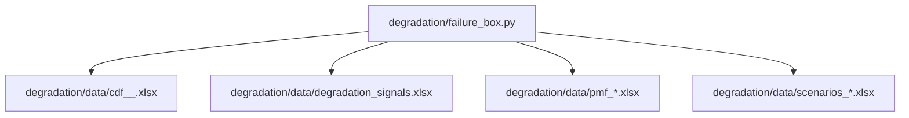
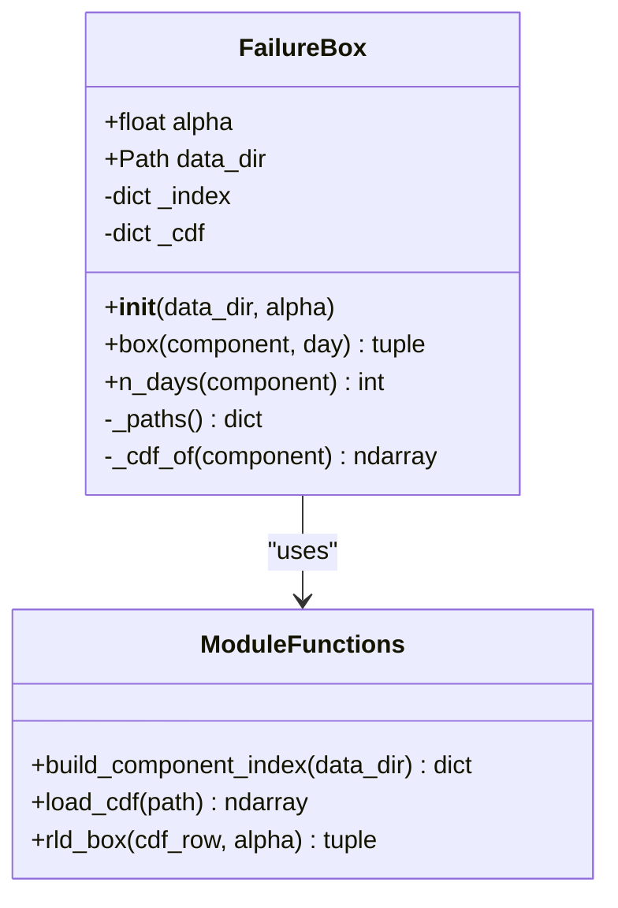
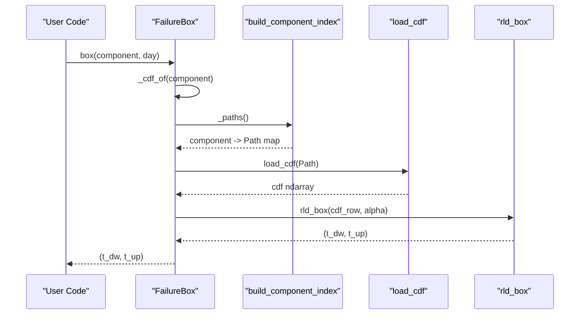
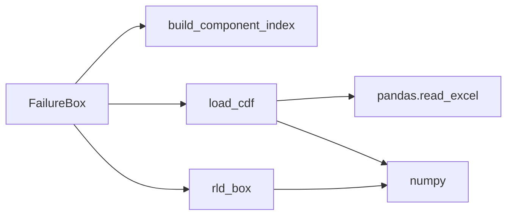

# Degradation Analysis Module

<cite>
**Referenced Files in This Document**
- [failure_box.py](file://degradation/failure_box.py)
- [README.md](file://degradation/README.md)
</cite>

## Table of Contents
1. [Introduction](#introduction)
2. [Project Structure](#project-structure)
3. [Core Components](#core-components)
4. [Architecture Overview](#architecture-overview)
5. [Detailed Component Analysis](#detailed-component-analysis)
6. [Dependency Analysis](#dependency-analysis)
7. [Performance Considerations](#performance-considerations)
8. [Troubleshooting Guide](#troubleshooting-guide)
9. [Conclusion](#conclusion)

## Introduction
This document explains the degradation analysis module that computes central confidence intervals for the remaining life of components using precomputed cumulative distribution functions (CDFs). The core class is `FailureBox`, which provides:
- Lazy loading of CDF files by component index
- Validation of alpha levels and day indices
- Calculation of a central interval `[t_dw, t_up]` at a given day for a given component
- Forecast horizon length per component

The data layer expects CDF Excel files under `degradation/data`, with a strict naming convention and shape validation.

## Project Structure
The relevant code lives under `degradation/`. The key source file is `failure_box.py`, and the data directory contains CDF, PMF, scenario, and signal metadata files.

**Diagram sources**
- [failure_box.py:11-14](file://degradation/failure_box.py#L11-L14)
- [failure_box.py:69-95](file://degradation/failure_box.py#L69-L95)

**Section sources**
- [failure_box.py:11-14](file://degradation/failure_box.py#L11-L14)
- [failure_box.py:69-95](file://degradation/failure_box.py#L69-L95)

## Core Components
- `FailureBox`: Encapsulates configuration (`alpha`), lazy-loaded component index, and cached CDF arrays. Exposes:
  - `box(component, day)`: returns the central interval `[t_dw, t_up]` in days
  - `n_days(component)`: returns the forecast horizon length (number of rows in the CDF)
- `build_component_index(data_dir)`: scans `data_dir` for CDF files and builds a mapping from component ID to file path
- `load_cdf(path)`: reads an Excel sheet into a NumPy array and validates its shape
- `rld_box(cdf_row, alpha)`: computes the central interval for a single CDF row using quantile-based searchsorted logic

Key constants:
- `CDF_SUPPORT_DAYS = 500`: expected number of columns in each CDF
- `N_COMPONENTS = 100`: allowed range for component IDs
- `DEFAULT_ALPHA = 0.1`: default confidence level parameter

**Section sources**
- [failure_box.py:11-14](file://degradation/failure_box.py#L11-L14)
- [failure_box.py:17-66](file://degradation/failure_box.py#L17-L66)
- [failure_box.py:69-106](file://degradation/failure_box.py#L69-L106)
- [failure_box.py:109-133](file://degradation/failure_box.py#L109-L133)

## Architecture Overview
The module follows a layered design:
- API layer: `FailureBox` methods
- Indexing layer: `build_component_index`
- Data access layer: `load_cdf`
- Computation layer: `rld_box`

**Diagram sources**
- [failure_box.py:17-66](file://degradation/failure_box.py#L17-L66)
- [failure_box.py:69-106](file://degradation/failure_box.py#L69-L106)
- [failure_box.py:109-133](file://degradation/failure_box.py#L109-L133)

## Detailed Component Analysis

### FailureBox Class
Responsibilities:
- Validate and store `alpha`
- Resolve `data_dir` to the default or provided path
- Lazily build the component-to-file index
- Cache loaded CDF arrays per component
- Provide high-level APIs `box()` and `n_days()`

Constructor parameters:
- `data_dir`: optional override for the data directory; defaults to `degradation/data`
- `alpha`: float in `(0, 1)` controlling the central coverage `1 - alpha`; default is `0.1`

Internal state:
- `_index`: lazily built dictionary mapping component IDs to file paths
- `_cdf`: cache of loaded CDF arrays keyed by component ID

Key behaviors:
- `box(component, day)`:
  - Validates `day` against the loaded CDF’s row count
  - Calls `rld_box` on the corresponding CDF row
  - Wraps errors with component/day context
- `n_days(component)`:
  - Returns the number of rows in the CDF for the component

Lazy loading mechanisms:
- `_paths()`: builds the component index only once per instance
- `_cdf_of(component)`: loads and caches the CDF array only when first accessed

**Diagram sources**
- [failure_box.py:32-44](file://degradation/failure_box.py#L32-L44)
- [failure_box.py:50-66](file://degradation/failure_box.py#L50-L66)
- [failure_box.py:69-95](file://degradation/failure_box.py#L69-L95)
- [failure_box.py:98-106](file://degradation/failure_box.py#L98-L106)
- [failure_box.py:109-133](file://degradation/failure_box.py#L109-L133)

**Section sources**
- [failure_box.py:17-66](file://degradation/failure_box.py#L17-L66)

### CDF File Structure and Naming Conventions
File naming:
- Pattern: `cdf_<signal>_<component>.xlsx`
- `<signal>` is a string identifying the signal source; it is ignored by the indexer
- `<component>` is an integer between `1` and `N_COMPONENTS` (inclusive)

Data shape:
- Each CDF file is read without headers
- Expected shape: `(n_días, CDF_SUPPORT_DAYS)` where `CDF_SUPPORT_DAYS = 500`
- Rows represent days (1-based in the API)
- Columns represent remaining-life support points (discrete grid)

Validation:
- `build_component_index` enforces:
  - Directory existence
  - Filename pattern and three-part split
  - Component ID range
  - No duplicate component IDs
  - At least one matching file
- `load_cdf` enforces:
  - Exactly two dimensions
  - Exactly `CDF_SUPPORT_DAYS` columns

Example file names present in the repository include patterns like `cdf_10_24.xlsx`, `cdf_11_2.xlsx`, etc., demonstrating the required naming scheme.

**Section sources**
- [failure_box.py:69-95](file://degradation/failure_box.py#L69-L95)
- [failure_box.py:98-106](file://degradation/failure_box.py#L98-L106)

### Mathematical Algorithm for Confidence Interval Calculation
The function `rld_box` computes the central interval `[t_dw, t_up]` for a single CDF row:
- Coverage: `1 - alpha`
- Lower quantile: `alpha / 2`
- Upper quantile: `1 - alpha / 2`
- Uses `np.searchsorted` with `side="left"` to find the smallest index `k` such that `F(k) >= q`
- Adds 1 to convert from 0-based array index to 1-based day numbering

Algorithm flow:

```mermaid
flowchart TD
Start(["Start rld_box"]) --> CheckAlpha["Validate alpha in (0,1)"]
CheckAlpha --> PrepareRow["Convert input to 1-D float array"]
PrepareRow --> ShapeCheck{"Valid shape?"}
ShapeCheck --> |No| ErrShape["Raise ValueError"]
ShapeCheck --> |Yes| ComputeQuantiles["Compute lower_quantile = α/2<br/>upper_quantile = 1 - α/2"]
ComputeQuantiles --> MaxCheck["Check maximum F(n) >= upper_quantile"]
MaxCheck --> |No| ErrSupport["Raise ValueError about insufficient support"]
MaxCheck --> |Yes| SearchLower["lower = searchsorted(row, lower_quantile, side='left') + 1"]
SearchLower --> SearchUpper["upper = searchsorted(row, upper_quantile, side='left') + 1"]
SearchUpper --> Return(["Return (lower, upper)"])
```

**Diagram sources**
- [failure_box.py:109-133](file://degradation/failure_box.py#L109-L133)

Complexity:
- Time: O(log n) per quantile due to binary search via `searchsorted`, where `n = CDF_SUPPORT_DAYS = 500`
- Space: O(1) beyond the input row

Interpretation:
- `t_dw` is the earliest day index where the cumulative probability reaches at least `α/2`
- `t_up` is the earliest day index where the cumulative probability reaches at least `1 - α/2`
- The returned pair represents a central interval of remaining life in days relative to the queried day

**Section sources**
- [failure_box.py:109-133](file://degradation/failure_box.py#L109-L133)

### Internal Component Index Management
Index construction:
- Scans `data_dir` for files matching `cdf_*_*.xlsx`
- Splits filename into parts and extracts the component ID
- Enforces component ID bounds and uniqueness
- Returns a dictionary mapping component ID to file path

Access patterns:
- `_paths()` builds the index lazily on first call and caches it in `_index`
- `_cdf_of(component)` uses the index to locate the file and then loads and caches the CDF array in `_cdf`

Error handling:
- Missing directory raises a clear error
- Invalid filenames raise descriptive errors
- Duplicate components raise a conflict error
- Missing component raises an error listing available range

**Section sources**
- [failure_box.py:50-66](file://degradation/failure_box.py#L50-L66)
- [failure_box.py:69-95](file://degradation/failure_box.py#L69-L95)

### Concrete Usage Examples
Note: These are usage patterns derived from the implementation; they do not reproduce code content.

- Querying a central interval:
  - Instantiate `FailureBox` with default settings or custom `alpha`
  - Call `box(component=24, day=10)` to obtain `(t_dw, t_up)` for component 24 at day 10
  - Interpretation: the interval `[t_dw, t_up]` gives the central remaining-life window in days around day 10

- Checking forecast horizon:
  - Call `n_days(component=24)` to get the number of days modeled for component 24

- Handling invalid inputs:
  - Passing `day` outside `[1, n_days]` raises a value error with component context
  - Passing `alpha` outside `(0, 1)` raises a value error during initialization or computation

- Performance considerations:
  - Reusing the same `FailureBox` instance avoids repeated file scanning and reloading
  - Caching ensures each component’s CDF is loaded once per instance

**Section sources**
- [failure_box.py:24-48](file://degradation/failure_box.py#L24-L48)
- [failure_box.py:50-66](file://degradation/failure_box.py#L50-L66)

## Dependency Analysis
External dependencies:
- `numpy`: numerical operations and `searchsorted`
- `pandas`: reading Excel files
- Standard library `pathlib`: path manipulation

Module-level relationships:
- `FailureBox` depends on `build_component_index`, `load_cdf`, and `rld_box`
- `build_component_index` depends on filesystem traversal and filename parsing
- `load_cdf` depends on pandas Excel I/O and NumPy conversion
- `rld_box` depends on NumPy for vectorized operations

**Diagram sources**
- [failure_box.py:17-66](file://degradation/failure_box.py#L17-L66)
- [failure_box.py:69-106](file://degradation/failure_box.py#L69-L106)
- [failure_box.py:109-133](file://degradation/failure_box.py#L109-L133)

**Section sources**
- [failure_box.py:1-133](file://degradation/failure_box.py#L1-L133)

## Performance Considerations
- Lazy indexing: `_paths()` builds the component index only once per instance, avoiding repeated globbing
- Caching CDF arrays: `_cdf` stores loaded arrays per component, preventing redundant disk reads
- Efficient quantile search: `np.searchsorted` performs binary search over the fixed support size of 500, yielding O(log 500) per quantile
- Memory footprint:
  - Each CDF row is a 1-D array of 500 floats
  - Full CDF matrix per component is `(n_días, 500)` floats
  - For many components, consider creating multiple `FailureBox` instances scoped to subsets of components if memory is constrained
- I/O optimization:
  - Reuse a single `FailureBox` instance across queries to benefit from caching
  - Avoid repeatedly constructing new instances unless necessary

[No sources needed since this section provides general guidance]

## Troubleshooting Guide
Common issues and resolutions:
- Invalid alpha:
  - Symptom: Value error indicating alpha must be in `(0, 1)`
  - Cause: Alpha passed to constructor or `rld_box` is out of range
  - Resolution: Ensure `0 < alpha < 1`

- Day index out of bounds:
  - Symptom: Value error stating the valid day range for a component
  - Cause: `day` is less than 1 or greater than the number of rows in the CDF
  - Resolution: Use `n_days(component)` to determine the valid range and query within `[1, n_days]`

- Missing or misnamed CDF files:
  - Symptom: Value error about missing directory, unexpected filename, no matching files, or duplicate components
  - Cause: Files do not match `cdf_<signal>_<component>.xlsx`, component IDs out of range, or duplicates exist
  - Resolution: Rename files to follow the naming convention and ensure unique component IDs within `1..N_COMPONENTS`

- Insufficient CDF support:
  - Symptom: Value error indicating the CDF does not cover the upper quantile
  - Cause: The maximum cumulative probability in the CDF row is below `1 - alpha/2`
  - Resolution: Increase `alpha` to reduce the required coverage or extend the CDF support

- Unexpected CDF shape:
  - Symptom: Value error about expecting exactly 500 columns
  - Cause: The Excel sheet has a different number of columns than expected
  - Resolution: Regenerate CDF files to conform to the expected shape `(n_días, 500)`

**Section sources**
- [failure_box.py:24-28](file://degradation/failure_box.py#L24-L28)
- [failure_box.py:32-44](file://degradation/failure_box.py#L32-L44)
- [failure_box.py:69-95](file://degradation/failure_box.py#L69-L95)
- [failure_box.py:98-106](file://degradation/failure_box.py#L98-L106)
- [failure_box.py:109-133](file://degradation/failure_box.py#L109-L133)

## Conclusion
The degradation analysis module provides a robust, efficient interface for computing central confidence intervals of component remaining life based on precomputed CDFs. `FailureBox` encapsulates configuration, lazy loading, and caching, while helper functions enforce data integrity and perform fast quantile-based interval calculations. By adhering to the documented file conventions and using the provided APIs, users can reliably query intervals and forecast horizons for large sets of components with predictable performance and clear error reporting.

[No sources needed since this section summarizes without analyzing specific files]