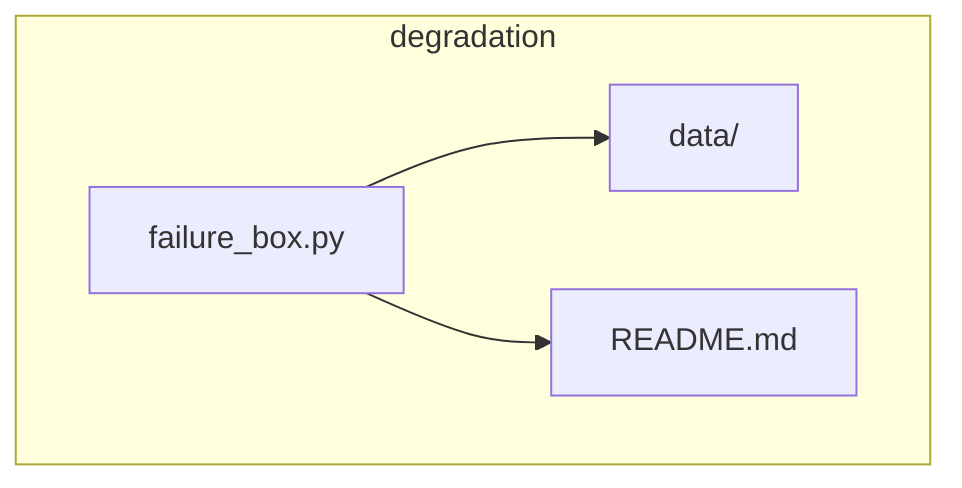
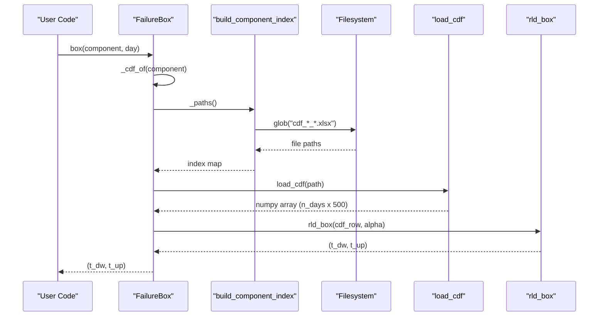
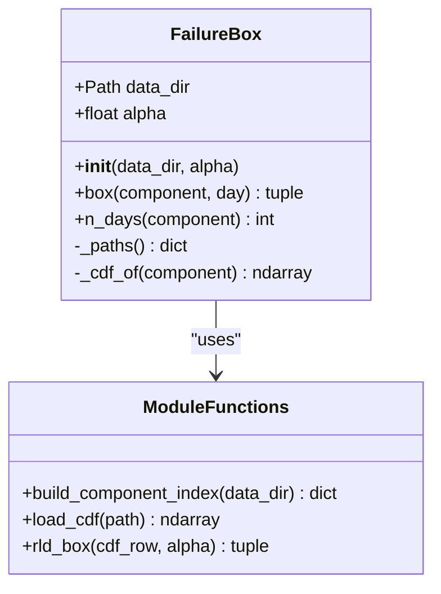
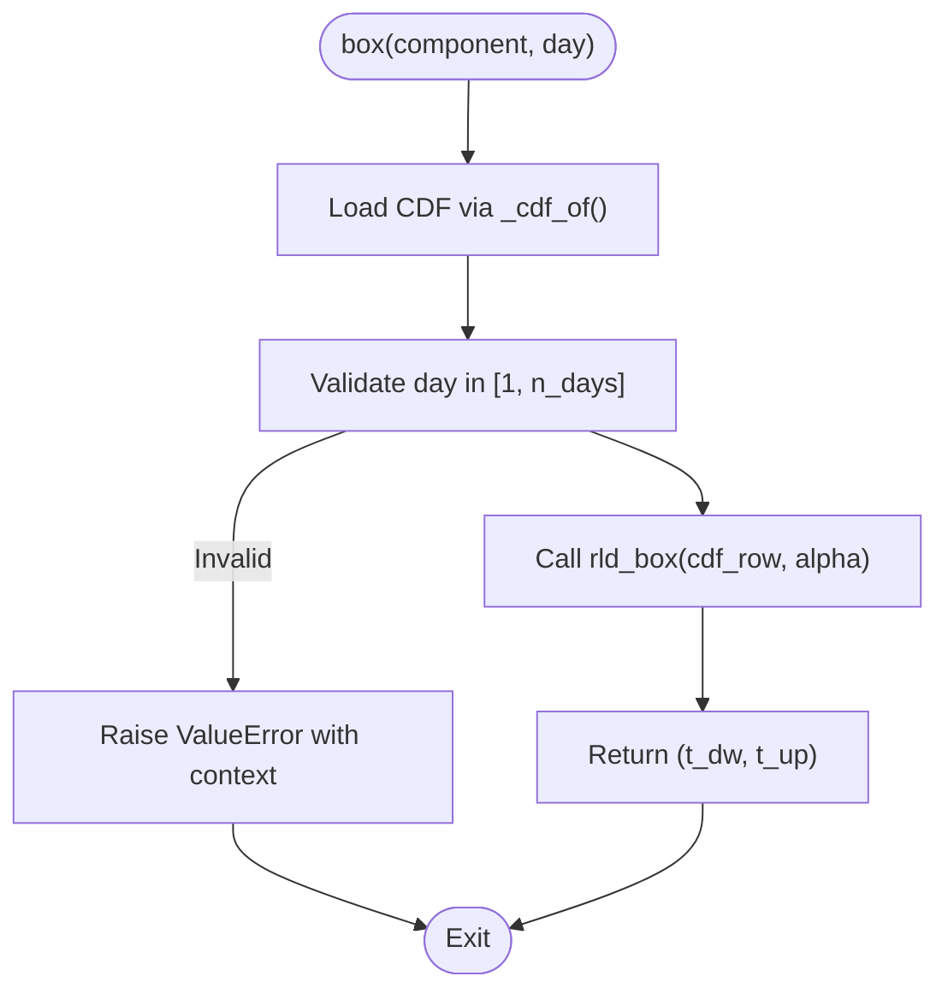
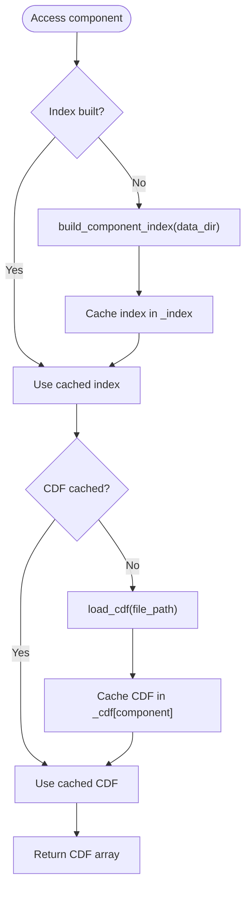
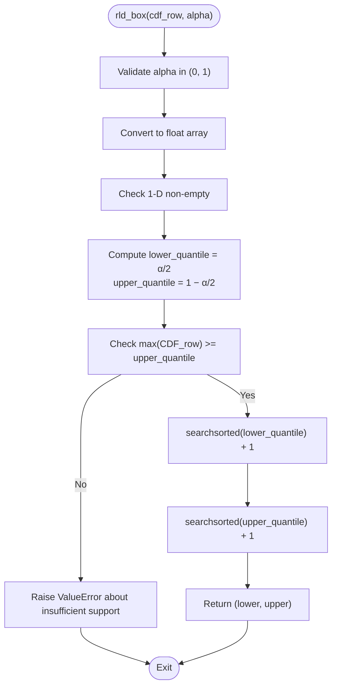
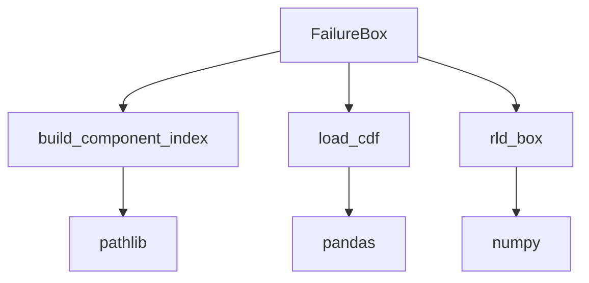

# FailureBox Class Interface

<cite>
**Referenced Files in This Document**
- [failure_box.py](file://degradation/failure_box.py)
- [README.md](file://degradation/README.md)
</cite>

## Table of Contents
1. [Introduction](#introduction)
2. [Project Structure](#project-structure)
3. [Core Components](#core-components)
4. [Architecture Overview](#architecture-overview)
5. [Detailed Component Analysis](#detailed-component-analysis)
6. [Dependency Analysis](#dependency-analysis)
7. [Performance Considerations](#performance-considerations)
8. [Troubleshooting Guide](#troubleshooting-guide)
9. [Conclusion](#conclusion)

## Introduction
FailureBox is the primary interface for component degradation analysis. It provides a central interval of remaining useful life (RUL) for each component at a given forecast day, derived from precomputed cumulative distribution functions (CDFs). The class encapsulates data loading, validation, and caching so that users can query RUL intervals efficiently without handling file I/O or numerical details directly.

Key responsibilities:
- Validate configuration parameters such as alpha levels for confidence intervals.
- Map components to their CDF files lazily.
- Compute the central interval of RUL for a specific component and day.
- Expose the forecast horizon length per component.

The underlying mathematical model uses quantiles of the CDF row corresponding to the requested day to compute lower and upper bounds of the RUL interval at a specified confidence level.

**Section sources**
- [failure_box.py:17-66](file://degradation/failure_box.py#L17-L66)
- [README.md:1-53](file://degradation/README.md#L1-L53)

## Project Structure
This repository organizes degradation-related logic under the degradation package. The FailureBox implementation lives in failure_box.py, while supporting documentation explains data layout and usage patterns.

**Diagram sources**
- [failure_box.py:11-13](file://degradation/failure_box.py#L11-L13)
- [README.md:7-17](file://degradation/README.md#L7-L17)

**Section sources**
- [failure_box.py:11-13](file://degradation/failure_box.py#L11-L13)
- [README.md:7-17](file://degradation/README.md#L7-L17)

## Core Components
- FailureBox: Main class exposing box() and n_days(), with internal lazy loading and caching.
- build_component_index(): Scans data_dir for CDF files and builds a mapping from component IDs to file paths.
- load_cdf(): Reads an Excel file into a NumPy array and validates its shape.
- rld_box(): Computes the central RUL interval for a single CDF row using quantile search.

Public API highlights:
- Constructor parameters:
  - data_dir: Path to the directory containing CDF files; defaults to the package’s data directory.
  - alpha: Confidence level parameter for interval calculation; must be strictly between 0 and 1.
- Methods:
  - box(component, day): Returns the RUL interval (t_dw, t_up) for the given component and day.
  - n_days(component): Returns the number of forecast days available for the component.

Internal mechanisms:
- Lazy loading: CDF arrays are loaded only when first accessed for a component.
- Caching: Loaded CDF arrays are stored in memory keyed by component ID.
- Indexing: Component-to-file mapping is built once and cached.

**Section sources**
- [failure_box.py:17-66](file://degradation/failure_box.py#L17-L66)
- [failure_box.py:69-106](file://degradation/failure_box.py#L69-L106)
- [failure_box.py:109-133](file://degradation/failure_box.py#L109-L133)

## Architecture Overview
The FailureBox workflow integrates user queries with file discovery, validation, and numerical computation.

**Diagram sources**
- [failure_box.py:32-44](file://degradation/failure_box.py#L32-L44)
- [failure_box.py:50-66](file://degradation/failure_box.py#L50-L66)
- [failure_box.py:69-95](file://degradation/failure_box.py#L69-L95)
- [failure_box.py:98-106](file://degradation/failure_box.py#L98-L106)
- [failure_box.py:109-133](file://degradation/failure_box.py#L109-L133)

## Detailed Component Analysis

### FailureBox Class
Responsibilities:
- Validate alpha during initialization.
- Resolve data_dir and set default constants.
- Provide box() to compute RUL intervals.
- Provide n_days() to retrieve forecast horizon length.
- Manage lazy loading and caching via private methods.

Constructor parameters:
- data_dir: Optional path to the directory containing CDF files. If None, defaults to the package’s data directory.
- alpha: Float in (0, 1) controlling the confidence interval coverage. Defaults to a predefined constant.

Caching strategy:
- _index: A dict mapping component IDs to file paths, built once on first access.
- _cdf: A dict mapping component IDs to NumPy arrays representing CDF rows, loaded lazily on first access.

Validation and error handling:
- Alpha validation in constructor and in rld_box().
- Component existence check against discovered files.
- Day range validation relative to the component’s CDF length.

**Diagram sources**
- [failure_box.py:17-66](file://degradation/failure_box.py#L17-L66)
- [failure_box.py:69-106](file://degradation/failure_box.py#L69-L106)
- [failure_box.py:109-133](file://degradation/failure_box.py#L109-L133)

**Section sources**
- [failure_box.py:17-66](file://degradation/failure_box.py#L17-L66)

### box(component, day) Method
Purpose:
- Compute the central RUL interval for a given component and day.

Behavior:
- Loads the component’s CDF via _cdf_of().
- Validates that day is within the valid range [1, n_days].
- Calls rld_box() with the corresponding CDF row and alpha.
- Wraps errors to include component and day context.

Mathematical relationship:
- Uses rld_box() to find quantiles of the CDF row at α/2 and 1 − α/2, returning integer day indices for lower and upper bounds.

**Diagram sources**
- [failure_box.py:32-44](file://degradation/failure_box.py#L32-L44)
- [failure_box.py:109-133](file://degradation/failure_box.py#L109-L133)

**Section sources**
- [failure_box.py:32-44](file://degradation/failure_box.py#L32-L44)

### n_days(component) Method
Purpose:
- Retrieve the number of forecast days available for a component.

Behavior:
- Ensures the component exists and loads its CDF if not already cached.
- Returns the number of rows in the CDF array.

**Section sources**
- [failure_box.py:46-48](file://degradation/failure_box.py#L46-L48)

### Internal Caching and Lazy Loading
Mechanisms:
- _paths(): Builds and caches the component-to-file index on first call.
- _cdf_of(component): Loads the CDF array for a component only when first accessed and stores it in memory.

Benefits:
- Avoids unnecessary I/O and memory usage for components not queried.
- Reduces repeated file scanning by caching the index.

**Diagram sources**
- [failure_box.py:50-66](file://degradation/failure_box.py#L50-L66)
- [failure_box.py:69-95](file://degradation/failure_box.py#L69-L95)
- [failure_box.py:98-106](file://degradation/failure_box.py#L98-L106)

**Section sources**
- [failure_box.py:50-66](file://degradation/failure_box.py#L50-L66)
- [failure_box.py:69-95](file://degradation/failure_box.py#L69-L95)
- [failure_box.py:98-106](file://degradation/failure_box.py#L98-L106)

### Mathematical Algorithms
- rld_box(cdf_row, alpha):
  - Computes lower and upper quantiles at α/2 and 1 − α/2.
  - Uses binary search over sorted CDF values to find the smallest k where F(k) meets the threshold.
  - Raises an error if the maximum CDF value does not reach the required upper quantile, indicating insufficient support.

- Data shape expectations:
  - Each CDF file has shape (n_días, 500), where columns represent potential RUL days up to a fixed support size.

**Diagram sources**
- [failure_box.py:109-133](file://degradation/failure_box.py#L109-L133)

**Section sources**
- [failure_box.py:109-133](file://degradation/failure_box.py#L109-L133)

## Dependency Analysis
The FailureBox module depends on:
- pathlib.Path for filesystem operations.
- numpy.ndarray for numerical computations.
- pandas.read_excel for reading CDF files.

External integration points:
- Filesystem: Scans data_dir for CDF files matching a naming convention.
- Excel files: Assumes headerless sheets with numeric data.

Coupling and cohesion:
- High cohesion within FailureBox for RUL interval computation.
- Clear separation between IO (build_component_index, load_cdf) and computation (rld_box).

Potential circular dependencies:
- None observed; functions are organized linearly and called by FailureBox.

**Diagram sources**
- [failure_box.py:1-13](file://degradation/failure_box.py#L1-L13)
- [failure_box.py:69-106](file://degradation/failure_box.py#L69-L106)
- [failure_box.py:109-133](file://degradation/failure_box.py#L109-L133)

**Section sources**
- [failure_box.py:1-13](file://degradation/failure_box.py#L1-L13)
- [failure_box.py:69-106](file://degradation/failure_box.py#L69-L106)
- [failure_box.py:109-133](file://degradation/failure_box.py#L109-L133)

## Performance Considerations
- Lazy loading reduces initial startup time and memory footprint by loading CDF arrays only when needed.
- Caching avoids repeated disk reads and parsing for the same component across multiple queries.
- Binary search via searchsorted ensures efficient quantile lookup even for large CDF supports.
- Memory usage scales with the number of distinct components queried, proportional to (n_días × 500) floats per component.

Recommendations:
- Reuse a single FailureBox instance across multiple queries to benefit from caching.
- Limit the number of concurrently active components to manage memory consumption.
- Ensure data_dir contains only expected CDF files to avoid unnecessary scanning overhead.

[No sources needed since this section provides general guidance]

## Troubleshooting Guide
Common issues and resolutions:
- Invalid alpha:
  - Symptom: ValueError raised during initialization or computation.
  - Cause: alpha outside (0, 1).
  - Resolution: Set alpha to a value strictly between 0 and 1.

- Invalid component:
  - Symptom: ValueError indicating component not found.
  - Cause: Component ID not present in data_dir or out of supported range.
  - Resolution: Verify component ID exists and falls within the supported range.

- Invalid day:
  - Symptom: ValueError indicating day out of range.
  - Cause: day not within [1, n_days(component)].
  - Resolution: Query days within the component’s forecast horizon.

- Insufficient CDF support:
  - Symptom: ValueError stating the CDF maximum does not cover the required upper quantile.
  - Cause: The CDF’s maximum probability is below 1 − α/2.
  - Resolution: Increase alpha to reduce the required coverage or use a different dataset with longer support.

- Missing or malformed data files:
  - Symptom: Errors about missing directory, unexpected filenames, wrong column count.
  - Cause: data_dir not present, incorrect file naming, or incorrect CDF shape.
  - Resolution: Ensure data_dir exists, files follow cdf_<signal>_<component>.xlsx naming, and each file has exactly 500 columns.

Operational tips:
- Inspect n_days(component) before querying box(component, day).
- Store returned intervals to avoid recomputation.
- Validate alpha consistently across your application.

**Section sources**
- [failure_box.py:24-28](file://degradation/failure_box.py#L24-L28)
- [failure_box.py:32-44](file://degradation/failure_box.py#L32-L44)
- [failure_box.py:55-66](file://degradation/failure_box.py#L55-L66)
- [failure_box.py:69-95](file://degradation/failure_box.py#L69-L95)
- [failure_box.py:98-106](file://degradation/failure_box.py#L98-L106)
- [failure_box.py:109-133](file://degradation/failure_box.py#L109-L133)

## Conclusion
FailureBox offers a robust, efficient interface for computing central RUL intervals across components based on precomputed CDFs. Its design emphasizes validation, lazy loading, and caching to balance performance and usability. By understanding the constructor parameters, method behaviors, and underlying algorithms, users can reliably integrate component degradation analysis into broader forecasting and maintenance workflows.

[No sources needed since this section summarizes without analyzing specific files]