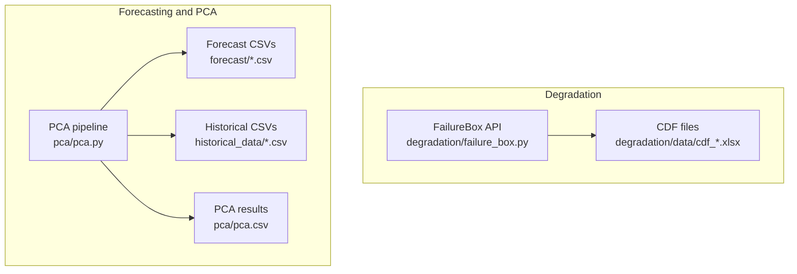
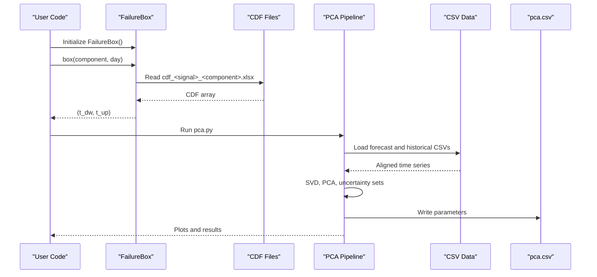
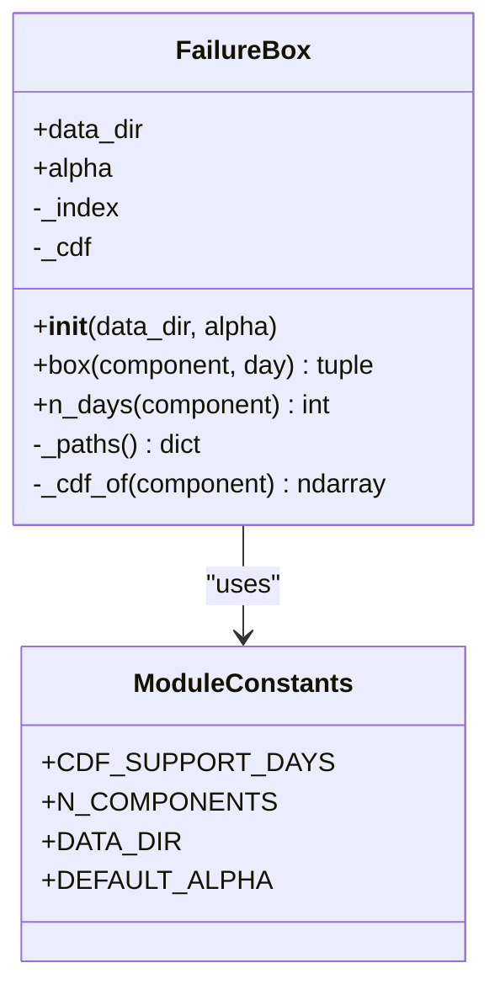
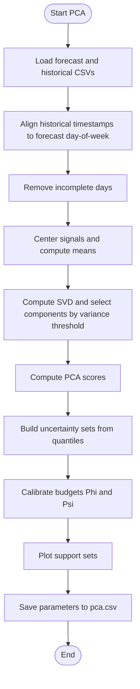
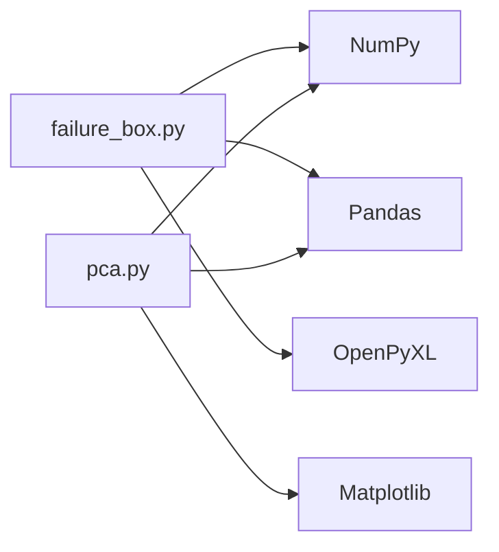

# Getting Started

<cite>
**Referenced Files in This Document**
- [README.md](file://degradation/README.md)
- [failure_box.py](file://degradation/failure_box.py)
- [pca.py](file://pca/pca.py)
</cite>

## Table of Contents
1. [Introduction](#introduction)
2. [Project Structure](#project-structure)
3. [Installation and Environment Setup](#installation-and-environment-setup)
4. [Quick Start](#quick-start)
5. [Core Components](#core-components)
6. [Architecture Overview](#architecture-overview)
7. [Detailed Component Analysis](#detailed-component-analysis)
8. [Common Workflows: Degradation plus Uncertainty Quantification](#common-workflows-degradation-plus-uncertainty-quantification)
9. [Dependency Analysis](#dependency-analysis)
10. [Performance Considerations](#performance-considerations)
11. [Troubleshooting Guide](#troubleshooting-guide)
12. [Conclusion](#conclusion)

## Introduction
This repository provides a wind power degradation and forecasting system with two main capabilities:
- Component degradation intervals using residual life cumulative distribution functions (CDFs).
- Principal Component Analysis (PCA) for uncertainty quantification over wind power and demand forecasts.

The system is Python-based and uses NumPy, Pandas, Matplotlib, and OpenPyXL. The degradation module exposes the `FailureBox` class to query central residual-life intervals per component and day. The PCA module loads historical and forecast data, aligns them by day-of-week, performs SVD-based PCA, builds uncertainty sets, and writes calibrated parameters to CSV.

## Project Structure
At a high level, the relevant parts for getting started are:
- `degradation/`: Residual-life CDFs and the `FailureBox` API.
- `pca/`: Forecast alignment, PCA, uncertainty set calibration, and plotting.
- `forecast/`: Wind power and demand forecasts for 2025.
- `historical_data/`: Historical wind power and demand series used to calibrate PCA.

**Diagram sources**
- [failure_box.py:17-66](file://degradation/failure_box.py#L17-L66)
- [pca.py:24-31](file://pca/pca.py#L24-L31)
- [pca.py:308-322](file://pca/pca.py#L308-L322)

**Section sources**
- [README.md:7-17](file://degradation/README.md#L7-L17)
- [failure_box.py:11-14](file://degradation/failure_box.py#L11-L14)
- [pca.py:6-18](file://pca/pca.py#L6-L18)

## Installation and Environment Setup
Use a Python environment with the following dependencies:
- NumPy
- Pandas
- Matplotlib
- OpenPyXL

Recommended steps:
1. Create a virtual environment.
2. Install the required packages.
3. Verify that the repository root contains:
   - `degradation/data/cdf_<signal>_<component>.xlsx` files.
   - `forecast/wind_power_forecast_2025.csv` and `forecast/demand_forecast_2025.csv`.
   - `historical_data/wind_power_2023.csv`, `wind_power_2024.csv`, `demand_2023.csv`, `demand_2024.csv`.

Validation checklist:
- Importing `FailureBox` from `degradation.failure_box` works without errors.
- Running the PCA script reads all CSVs and produces `pca/pca.csv`.

**Section sources**
- [README.md:34-42](file://degradation/README.md#L34-L42)
- [pca.py:24-31](file://pca/pca.py#L24-L31)

## Quick Start
This section shows how to perform the most common tasks:
- Load the `FailureBox` class.
- Query component degradation intervals.
- Run the PCA analysis.

### Load FailureBox and Query Intervals
From the repository root:
1. Import `FailureBox`.
2. Instantiate it.
3. Call `box(component, day)` to get `(t_dw, t_up)`.
4. Use `n_days(component)` to check the valid day range for a component.

Interpretation:
- `t_dw` and `t_up` are residual-life days counted from the queried day.
- The default confidence interval covers the central portion defined by `alpha=0.1`.

Example workflow pattern:
- Initialize once.
- Cache the returned tuple.
- Unpack or index the tuple later.

**Section sources**
- [README.md:34-52](file://degradation/README.md#L34-L52)
- [failure_box.py:24-48](file://degradation/failure_box.py#L24-L48)

### Run PCA Analysis
To run the full PCA pipeline:
1. Execute the PCA script from the repository root.
2. It loads forecast and historical CSVs.
3. It aligns historical data to the same day-of-week as the forecast.
4. It computes SVD, selects components by variance thresholds, and builds uncertainty sets.
5. It writes calibrated parameters to `pca/pca.csv`.
6. It displays plots if a GUI backend is available.

Expected outputs:
- `pca/pca.csv` containing centers, radii, selected components, and budget parameters.
- Plots showing support sets for wind power and demand.

**Section sources**
- [pca.py:24-31](file://pca/pca.py#L24-L31)
- [pca.py:41-73](file://pca/pca.py#L41-L73)
- [pca.py:147-178](file://pca/pca.py#L147-L178)
- [pca.py:184-234](file://pca/pca.py#L184-L234)
- [pca.py:240-322](file://pca/pca.py#L240-L322)

## Core Components
This section explains the primary building blocks you will use.

### FailureBox
Responsibilities:
- Validate configuration such as `alpha`.
- Build an index mapping component IDs to their CDF Excel files.
- Load and cache CDF arrays per component.
- Compute central residual-life intervals for a given component and day.

Key behaviors:
- `box(component, day)` returns `(t_dw, t_up)`.
- `n_days(component)` returns the number of forecast days available for a component.
- CDF files must have shape `(n_días, 500)` where columns represent residual-life days up to 500.

Error handling:
- Invalid `alpha` values raise an error.
- Out-of-range days raise an error.
- Missing or malformed CDF files raise descriptive errors.

**Section sources**
- [failure_box.py:17-66](file://degradation/failure_box.py#L17-L66)
- [failure_box.py:69-106](file://degradation/failure_box.py#L69-L106)
- [failure_box.py:109-133](file://degradation/failure_box.py#L109-L133)

### PCA Pipeline
Responsibilities:
- Load forecast and historical datasets.
- Align historical timestamps to the forecast’s day-of-week schedule.
- Remove incomplete days across hours.
- Center and decorrelate signals via SVD.
- Select principal components based on variance thresholds.
- Build uncertainty sets using quantiles of PCA scores.
- Calibrate budgets for robust optimization.
- Plot support sets and save parameters.

Key variables and outputs:
- `c_p`, `a_p`, `c_d`, `a_d`: centers and radii for wind and demand.
- `r_p`, `r_d`: number of retained components.
- `s_p`, `s_d`: pairwise component selection sizes.
- `Phi_p`, `Psi_p`, `Phi_d`, `Psi_d`: calibrated budgets.
- `pca/pca.csv`: saved parameters for downstream use.

**Section sources**
- [pca.py:6-18](file://pca/pca.py#L6-L18)
- [pca.py:41-116](file://pca/pca.py#L41-L116)
- [pca.py:147-178](file://pca/pca.py#L147-L178)
- [pca.py:184-234](file://pca/pca.py#L184-L234)
- [pca.py:240-322](file://pca/pca.py#L240-L322)

## Architecture Overview
The system combines two independent pipelines:
- Degradation queries through `FailureBox`.
- Forecast uncertainty modeling through PCA.

**Diagram sources**
- [failure_box.py:24-48](file://degradation/failure_box.py#L24-L48)
- [failure_box.py:98-106](file://degradation/failure_box.py#L98-L106)
- [pca.py:24-31](file://pca/pca.py#L24-L31)
- [pca.py:147-178](file://pca/pca.py#L147-L178)
- [pca.py:308-322](file://pca/pca.py#L308-L322)

## Detailed Component Analysis

### FailureBox Class Diagram

**Diagram sources**
- [failure_box.py:11-14](file://degradation/failure_box.py#L11-L14)
- [failure_box.py:17-66](file://degradation/failure_box.py#L17-L66)

### PCA Processing Flow

**Diagram sources**
- [pca.py:24-31](file://pca/pca.py#L24-L31)
- [pca.py:41-116](file://pca/pca.py#L41-L116)
- [pca.py:147-178](file://pca/pca.py#L147-L178)
- [pca.py:184-234](file://pca/pca.py#L184-L234)
- [pca.py:240-322](file://pca/pca.py#L240-L322)

**Section sources**
- [failure_box.py:17-66](file://degradation/failure_box.py#L17-L66)
- [pca.py:147-178](file://pca/pca.py#L147-L178)
- [pca.py:184-234](file://pca/pca.py#L184-L234)

## Common Workflows: Degradation plus Uncertainty Quantification
A typical advanced workflow combines both modules:
1. Run PCA to obtain uncertainty parameters (`c_p`, `a_p`, `c_d`, `a_d`, `s_p`, `s_d`, `Phi`, `Psi`).
2. Use these parameters in a robust optimization or risk-aware scheduling model.
3. For each decision horizon, query `FailureBox` to obtain residual-life intervals for critical components.
4. Combine interval information with uncertainty sets to assess operational risk and maintenance windows.

Practical tips:
- Cache `FailureBox` instances to avoid repeated file reads.
- Precompute PCA parameters once and reuse them across scenarios.
- Validate that the forecast timestamps align with historical data before running PCA.

**Section sources**
- [pca.py:308-322](file://pca/pca.py#L308-L322)
- [failure_box.py:24-48](file://degradation/failure_box.py#L24-L48)

## Dependency Analysis
The core dependencies are:
- NumPy: numerical operations, SVD, quantiles, searchsorted.
- Pandas: CSV/Excel I/O, DatetimeIndex alignment.
- Matplotlib: plotting support sets.
- OpenPyXL: reading Excel CDF files.

**Diagram sources**
- [failure_box.py:7-8](file://degradation/failure_box.py#L7-L8)
- [pca.py:3-4](file://pca/pca.py#L3-L4)
- [pca.py:240-322](file://pca/pca.py#L240-L322)

**Section sources**
- [failure_box.py:7-8](file://degradation/failure_box.py#L7-L8)
- [pca.py:3-4](file://pca/pca.py#L3-L4)

## Performance Considerations
- Caching: `FailureBox` caches loaded CDF arrays per component after the first access.
- Vectorization: PCA uses vectorized NumPy operations for efficiency.
- Memory: Large CDF arrays and historical matrices can consume memory; ensure sufficient RAM.
- Plotting: Matplotlib rendering may be slow on headless environments; consider saving figures instead of displaying.

[No sources needed since this section provides general guidance]

## Troubleshooting Guide
Common issues and resolutions:

- Missing CDF files:
  - Ensure `degradation/data` contains `cdf_<signal>_<component>.xlsx` files.
  - File names must follow the expected naming convention.

- Invalid alpha value:
  - `alpha` must be strictly between 0 and 1.

- Out-of-range day:
  - The day must be within `1..n_days(component)`.

- CDF shape mismatch:
  - Each CDF must have exactly 500 columns representing residual-life days.

- Forecast and historical misalignment:
  - Historical timestamps must match the forecast’s day-of-week schedule.

- Incomplete days:
  - Days with missing hourly data are removed; verify that enough complete days remain.

- Excel reading errors:
  - Ensure OpenPyXL is installed and Excel files are readable.

**Section sources**
- [failure_box.py:24-48](file://degradation/failure_box.py#L24-L48)
- [failure_box.py:69-106](file://degradation/failure_box.py#L69-L106)
- [failure_box.py:109-133](file://degradation/failure_box.py#L109-L133)
- [pca.py:71-73](file://pca/pca.py#L71-L73)

## Conclusion
You can quickly start by:
- Installing NumPy, Pandas, Matplotlib, and OpenPyXL.
- Loading `FailureBox` to query component degradation intervals.
- Running the PCA pipeline to obtain uncertainty parameters for wind power and demand.

For advanced usage, combine residual-life intervals with PCA-derived uncertainty sets to support robust decision-making under uncertainty.

[No sources needed since this section summarizes without analyzing specific files]