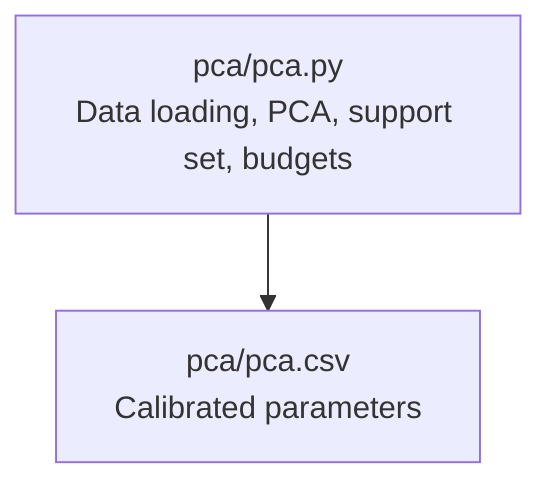
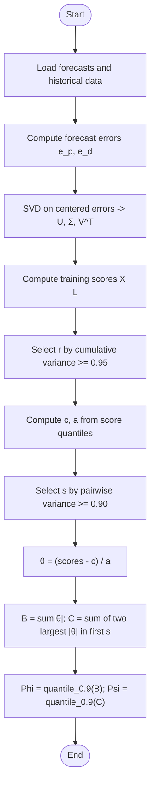
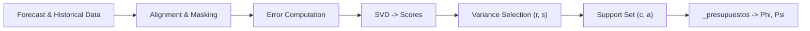

# Budget Parameter Calibration

<cite>
**Referenced Files in This Document**
- [pca.py](file://pca/pca.py)
- [pca.csv](file://pca/pca.csv)
</cite>

## Table of Contents
1. [Introduction](#introduction)
2. [Project Structure](#project-structure)
3. [Core Components](#core-components)
4. [Architecture Overview](#architecture-overview)
5. [Detailed Component Analysis](#detailed-component-analysis)
6. [Dependency Analysis](#dependency-analysis)
7. [Performance Considerations](#performance-considerations)
8. [Troubleshooting Guide](#troubleshooting-guide)
9. [Conclusion](#conclusion)
10. [Appendices](#appendices)

## Introduction
This document explains the budget parameter calibration algorithms used to construct robust optimization uncertainty sets from historical forecast errors. It focuses on:
- The pairwise variance threshold concept and how it determines the number of components s for budget calculation.
- The _presupuestos function that computes budget parameters Phi and Psi from training scores.
- The transformation θ = (z - c) / a, and the computation of B (sum of absolute values) and C (sum of two largest absolute values among the first s components).
- Mathematical formulations for budget constraints and their role in robust optimization.
- Practical guidance for tuning and sensitivity analysis of these budget parameters.

The implementation is contained in pca/pca.py and produces calibrated parameters saved in pca/pca.csv.

## Project Structure
The relevant code resides under the pca directory:
- pca/pca.py implements data loading, PCA-based error modeling, support set construction, and budget calibration.
- pca/pca.csv stores the resulting per-component parameters (c, a), component counts (s, r), and budget parameters (phi, psi).

**Diagram sources**
- [pca.py:1-323](file://pca/pca.py#L1-L323)
- [pca.csv:1-18](file://pca/pca.csv#L1-L18)

**Section sources**
- [pca.py:1-323](file://pca/pca.py#L1-L323)
- [pca.csv:1-18](file://pca/pca.csv#L1-L18)

## Core Components
- Pairwise variance threshold: PAIRWISE_VARIANCE_THRESHOLD = 0.90 controls the minimum explained variance retained by the first s principal components when computing pairwise budgets.
- Principal components selection: DEFAULT_VARIANCE_THRESHOLD = 0.95 selects the number of components r for each variable group (wind and demand).
- Support set construction: Centers c and radii a are derived from quantiles of training scores; the support set is z = c + a ⊙ θ with θ ∈ [-1, 1]^r.
- Budget calibration: _componentes_pares determines s; _presupuestos computes normalized scores θ, aggregate magnitudes B and C, and budget thresholds Phi and Psi at the 90th percentile.

Key responsibilities:
- Data alignment and SVD to obtain scores and loadings.
- Quantile-based centering and scaling to define uncertainty sets.
- Variance-threshold logic to choose r and s.
- Budget parameter estimation via empirical quantiles of B and C.

**Section sources**
- [pca.py:9-11](file://pca/pca.py#L9-L11)
- [pca.py:155-179](file://pca/pca.py#L155-L179)
- [pca.py:184-199](file://pca/pca.py#L184-L199)
- [pca.py:204-234](file://pca/pca.py#L204-L234)

## Architecture Overview
The pipeline proceeds as follows:
1. Load forecasts and aligned historical series.
2. Compute forecast errors e_p and e_d for wind and demand.
3. Center errors and perform SVD to obtain principal components and training scores.
4. Select r based on cumulative variance threshold.
5. Build support set centers c and radii a from score quantiles.
6. Determine s using pairwise variance threshold.
7. Normalize scores to θ, compute B and C, and estimate Phi and Psi.

**Diagram sources**
- [pca.py:120-179](file://pca/pca.py#L120-L179)
- [pca.py:184-199](file://pca/pca.py#L184-L199)
- [pca.py:204-234](file://pca/pca.py#L204-L234)

## Detailed Component Analysis

### Pairwise Variance Threshold and Selection of s
The function _componentes_pares selects the smallest s between 2 and r such that the cumulative explained variance of the first s components reaches or exceeds PAIRWISE_VARIANCE_THRESHOLD = 0.90. If r < 2, s is set to 0.

Mathematical formulation:
- Let σ_j be singular values for j = 1..r.
- Retained variance ratio after s components: sum_{j=1}^s σ_j^2 / sum_{j=1}^r σ_j^2.
- s = min(max(argmin_s {retained(s) ≥ 0.90}, 2), r).

Role:
- s restricts the “pairwise” budget to the most energetic modes captured by the top s components, ensuring robustness against dominant directions while limiting conservatism.

Implementation reference:
- See _componentes_pares definition and usage.

**Section sources**
- [pca.py:204-211](file://pca/pca.py#L204-L211)
- [pca.py:231-234](file://pca/pca.py#L231-L234)

### Budget Parameters Computation: _presupuestos
_presupuestos computes normalized scores and aggregates to derive budget thresholds.

Inputs:
- scores: matrix of training scores (samples × r).
- c: vector of centers (length r).
- a: vector of radii (length r), strictly positive.
- s: number of components considered for pairwise budget.

Steps:
1. Validate a > 0.
2. Transform θ = (scores - c) / a.
3. Compute magnitudes M = |θ|.
4. Compute B = row-wise sum of all M entries.
5. If s ≥ 2, compute C as the sum of the two largest absolute values among the first s columns of M; otherwise C = 0.
6. Set Phi = 90th percentile of B across samples.
7. Set Psi = 90th percentile of C across samples.

Output:
- θ, B, C, Phi, Psi.

Mathematical interpretation:
- θ represents standardized deviations within the hyperrectangle defined by c and a.
- B measures total deviation magnitude across all components.
- C captures the strongest pairwise deviation among the top s components.
- Phi and Psi are conservative thresholds chosen to cover the 90% upper tail of these aggregates.

Implementation reference:
- See _presupuestos definition and usage.

**Section sources**
- [pca.py:214-228](file://pca/pca.py#L214-L228)
- [pca.py:231-234](file://pca/pca.py#L231-L234)

### Transformation θ = (z - c) / a and Uncertainty Set
The support set is defined as:
- z ∈ R^r such that z = c + a ⊙ θ, with θ ∈ [-1, 1]^r.
- Equivalently, θ = (z - c) / a.

Interpretation:
- c is the center of the uncertainty box in score space.
- a defines half-widths along each principal direction.
- θ normalizes deviations to a unit hypercube, enabling uniform budgeting across dimensions.

Implementation reference:
- Construction of c and a from score quantiles.
- Comment describing the support set form.

**Section sources**
- [pca.py:184-199](file://pca/pca.py#L184-L199)

### Budget Constraints and Robust Optimization
Budget constraints typically take the form:
- ∑_{j=1}^r |θ_j| ≤ Φ
- ∑_{j∈Top2(s)} |θ_j| ≤ Ψ

Where:
- Φ = Phi bounds the total absolute deviation across all components.
- Ψ = Psi bounds the combined absolute deviation of the two largest-magnitude components among the first s.

These constraints limit the worst-case perturbation within the uncertainty set, providing robustness against adversarial deviations while controlling conservatism through empirically calibrated thresholds.

Practical implications:
- Larger Φ allows more overall deviation but may reduce robustness if too large.
- Smaller Ψ tightens control over extreme pairwise deviations.
- Tuning both parameters balances protection against outliers and model flexibility.

Note: These constraints are conceptual and not explicitly enforced in the script; they describe how Phi and Psi are intended to be used downstream in a robust optimization model.

[No sources needed since this section provides general guidance]

### Example Outputs and Interpretation
The file pca/pca.csv contains one row per component per group (“viento”, “demanda”), including:
- c: center per component.
- a: radius per component.
- s: number of components selected by pairwise variance threshold.
- r: number of components selected by default variance threshold.
- phi: budget threshold for total deviation.
- psi: budget threshold for pairwise deviation among top s.

Example interpretation:
- For “viento”, s = 3 and r = 5, indicating that the top 3 components retain at least 90% of the variance among the top 5.
- phi and psi are constant across components within a group because they are computed globally over all samples for that group.

**Section sources**
- [pca.csv:1-18](file://pca/pca.csv#L1-L18)

## Dependency Analysis
The calibration depends on:
- Data loading and alignment functions for forecasts and historical series.
- SVD decomposition to obtain principal components and scores.
- Quantile computations for constructing c, a, and budget thresholds.
- Variance accumulation to select r and s.

**Diagram sources**
- [pca.py:24-121](file://pca/pca.py#L24-L121)
- [pca.py:147-179](file://pca/pca.py#L147-L179)
- [pca.py:184-234](file://pca/pca.py#L184-L234)

**Section sources**
- [pca.py:24-121](file://pca/pca.py#L24-L121)
- [pca.py:147-179](file://pca/pca.py#L147-L179)
- [pca.py:184-234](file://pca/pca.py#L184-L234)

## Performance Considerations
- SVD complexity: O(n_train · r · min(n_train, r)). Since r is small (e.g., 5–11), performance is dominated by n_train.
- Partitioning for top-2 selection: np.partition is O(k) per sample where k = s; efficient for small s.
- Quantile computations: O(n_train) per dimension; negligible compared to SVD.
- Memory: Storing scores and intermediate matrices scales with n_train × r.

Recommendations:
- Ensure n_train is reasonable; consider subsampling if necessary.
- Keep r and s small to maintain computational efficiency.
- Vectorize operations as implemented; avoid Python loops over samples.

[No sources needed since this section provides general guidance]

## Troubleshooting Guide
Common issues and resolutions:
- Non-positive radii: _presupuestos raises an error if any a_j ≤ 0. Check quantile-derived radii and ensure sufficient spread in scores.
- Dimension mismatches: Validation checks raise errors if shapes of b, x, scores do not match expectations. Verify alignment of historical and forecast indices and masks.
- Insufficient explained variance: If cumulative variance below DEFAULT_VARIANCE_THRESHOLD, an error is raised. Increase r or adjust data preprocessing.
- Day-of-week misalignment: An error is raised if historical days do not align with forecast day-of-week. Confirm ORIGIN_FORECAST and ORIGIN_HISTORICAL settings.

Operational tips:
- Inspect c and a before calling _presupuestos.
- Validate s and r values; ensure s ≥ 2 for meaningful pairwise budget.
- Use pca.csv outputs to verify calibrated parameters.

**Section sources**
- [pca.py:169-179](file://pca/pca.py#L169-L179)
- [pca.py:214-218](file://pca/pca.py#L214-L218)
- [pca.py:71-73](file://pca/pca.py#L71-L73)

## Conclusion
The budget parameter calibration pipeline constructs robust uncertainty sets using PCA-based error modeling and quantile-driven normalization. The pairwise variance threshold ensures that only the most significant components influence the pairwise budget, while Phi and Psi provide empirically calibrated limits on total and pairwise deviations. These parameters enable robust optimization by bounding worst-case perturbations within a well-defined support set. Proper tuning and validation of r, s, c, a, Phi, and Psi are essential to balance robustness and performance.

[No sources needed since this section summarizes without analyzing specific files]

## Appendices

### Mathematical Summary
- Support set: z = c + a ⊙ θ, θ ∈ [-1, 1]^r.
- Normalization: θ = (z - c) / a.
- Aggregates: B = ∑_j |θ_j|; C = sum of two largest |θ_j| among j = 1..s.
- Budget thresholds: Φ = quantile_0.9(B); Ψ = quantile_0.9(C).
- Variance selection:
  - r: smallest index such that cumulative variance ≥ 0.95.
  - s: smallest index in [2, r] such that cumulative variance among top s ≥ 0.90.

[No sources needed since this section provides general guidance]