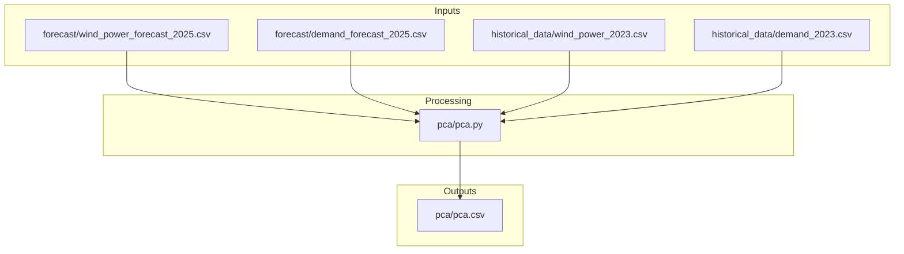
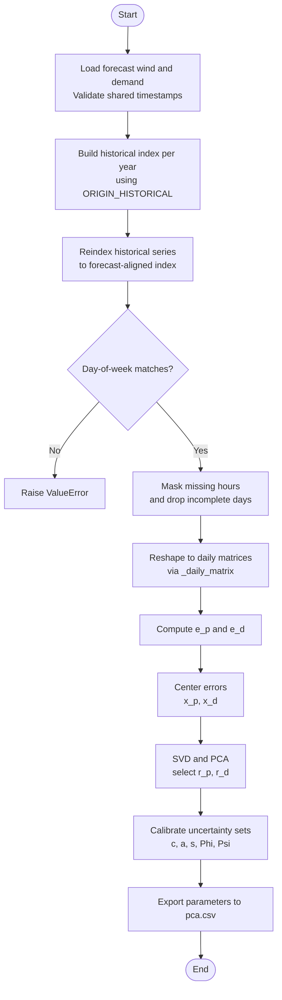
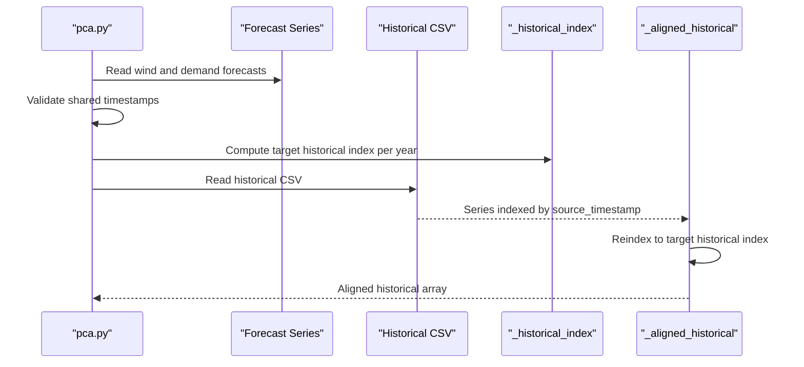
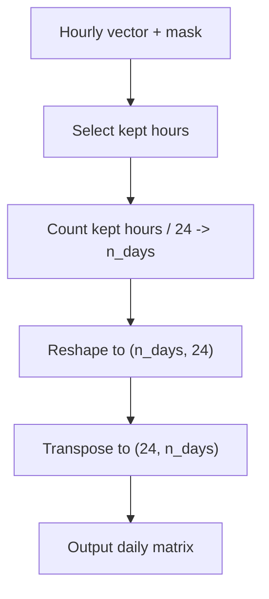
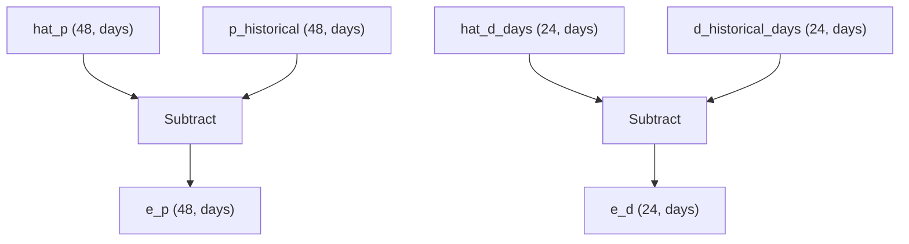
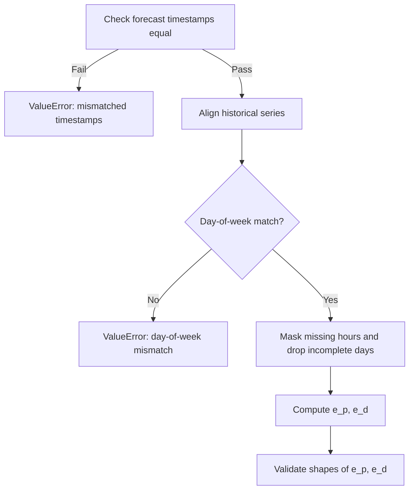
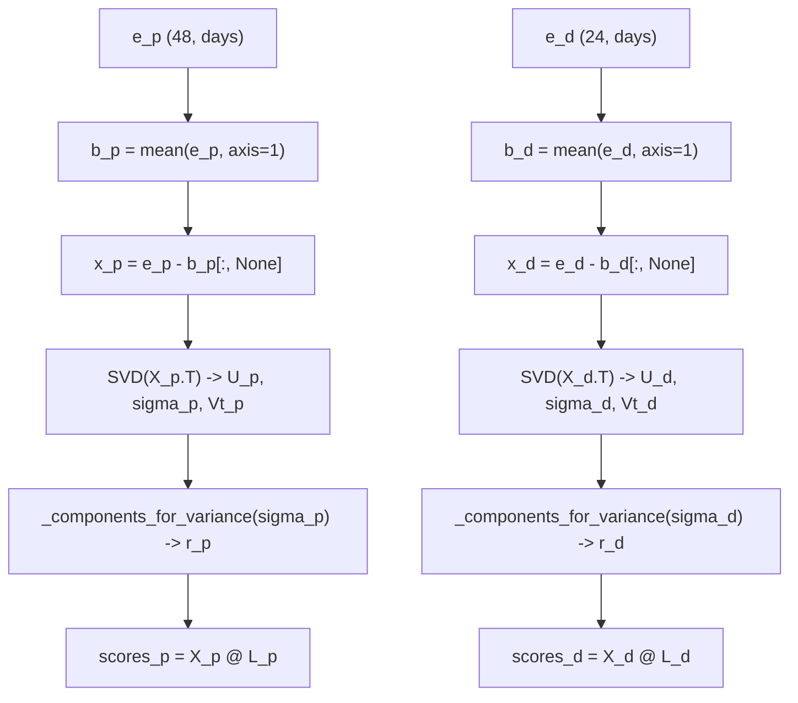
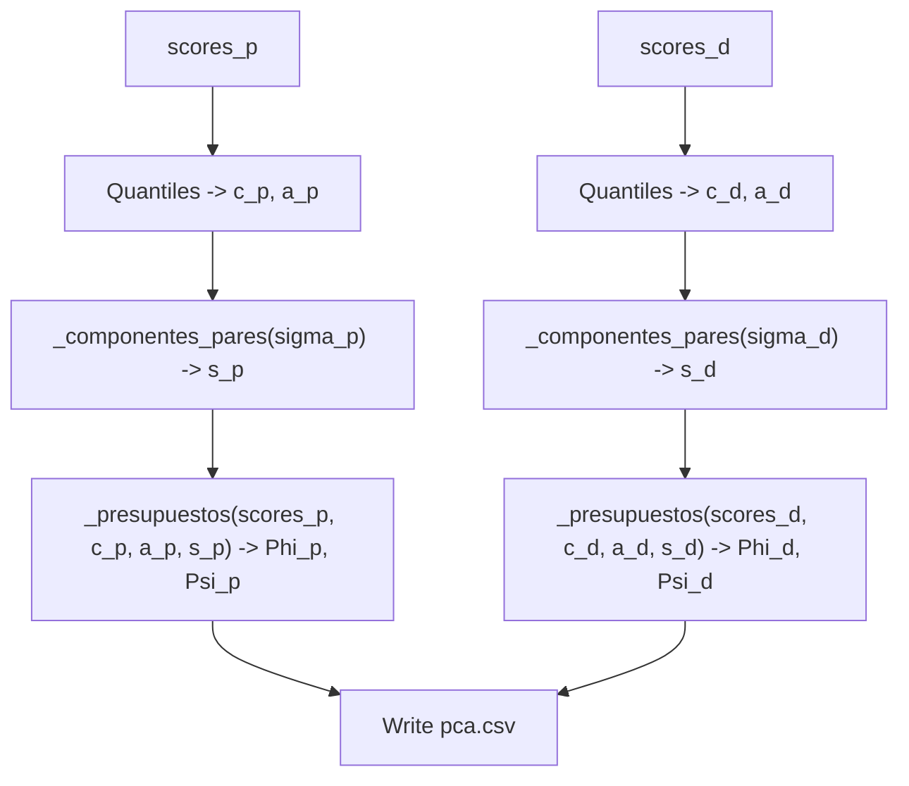
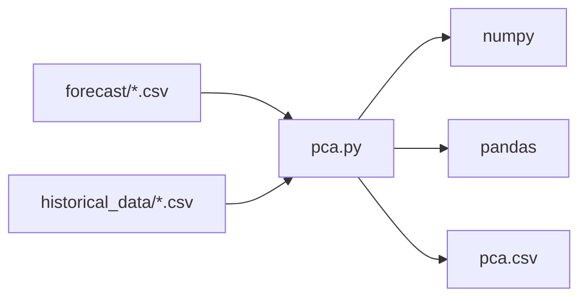

# Data Processing Pipeline

<cite>
**Referenced Files in This Document**   
- [pca.py](file://pca/pca.py)
- [wind_power_forecast_2025.csv](file://forecast/wind_power_forecast_2025.csv)
- [demand_forecast_2025.csv](file://forecast/demand_forecast_2025.csv)
- [wind_power_2023.csv](file://historical_data/wind_power_2023.csv)
- [demand_2023.csv](file://historical_data/demand_2023.csv)
</cite>

## Table of Contents
1. [Introduction](#introduction)
2. [Project Structure](#project-structure)
3. [Core Components](#core-components)
4. [Architecture Overview](#architecture-overview)
5. [Detailed Component Analysis](#detailed-component-analysis)
6. [Dependency Analysis](#dependency-analysis)
7. [Performance Considerations](#performance-considerations)
8. [Troubleshooting Guide](#troubleshooting-guide)
9. [Conclusion](#conclusion)

## Introduction
This document explains the complete data processing pipeline implemented in the PCA module, from temporal alignment between forecast and historical series through daily matrix reshaping, error calculation, bias removal, and Principal Component Analysis (PCA). The pipeline aligns hourly forecasts for wind power and demand with historical observations using fixed ORIGIN_FORECAST and per-year ORIGIN_HISTORICAL timestamps, validates day-of-week consistency, removes incomplete days, computes errors e_p and e_d, centers them, and performs SVD-based PCA to obtain low-dimensional representations used for uncertainty set construction.

## Project Structure
The relevant code and data are organized as follows:
- Forecast inputs: hourly time series for wind power and demand starting at a fixed forecast origin.
- Historical inputs: multi-year hourly records for wind power and demand aligned by day-of-week relative to the forecast origin.
- Processing script: pca.py implements alignment, reshaping, validation, error computation, PCA, and parameter export.

**Diagram sources**
- [pca.py:24-38](file://pca/pca.py#L24-L38)
- [pca.py:52-69](file://pca/pca.py#L52-L69)
- [pca.py:308-308](file://pca/pca.py#L308-L308)

**Section sources**
- [pca.py:1-10](file://pca/pca.py#L1-L10)
- [pca.py:24-38](file://pca/pca.py#L24-L38)
- [pca.py:52-69](file://pca/pca.py#L52-L69)
- [pca.py:308-308](file://pca/pca.py#L308-L308)

## Core Components
- Temporal alignment constants:
  - ORIGIN_FORECAST anchors the forecast horizon.
  - ORIGIN_HISTORICAL maps each historical year to an anchor date so that same weekday alignment is preserved.
- Alignment helpers:
  - _historical_index builds the target DatetimeIndex for historical reindexing based on the difference between forecast dates and ORIGIN_FORECAST.
  - _aligned_historical loads a CSV, selects a column, sorts by timestamp, and reindexes to the computed historical index.
- Daily matrix reshaping:
  - _daily_matrix converts a masked hourly vector into a (24, days) matrix where columns represent full days.
- Error computation:
  - e_p = p_historical - hat_p for wind power across two sites.
  - e_d = d_historical_days - hat_d_days for demand.
- Bias removal and PCA:
  - Centering by mean across samples yields x_p and x_d.
  - SVD provides principal components; variance thresholds determine retained dimensions r_p and r_d.
- Uncertainty set calibration:
  - Quantiles of scores define centers c and radii a.
  - Pairwise budget calibration selects s components and computes Phi and Psi.

**Section sources**
- [pca.py:18-22](file://pca/pca.py#L18-L22)
- [pca.py:41-49](file://pca/pca.py#L41-L49)
- [pca.py:94-97](file://pca/pca.py#L94-L97)
- [pca.py:120-121](file://pca/pca.py#L120-L121)
- [pca.py:131-148](file://pca/pca.py#L131-L148)
- [pca.py:155-167](file://pca/pca.py#L155-L167)
- [pca.py:184-234](file://pca/pca.py#L184-L234)

## Architecture Overview
The pipeline proceeds through these stages:
1. Load forecast series and validate they share identical timestamps.
2. Compute historical indices per year anchored to ORIGIN_HISTORICAL.
3. Reindex historical series to match the forecast timeline while preserving day-of-week alignment.
4. Validate that historical and forecast day-of-week sequences match.
5. Identify and drop incomplete days caused by missing values.
6. Reshape hourly vectors into daily matrices via _daily_matrix.
7. Compute errors e_p and e_d.
8. Remove bias and perform PCA (SVD).
9. Calibrate uncertainty sets and export parameters.

**Diagram sources**
- [pca.py:24-38](file://pca/pca.py#L24-L38)
- [pca.py:41-49](file://pca/pca.py#L41-L49)
- [pca.py:71-72](file://pca/pca.py#L71-L72)
- [pca.py:75-91](file://pca/pca.py#L75-L91)
- [pca.py:94-116](file://pca/pca.py#L94-L116)
- [pca.py:120-126](file://pca/pca.py#L120-L126)
- [pca.py:131-148](file://pca/pca.py#L131-L148)
- [pca.py:155-167](file://pca/pca.py#L155-L167)
- [pca.py:184-234](file://pca/pca.py#L184-L234)
- [pca.py:308-308](file://pca/pca.py#L308-L308)

## Detailed Component Analysis

### Temporal Alignment Using ORIGIN_FORECAST and ORIGIN_HISTORICAL
- ORIGIN_FORECAST is a fixed Monday in January 2025.
- ORIGIN_HISTORICAL maps each historical year to a Monday such that the same weekday mapping holds between forecast and historical hours.
- _historical_index computes the offset between each forecast timestamp and ORIGIN_FORECAST, then applies it to ORIGIN_HISTORICAL[year] plus the original hour to produce the target historical timestamps.
- _aligned_historical reads a historical CSV, selects the requested column, sorts by source_timestamp, and reindexes to the computed historical index.

**Diagram sources**
- [pca.py:18-22](file://pca/pca.py#L18-L22)
- [pca.py:24-38](file://pca/pca.py#L24-L38)
- [pca.py:41-49](file://pca/pca.py#L41-L49)

**Section sources**
- [pca.py:18-22](file://pca/pca.py#L18-L22)
- [pca.py:41-49](file://pca/pca.py#L41-L49)

### Daily Matrix Reshaping With _daily_matrix
- A boolean mask identifies complete days across all variables (both wind sites and demand).
- Days with any missing hour are excluded.
- _daily_matrix takes a masked hourly vector and reshapes it into a (24, days) matrix: rows are hours 0..23, columns are consecutive valid days.
- For wind power, AB and KA are stacked vertically to form a 48-row matrix; demand remains 24 rows.

**Diagram sources**
- [pca.py:75-91](file://pca/pca.py#L75-L91)
- [pca.py:94-97](file://pca/pca.py#L94-L97)
- [pca.py:100-116](file://pca/pca.py#L100-L116)

**Section sources**
- [pca.py:75-91](file://pca/pca.py#L75-L91)
- [pca.py:94-97](file://pca/pca.py#L94-L97)
- [pca.py:100-116](file://pca/pca.py#L100-L116)

### Error Calculation e_p and e_d
- After constructing daily matrices:
  - e_p = p_historical - hat_p has shape (48, total_days).
  - e_d = d_historical_days - hat_d_days has shape (24, total_days).
- Shape validations ensure correct dimensions before proceeding.

**Diagram sources**
- [pca.py:113-121](file://pca/pca.py#L113-L121)
- [pca.py:123-126](file://pca/pca.py#L123-L126)

**Section sources**
- [pca.py:113-126](file://pca/pca.py#L113-L126)

### Validation Checks and Data Consistency
- Forecast series must share identical timestamps; otherwise, a ValueError is raised.
- Historical and forecast day-of-week sequences must match; otherwise, a ValueError is raised.
- Missing data handling:
  - Any NaN in wind_AB, wind_KA, or demand for a given day causes the entire day to be dropped.
  - Incomplete days are tracked and reported via dias_sin_par.
- Post-error shape checks ensure e_p and e_d have expected shapes.

**Diagram sources**
- [pca.py:32-33](file://pca/pca.py#L32-L33)
- [pca.py:71-72](file://pca/pca.py#L71-L72)
- [pca.py:75-91](file://pca/pca.py#L75-L91)
- [pca.py:123-126](file://pca/pca.py#L123-L126)

**Section sources**
- [pca.py:32-33](file://pca/pca.py#L32-L33)
- [pca.py:71-72](file://pca/pca.py#L71-L72)
- [pca.py:75-91](file://pca/pca.py#L75-L91)
- [pca.py:123-126](file://pca/pca.py#L123-L126)

### PCA Decomposition and Variance Thresholds
- Bias removal:
  - b_p and b_d are means across samples (columns).
  - x_p and x_d center the errors by subtracting their biases.
- SVD:
  - X_p and X_d are formed as sample-by-feature matrices.
  - U, sigma, Vt are obtained via SVD; V_p and V_d are reconstructed.
- Component selection:
  - _components_for_variance chooses the smallest r such that cumulative explained variance reaches DEFAULT_VARIANCE_THRESHOLD.
- Orthogonality and score shape checks ensure correctness.

**Diagram sources**
- [pca.py:131-148](file://pca/pca.py#L131-L148)
- [pca.py:155-167](file://pca/pca.py#L155-L167)

**Section sources**
- [pca.py:131-148](file://pca/pca.py#L131-L148)
- [pca.py:155-167](file://pca/pca.py#L155-L167)

### Uncertainty Set Calibration and Parameter Export
- Score quantiles at 10th and 90th percentiles define centers c and radii a for both wind and demand.
- Pairwise component selection (_componentes_pares) ensures at least two components when possible and meets PAIRWISE_VARIANCE_THRESHOLD.
- Budgets Phi and Psi are derived from quantiles of aggregated absolute theta norms.
- Parameters are exported to pca.csv.

**Diagram sources**
- [pca.py:184-195](file://pca/pca.py#L184-L195)
- [pca.py:204-228](file://pca/pca.py#L204-L228)
- [pca.py:231-234](file://pca/pca.py#L231-L234)
- [pca.py:308-308](file://pca/pca.py#L308-L308)

**Section sources**
- [pca.py:184-195](file://pca/pca.py#L184-L195)
- [pca.py:204-228](file://pca/pca.py#L204-L228)
- [pca.py:231-234](file://pca/pca.py#L231-L234)
- [pca.py:308-308](file://pca/pca.py#L308-L308)

## Dependency Analysis
- Input dependencies:
  - Forecast files provide hourly median series for wind power (AB and KA) and demand.
  - Historical files provide corresponding observed series for years 2023 and 2024.
- Internal dependencies:
  - _historical_index depends on ORIGIN_FORECAST and ORIGIN_HISTORICAL.
  - _aligned_historical depends on file paths and column names.
  - _daily_matrix depends on masks derived from missing value detection.
  - PCA functions depend on SVD outputs and variance thresholds.
- External libraries:
  - numpy and pandas are used for numerical operations and time-series manipulation.

**Diagram sources**
- [pca.py:1-4](file://pca/pca.py#L1-L4)
- [pca.py:24-38](file://pca/pca.py#L24-L38)
- [pca.py:52-69](file://pca/pca.py#L52-L69)
- [pca.py:308-308](file://pca/pca.py#L308-L308)

**Section sources**
- [pca.py:1-4](file://pca/pca.py#L1-L4)
- [pca.py:24-38](file://pca/pca.py#L24-L38)
- [pca.py:52-69](file://pca/pca.py#L52-L69)
- [pca.py:308-308](file://pca/pca.py#L308-L308)

## Performance Considerations
- Vectorized operations:
  - Boolean masking and reshape operations are efficient for large hourly series.
- Memory usage:
  - Stacking multiple series into larger matrices increases memory consumption; ensure sufficient RAM for multi-year datasets.
- Computational cost:
  - SVD scales with the number of samples (days) and features (hours); typical sizes here are manageable but should be monitored if extending to longer horizons.
- I/O considerations:
  - Reading large CSVs can be optimized by selecting only required columns and parsing timestamps efficiently.

[No sources needed since this section provides general guidance]

## Troubleshooting Guide
Common issues and resolutions:
- Mismatched forecast timestamps:
  - Symptom: ValueError indicating wind and demand forecasts do not share the same hours.
  - Resolution: Ensure both forecast files have identical source_timestamp columns and lengths.
- Day-of-week misalignment:
  - Symptom: ValueError stating historical does not fall on the same day of week as forecast.
  - Resolution: Verify ORIGIN_FORECAST and ORIGIN_HISTORICAL map to Mondays that preserve weekday alignment.
- Missing data causing incomplete days:
  - Symptom: Fewer days than expected or explicit reporting of dias_sin_par.
  - Resolution: Inspect historical CSVs for NaN entries; either impute or remove affected days.
- Shape mismatches after error computation:
  - Symptom: ValueError about unexpected shapes for e_p or e_d.
  - Resolution: Confirm masks exclude incomplete days consistently across all series and that reshaping uses HOURS_PER_DAY.

**Section sources**
- [pca.py:32-33](file://pca/pca.py#L32-L33)
- [pca.py:71-72](file://pca/pca.py#L71-L72)
- [pca.py:75-91](file://pca/pca.py#L75-L91)
- [pca.py:123-126](file://pca/pca.py#L123-L126)

## Conclusion
The pipeline robustly aligns forecast and historical hourly series using fixed origins, enforces day-of-week consistency, handles missing data by dropping incomplete days, reshapes data into daily matrices, computes errors, and performs PCA to extract dominant modes of variability. The resulting parameters support uncertainty set construction and downstream optimization. Proper attention to input data quality and alignment constants ensures reliable results.

[No sources needed since this section summarizes without analyzing specific files]