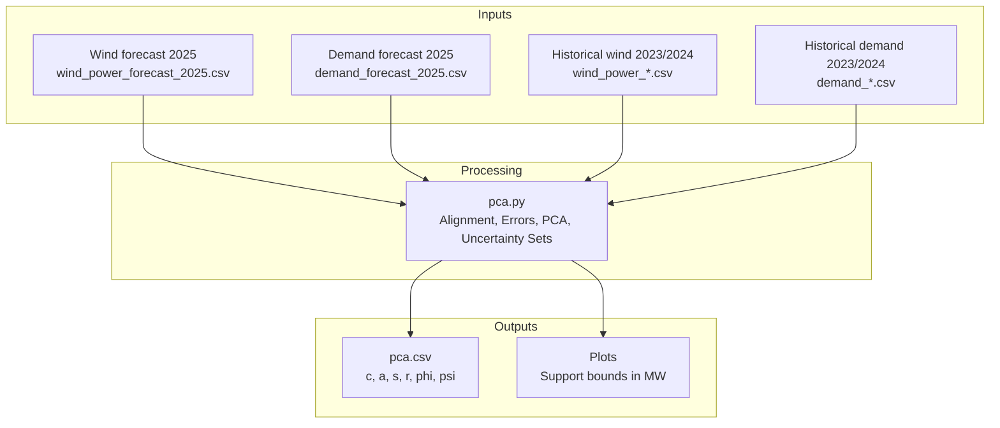
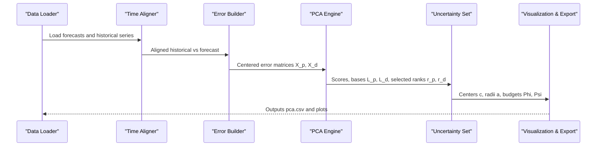

# PCA and Uncertainty Quantification

<cite>
**Referenced Files in This Document**
- [pca.py](file://pca/pca.py)
- [pca.csv](file://pca/pca.csv)
- [demand_2023.csv](file://historical_data/demand_2023.csv)
- [wind_power_2023.csv](file://historical_data/wind_power_2023.csv)
- [demand_forecast_2025.csv](file://forecast/demand_forecast_2025.csv)
- [wind_power_forecast_2025.csv](file://forecast/wind_power_forecast_2025.csv)
</cite>

## Table of Contents
1. [Introduction](#introduction)
2. [Project Structure](#project-structure)
3. [Core Components](#core-components)
4. [Architecture Overview](#architecture-overview)
5. [Detailed Component Analysis](#detailed-component-analysis)
6. [Dependency Analysis](#dependency-analysis)
7. [Performance Considerations](#performance-considerations)
8. [Troubleshooting Guide](#troubleshooting-guide)
9. [Conclusion](#conclusion)
10. [Appendices](#appendices)

## Introduction
This document explains the Principal Component Analysis (PCA) and uncertainty quantification module used to model forecast errors for wind power and electricity demand. It covers:
- Data alignment across historical and forecast horizons
- Error computation and centering
- SVD-based PCA decomposition and component selection by variance thresholds
- Construction of quantile-based uncertainty sets in PCA coordinates
- Budget parameter calibration using aggregate and pairwise norms
- Mapping back to physical units (MW) for visualization and robust optimization constraints
- Computational efficiency and numerical stability considerations

The implementation is contained in a single script that reads CSV data, performs matrix operations with NumPy, and outputs both visualizations and a summary CSV of parameters.

## Project Structure
The module operates on four primary inputs:
- Forecast series for 2025: wind power and demand
- Historical series for 2023 and 2024: wind power and demand
- A configuration block defining time origins and thresholds
- An output CSV summarizing PCA components, centers, radii, and budget parameters

**Diagram sources**
- [pca.py:24-38](file://pca/pca.py#L24-L38)
- [pca.py:52-69](file://pca/pca.py#L52-L69)
- [pca.py:308-322](file://pca/pca.py#L308-L322)

**Section sources**
- [pca.py:1-12](file://pca/pca.py#L1-L12)
- [pca.py:24-38](file://pca/pca.py#L24-L38)
- [pca.py:52-69](file://pca/pca.py#L52-L69)

## Core Components
- Data loading and validation:
  - Loads forecast series and ensures timestamps align between wind and demand forecasts.
  - Reads historical series per year and column names.
- Time alignment:
  - Aligns historical timestamps to forecast days-of-week and hours, handling missing dates and leap-day omissions.
- Error construction:
  - Computes forecast errors for wind and demand over aligned historical windows.
- PCA decomposition:
  - Centers errors, performs SVD, selects principal components by cumulative variance thresholds.
- Uncertainty set construction:
  - Uses quantiles of PCA scores to define centers and radii per component.
- Budget calibration:
  - Computes aggregate and pairwise budgets from score magnitudes at a target quantile.
- Visualization and export:
  - Maps PCA support sets back to MW and plots hourly bands; exports parameters to CSV.

**Section sources**
- [pca.py:24-38](file://pca/pca.py#L24-L38)
- [pca.py:41-49](file://pca/pca.py#L41-L49)
- [pca.py:71-91](file://pca/pca.py#L71-L91)
- [pca.py:118-126](file://pca/pca.py#L118-L126)
- [pca.py:143-152](file://pca/pca.py#L143-L152)
- [pca.py:155-178](file://pca/pca.py#L155-L178)
- [pca.py:180-199](file://pca/pca.py#L180-L199)
- [pca.py:204-234](file://pca/pca.py#L204-L234)
- [pca.py:240-308](file://pca/pca.py#L240-L308)

## Architecture Overview
The pipeline follows a linear flow from raw data to robust uncertainty sets:

**Diagram sources**
- [pca.py:24-38](file://pca/pca.py#L24-L38)
- [pca.py:41-49](file://pca/pca.py#L41-L49)
- [pca.py:118-126](file://pca/pca.py#L118-L126)
- [pca.py:143-152](file://pca/pca.py#L143-L152)
- [pca.py:180-199](file://pca/pca.py#L180-L199)
- [pca.py:204-234](file://pca/pca.py#L204-L234)
- [pca.py:240-308](file://pca/pca.py#L240-L308)

## Detailed Component Analysis

### Data Processing Pipeline
- Forecast loading and validation:
  - Ensures wind and demand forecasts share identical timestamps.
- Historical loading and alignment:
  - For each year, loads wind and demand series, reindexes to match forecast day-of-week and hour offsets.
  - Drops incomplete days where any variable has missing values.
- Horizon calculation:
  - Determines number of full days retained per year and total columns for concatenated matrices.

Key responsibilities:
- Input integrity checks (timestamp equality, weekday alignment).
- Handling of missing data and leap-day omission logic.

**Section sources**
- [pca.py:24-38](file://pca/pca.py#L24-L38)
- [pca.py:41-49](file://pca/pca.py#L41-L49)
- [pca.py:52-69](file://pca/pca.py#L52-L69)
- [pca.py:71-91](file://pca/pca.py#L71-L91)

### Error Calculation and Centering
- Error matrices:
  - Wind error e_p: shape (48, N_train), concatenating AB and KA hourly profiles.
  - Demand error e_d: shape (24, N_train).
- Centering:
  - Computes mean vectors b_p and b_d across training samples.
  - Produces centered matrices x_p and x_d by subtracting means.

Validation:
- Shape checks ensure consistent dimensions before proceeding.

**Section sources**
- [pca.py:118-126](file://pca/pca.py#L118-L126)
- [pca.py:128-141](file://pca/pca.py#L128-L141)

### PCA Decomposition and Component Selection
- SVD:
  - Performs truncated SVD on X_p and X_d to obtain singular values and right singular vectors.
- Variance threshold selection:
  - Selects minimal rank r such that cumulative explained variance reaches a default threshold.
- Orthogonality and explained variance checks:
  - Verifies orthonormality of selected basis vectors and minimum explained variance.

Mathematical formulation:
- X_q = U_q Σ_q V_q^T
- L_q = V_q[:, :r_q]
- Scores: Z_q = X_q L_q

Complexity:
- SVD on matrices of size (N_train × d) where d ∈ {48, 24}.
- Truncated SVD reduces computational cost while retaining dominant modes.

**Section sources**
- [pca.py:143-152](file://pca/pca.py#L143-L152)
- [pca.py:155-178](file://pca/pca.py#L155-L178)

### Uncertainty Set Construction in PCA Coordinates
- Quantile-based bounds:
  - For each component j, compute lower and upper quantiles z_dw_j and z_up_j from scores.
  - Define center c_j = (z_up_j + z_dw_j)/2 and radius a_j = (z_up_j - z_dw_j)/2.
- Support set definition:
  - In PCA space: z = c + a ⊙ θ, with θ ∈ [-1, 1]^r.
- Mapping to physical units:
  - Reconstruct bounds in MW via hat + b + L z, yielding interval bands per hour.

Interpretation:
- The resulting bands represent plausible deviations around the forecast mean, accounting for correlated patterns captured by PCA.

**Section sources**
- [pca.py:180-199](file://pca/pca.py#L180-L199)
- [pca.py:240-257](file://pca/pca.py#L240-L257)

### Budget Parameter Calibration Algorithms
- Pairwise component selection:
  - Determines s ≤ r capturing a pairwise variance threshold, ensuring at least two components when possible.
- Score normalization and budgets:
  - Normalize scores by radii to obtain θ.
  - Compute aggregate budget B = ||θ||_1 and pairwise budget C = sum of top-two absolute scores among first s components.
  - Calibrate Φ and Ψ as quantiles of B and C distributions.

Algorithmic steps:
- If r < 2, set s = 0 and C = 0.
- Otherwise, select s to meet pairwise variance threshold.
- Compute B and C per sample; take 90th percentile for Φ and Ψ.

Robust optimization link:
- Φ controls overall deviation magnitude; Ψ penalizes concentration of deviations across a few components.

**Section sources**
- [pca.py:204-234](file://pca/pca.py#L204-L234)

### Visualization and Output
- Plotting:
  - Generates three panels: wind AB, wind KA, and demand.
  - Displays support bands (center ± radius) and overlay of mean forecast.
- Export:
  - Writes a CSV with group, component index, center c, radius a, s, r, Φ, Ψ.

Usage:
- Consumers can load pca.csv to reconstruct uncertainty sets without rerunning the pipeline.

**Section sources**
- [pca.py:240-308](file://pca/pca.py#L240-L308)

## Dependency Analysis
The module depends on:
- NumPy for numerical linear algebra (SVD, quantiles, partition).
- Pandas for time-series alignment and CSV I/O.
- Matplotlib for plotting.

External data dependencies:
- Forecast CSVs for 2025 (wind and demand).
- Historical CSVs for 2023 and 2024 (wind and demand).

Coupling:
- Strong coupling between data format expectations (column names, timestamp fields).
- Tight integration between alignment logic and error computation.

Potential circular dependencies:
- None observed; processing is linear.

**Section sources**
- [pca.py:1-5](file://pca/pca.py#L1-L5)
- [pca.py:24-38](file://pca/pca.py#L24-L38)
- [pca.py:52-69](file://pca/pca.py#L52-L69)

## Performance Considerations
- Matrix operations:
  - Use of truncated SVD minimizes memory and compute costs.
  - Vectorized operations for mean subtraction, quantiles, and partition reduce overhead.
- Numerical stability:
  - SVD is numerically stable; however, near-zero radii are guarded against via explicit checks.
  - Orthonormality assertions help detect degenerate cases early.
- Data quality:
  - Dropping incomplete days avoids NaN propagation through SVD.
  - Validating weekday alignment prevents misalignment artifacts.

Optimization opportunities:
- Precompute daily masks once and reuse across variables.
- Consider chunked reading for very large datasets if needed.

[No sources needed since this section provides general guidance]

## Troubleshooting Guide
Common issues and resolutions:
- Mismatched forecast timestamps:
  - Ensure wind and demand forecasts have identical source_timestamp sequences.
- Weekday misalignment:
  - Verify historical origins align with forecast weekdays; otherwise, an exception is raised.
- Missing data in historical files:
  - Days with any missing variable are excluded; check input completeness.
- Zero or negative radii:
  - Indicates degenerate components; inspect quantiles and consider adjusting thresholds.
- Insufficient explained variance:
  - If cumulative variance below threshold, adjust DEFAULT_VARIANCE_THRESHOLD or review data quality.

Relevant checks in code:
- Timestamp equality validation.
- Weekday alignment validation.
- Shape validations for error matrices and PCA outputs.
- Orthonormality and explained variance assertions.
- Radius positivity checks during budget calibration.

**Section sources**
- [pca.py:32-33](file://pca/pca.py#L32-L33)
- [pca.py:71-72](file://pca/pca.py#L71-L72)
- [pca.py:123-141](file://pca/pca.py#L123-L141)
- [pca.py:169-178](file://pca/pca.py#L169-L178)
- [pca.py:216-217](file://pca/pca.py#L216-L217)

## Conclusion
The PCA and uncertainty quantification module provides a robust framework for modeling forecast uncertainties in wind power and demand. By aligning historical and forecast data, computing centered errors, applying SVD-based PCA, and constructing quantile-driven uncertainty sets, it yields interpretable bounds suitable for robust optimization. Budget parameters calibrated from aggregate and pairwise norms offer flexible control over conservatism. The implementation emphasizes numerical stability, clear validation, and practical outputs for downstream decision-making.

[No sources needed since this section summarizes without analyzing specific files]

## Appendices

### Mathematical Formulations
- Error construction:
  - e_p = p_historical − hat_p
  - e_d = d_historical − hat_d
- Centering:
  - b_p = mean(e_p), b_d = mean(e_d)
  - x_p = e_p − b_p, x_d = e_d − b_d
- PCA decomposition:
  - X_q = x_q^T = U_q Σ_q V_q^T
  - L_q = V_q[:, :r_q], Scores Z_q = X_q L_q
- Uncertainty set in PCA space:
  - z = c + a ⊙ θ, θ ∈ [-1, 1]^r
  - c_j = (z_up_j + z_dw_j)/2, a_j = (z_up_j − z_dw_j)/2
- Mapping to physical units:
  - Bounds = hat + b + L z
- Budgets:
  - θ = (Z − c) / a
  - B = ||θ||_1, C = sum of top-two |θ| among first s components
  - Φ = quantile(B, 0.90), Ψ = quantile(C, 0.90)

These formulations underpin the module’s uncertainty sets and their integration into robust optimization constraints.

**Section sources**
- [pca.py:118-126](file://pca/pca.py#L118-L126)
- [pca.py:128-141](file://pca/pca.py#L128-L141)
- [pca.py:143-152](file://pca/pca.py#L143-L152)
- [pca.py:180-199](file://pca/pca.py#L180-L199)
- [pca.py:204-234](file://pca/pca.py#L204-L234)
- [pca.py:240-257](file://pca/pca.py#L240-L257)

### Example Interpretation of PCA Results and Budget Parameters
- From pca.csv:
  - Each row corresponds to a component within a group (wind or demand).
  - Columns include:
    - grupo: group identifier (viento, demanda)
    - componente: component index
    - c: center of the uncertainty interval in PCA space
    - a: radius of the uncertainty interval in PCA space
    - s: number of components considered for pairwise budget
    - r: total number of retained components
    - phi: aggregate budget Φ
    - psi: pairwise budget Ψ
- Interpretation:
  - Larger |c| indicates systematic bias in that component.
  - Larger a implies higher variability along that mode.
  - Higher Φ suggests larger overall deviations; higher Ψ indicates stronger concentration of deviations across a few components.

Practical usage:
- Load pca.csv to reconstruct uncertainty sets for robust optimization without recomputing PCA.
- Adjust thresholds (DEFAULT_VARIANCE_THRESHOLD, PAIRWISE_VARIANCE_THRESHOLD) to tune conservativeness.

**Section sources**
- [pca.csv:1-18](file://pca/pca.csv#L1-L18)
- [pca.py:290-308](file://pca/pca.py#L290-L308)