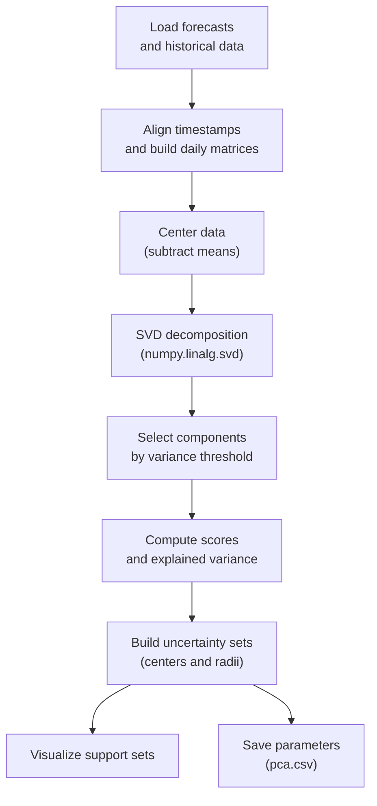
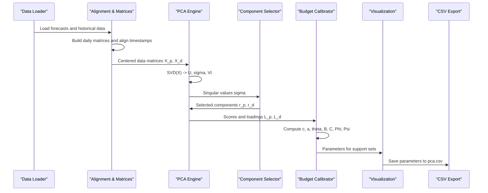
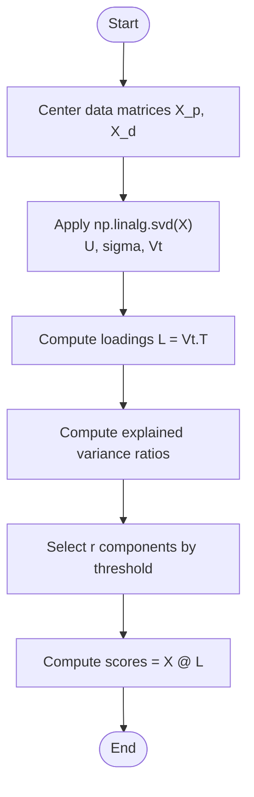
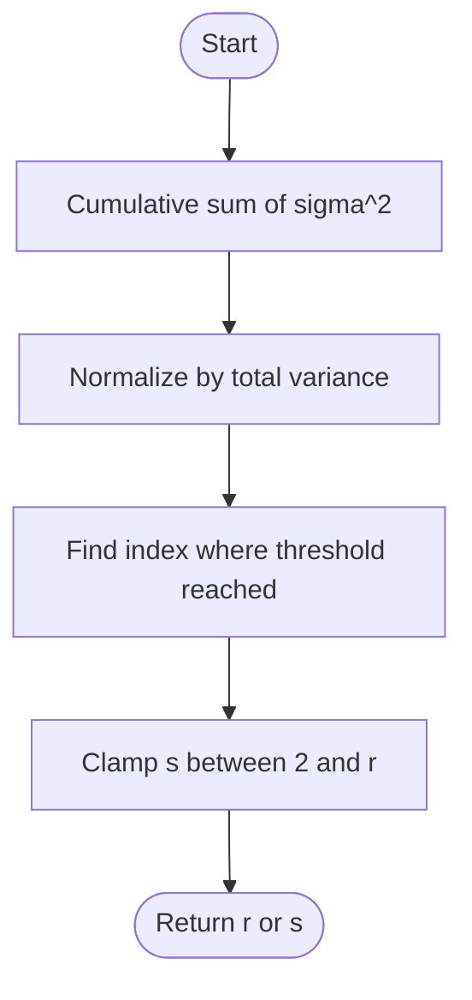
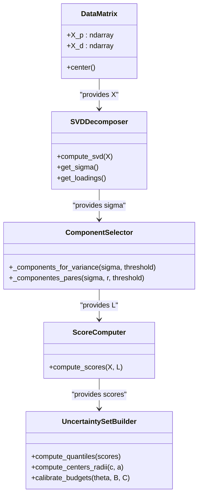
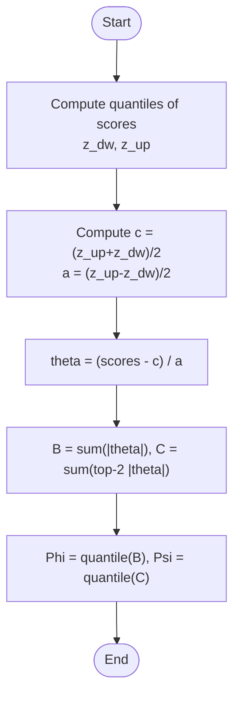
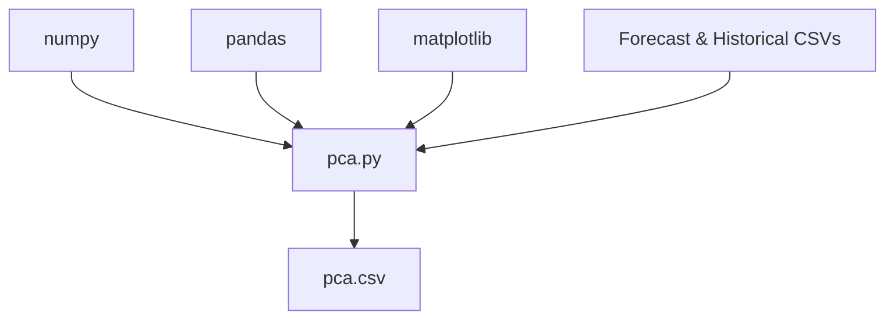

# Principal Component Analysis Implementation

<cite>
**Referenced Files in This Document**   
- [pca.py](file://pca/pca.py)
- [pca.csv](file://pca/pca.csv)
</cite>

## Table of Contents
1. [Introduction](#introduction)
2. [Project Structure](#project-structure)
3. [Core Components](#core-components)
4. [Architecture Overview](#architecture-overview)
5. [Detailed Component Analysis](#detailed-component-analysis)
6. [Dependency Analysis](#dependency-analysis)
7. [Performance Considerations](#performance-considerations)
8. [Troubleshooting Guide](#troubleshooting-guide)
9. [Conclusion](#conclusion)
10. [Appendices](#appendices)

## Introduction
This document explains the Principal Component Analysis (PCA) implementation used to model uncertainty sets for wind power and demand time series. The code performs SVD-based PCA on aligned historical and forecast data, selects components by a cumulative variance threshold, computes component loadings and scores, and derives robust support sets for optimization. It also includes visualization utilities and outputs key parameters to CSV.

The mathematical foundations covered include:
- Data alignment and centering
- SVD decomposition via numpy.linalg.svd
- Covariance matrix interpretation through eigenvalue decomposition
- Principal component extraction and selection using variance thresholds
- Uncertainty set construction from quantiles of principal component scores

## Project Structure
The PCA module is implemented as a single script that:
- Loads forecast and historical datasets
- Aligns them temporally
- Builds matrices of hourly profiles across days
- Performs PCA per variable group (wind AB+KA combined, and demand)
- Computes uncertainty set parameters and visualizes results
- Saves parameters to a CSV file

**Diagram sources**
- [pca.py:24-38](file://pca/pca.py#L24-L38)
- [pca.py:41-49](file://pca/pca.py#L41-L49)
- [pca.py:94-121](file://pca/pca.py#L94-L121)
- [pca.py:131-152](file://pca/pca.py#L131-L152)
- [pca.py:155-178](file://pca/pca.py#L155-L178)
- [pca.py:184-195](file://pca/pca.py#L184-L195)
- [pca.py:240-288](file://pca/pca.py#L240-L288)
- [pca.py:290-308](file://pca/pca.py#L290-L308)

**Section sources**
- [pca.py:1-12](file://pca/pca.py#L1-L12)
- [pca.py:24-38](file://pca/pca.py#L24-L38)
- [pca.py:41-49](file://pca/pca.py#L41-L49)
- [pca.py:94-121](file://pca/pca.py#L94-L121)
- [pca.py:131-152](file://pca/pca.py#L131-L152)
- [pca.py:155-178](file://pca/pca.py#L155-L178)
- [pca.py:184-195](file://pca/pca.py#L184-L195)
- [pca.py:240-288](file://pca/pca.py#L240-L288)
- [pca.py:290-308](file://pca/pca.py#L290-L308)

## Core Components
- Constants and configuration:
  - DEFAULT_VARIANCE_THRESHOLD = 0.95 controls the minimum cumulative variance retained when selecting components.
  - PAIRWISE_VARIANCE_THRESHOLD = 0.90 controls pairwise budget calibration across selected components.
- Data loading and alignment:
  - Reads forecast and historical CSV files, validates timestamp alignment, and constructs daily matrices for each year.
- PCA pipeline:
  - Centers data by subtracting mean profiles.
  - Applies SVD to obtain singular values and right singular vectors (loadings).
  - Selects number of components r based on cumulative variance threshold.
  - Computes scores and validated explained variance.
- Uncertainty set construction:
  - Uses quantiles of scores to compute centers c and radii a for each component.
  - Calibrates budgets Phi and Psi for total and pairwise magnitudes.
- Visualization and output:
  - Plots support sets for wind and demand across hours.
  - Exports component parameters (c, a, s, r, phi, psi) to pca.csv.

Key functions:
- _components_for_variance(sigma, threshold): Determines minimal r such that cumulative variance reaches threshold.
- _componentes_pares(sigma, r, threshold): Determines minimal s (with 2 ≤ s ≤ r) for pairwise budget calibration.
- _presupuestos(scores, c, a, s): Computes theta, aggregate budgets B and C, and quantile-based thresholds Phi and Psi.
- _soporte_mw(L, c, a, b, hat): Maps uncertainty set from component space to physical units (MW).

**Section sources**
- [pca.py:9-11](file://pca/pca.py#L9-L11)
- [pca.py:24-38](file://pca/pca.py#L24-L38)
- [pca.py:41-49](file://pca/pca.py#L41-L49)
- [pca.py:94-121](file://pca/pca.py#L94-L121)
- [pca.py:131-152](file://pca/pca.py#L131-L152)
- [pca.py:155-178](file://pca/pca.py#L155-L178)
- [pca.py:184-195](file://pca/pca.py#L184-L195)
- [pca.py:204-228](file://pca/pca.py#L204-L228)
- [pca.py:242-249](file://pca/pca.py#L242-L249)
- [pca.py:290-308](file://pca/pca.py#L290-L308)

## Architecture Overview
The PCA workflow can be viewed as a sequence of transformations from raw time series to uncertainty set parameters:

**Diagram sources**
- [pca.py:24-38](file://pca/pca.py#L24-L38)
- [pca.py:41-49](file://pca/pca.py#L41-L49)
- [pca.py:94-121](file://pca/pca.py#L94-L121)
- [pca.py:131-152](file://pca/pca.py#L131-L152)
- [pca.py:155-178](file://pca/pca.py#L155-L178)
- [pca.py:184-195](file://pca/pca.py#L184-L195)
- [pca.py:204-228](file://pca/pca.py#L204-L228)
- [pca.py:240-288](file://pca/pca.py#L240-L288)
- [pca.py:290-308](file://pca/pca.py#L290-L308)

## Detailed Component Analysis

### SVD Decomposition Process Using numpy.linalg.svd
The implementation uses SVD to decompose centered data matrices:
- For wind variables (AB and KA combined), it forms X_p with shape (n_train_p, n_features_p).
- For demand, it forms X_d with shape (n_train_d, n_features_d).
- SVD returns U, sigma, Vt; loadings are obtained as V = Vt.T.

Mathematical background:
- SVD factorization: X = U Σ V^T
- Singular values σ_i relate to covariance eigenvalues λ_i by λ_i = σ_i^2 / (n-1) when X is centered.
- Principal components correspond to columns of V (right singular vectors).
- Scores are computed as X @ L where L contains selected loadings.

Implementation highlights:
- full_matrices=False reduces memory usage by returning compact SVD factors.
- Explained variance ratio is computed directly from singular values: sum(σ_i^2)/sum(σ_all^2).

**Diagram sources**
- [pca.py:131-152](file://pca/pca.py#L131-L152)
- [pca.py:155-178](file://pca/pca.py#L155-L178)

**Section sources**
- [pca.py:131-152](file://pca/pca.py#L131-L152)
- [pca.py:155-178](file://pca/pca.py#L155-L178)

### Component Selection Criteria Based on Variance Thresholds
The function _components_for_variance determines the smallest r such that cumulative explained variance reaches DEFAULT_VARIANCE_THRESHOLD (0.95). It operates on singular values:
- Computes cumulative sum of squared singular values.
- Normalizes by total variance.
- Uses searchsorted to find index where threshold is first met.

For pairwise budget calibration, _componentes_pares finds minimal s (2 ≤ s ≤ r) achieving PAIRWISE_VARIANCE_THRESHOLD (0.90) over the top s components.

**Diagram sources**
- [pca.py:155-159](file://pca/pca.py#L155-L159)
- [pca.py:204-211](file://pca/pca.py#L204-L211)

**Section sources**
- [pca.py:155-159](file://pca/pca.py#L155-L159)
- [pca.py:204-211](file://pca/pca.py#L204-L211)

### Dimensionality Reduction Techniques
Dimensionality reduction is achieved by projecting centered data onto selected principal components:
- Scores are computed as X @ L where L contains the first r columns of V.
- This reduces dimensionality from n_features to r while retaining at least DEFAULT_VARIANCE_THRESHOLD of variance.
- Validation ensures orthogonality of loadings and correct shapes of scores.

Practical implications:
- Reduces noise and multicollinearity in high-dimensional hourly profiles.
- Enables efficient computation of uncertainty sets and downstream optimization.

**Section sources**
- [pca.py:147-152](file://pca/pca.py#L147-L152)
- [pca.py:162-178](file://pca/pca.py#L162-L178)

### Mathematical Foundations: Covariance Matrix, Eigenvalue Decomposition, and Principal Components
Although the code uses SVD directly, the underlying mathematics connects to covariance and eigen-decomposition:
- Covariance matrix: Σ_X = (1/(n-1)) X^T X
- Eigenvalue decomposition: Σ_X = V Λ V^T
- Relationship to SVD: If X = U Σ V^T, then Σ_X = (1/(n-1)) V Σ^2 V^T
- Principal components: Columns of V corresponding to largest eigenvalues (or singular values)
- Explained variance: λ_i / sum(λ_all) equals σ_i^2 / sum(σ_all^2)

In this implementation:
- Singular values σ_i are used directly to compute explained variance ratios.
- Loadings L are columns of V (right singular vectors).
- Scores represent projections onto principal axes.

**Diagram sources**
- [pca.py:131-152](file://pca/pca.py#L131-L152)
- [pca.py:155-178](file://pca/pca.py#L155-L178)
- [pca.py:184-195](file://pca/pca.py#L184-L195)
- [pca.py:204-228](file://pca/pca.py#L204-L228)

**Section sources**
- [pca.py:131-152](file://pca/pca.py#L131-L152)
- [pca.py:155-178](file://pca/pca.py#L155-L178)
- [pca.py:184-195](file://pca/pca.py#L184-L195)
- [pca.py:204-228](file://pca/pca.py#L204-L228)

### The _components_for_variance Function
Purpose:
- Determine the optimal number of components r to retain so that cumulative explained variance meets or exceeds the threshold.

Algorithm:
- Input: singular values sigma and threshold (default DEFAULT_VARIANCE_THRESHOLD = 0.95).
- Compute cumulative explained variance: cumsum(sigma^2) / sum(sigma^2).
- Find smallest index where cumulative variance ≥ threshold.
- Return r = index + 1.

Complexity:
- Time: O(r) for cumulative sum and search.
- Space: O(r) for intermediate array.

Numerical considerations:
- Uses floating-point arithmetic; ensure sigma values are non-negative and well-scaled.
- searchsorted with side="left" guarantees minimal r satisfying the threshold.

**Section sources**
- [pca.py:155-159](file://pca/pca.py#L155-L159)

### Uncertainty Set Construction and Budget Calibration
After PCA:
- Quantiles of scores define component-wise centers c and radii a.
- Theta transformation normalizes scores relative to radii.
- Aggregate budgets:
  - B: sum of absolute theta across components (total budget).
  - C: sum of two largest absolute theta among first s components (pairwise budget).
- Phi and Psi are quantiles (e.g., 0.90) of B and C respectively.

**Diagram sources**
- [pca.py:184-195](file://pca/pca.py#L184-L195)
- [pca.py:214-228](file://pca/pca.py#L214-L228)

**Section sources**
- [pca.py:184-195](file://pca/pca.py#L184-L195)
- [pca.py:214-228](file://pca/pca.py#L214-L228)

### Visualization of Support Sets
The script plots support sets for wind (AB and KA) and demand:
- Transforms component-space uncertainty intervals into MW using loadings L, centers c, radii a, and bias b.
- Displays lower bound, center, upper bound, and mean forecast across hours.

Interpretation:
- Wider bands indicate higher uncertainty for specific hours.
- Comparison with mean forecast helps identify periods of potential deviation.

**Section sources**
- [pca.py:242-249](file://pca/pca.py#L242-L249)
- [pca.py:252-288](file://pca/pca.py#L252-L288)

### Practical Examples: Interpreting PCA Results and Explained Variance
- Explained variance:
  - Computed as sum(σ_i^2)/sum(σ_all^2) for selected components.
  - Ensures at least DEFAULT_VARIANCE_THRESHOLD is retained; otherwise raises an error.
- Component loadings:
  - Columns of L represent directions of maximum variance in original feature space.
  - Magnitudes indicate contribution of each hour to the component.
- Scores:
  - Projections of centered data onto principal components.
  - Used to construct uncertainty sets via quantiles.

Example interpretation steps:
- Inspect explained variance ratios to assess how many components capture most variability.
- Analyze loadings to understand which hours dominate each component.
- Use scores to evaluate typical vs. extreme scenarios within uncertainty sets.

**Section sources**
- [pca.py:162-178](file://pca/pca.py#L162-L178)
- [pca.py:184-195](file://pca/pca.py#L184-L195)

### Component Loading Visualization
While the current script focuses on plotting support sets rather than explicit loading plots, the loadings L_p and L_d are available for visualization:
- Plot each column of L against hours to see temporal patterns.
- Normalize or scale for better interpretability if needed.
- Combine with explained variance ratios to prioritize significant components.

Note: To visualize loadings, extend the script to plot columns of L_p and L_d against hours, optionally annotating with explained variance contributions.

[No sources needed since this section provides general guidance]

## Dependency Analysis
The PCA module depends on:
- numpy for numerical operations (SVD, linear algebra, quantiles).
- pandas for data loading, datetime handling, and CSV export.
- matplotlib for plotting support sets.

External data dependencies:
- Forecast CSV files for wind and demand.
- Historical CSV files for wind and demand across years.

Coupling and cohesion:
- High cohesion within the PCA pipeline (data prep → PCA → uncertainty sets).
- Low coupling with other modules except for data I/O.

Potential circular dependencies:
- None detected; the script is self-contained.

Integration points:
- Outputs pca.csv for downstream consumption.
- Visualizations aid manual inspection and debugging.

**Diagram sources**
- [pca.py:1-4](file://pca/pca.py#L1-L4)
- [pca.py:24-38](file://pca/pca.py#L24-L38)
- [pca.py:290-308](file://pca/pca.py#L290-L308)

**Section sources**
- [pca.py:1-4](file://pca/pca.py#L1-L4)
- [pca.py:24-38](file://pca/pca.py#L24-L38)
- [pca.py:290-308](file://pca/pca.py#L290-L308)

## Performance Considerations
- SVD efficiency:
  - full_matrices=False reduces memory footprint and computation time.
  - Singular value decomposition scales with O(min(mn^2, m^2n)) for matrix size m×n.
- Numerical stability:
  - Centering data improves conditioning of covariance-related computations.
  - Avoid division by zero in radius calculations; validation checks for non-positive radii.
- Vectorized operations:
  - Uses numpy vectorized functions for cumulative sums, quantiles, and matrix multiplications.
- Memory management:
  - Building large matrices from multiple years may increase memory usage; consider chunking if dataset grows significantly.

Optimization opportunities:
- Preallocate arrays for repeated operations.
- Use sparse representations if many zeros exist in hourly profiles.
- Parallelize across years if independent processing is feasible.

[No sources needed since this section provides general guidance]

## Troubleshooting Guide
Common issues and resolutions:
- Timestamp misalignment:
  - Error raised if forecast and historical timestamps do not match or fall on different weekdays.
  - Ensure consistent date ranges and weekday alignment.
- Shape mismatches:
  - Errors raised if e_p or e_d have unexpected shapes after centering.
  - Verify daily matrix construction and masking logic.
- Non-orthogonal loadings:
  - Validation checks ensure L_p and L_d are orthonormal; failures indicate numerical issues or incorrect SVD usage.
- Insufficient explained variance:
  - If cumulative variance below threshold, an error is raised; adjust data quality or reconsider threshold.
- Zero or negative radii:
  - Validation prevents division by zero in theta computation; check quantile-derived radii.

Diagnostic tips:
- Print shapes of intermediate arrays (e_p, e_d, X_p, X_d).
- Inspect singular values to detect near-zero components.
- Validate quantiles and radii before computing budgets.

**Section sources**
- [pca.py:71-72](file://pca/pca.py#L71-L72)
- [pca.py:123-141](file://pca/pca.py#L123-L141)
- [pca.py:169-178](file://pca/pca.py#L169-L178)
- [pca.py:216-217](file://pca/pca.py#L216-L217)

## Conclusion
The PCA implementation provides a robust framework for modeling uncertainty in wind power and demand time series. By leveraging SVD-based decomposition, variance-thresholded component selection, and quantile-driven uncertainty sets, it balances accuracy and computational efficiency. The included visualizations and CSV outputs facilitate interpretation and integration into downstream optimization workflows. Careful attention to numerical stability and validation checks ensures reliable results even under challenging data conditions.

[No sources needed since this section summarizes without analyzing specific files]

## Appendices

### PCA Parameters Output (pca.csv)
The script exports component-level parameters including:
- grupo: variable group ("viento" or "demanda")
- componente: component index
- c: center of uncertainty interval
- a: radius of uncertainty interval
- s: pairwise-selected components count
- r: total selected components count
- phi: total budget quantile
- psi: pairwise budget quantile

These values enable reconstruction of uncertainty sets and calibration of robust optimization constraints.

**Section sources**
- [pca.csv:1-18](file://pca/pca.csv#L1-L18)
- [pca.py:290-308](file://pca/pca.py#L290-L308)