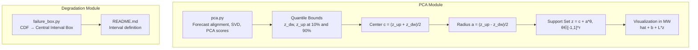
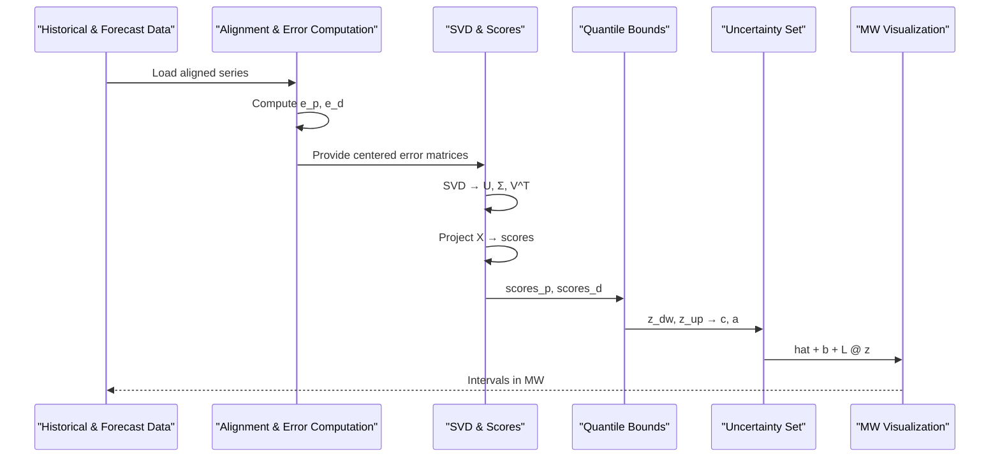
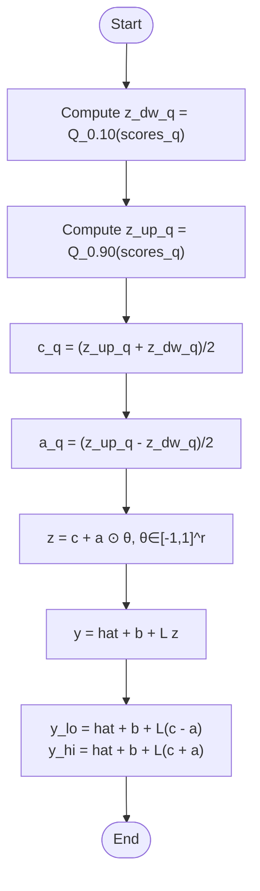
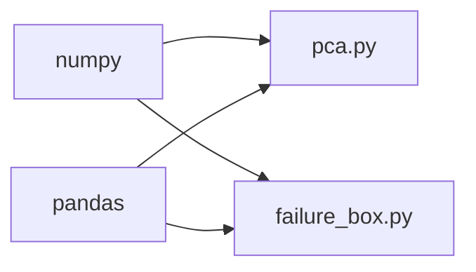

# Uncertainty Set Construction

<cite>
**Referenced Files in This Document**
- [pca.py](file://pca/pca.py)
- [failure_box.py](file://degradation/failure_box.py)
- [README.md](file://degradation/README.md)
</cite>

## Table of Contents
1. [Introduction](#introduction)
2. [Project Structure](#project-structure)
3. [Core Components](#core-components)
4. [Architecture Overview](#architecture-overview)
5. [Detailed Component Analysis](#detailed-component-analysis)
6. [Dependency Analysis](#dependency-analysis)
7. [Performance Considerations](#performance-considerations)
8. [Troubleshooting Guide](#troubleshooting-guide)
9. [Conclusion](#conclusion)
10. [Appendices](#appendices)

## Introduction
This document explains the uncertainty set construction methodology implemented in the repository. The approach is quantile-based: for each principal component score series, the 10th and 90th percentiles define lower and upper bounds (z_dw and z_up). From these bounds, the center c (midpoint) and radius a (half-width) are derived. The resulting support set is parameterized as z = c + a * θ with θ ∈ [-1, 1]^r. The documentation covers mathematical formulations, geometric interpretation, visualization, parameter interpretation, and the relationship to robust optimization constraints.

## Project Structure
The uncertainty set construction is primarily implemented in the PCA module, which processes historical wind power and demand data, performs PCA on forecast errors, and builds quantile-based uncertainty sets in PCA space. A separate degradation module provides an independent central interval box based on CDF quantiles for remaining life, illustrating the same quantile-to-interval idea in a different domain.

**Diagram sources**
- [pca.py:118-199](file://pca/pca.py#L118-L199)
- [pca.py:242-288](file://pca/pca.py#L242-L288)
- [failure_box.py:109-133](file://degradation/failure_box.py#L109-L133)
- [README.md:19-30](file://degradation/README.md#L19-L30)

**Section sources**
- [pca.py:1-323](file://pca/pca.py#L1-L323)
- [failure_box.py:1-134](file://degradation/failure_box.py#L1-L134)
- [README.md:1-53](file://degradation/README.md#L1-L53)

## Core Components
- Quantile-based bounds: For each PCA score dimension q, compute z_dw_q = Q_{0.10}(scores_q) and z_up_q = Q_{0.90}(scores_q).
- Center and radius: c_q = (z_up_q + z_dw_q)/2 and a_q = (z_up_q - z_dw_q)/2.
- Support set: z = c + a ⊙ θ where θ ∈ [-1, 1]^r.
- Mapping back to physical units: hat + b + L z yields intervals in MW for wind and demand.

These steps are implemented in the PCA module; the degradation module demonstrates the same quantile-to-interval logic for remaining life distributions.

**Section sources**
- [pca.py:184-199](file://pca/pca.py#L184-L199)
- [pca.py:242-249](file://pca/pca.py#L242-L249)
- [failure_box.py:109-133](file://degradation/failure_box.py#L109-L133)

## Architecture Overview
The uncertainty set pipeline proceeds as follows:
1. Align historical and forecast series by day-of-week and hour.
2. Compute forecast errors e_p and e_d for wind and demand.
3. Perform SVD to obtain PCA bases L_p and L_d and project errors into scores.
4. Compute quantile bounds z_dw and z_up at 10% and 90%.
5. Derive centers c and radii a.
6. Define support set z = c + a*θ, θ ∈ [-1, 1]^r.
7. Map back to physical units via hat + b + L z to visualize intervals.

**Diagram sources**
- [pca.py:41-121](file://pca/pca.py#L41-L121)
- [pca.py:147-167](file://pca/pca.py#L147-L167)
- [pca.py:184-199](file://pca/pca.py#L184-L199)
- [pca.py:242-257](file://pca/pca.py#L242-L257)

## Detailed Component Analysis

### Quantile-Based Uncertainty Bounds
- Lower bound: z_dw_q = Q_{0.10}(scores_q)
- Upper bound: z_up_q = Q_{0.90}(scores_q)
- These bounds capture the central 80% of the empirical distribution of PCA scores along each dimension.

Mathematical formulation:
- For each dimension q ∈ {1, …, r}:
  - z_dw_q = inf{k : F_q(k) ≥ 0.10}
  - z_up_q = inf{k : F_q(k) ≥ 0.90}
where F_q is the empirical CDF of scores_q.

Implementation references:
- Wind scores: z_dw_p, z_up_p computed from scores_p.
- Demand scores: z_dw_d, z_up_d computed from scores_d.

**Section sources**
- [pca.py:184-187](file://pca/pca.py#L184-L187)

### Center and Radius Calculation
- Center: c_q = (z_up_q + z_dw_q)/2
- Radius: a_q = (z_up_q - z_dw_q)/2

Geometric interpretation:
- In PCA space, the uncertainty set is an axis-aligned hyperrectangle centered at c with half-lengths a_q along each dimension.
- The set includes all z such that |z_q - c_q| ≤ a_q for all q.

Implementation references:
- Centers c_p, c_d and radii a_p, a_d are computed directly from z_dw and z_up.

**Section sources**
- [pca.py:190-195](file://pca/pca.py#L190-L195)

### Support Set Formulation
- Parameterization: z = c + a ⊙ θ, where θ ∈ [-1, 1]^r.
- Each component q satisfies z_q = c_q + a_q θ_q with θ_q ∈ [-1, 1].
- This defines a hyperrectangle in PCA space.

Mapping to physical units:
- Physical vector y = hat + b + L z.
- The interval in physical units is [y_lo, y_hi] where:
  - y_lo = hat + b + L(c - a)
  - y_hi = hat + b + L(c + a)
- Hourly width equals sum_j |L_{ij}| a_j.

Implementation references:
- _soporte_mw computes centro, radio, and returns lo, hi intervals in MW.

**Diagram sources**
- [pca.py:184-199](file://pca/pca.py#L184-L199)
- [pca.py:242-249](file://pca/pca.py#L242-L249)

**Section sources**
- [pca.py:197-199](file://pca/pca.py#L197-L199)
- [pca.py:242-249](file://pca/pca.py#L242-L249)

### Visualization of Uncertainty Sets
- The code plots three panels:
  - Wind AB: hourly intervals over 24 hours.
  - Wind KA: hourly intervals over 24 hours.
  - Demand: hourly intervals over 24 hours.
- Each panel shows:
  - Shaded region between y_lo and y_hi representing the support set.
  - Center line y_center = hat + b + L c.
  - Dashed line for mean forecast hat.

Interpretation:
- The shaded band visualizes the range of plausible values under the constructed uncertainty set.
- The center line indicates the nominal point within the set.
- The dashed forecast line anchors the visualization to the expected value.

Implementation references:
- Plotting uses matplotlib to fill_between(lo, hi), plot(centro), and plot(hat).

**Section sources**
- [pca.py:252-288](file://pca/pca.py#L252-L288)

### Relationship to Robust Optimization Constraints
- The support set z ∈ [-1, 1]^r in PCA space can be embedded into robust constraints of the form:
  - g(y) ≤ 0 for all y ∈ {hat + b + L z : z = c + a ⊙ θ, θ ∈ [-1, 1]^r}.
- This ensures feasibility against worst-case deviations within the constructed uncertainty set.
- Budget parameters Phi and Psi calibrate aggregate and pairwise robustness levels using quantiles of B and C norms of θ.

Notes:
- While the repository constructs the support set and calibration metrics, explicit robust constraint formulations are not included here; the support set provides the building blocks for such constraints.

**Section sources**
- [pca.py:214-228](file://pca/pca.py#L214-L228)
- [pca.py:231-234](file://pca/pca.py#L231-L234)

### Degradation Module: Parallel Quantile-to-Interval Logic
- The degradation module computes a central interval box from CDF rows:
  - t_dw = min{k : F(k) ≥ α/2}
  - t_up = min{k : F(k) ≥ 1 − α/2}
- With α = 0.1, this yields the central 90% interval.
- This mirrors the quantile-based approach used in PCA space, demonstrating consistency across domains.

**Section sources**
- [failure_box.py:109-133](file://degradation/failure_box.py#L109-L133)
- [README.md:19-30](file://degradation/README.md#L19-L30)

## Dependency Analysis
Key dependencies and relationships:
- pca.py depends on numpy and pandas for numerical operations and data handling.
- failure_box.py depends on numpy and pandas for CDF processing.
- Both modules implement quantile-based interval construction but in different spaces (PCA scores vs. remaining life CDF).

**Diagram sources**
- [pca.py:1-4](file://pca/pca.py#L1-L4)
- [failure_box.py:1-8](file://degradation/failure_box.py#L1-L8)

**Section sources**
- [pca.py:1-4](file://pca/pca.py#L1-L4)
- [failure_box.py:1-8](file://degradation/failure_box.py#L1-L8)

## Performance Considerations
- SVD computation scales with the number of time points and dimensions; ensure efficient memory usage when aligning large datasets.
- Quantile computations are O(N log N) per dimension; vectorized operations in numpy mitigate overhead.
- Visualization involves matrix multiplications L @ c and L @ a; precompute once and reuse.

[No sources needed since this section provides general guidance]

## Troubleshooting Guide
Common issues and resolutions:
- Misaligned historical and forecast timestamps: Ensure day-of-week matches and handle missing dates (e.g., leap days).
- Insufficient CDF support: If maximum CDF value does not reach required quantile, adjust alpha or extend support.
- Zero-radius components: Check that a_q > 0; otherwise, the uncertainty set collapses along dimension q.

References:
- Timestamp alignment and validation checks.
- CDF support validation and alpha constraints.
- Radius positivity checks in budget calibration.

**Section sources**
- [pca.py:71-72](file://pca/pca.py#L71-L72)
- [failure_box.py:115-129](file://degradation/failure_box.py#L115-L129)
- [pca.py:216-217](file://pca/pca.py#L216-L217)

## Conclusion
The repository implements a clear, quantile-based methodology for constructing uncertainty sets in PCA space. By computing 10th and 90th percentile bounds, deriving centers and radii, and parameterizing the support set as z = c + a*θ with θ ∈ [-1, 1]^r, it provides a robust foundation for downstream optimization. The degradation module reinforces the approach through an analogous CDF-based interval construction. Together, these components offer a practical framework for uncertainty modeling and visualization in energy forecasting contexts.

[No sources needed since this section summarizes without analyzing specific files]

## Appendices

### Mathematical Summary
- Quantile bounds:
  - z_dw_q = Q_{0.10}(scores_q)
  - z_up_q = Q_{0.90}(scores_q)
- Center and radius:
  - c_q = (z_up_q + z_dw_q)/2
  - a_q = (z_up_q - z_dw_q)/2
- Support set:
  - z = c + a ⊙ θ, θ ∈ [-1, 1]^r
- Physical mapping:
  - y = hat + b + L z
  - y_lo = hat + b + L(c - a)
  - y_hi = hat + b + L(c + a)

**Section sources**
- [pca.py:184-199](file://pca/pca.py#L184-L199)
- [pca.py:242-249](file://pca/pca.py#L242-L249)