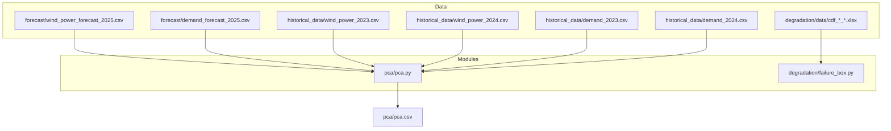
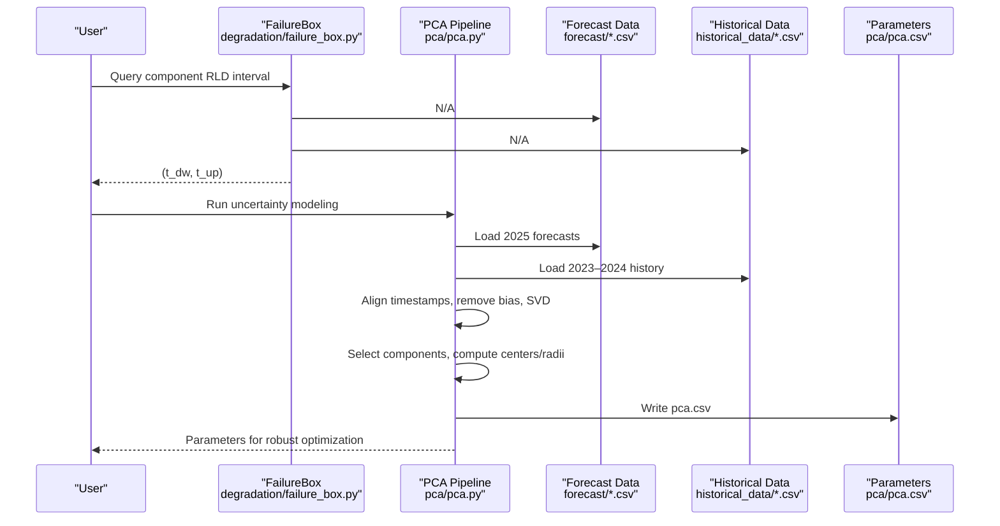
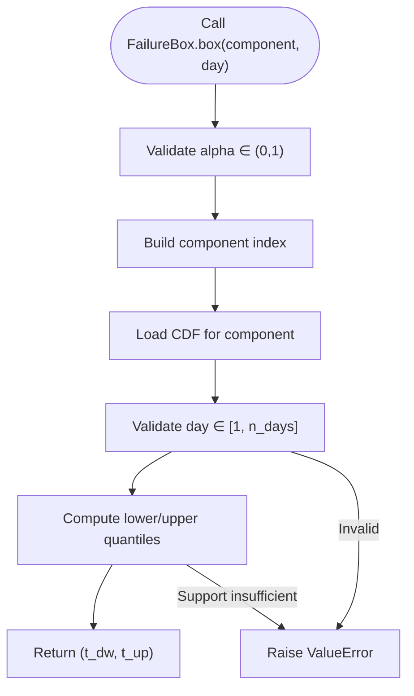
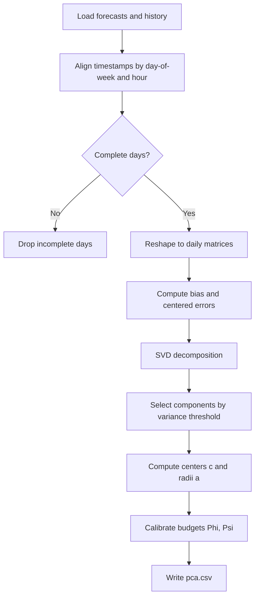
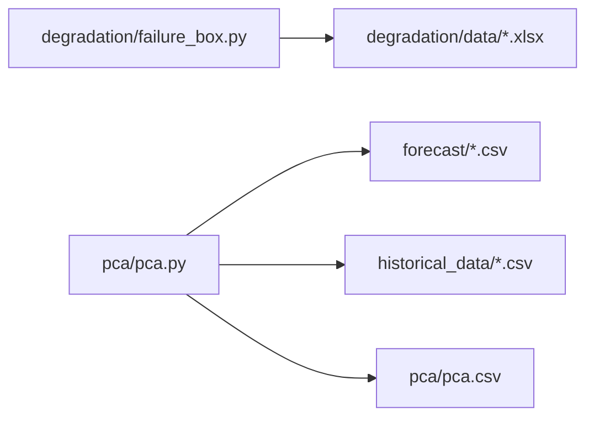

# Project Overview

<cite>
**Referenced Files in This Document**
- [failure_box.py](file://degradation/failure_box.py)
- [README.md](file://degradation/README.md)
- [pca.py](file://pca/pca.py)
- [pca.csv](file://pca/pca.csv)
- [wind_power_forecast_2025.csv](file://forecast/wind_power_forecast_2025.csv)
- [demand_forecast_2025.csv](file://forecast/demand_forecast_2025.csv)
- [wind_power_2023.csv](file://historical_data/wind_power_2023.csv)
- [wind_power_2024.csv](file://historical_data/wind_power_2024.csv)
- [demand_2023.csv](file://historical_data/demand_2023.csv)
- [demand_2024.csv](file://historical_data/demand_2024.csv)
</cite>

## Table of Contents
1. [Introduction](#introduction)
2. [Project Structure](#project-structure)
3. [Core Components](#core-components)
4. [Architecture Overview](#architecture-overview)
5. [Detailed Component Analysis](#detailed-component-analysis)
6. [Dependency Analysis](#dependency-analysis)
7. [Performance Considerations](#performance-considerations)
8. [Troubleshooting Guide](#troubleshooting-guide)
9. [Conclusion](#conclusion)

## Introduction
This project is a scientific computing toolkit for wind turbine component lifecycle management under uncertainty. It combines degradation analysis with principal component analysis (PCA) to quantify uncertainty and support robust optimization for maintenance planning in wind power systems.

The system focuses on:
- Remaining useful life prediction through component-wise cumulative distribution functions (CDFs).
- Dimensionality reduction via PCA applied to historical wind power and demand time series.
- Integration of historical observations with forecast scenarios to build structured uncertainty sets.
- Robust decision-making that accounts for both component degradation and uncertain generation/demand profiles.

Target audience includes renewable energy researchers, operations planners, reliability engineers, and optimization practitioners who need principled methods to plan maintenance under uncertainty. The academic context emphasizes uncertainty quantification and robust optimization; the practical application targets wind farm maintenance scheduling, spare parts planning, and risk-aware operational decisions.

## Project Structure
At a high level, the repository separates data from code:
- `degradation/`: Degradation analysis module providing remaining useful life intervals per component.
- `pca/`: Uncertainty modeling module using PCA on historical and forecast data.
- `forecast/`: Forecasted wind power and demand profiles used as inputs to the uncertainty model.
- `historical_data/`: Historical wind power and demand records aligned with the forecast horizon.
- `rddp/`: Placeholder directory for additional robust dynamic programming or related modules.

**Diagram sources**
- [pca.py:24-38](file://pca/pca.py#L24-L38)
- [pca.py:52-69](file://pca/pca.py#L52-L69)
- [failure_box.py:11-14](file://degradation/failure_box.py#L11-L14)

**Section sources**
- [README.md:7-17](file://degradation/README.md#L7-L17)
- [pca.py:1-18](file://pca/pca.py#L1-L18)

## Core Components
The system has two primary computational components:

- Degradation module (`degradation/failure_box.py`): Provides central intervals of remaining useful life for each component based on precomputed CDFs stored in Excel files. It validates inputs, loads CDFs lazily, and computes lower and upper bounds for a given component and day.

- PCA module (`pca/pca.py`): Aligns historical and forecast time series, removes bias, performs SVD-based PCA, selects components by explained variance, constructs uncertainty set centers and radii, calibrates budgets, and outputs parameters to `pca/pca.csv`.

These components are complementary:
- The degradation module supplies component-level uncertainty about failure timing.
- The PCA module supplies system-level uncertainty about wind generation and demand patterns.
Together they enable robust optimization over maintenance actions considering both equipment aging and environmental variability.

**Section sources**
- [failure_box.py:17-48](file://degradation/failure_box.py#L17-L48)
- [pca.py:143-178](file://pca/pca.py#L143-L178)

## Architecture Overview
The architecture integrates data ingestion, uncertainty modeling, and output preparation:

**Diagram sources**
- [failure_box.py:32-48](file://degradation/failure_box.py#L32-L48)
- [pca.py:24-38](file://pca/pca.py#L24-L38)
- [pca.py:52-69](file://pca/pca.py#L52-L69)
- [pca.py:143-178](file://pca/pca.py#L143-L178)
- [pca.py:308-308](file://pca/pca.py#L308-L308)

## Detailed Component Analysis

### Degradation Module: Remaining Useful Life Intervals
The degradation module models each component’s remaining useful life (RLD) as a discrete distribution across days up to a fixed support. For a given component index and forecast day, it returns the central interval covering a specified confidence level.

Key behaviors:
- Input validation ensures alpha is within (0, 1) and requested day is valid for the component.
- Lazy loading caches CDF arrays per component after first access.
- Central interval computation uses quantiles of the CDF row corresponding to the queried day.
- File naming convention maps component indices to CDF files.

**Diagram sources**
- [failure_box.py:24-44](file://degradation/failure_box.py#L24-L44)
- [failure_box.py:69-95](file://degradation/failure_box.py#L69-L95)
- [failure_box.py:98-106](file://degradation/failure_box.py#L98-L106)
- [failure_box.py:109-133](file://degradation/failure_box.py#L109-L133)

Practical implications:
- Maintenance planners can use `(t_dw, t_up)` to schedule interventions within a reliable window.
- The module enforces strict input checks to prevent invalid queries.

**Section sources**
- [failure_box.py:17-48](file://degradation/failure_box.py#L17-L48)
- [failure_box.py:69-106](file://degradation/failure_box.py#L69-L106)
- [failure_box.py:109-133](file://degradation/failure_box.py#L109-L133)
- [README.md:19-30](file://degradation/README.md#L19-L30)

### PCA Module: Uncertainty Modeling and Budget Calibration
The PCA module builds structured uncertainty sets for wind power and demand by aligning historical and forecast data, removing bias, performing dimensionality reduction, and calibrating budgets.

Processing steps:
- Load 2025 forecasts for wind power and demand.
- Load historical data for 2023 and 2024.
- Align timestamps by day-of-week and hour, ensuring consistency between forecast and historical series.
- Remove incomplete days where any signal is missing.
- Reshape hourly series into daily matrices for wind and demand.
- Compute bias vectors and centered error matrices.
- Perform SVD to obtain principal components and scores.
- Select components by cumulative explained variance thresholds.
- Compute uncertainty set centers and radii from historical quantiles.
- Calibrate budgets using pairwise selection of top components.
- Output parameters to `pca.csv`.

**Diagram sources**
- [pca.py:24-38](file://pca/pca.py#L24-L38)
- [pca.py:41-72](file://pca/pca.py#L41-L72)
- [pca.py:74-116](file://pca/pca.py#L74-L116)
- [pca.py:118-178](file://pca/pca.py#L118-L178)
- [pca.py:180-234](file://pca/pca.py#L180-L234)
- [pca.py:308-308](file://pca/pca.py#L308-L308)

Output structure:
- `pca.csv` contains parameters grouped by “viento” (wind) and “demanda” (demand), including centers `c`, radii `a`, selected component counts `s` and total `r`, and budget values `phi` and `psi`.

**Section sources**
- [pca.py:24-38](file://pca/pca.py#L24-L38)
- [pca.py:41-72](file://pca/pca.py#L41-L72)
- [pca.py:74-116](file://pca/pca.py#L74-L116)
- [pca.py:118-178](file://pca/pca.py#L118-L178)
- [pca.py:180-234](file://pca/pca.py#L180-L234)
- [pca.py:308-308](file://pca/pca.py#L308-L308)
- [pca.csv:1-18](file://pca/pca.csv#L1-L18)

### Integration of Historical and Forecast Data
The pipeline explicitly aligns historical and forecast data by day-of-week and hour, ensuring that comparisons are meaningful. It also handles leap year differences by omitting specific dates when necessary.

Important aspects:
- Forecast origin date anchors alignment.
- Historical origins differ by year but are shifted to match forecast weekdays.
- Missing hours invalidate entire days, which are excluded from training.
- The resulting matrices have consistent dimensions for SVD.

**Section sources**
- [pca.py:13-22](file://pca/pca.py#L13-L22)
- [pca.py:41-72](file://pca/pca.py#L41-L72)
- [pca.py:74-91](file://pca/pca.py#L74-L91)

## Dependency Analysis
The main dependencies are:
- `numpy` for numerical operations and linear algebra.
- `pandas` for data loading, timestamp handling, and CSV/Excel I/O.
- `matplotlib` for visualization within the PCA module.

Module relationships:
- `degradation/failure_box.py` depends only on data files in `degradation/data`.
- `pca/pca.py` depends on forecast and historical CSV files and writes results to `pca/pca.csv`.
- There is no direct runtime coupling between the degradation and PCA modules; they provide independent uncertainty representations consumed by downstream optimization routines.

**Diagram sources**
- [failure_box.py:11-14](file://degradation/failure_box.py#L11-L14)
- [pca.py:24-38](file://pca/pca.py#L24-L38)
- [pca.py:52-69](file://pca/pca.py#L52-L69)
- [pca.py:308-308](file://pca/pca.py#L308-L308)

**Section sources**
- [failure_box.py:1-9](file://degradation/failure_box.py#L1-L9)
- [pca.py:1-5](file://pca/pca.py#L1-L5)

## Performance Considerations
- Lazy loading of CDFs in the degradation module reduces memory usage by caching only accessed components.
- PCA uses SVD on daily matrices; keeping complete days avoids irregular shapes and improves stability.
- Variance thresholds control dimensionality; higher thresholds retain more components at increased computational cost.
- Budget calibration uses quantiles; ensure sufficient historical samples for stable estimates.

[No sources needed since this section provides general guidance]

## Troubleshooting Guide
Common issues and resolutions:
- Invalid alpha value: Ensure alpha is strictly between 0 and 1.
- Day out of range: Verify the requested day does not exceed the number of forecast days for the component.
- Insufficient CDF support: If the maximum CDF probability does not reach the required upper quantile, adjust alpha or extend support.
- Mismatched timestamps: Ensure forecast and historical series share identical timestamps and weekday alignment.
- Incomplete days: Days with any missing signal are dropped; verify data completeness before running PCA.
- Non-orthogonal bases: The PCA implementation asserts orthonormality; check SVD results if assertions fail.

**Section sources**
- [failure_box.py:24-44](file://degradation/failure_box.py#L24-L44)
- [failure_box.py:109-133](file://degradation/failure_box.py#L109-L133)
- [pca.py:32-33](file://pca/pca.py#L32-L33)
- [pca.py:71-72](file://pca/pca.py#L71-L72)
- [pca.py:169-178](file://pca/pca.py#L169-L178)

## Conclusion
This toolkit provides a rigorous foundation for wind turbine lifecycle management under uncertainty. By combining component-level remaining useful life intervals with system-level uncertainty sets derived from PCA, it enables robust optimization for maintenance planning. Researchers can explore new uncertainty models and optimization formulations, while practitioners can apply these methods to improve reliability and reduce downtime in wind power systems.

[No sources needed since this section summarizes without analyzing specific files]